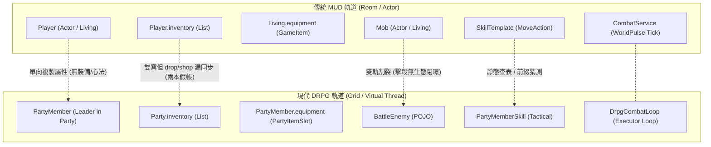
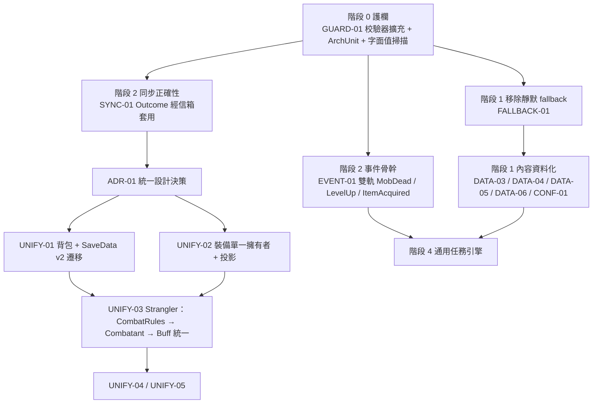

# ☯️ 專案歷史雙軌機制割裂深度盤查與審查報告 (Dual-Track Historical Analysis & Review)

> **歷史封存說明 (Archival Notice)**：  
> 本文件收錄專案在轉型為純單機 DRPG 之前，針對傳統 MUD 與網格 DRPG 雙軌割裂的深度盤查分析（原 §17 與 §18）。  
> 專案已全面廢除 MUD 軌道與文字指令，相關膠水代碼在 SP-01~09 中已徹底清理。本文件僅作為架構演進歷史考證參考，不具任何現行規範力。

---

## ☯️ 17. [已除役 / ARCHIVED] MUD 與 DRPG 雙軌機制割裂歷史盤查 (全面由純單機 DRPG 營地與地牢架構取代)

> [!NOTE]
> **歷史除役聲明**：本章所探討之「MUD 軌道與 DRPG 軌道雙軌融合與橋接」，已依專案核心決策全面封存除役。MUD 軌道相關之文字指令、房間 exits 與雙寫膠水代碼在 SP-01~09 中已徹底清除。專案已全面統一為純單機 DRPG 選單式營地 (M1) 與網格地牢 (M2) 架構。本章僅保留作為歷史分析參考。

> **架構背景與核心痛點**：
> 本專案在演進過程中形成了兩套平行運行的子系統：一端是繼承傳統文字泥巴的 **MUD 端**（`Player` Actor、`Living`、`Room`、`Mob`、`CombatService`、`GameItem`），另一端是現代小隊走格子的 **DRPG 端**（`Party`、`PartyMember`、`BattleContext`、`BattleEnemy`、`DrpgCombatLoop`、`PartyInventory`）。
> 雖然歷史重構（Phase 2~5、Phase 10 Clean Architecture）建立了部分橋樑（如 `CharacterSyncService`、`DefenseResolver`、`Buffable`），但**這兩套機制在實體層、狀態層與資料流上依然各搞一套，存在嚴重的機制割裂與「兩本假帳」風險**！

### 17.1 六大核心領域雙軌割裂深度盤點 (The 6 Divergent Domains)



#### 1. 角色與玩家 (Character: `Player` vs `PartyMember`)
- **MUD 端**：`Player extends Living`（VirtualActor 訊息郵件信箱模型），擁有自己的 `inventory: List<GameItem>`、裝備、姿勢、GCD。
- **DRPG 端**：`PartyMember`（POJO），隸屬於 `Party`，擁有 `PartyItemSlot` 裝備、SP/RAGE/COMBO、SAN 值、道心狀態。
- **割裂現況**：兩者僅靠 [`CharacterSyncService`](file:///c:/Workspace/my_practice/practice_mud/src/main/java/com/example/htmlmud/domain/service/CharacterSyncService.java) 在進出戰鬥時單向拷貝 HP/MP/Exp/基礎 5 維數值。**裝備、心法、被動技能、狀態 Buff 完全互不流通！**
  - 玩家在主選單或 DRPG 背包中換上神兵利器，MUD 端的 `Player` 裝備完全不會變；在 MUD 房間穿上裝備，DRPG 也毫無感知。
  - 若在 MUD 模式遭到主動怪撲咬，玩家是以過期的 MUD 數值進行戰鬥，同伴也不會拔刀相助。

#### 2. 物品與行囊 (Inventory: `GameItem` vs `PartyItemSlot` vs Canonical `ItemInstance`)
- **MUD 端**：`Player.inventory`（`List<GameItem>`，個人背包）。
- **DRPG 端**：`Party.inventory`（`PartyInventory`，由 `List<PartyItemSlot>` 組成的小隊公共背包）。
- **割裂現況**：雙軌背包完全分裂，存在嚴重的同步漏洞：
  - [`GetCommand.java`](file:///c:/Workspace/my_practice/practice_mud/src/main/java/com/example/htmlmud/application/command/impl/GetCommand.java) 試圖雙寫（`player.getInventory().add()` + `party.getInventory().addGameItem()`）。
  - 但 [`DropCommand.java`](file:///c:/Workspace/my_practice/practice_mud/src/main/java/com/example/htmlmud/application/command/impl/DropCommand.java) 僅從 `player.inventory` 移除，`party.inventory` 完全沒動！
  - [`ShopCommand.java`](file:///c:/Workspace/my_practice/practice_mud/src/main/java/com/example/htmlmud/application/command/impl/ShopCommand.java) 購買時僅加到 `party.inventory`，`player.inventory` 完全沒有商品！
  - 雖然 Phase 2 建立了 Canonical [`ItemDefinition`](file:///c:/Workspace/my_practice/practice_mud/src/main/java/com/example/htmlmud/domain/model/definition/ItemDefinition.java) / [`ItemInstance`](file:///c:/Workspace/my_practice/practice_mud/src/main/java/com/example/htmlmud/domain/model/entity/ItemInstance.java)，但未貫穿全專案，導致兩邊背包數量各算各的，形成「兩本假帳」。

#### 3. 戰鬥迴圈與引擎 (Combat Engine: `CombatService` vs `DrpgCombatLoop`)
- **MUD 戰鬥**：[`CombatService.java`](file:///c:/Workspace/my_practice/practice_mud/src/main/java/com/example/htmlmud/domain/service/CombatService.java)，由 `WorldPulse` 心跳驅動，在 `Room` 內進行 1v1 普攻與 `MoveAction` 招式文字敘事。同伴在旁邊看戲，陣法孔位無效。
- **DRPG 戰鬥**：[`DrpgCombatLoop.java`](file:///c:/Workspace/my_practice/practice_mud/src/main/java/com/example/htmlmud/domain/dungeon/battle/DrpgCombatLoop.java)，由 Spring 託管之虛擬執行緒池驅動，小隊 5 人陣列交鋒，支援 5x5 站位、GCD 唱條、仇恨威脅表、Combo 合擊、Telegraph 意圖預告。
- **割裂現況**：兩套完全不相容的戰鬥心跳迴圈並存。城鎮打怪用 MUD 邏輯（`kill`），地牢打怪用 DRPG 邏輯（`step` 遇敵），機制、仇恨、連攜技與視覺效果完全脫節。

#### 4. 生靈與敵怪 (Mobs: `Mob` vs `BattleEnemy`)
- **MUD 端**：`Mob extends Living`（Room Actor，擁有 `MobAi` 與房間對話能力）。
- **DRPG 端**：`BattleEnemy`（POJO，具備站位、尺寸、意圖預告與蓄力唱條）。
- **割裂現況**：兩者雖皆源自 `MobTemplate`，但實例完全分離。在地牢或遭遇戰中，系統是重新 new 出 `BattleEnemy` 實例，戰鬥結束擊倒 `BattleEnemy` 後，房間內的 `Mob` Actor 根本毫無所悉，缺乏生態閉環。

#### 5. 武學與招式 (Skills: `SkillTemplate` vs `PartyMemberSkill`)
- **MUD 端**：`SkillTemplate`，側重文字招式敘事（`MoveAction` 含有發招、命中、閃避語句）。
- **DRPG 端**：`PartyMemberSkill`，側重戰術參數（冷卻毫秒、資源類型、消耗值、傷害倍率、作用範圍）。
- **割裂現況**：雖然 Phase 3 提出了 `SkillDefinition`（Canonical Model），但目前實際仍依賴 [`SkillBridgeService`](file:///c:/Workspace/my_practice/practice_mud/src/main/java/com/example/htmlmud/domain/service/SkillBridgeService.java) 進行脆弱的橋接，且敵怪在 DRPG 戰鬥中無法直接使用 MUD 定義的招式庫。

#### 6. 狀態與增益 (Buffs: Dual Tick Isolation)
- **割裂現況**：雖然 `Living` 與 `BattleEnemy` 皆實作了 `Buffable`，但 MUD Buff 由 `WorldPulse` 結算，DRPG Buff 由 `DrpgCombatLoop` 結算。角色脫離戰鬥時，戰鬥中獲得的 Buff 不會帶出到地圖；地圖上的中毒或詛咒也不會帶入戰鬥。

---

### 17.2 大一統融合架構規劃 (The Unified Evolution Blueprint)

為徹底消除雙軌割裂、實現機制大一統，建議依序實施以下 5 大融合任務：

#### 1. UNIFY-01: 背包與物品大一統 (Unified Inventory Single Source of Truth) (P1)
- **目標**：徹底廢除雙軌背包，建立小隊公共行囊為唯一單一真相源。
- **作法**：
  1. 除役 `Player.inventory`（`List<GameItem>`），`Player` 內部背包直通 `Party.getInventory()`。
  2. 背包底層全面以 Canonical `ItemInstance` / `ItemDefinition` 作為核心儲存單元，`PartyItemSlot` 降級為視圖模型或直接收斂。
  3. `get`、`drop`、`shop buy`、`use` 全數操作同一份 `PartyInventory`，消除任何雙寫與數量不同步問題。

#### 2. UNIFY-02: 角色與裝備大一統 (Unified Character & Equipment Model) (P1)
- **目標**：消除 `Player` 與 `PartyMember` 裝備互不相通的缺陷。
- **作法**：
  1. 將 7 槽位裝備數據下沉至共享的 `LivingStats` 或 `EquipmentInventory`。
  2. `Player` 與隊長 `PartyMember` 共享同一份裝備狀態參照；無論透過 MUD 指令 `equip` 還是前端主選單面板穿脫裝備，兩端即時同步生效。
  3. 戰鬥前後的同步由「欄位淺拷貝」升級為「單一狀態持有」。

#### 3. UNIFY-03: 戰鬥引擎收斂與雙模呈現投影 (Single Combat Engine, Dual Presentation) (P1)
- **目標**：廢除兩套戰鬥迴圈，核心下沉為統一戰鬥引擎，支援 MUD 敘事與 Web 視覺雙模投影。
- **作法**：
  1. 將戰鬥核心邏輯（圓桌判定、Stamina 破防、仇恨威脅表、GCD 唱條、Buff 結算）統一下沉至領域層戰鬥服務。
  2. 廢除 `CombatService` 獨立的 1v1 普攻迴圈，城鎮與野外戰鬥統一呼叫戰鬥引擎。
  3. **雙模呈現投影 (Dual Presentation Pattern)**：
     - **MUD 模式投影**：純終端/文字日誌接收結構化事件，調用 `SkillTemplate.moves` 渲染為生動的長篇武俠對決文學。
     - **DRPG 模式投影**：Web 前端接收 `BattleEvent` DTO，演繹 5x5 卡片浮動數字、唱條與 VFX 刀光特效。

#### 4. UNIFY-04: 生靈與敵怪生命週期閉環 (Unified Mob Lifecycle) (P2)
- **目標**：打通房間生靈與戰鬥敵怪的生命週期。
- **作法**：
  1. 在城鎮或地牢遭遇戰鬥時，將當前空間中的 `Mob` Actor 映射為戰鬥參與者（`Combatant`）。
  2. 戰鬥結束時，戰鬥結算的死亡、掉落與傷損透過 Actor 信箱直接回寫至空間內的 `Mob` 實例，完成世界生態閉環。

#### 5. UNIFY-05: 技能全域規範單一模型 (Canonical Skill Single Source of Truth) (P2)
- **目標**：徹底廢除脆弱的橋接查表與前綴猜測。
- **作法**：
  1. 全域技能統一以 `SkillDefinition` 定義，在同一份 JSON 中宣告 `narrative`（敘事招式動詞）與 `tactical`（冷卻/消耗/傷害倍率/範圍）。
  2. 敵方怪物亦可依據模板直接施放與玩家同等機制的招式，實現對等的攻防反制深度。

---


## 🧪 18. [已除役 / ARCHIVED] §16/§17 雙軌報告第二輪審查歷史紀錄 (Second-Opinion Review)

> [!NOTE]
> **歷史除役聲明**：雙軌融合方案已隨 MUD 機制除役而終結，後續唯一架構為純單機單體 DRPG。

> **審查定位**：§16（硬編碼盤查）與 §17（MUD/DRPG 雙軌割裂）方向正確，問題分類也清楚，可以作為藍圖。但經抽樣比對程式碼，報告有**事實遺漏與不精確**、部分**方案與既有架構原則衝突**，也**沒有執行順序、驗收標準與防止回歸的護欄**。本節在不推翻 §16/§17 的前提下補正，並把路徑 P/Q 重排為可安全落地的順序。

### 18.1 事實校正與遺漏的硬編碼 (Accuracy Corrections)

| # | §16/§17 原述 | 實際程式碼狀況 | 影響 |
| :---: | :--- | :--- | :--- |
| 1 | DATA-01 已「徹底廢除 `"SWORDSMAN"` 字串硬編碼」 | 仍殘留 5 處：[`DefenseResolver.java:L133, L204`](file:///c:/Workspace/my_practice/practice_mud/src/main/java/com/example/htmlmud/domain/dungeon/battle/DefenseResolver.java#L133) 以 `orElse("SWORDSMAN".equalsIgnoreCase(...))` 作 fallback；[`FormationTemplate.java:L71`](file:///c:/Workspace/my_practice/practice_mud/src/main/java/com/example/htmlmud/domain/party/model/FormationTemplate.java#L71) 有「TANK 需求可由 SWORDSMAN 滿足」特例；[`RoleCategory.java:L13, L51, L82`](file:///c:/Workspace/my_practice/practice_mud/src/main/java/com/example/htmlmud/domain/model/enums/RoleCategory.java#L13) 以 switch 寫死職業→職能映射；[`Player.java:L63-66`](file:///c:/Workspace/my_practice/practice_mud/src/main/java/com/example/htmlmud/domain/actor/impl/Player.java#L63-L66) 預設職業寫死 | DATA-01 狀態為「已完成」但有殘留；新增職業仍須改 Java |
| 2 | `TOMB_ITEMS` 僅出現在 `DungeonCommand` | **共有 3 份複本**：[`DungeonCommand.java:L41`](file:///c:/Workspace/my_practice/practice_mud/src/main/java/com/example/htmlmud/application/command/impl/DungeonCommand.java#L41)（ID 帶 `taiyin_tomb:` 前綴）、[`DrpgBattleService.java:L58`](file:///c:/Workspace/my_practice/practice_mud/src/main/java/com/example/htmlmud/domain/dungeon/battle/DrpgBattleService.java#L58)、[`DrpgRewardService.java:L37`](file:///c:/Workspace/my_practice/practice_mud/src/main/java/com/example/htmlmud/domain/dungeon/battle/DrpgRewardService.java#L37)（ID **不帶**前綴） | 同一份資料有兩種 ID 寫法，全靠 `TemplateRepository` 的後綴模糊比對才能運作 |
| 3 | 首領硬編碼只有「宋天衡掉落」 | [`DrpgBattleService.startBossBattle():L547-562`](file:///c:/Workspace/my_practice/practice_mud/src/main/java/com/example/htmlmud/domain/dungeon/battle/DrpgBattleService.java#L547-L562) 對**所有**首領都套用固定 `dex(12)`、`xp(500)`、`dropItemId("mozhu_mines:black_obsidian_scythe")`，且忽略 `MobTemplate.expReward/loot`；L475-478 用 `templateId.contains("mozhu")` 決定掉落；[`DungeonCommand.java:L289`](file:///c:/Workspace/my_practice/practice_mud/src/main/java/com/example/htmlmud/application/command/impl/DungeonCommand.java#L289) BOSS 地塊 fallback 寫死宋天衡 | 新增任何首領都會掉墨竹山鐮刀，屬功能 Bug，而不只是程式風格問題 |
| 4 | 道核 ID 為 `"core_" + memberId + "_" + skillId` | 存在**三種**格式與兩套文案：`DrpgCombatLoop` 用 `core_{member}_{skill}`；[`ItemFactory.createDaoCore()`](file:///c:/Workspace/my_practice/practice_mud/src/main/java/com/example/htmlmud/domain/factory/ItemFactory.java#L80-L96) 用 `dao_core_{skill}` 且名為「凝煞道核」；`DrpgRewardService` fallback 也用 `dao_core_{skill}`，但名為「血肉道核」 | 同一物品因 Bean 是否注入而名稱不同；存檔與堆疊判斷不穩定 |
| 5 | 裝備位於 `Living.equipment` | 實際有**三種表示法**：[`LivingStats.equipment`](file:///c:/Workspace/my_practice/practice_mud/src/main/java/com/example/htmlmud/domain/model/entity/LivingStats.java#L53)（`Map<EquipmentSlot, GameItem>`）、[`PartyMember.equipment`](file:///c:/Workspace/my_practice/practice_mud/src/main/java/com/example/htmlmud/domain/party/model/PartyMember.java#L107)（`Map<EquipmentSlot, PartyItemSlot>`）、[`BattleEnemy.equipment`](file:///c:/Workspace/my_practice/practice_mud/src/main/java/com/example/htmlmud/domain/dungeon/battle/BattleEnemy.java#L85)（`Map<EquipmentSlot, String>`） | UNIFY-02 已於 Commit `a18645a` 落地，確立 `PartyMember` 為 SSoT 並透過 Actor 信箱單向投影至 `Player.stats.equipment`（唯讀視圖） |
| 6 | `buildTombB1F()` 是「未同步的冗餘」 | 真正的風險不在冗餘：它只在 JSON 全部載入失敗時啟用，會**把資源載入失敗掩蓋成「遊戲照常可玩」** | 應改為 fail-fast，而不只是刪除 |

### 18.2 §17 統一方案的架構風險 (Design Risks in UNIFY-*)

1. **UNIFY-02「`Player` 與 `PartyMember` 共享同一份裝備狀態參照」與既有原則衝突**：
   - CANON-04（§1.4）明確採用「不可變 Snapshot → Outcome 單向套用」，理由是**避免共享可變參照與併發競態**；ACT-01（§7.1）要求 Actor 狀態只能由其信箱執行緒修改。
   - 共享參照會讓 Player Actor 執行緒與 `combatExecutor` 戰鬥虛擬執行緒同時讀寫同一個 Map，等於回頭打破這兩項已完成的成果。
   - **修正**：採用「**單一擁有者 + 投影**」——由 `Party` 聚合（或獨立的 `CharacterSheet` 聚合）作為裝備的唯一擁有者，`Player` 只透過唯讀投影讀取；所有穿脫操作都改成送進擁有者序列化處理的命令。
2. **現有同步已經違反 Actor 邊界，必須在統一前先修正**：
   - [`CharacterSyncService.syncFromPartyToPlayer()`](file:///c:/Workspace/my_practice/practice_mud/src/main/java/com/example/htmlmud/domain/service/CharacterSyncService.java#L119-L143) 由 `DrpgRewardService` 在戰鬥執行緒呼叫，直接 `copyStats` 修改 `Player.stats`，沒有經過 Player 信箱。
   - 它每次都以 `battleId = "sync-" + System.nanoTime()` 建立 Outcome，因此 LRU 冪等快取永遠不會命中；最後又無條件 `copyStats` 覆寫。**Outcome 模式名存實亡**。
   - **修正（SYNC-01）**：Outcome 用真實 `battleId` 作冪等鍵，透過 `ActorMessage` 投遞給 Player 信箱套用，並刪除事後的 `copyStats`。
3. **UNIFY-01 漏了「雙持久化」問題**：MUD 背包經 [`PlayerRecord`](file:///c:/Workspace/my_practice/practice_mud/src/main/java/com/example/htmlmud/domain/model/entity/PlayerRecord.java#L19) / [`CharacterEntity.inventory`](file:///c:/Workspace/my_practice/practice_mud/src/main/java/com/example/htmlmud/infra/persistence/entity/CharacterEntity.java#L61) 寫入 **H2 DB**，DRPG 小隊背包經 `SaveData` 寫入 **JSON 存檔槽**。合併背包前必須先決定以哪一邊為準，並規劃：
   - `SaveData.CURRENT_SCHEMA_VERSION` 升到 2，以及 v1→v2 遷移（合併兩邊物品、去重）；
   - H2 端的欄位遷移或棄用策略；
   - 已分歧玩家資料的合併規則（以哪邊數量為準）。
4. **UNIFY-03「廢除 `CombatService`」屬於大爆炸式重寫**：兩套迴圈牽動指令、廣播、AI、Buff 心跳與測試，一次替換的回歸風險很高。**修正**：改用 Strangler 漸進式取代——
   1. 抽出純函式的 `CombatRules`（`DefenseResolver` 已經是半成品），讓兩條迴圈共用同一套數學；
   2. 定義 `Combatant` 介面，由 `Living`、`PartyMember`、`BattleEnemy` 各自實作適配器；
   3. 統一 Buff 結算服務；
   4. 最後才決定是否把城鎮 `kill` 導入小隊遭遇戰。這一步是**遊戲設計決策**，須先寫 ADR（見 §18.5）。
5. **執行順序有陷阱**：§16 建議直接刪除 fallback（`TOMB_*`、`buildTombB1F`、`newbie_village:inn` 預設），但 [`DataIntegrityValidator`](file:///c:/Workspace/my_practice/practice_mud/src/main/java/com/example/htmlmud/domain/validation/DataIntegrityValidator.java#L296-L324) 目前**不檢查**地牢地塊 `drops`/`eventId`、技能橋接目標、商店 `templateId` 與開局物資。若先刪 fallback，資料缺漏會從「靜默降級」變成「執行期 NPE」。**原則：先擴充校驗器，再移除 fallback。**

### 18.3 §16/§17 未涵蓋的系統性問題 (Missed Systemic Issues)

1. **靜默 fallback 反模式（比個別硬編碼更根本）**：
   - 生產程式碼中有約 30 處 `new TemplateCatalog()`，分布在 Service 無參建構子、DTO（[`DrpgStateDto`](file:///c:/Workspace/my_practice/practice_mud/src/main/java/com/example/htmlmud/domain/dungeon/dto/DrpgStateDto.java#L31)）、領域模型（[`PartyInventory`](file:///c:/Workspace/my_practice/practice_mud/src/main/java/com/example/htmlmud/domain/party/model/PartyInventory.java#L25)、`PartyMember`、`ShopTemplate`、`BattleEnemy`）與 `MessageFactory`。空的 Catalog 會讓物品名稱退化成 ID、技能查無資料，卻**不報錯**。
   - [`GameConfig.getInstance()`](file:///c:/Workspace/my_practice/practice_mud/src/main/java/com/example/htmlmud/config/GameConfig.java#L34-L43) 靜態單例被 `Player`、`Living` 直接呼叫，並在建構子內覆寫 `INSTANCE`；在測試或多 Context 情境下，可能拿到未綁定 YAML 的預設值。
   - 多個核心協作者使用 `@Autowired(required = false)` 加延遲 `new`（`DrpgRewardService`、`CharacterSyncService`、`CombatService.buffSettlementService`），注入失敗時會悄悄改用沒有依賴的實例。
   - **修正（FALLBACK-01）**：從生產程式碼移除無參建構子與 `new TemplateCatalog()`，測試改用 `TestTemplates` fixture；`GameConfig` 改為建構子注入；必要依賴一律改成必填注入。
2. **領域事件骨幹幾乎沒有運作**：全專案僅有**一個** `publishEvent`（`DrpgRewardService` 中的宋天衡死亡）。`PlayerEvents.LevelUp`、`SessionEvent` 的發布都被註解掉，MUD 端擊殺怪物不發 `MobDead`，所以 [`QuestEventListener`](file:///c:/Workspace/my_practice/practice_mud/src/main/java/com/example/htmlmud/application/listener/QuestEventListener.java) 永遠不會被觸發。§16 提出的「通用任務引擎」必須以事件骨幹為前提。另外，[`MozhuMinesQuestListener`](file:///c:/Workspace/my_practice/practice_mud/src/main/java/com/example/htmlmud/application/listener/MozhuMinesQuestListener.java) 是 `@Async`，會在非 Actor 執行緒直接 `player.reply`，宣稱「獲得戰利品」的物品實際上也是由 RewardService 發放，兩處各自維護。
3. **首領身分用子字串比對**：`DrpgRewardService` 與 `MozhuMinesQuestListener` 都用 `contains("boss_song_tianheng")` 判斷，任何 ID 含此字串的怪（例如未來的 `boss_song_tianheng_phase2`）都會重複觸發。應改為精確 ID，或在模板加 `questTriggers` 標籤。
4. **除錯入口暴露在正式指令**：`dungeon dummy/test/testmob` 與 `battle test/dummy/木樁` 可在正式環境召喚試道傀儡（每隻有 XP 與掉落，可被刷資源）。應以 Spring Profile 或管理員旗標限制。
5. **缺少防回歸護欄**：DATA-01/DATA-02 宣稱「100% 資料驅動」後仍有殘留（見 §18.1），代表單靠人工審查不夠。需要自動化檢查：
   - **ArchUnit** 規則：禁止 `src/main` 出現 `new TemplateCatalog()`、禁止 domain 呼叫 `GameConfig.getInstance()`；
   - **內容 ID 字面值掃描**：CI 以允許清單掃描 `src/main/java`，禁止出現 `taiyin|mozhu|newbie_village|SWORDSMAN` 等內容識別字（`GameConfig` 預設值除外）。
6. **報告格式**：§16/§17 的 14 個任務沒有驗收標準、測試要求、相依關係與工作量估計，且大量集中在 P1，無法排程。建議每項任務都補上下列 DoD 模板。

```text
DoD 模板：
- [ ] 校驗器已覆蓋此資料欄位（缺漏時啟動 fail-fast）
- [ ] 移除對應 fallback / 字面值，ArchUnit 或字面值掃描通過
- [ ] 新增或修改的單元測試（優先純單元測試，呼應 TEST-01）
- [ ] 若變更存檔結構：schemaVersion +1 並附遷移測試
- [ ] .\test.ps1 全綠，並更新 CHANGELOG.md
```

### 18.4 修正後的落地順序 (Revised Dependency-Ordered Roadmap)



| 階段 | 任務 | 為何排在這裡 | 預估規模 | 狀態 |
| :---: | :--- | :--- | :---: | :---: |
| 0 | GUARD-01、DEBUG-01 | 成本最低，能防止後續所有重構引入回歸 | S（1~2 天） | ✅ 已完成 (2026-10-11) |
| 1 | FALLBACK-01 → DATA-03/04/05/06、CONF-01、COMB-03 | 校驗器到位後，fallback 移除即可安全 fail-fast | M（約 1 週） | ✅ 已完成 (2026-10-11) |
| 2 | SYNC-01、EVENT-01 | 修正現存的 Actor 邊界違規；任務引擎與 UNIFY 都依賴它 | M | ✅ 已完成 (2026-10-11) |
| 3 | ADR-01 → UNIFY-01/02 → UNIFY-03 → UNIFY-04/05 | 涉及存檔遷移與玩法決策，必須先定案 | L（多週，分 PR） | 🟡 進行中 (UNIFY-01, UNIFY-02, UNIFY-03 已完成) |
| 4 | 通用任務引擎、TOWN-02 典當 | 建立在事件骨幹與統一背包之上 | M | 🔲 待執行 |

### 18.5 架構設計決策記錄 (ADR-01: Architecture Decision Records) — ✅ 已定案 (2026-10-11)

經過專案擁有人明確決策，統一演進之核心方針定案如下：

| 決策項目 | 決策結果 | 核心架構與實施影響 | 對應後續任務 |
| :--- | :--- | :--- | :--- |
| **1. 戰鬥機制統一** | **選項 A：共用同一套機制** | 城鎮輸入 `kill` 與野外地牢探索遭遇戰，全面接入**單一現代戰鬥引擎**。<br>廢除原先 `CombatService` 割裂的 1v1 普攻心跳，進入戰鬥後由虛擬執行緒戰鬥迴圈驅動，支援小隊協同、站位、GCD 唱條、仇恨與戰術反制；MUD 視窗投影同步渲染戰鬥文字敘事。 | UNIFY-03 |
| **2. 背包所有權模型** | **選項 B：雙層背包模型** | 保留「**個人行囊 (Personal Inventory)**」+「**小隊倉庫/行囊 (Party Storage)**」雙層架構。<br>・**個人行囊**：角色隨身佩掛裝備、當前快捷消耗品（如金丹/靈符），容量緊湊（12 格）。<br>・**小隊倉庫**：團隊戰利品、深淵道核、採集素材與備用裝備，團隊共享（30 格）。<br>徹底消除 `get` / `drop` / `shop` 的雙寫假帳漏洞，明確規範個人與倉庫流轉指令（如 `stash` 存入 / `withdraw` 取出）。 | UNIFY-01 |
| **3. 持久化真相源** | **優先以單機版收斂為統一的 `SaveData` JSON** | 角色數值、雙層背包、小隊狀態與地牢進度，全面以 **`SaveData` (JSON 槽位存檔)** 作為唯一單一真相源。<br>升級 `schemaVersion: 2` 進行平滑遷移；H2 DB 逐步降級或解耦，單機模式不再雙寫兩套資料庫。 | UNIFY-01, SAVE-01 |
| **4. 客戶端呈現定位** | **Web 終端視窗 + GUI 混合界面為主** | 聚焦於現行現代 Web 前端（終端文字視窗 + DRPG GUI 面板/卡片/演出特效）。<br>戰鬥引擎以結構化 `BattleEvent` 廣播為主，終端視窗負責將戰鬥事件投影為武俠長篇文字，GUI 視窗負責卡片動態演出，無需為純外部 telnet 客戶端做過度妥協設計。 | UNIFY-03, COMBAT-FX |

### 18.6 UNIFY-01 雙層背包模型與存檔 v2 平滑遷移 (Dual-Tier Inventory & SaveData v2) — ✅ 已完成 (2026-10-11)
- **1. 消除雙寫假帳 (No Double Accounting)**：
  - `GetCommand`: 散落於地面的非容器物品拾取至玩家 `player.getInventory()`（個人行囊容量上限 12 格，滿載時自動溢流至小隊倉庫）；容器戰利品（如【散落的儲物袋】、寶箱）搜刮後物品全數進入 `party.getInventory()`（小隊公共倉庫 30 格）。徹底移除過去同時 `addItem` 至兩處的假帳代碼。
  - `DropCommand`: 預設 `drop <物品>` 自個人隨身行囊丟棄至地面；新增 `drop stash <物品>` / `drop storage <物品>` 自小隊公共倉庫丟棄至地面；當個人行囊無該物品但倉庫存在時，給予友善提示語法。
  - `StashCommand`: 新建指令處理個人隨身行囊與小隊倉庫之流轉。支援 `stash <物品>` / `store <物品>` 將行囊物品存入小隊倉庫；支援 `withdraw <物品>` / `take <物品>` 將倉庫物品取回個人行囊。
  - `InventoryCommand`: 升級指令顯示，同步列出【個人隨身行囊】（12 格）與【小隊儲物倉庫】（30 格），並提示 stash / withdraw 快捷用法。
- **2. 存檔架構升級 (SaveData v2 Migration)**：
  - `SaveData.CURRENT_SCHEMA_VERSION` 升級為 `2`，新增 `personalInventory: List<PartyItemSlot>` 欄位。
  - `SaveMigrationPipeline` 實作 `1 -> 2` 自動補齊空 `personalInventory` 陣列，確保舊存檔讀取不中斷。
  - `SaveGameService` 存檔時自動序列化冒險主角隨身行囊至 `personalInventory`，讀檔時完整還原至 `player.getInventory()`。
- **3. 自動化測試驗證**：
  - `DualTierInventoryAndStashTest`: 包含散落物拾取入行囊、容器入倉庫、雙向 stash/withdraw 流轉、雙向 drop 丟棄、存檔還原與雙層 inventory 顯示共 6 項整合測試。
  - `SaveGameServiceTest`: 擴充舊存檔 v0->v1->v2 平滑遷移測試。
  - 全專案 274 項測試 100% 綠燈通過。

### 18.7 UNIFY-02 角色與裝備大一統 (7-Slot Canonical Equipment SSoT & Real-Time Projection) — ✅ 已完成 (2026-10-11)
- **1. 7 槽位裝備單一狀態持有 (Single Source of Truth)**：
  - `PartyMember`（小隊首位主角隊長，`memberIdx == 0`）為 7 大槽位（`MAIN_HAND`, `OFF_HAND`, `HEAD`, `BODY`, `FEET`, `ACCESSORY_1`, `ACCESSORY_2`）之唯一權威真相持有者。
  - 終結過去 MUD `Player.stats.equipment`（僅 4 槽位）與 DRPG `PartyMember.equipment`（7 槽位）各自穿脫分裂之歷史遺留。
- **2. 嚴格遵守 Actor 執行緒邊界的即時單向投影 (Mailbox Projection Protocol)**：
  - `ActorMessage` 擴充 `record ProjectEquipment(Map<EquipmentSlot, PartyItemSlot> equipment, CompletableFuture<Boolean> future) implements PlayerMessage` 協定。
  - `Player.handlePlayerMessage` 在 Player Virtual Thread 安全重構 `GameItem` 投影映射，並呼叫 `livingService.recalculateStats(this)` 重算攻擊力與防禦力。
  - `CharacterSyncService.syncEquipmentFromPartyToPlayer`:
    - 具備 Actor 執行緒邊界感知：同執行緒或離線測試環境直接同步投影；跨執行緒則將裝備狀態封裝並投遞至 Player Mailbox，避免穿透修改破壞 Single-Writer 原則。
    - 依據 `TemplateReader` 解析物品定義，對齊屬性加成 (`bonusMinDamage`, `bonusMaxDamage`, `bonusDefense`)。
- **3. 雙層背包裝備穿脫互通與卸裝重算**：
  - `DrpgBattleService.equipItem`:
    - 穿戴裝備時，優先從小隊公共倉庫尋找，若無則自動在主角個人隨身行囊檢索裝備，裝備成功後扣除並將舊裝備卸至倉庫/行囊。
    - 穿裝與卸裝後，立即觸發 `CharacterSyncService.syncEquipmentFromPartyToPlayer` 即時投影更新主角攻防屬性。
  - `LivingService.recalculateStats`: 公開為 API 並擴充支援 `ItemDefinition`，卸下裝備時數值立即精確回落。
- **4. 存檔與開局初始同步**：
  - `SaveGameService.loadGame` 與 `createNewGame` 中，讀檔與開局後自動執行 `syncEquipmentFromPartyToPlayer`，保證存檔讀取後 MUD 視角立即可見 7 槽位投影數值。
- **5. MUD 指令介面擴充**：
  - `EquipCommand`: 支援 `eq` / `equipment` 別名；無參數時以武俠格式格式化輸出 7 槽位穿著狀態、攻擊區間與總防禦力。
- **6. 整合驗證測試**：
  - 新增 `CanonicalEquipmentProjectionTest`（5 項整合測試：7 槽位投影、個人行囊穿裝、卸裝數值回落、存檔讀取投影、指令視圖渲染）。
  - 全專案 279 項測試 100% 綠燈通過。

### 18.8 UNIFY-03 戰鬥引擎收斂與雙模呈現投影 (Single Combat Engine & Dual Presentation) — ✅ 已完成 (2026-10-11)
- **1. 純函式戰鬥規則與統一數學公式 (CombatRules SSoT)**：
  - 新建 `CombatRules`：抽離純函式戰鬥演算法，包含基礎傷害計算（`calculateRawDamage`，支援武器浮動與 `MobRank` 傷害倍率）、抗性折減（`applyResistance`）以及一元一次擲骰圓桌判定（`executeCombatTable`: Miss -> Dodge -> Parry -> Block -> Crit -> Hit）。
  - `CombatService`、`DefenseResolver`、`DrpgEnemyTacticsService` 100% 收斂委託 `CombatRules`，消除兩套戰鬥數學公式的割裂。
- **2. 大一統戰鬥參與者抽象 (Universal Combatant Interface)**：
  - 定義 `Combatant` 介面（繼承 `Buffable`），宣告攻防範圍、抗性、屬性與生命週期契約。
  - `Living` (包括 `Player`, `Mob`)、`PartyMember`、`BattleEnemy` 統一實現 `Combatant`，使戰鬥規則可多態消費任意對決實體。
- **3. 雙模呈現投影架構 (Dual Presentation Projection)**：
  - 新建 `CombatPresentation`：
    - **MUD 模式投影 (`projectMudCombatLog`)**：將戰鬥結果轉化為純淨無時間戳的武俠招式敘事，支援 `$W`/`$w`/`$l`/`$d` 佔位符色彩渲染並廣播至當前房間終端。
    - **DRPG/Web 模式投影 (`projectGuiCombatEvent`)**：生成標準結構化 `BattleEvent` / `BattleEventsDto`，支援 Web 介面卡片動態演出、血條扣減與浮動數字特效。
- **4. 城鎮遭遇戰與戰鬥流程統一 (ADR-01 決策落地)**：
  - `CombatService` 普攻計算與城鎮 `kill` 指令全面接入 `CombatRules` 與 `CombatPresentation`，支援雙模投影並維護狀態機閉環。
- **5. 整合驗證測試**：
  - 新增 `UnifiedCombatEngineAndPresentationTest`（涵蓋純函式數學與抗性、Combatant 多態契約、雙模投影生成、城鎮遭遇戰整合廣播 4 項測試）。
  - 全專案 283 項測試 100% 綠燈通過。

---


