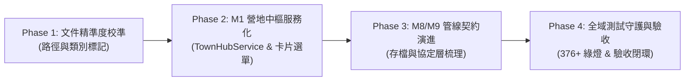

# 📋 程式碼與文件一致性全域審查待辦清單 (Codebase & Docs Alignment Action Tasks)

> **文檔定位**：Level 3 — Task Lists (專案治理與全域對齊之具體可執行待辦清單)  
> **制定日期**：2026-10-22  
> **審查基準**：全專案 Java 源碼（src/main/java 288 個檔案、src/test/java 89 個檔案）、靜態資料 JSON、前端 Vanilla 模組、全量單元與整合測試（以 `.\test.ps1` 100% 綠燈通過為準），以及四層架構文檔（L1~L4）交叉比對。  
> **核心目標**：將代碼庫與技術文件間的「規格超前」、「路徑簡寫」及「架構命名落差」轉化為結構清晰、分步推進、附帶測試保護的具體工程待辦事項。

---

## 📌 一、審查基線與既有達成成果 (Baseline & Aligned Achievements)

經實地代碼特徵掃描與測試套件驗證，以下核心領域已在程式碼庫中 **100% 落實**，作為本待辦清單的穩固底座：

1. **核心戰鬥與破防打斷體系 (對齊 L1/L2 M3/M3-1)**：
   - 罡氣削韌與破防 1.5x 爆擊傷害加成（[`CombatRules.applyPoiseBreakCrit`](../../src/main/java/com/example/htmlmud/domain/combat/CombatRules.java)）。
   - 蓄力打斷與破防硬直（[`DrpgCombatLoop.resolveSkillInterrupt`](../../src/main/java/com/example/htmlmud/domain/dungeon/battle/DrpgCombatLoop.java)）。
   - 天道靈氣元素反應（`VAPORIZE`、`ELECTRO_CHARGED` 等五行相生相剋結算）。
   - 跨隊員連攜終結絕技（[`ComboResolver.executeFormationFinisher`](../../src/main/java/com/example/htmlmud/domain/dungeon/battle/ComboResolver.java)）。
   - 首領多階段血量門檻（`phaseThresholds` 與 `isEnraged`）與戰術求值器（`evaluateTacticsCondition`）。
2. **角色道基、裝備與流派體系 (對齊 L1/L2 M4/M5/M6)**：
   - 小隊共用 40 格儲物袋（[`PartyInventory.CAPACITY = 40`](../../src/main/java/com/example/htmlmud/party/PartyInventory.java) 單一真相源）。
   - 5+2 裝備位架構（[`EquipmentSlot.ACCESSORY_1`](../../src/main/java/com/example/htmlmud/domain/model/enums/EquipmentSlot.java)、`ACCESSORY_2`）。
   - 隨機道韻裝備詞綴池（[`ItemAffix.java`](../../src/main/java/com/example/htmlmud/domain/item/model/ItemAffix.java) 支援前綴／後綴與動態屬性累加）。
   - 四大賽博修仙流派（[`CyberSchool`](../../src/main/java/com/example/htmlmud/party/PartyMemberSkill.java)）與技能超頻階級（`overclockTier 0~3`）。
3. **純單機化去毒瘤與介面下架 (對齊 L1/L3/L4)**：
   - 外神侵蝕僅施加【精神萎靡】Debuff，心魔背刺隊友邏輯徹底清零。
   - 舊 MUD 封印術指令代碼物理徹底除役出清（`SealCommand.java` 刪除）。
   - 前端常規介面文字輸入框彻底移除，僅保留開發者終端（[`#dev-console-modal`](../../src/main/resources/static/index.html)）。

---

## 📋 二、可執行分階段待辦事項 (Phased Actionable Tasks)

---

### 🔹 Phase 1: 文件精準度輕量校準 (Doc Precision & Path Correction)
> **目的**：修正 L2 規格手冊中過於簡寫的設定檔路徑與命名，使其與已落地的代碼檔案系統 1:1 吻合。

- [ ] **Task 1.1: 校準 `MODULES_MAP.md` 與規格子手冊中的靜態資料儲存路徑**
  - **目標檔案**：
    - [`docs/2_specifications/MODULES_MAP.md`](../2_specifications/MODULES_MAP.md)
    - [`docs/2_specifications/backend/M1_TOWN_HUB_AND_FACILITIES.md`](../2_specifications/backend/M1_TOWN_HUB_AND_FACILITIES.md)
    - [`docs/2_specifications/backend/M5_SKILL_AND_PROGRESSION.md`](../2_specifications/backend/M5_SKILL_AND_PROGRESSION.md)
    - [`docs/2_specifications/backend/M6_ITEM_AND_ECONOMY.md`](../2_specifications/backend/M6_ITEM_AND_ECONOMY.md)
  - **執行動作**：
    1. 將 M5 資料路徑 `src/main/resources/data/classes/classes.json` 更新為真實路徑 `src/main/resources/data/global/classes.json`。
    2. 將 M6 物品資料路徑 `src/main/resources/data/items.json` 補充說明為分流架構：全域物品分佈於 `src/main/resources/data/global/items/{weapons,armors,accessories,consumables,materials,currencies,quest}/`，區域物品分佈於 `src/main/resources/data/zones/*/items.json`。
    3. 將 M1 營地設施路徑 `src/main/resources/data/hub/facilities.json` 更新為現行實際儲存位置 `src/main/resources/data/zones/newbie_village/facilities.json`。
  - **驗收標準**：L2 文件提及的所有靜態資料檔案路徑皆可透過實體檔案系統直接定位，無死鏈。

- [ ] **Task 1.2: 標註 `MODULES_MAP.md` 中 M8/M9 既有實作之代表類別**
  - **目標檔案**：
    - [`docs/2_specifications/MODULES_MAP.md`](../2_specifications/MODULES_MAP.md)
    - [`docs/2_specifications/backend/M8_SAVE_AND_PERSISTENCE.md`](../2_specifications/backend/M8_SAVE_AND_PERSISTENCE.md)
    - [`docs/2_specifications/backend/M9_STATE_PIPELINE_AND_EVENTS.md`](../2_specifications/backend/M9_STATE_PIPELINE_AND_EVENTS.md)
  - **執行動作**：
    1. 在 M8 代表類別中標註：目前自動存檔由 [`SaveGameService`](../../src/main/java/com/example/htmlmud/domain/save/service/SaveGameService.java) 統一管理，角色存檔封裝於 [`SaveData`](../../src/main/java/com/example/htmlmud/domain/save/model/SaveData.java) 之小隊狀態。
    2. 在 M9 代表類別中標註：現行網路連線與動作分發由 [`MudWebSocketHandler`](../../src/main/java/com/example/htmlmud/infra/server/MudWebSocketHandler.java) 與 [`CommandDispatcher`](../../src/main/java/com/example/htmlmud/application/command/CommandDispatcher.java) 提供服務。
  - **驗收標準**：手冊清楚反映當前工程現實，避免後續開發者尋找不存在的單獨類別。

---

### 🔹 Phase 2: M1 營地中樞服務化與前端卡片選單重構 (Town Hub Modernization)
> **目的**：落實 Milestone VS-01 規劃（本階段待 Milestone VS-01 正式開工後排程實作），將營地中樞從舊 MUD 房間拓撲中徹底解放，轉為真正的選單卡片式體驗。

- [ ] **Task 2.1: 後端實作 `TownHubService` 與專屬 DTO**
  - **目標檔案**：
    - `src/main/java/com/example/htmlmud/domain/world/service/TownHubService.java`（新建）
    - `src/main/java/com/example/htmlmud/domain/world/dto/TownHubDto.java`（新建）
    - [`src/main/java/com/example/htmlmud/application/command/CommandDispatcher.java`](../../src/main/java/com/example/htmlmud/application/command/CommandDispatcher.java)
  - **執行動作**：
    1. 建立 `TownHubService`，負責加載 `facilities.json` 並管理安全營地機能設施互動（工坊、修煉場、醫療站、傳送門）。
    2. 封裝 `TownHubDto`，包含當前營地名稱、介紹、設施卡片列表（`FacilityDto`）以及可對話 NPC 清單。
    3. 在 `CommandDispatcher` 或對應分發器新增對營地設施點選動作（如 `INTERACT_FACILITY`、`REST_PARTY`）的處理解析。
    4. 建立單元測試 `TownHubServiceTest.java` 守護設施加載與互動邏輯。
  - **驗收標準**：後端營地邏輯完全脫離 `RoomService.exits` 拓撲，並有 100% 綠燈測試覆蓋。

- [ ] **Task 2.2: 前端 `town-panel.js` 現代化重構 (移除 4 向羅盤，實裝設施卡片)**
  - **目標檔案**：
    - [`src/main/resources/static/js/panels/town-panel.js`](../../src/main/resources/static/js/panels/town-panel.js)
    - [`src/main/resources/static/css/style-05-town-and-hub.css`](../../src/main/resources/static/css/style-05-town-and-hub.css)
  - **執行動作**：
    1. 徹底自 `town-panel.js` 移除渲染舊 MUD 4 向出口（`exits.forEach` / `renderTownNav`）的代碼區塊。
    2. 實裝 `renderFacilities(facilities)` 渲染函式，以網格卡片呈現各機能設施（天工百煉坊、賽博晶片工坊、太華傳功道場、回春草堂醫療站、地牢傳送門）。
    3. 為設施卡片綁定 `data-action="enter-facility"` 與鍵盤數字快捷鍵（1~5）。
  - **驗收標準**：前端營地介面不再出現四向移動羅盤，全面轉為純單機點選式現代 RPG 營地選單。

---

### 🔹 Phase 3: M8/M9 狀態協定與持久化管線演進 (State Pipeline & Persistence Refinement)
> **目的**：強化純單機 DRPG 狀態廣播與存檔快照機制。

- [ ] **Task 3.1: 完善存檔觸發時機與多槽位守護測試**
  - **目標檔案**：
    - [`src/main/java/com/example/htmlmud/domain/save/service/SaveGameService.java`](../../src/main/java/com/example/htmlmud/domain/save/service/SaveGameService.java)
    - `src/test/java/com/example/htmlmud/domain/save/SaveGameServiceTest.java`
  - **執行動作**：
    1. 驗證地牢進入、撤離、重要戰鬥勝利時自動寫入 `slot_auto.json` 的心跳呼叫。
    2. 為 5 大手動存檔槽位（`slot_1` ~ `slot_5`）與版本遷移管線補齊專門的單元與邊界測試。
  - **驗收標準**：存檔系統具備防崩潰與自動備份（`.bak`）的完備測試守護。

- [ ] **Task 3.2: 梳理結構化 Action Protocol 前後端契約**
  - **目標檔案**：
    - [`src/main/resources/static/js/network/websocket.js`](../../src/main/resources/static/js/network/websocket.js)
    - [`src/main/java/com/example/htmlmud/domain/dungeon/dto/DrpgStateDto.java`](../../src/main/java/com/example/htmlmud/domain/dungeon/dto/DrpgStateDto.java)
  - **執行動作**：
    1. 全面審查用戶端發送之封包，確保不再發送任何原生 MUD 文字指令字串，統一採用 `{ type: "ACTION", payload: { ... } }` 格式。
    2. 後端持續收斂至 `DrpgStateDto` 作為全域單一狀態推播封包。
  - **驗收標準**：前後端通訊層完全摒除傳統 Telnet/MUD 命令行痕跡。

---

### 🔹 Phase 4: 全域回歸守護與驗收閉環 (Regression & DoD)
> **目的**：確保所有待辦落地時，零回歸、零破壞。

- [ ] **Task 4.1: 全套自動化測試守護門**
  - **執行動作**：
    1. 執行 `.\test.ps1`，保證既有 376 個測試與新增之測試全數綠燈通過。
    2. 驗證無任何編譯警告或資料庫依賴倒退。
  - **驗收標準**：Pass: 376+ / Fail: 0。

- [ ] **Task 4.2: 四層文檔一體化校驗**
  - **執行動作**：
    1. 執行文檔連結驗證腳本，確認全專案 60+ 份文檔之間無任何失效的 markdown 引用。
    2. 在 [`ACTIVE_TASKS.md`](../4_active_tasks/ACTIVE_TASKS.md) 中更新當前 Sprint 狀態，將本待辦清單納入追蹤。
  - **驗收標準**：全域無斷鏈，四層架構一體貫通。

---

## 🛡️ 三、完成定義 (Definition of Done, DoD)

1. **代碼與文件 1:1 精確一致**：文件所列之所有代表類別與資料路徑，均可在代碼庫與磁碟中精確對應。
2. **零 MUD 殘留**：前端營地徹底告別羅盤出口，後端業務徹底告別文字指令拼裝。
3. **綠燈守護門**：每次任務提交前，全專案 376+ 項自動化測試 100% 通過。
4. **極致輕量自洽**：本待辦清單聚焦於實際落地差距，保持簡練且高操作性。
