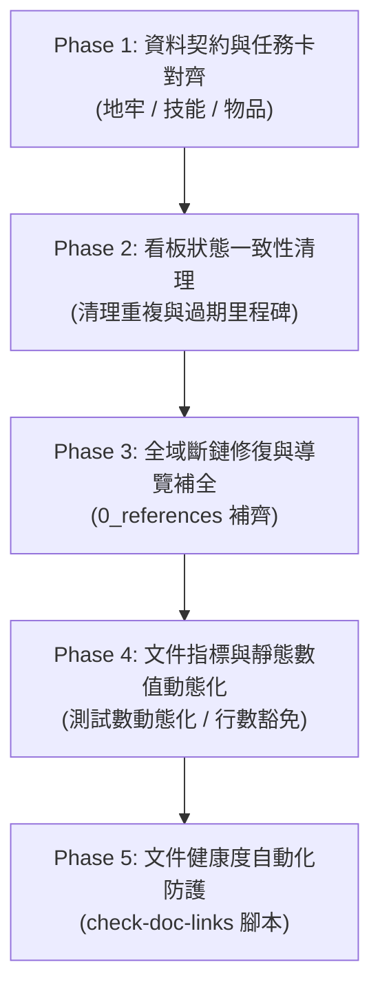

# 📋 四層級文檔深度對齊與契約閉環待辦清單 (Four-Tier Docs Alignment Action Tasks)

> **文檔層級**：Level 3 — Task Lists (專案治理與全域對齊可執行清單)  
> **制定日期**：2026-10-23  
> **審查來源**：彙整自 `docs/0_references/` 內四大審查報告（`Claude_Review.md`、`Codex_Review.md`、`Copilot_Review.md`、`docs_alignment_report.md`）並經過可行性、破窗風險與代碼實況全面過濾後之**「同意採納待辦清單」**。  
> **核心目標**：徹底消除 L1 需求、L2 規格契約、L3 演進清單、L4 微任務看板與代碼/資料三方之間的規格脫節、欄位名稱漂移、符號顛倒與無效連結，建立 100% 閉環的純單機 DRPG 工程標準。

---

## 📌 一、治理原則與邊界聲明

1. **契約嚴格閉環**：L2 資料 Schema 為規格層唯一契約，L4 任務卡所引用的欄位、ID、數值與地貌圖例必須 100% 能在 L2 與實際 JSON 資料中找到對應。
2. **平滑相容過渡**：為守護現有測試套件與存檔相容性，後端載入器（如 `DungeonFloorLoader`）優先採用 Jackson `@JsonAlias` 實現多欄位雙向相容，待資料全量遷移與測試綠燈後再行收斂，杜絕破壞性大重構。
3. **單一活躍焦點**：`ACTIVE_TASKS.md` 為專案唯一微觀執行看板，L3 本清單負責中長程治理任務追蹤，所有過期、重複的里程碑標記徹底清理。

---

## 📋 二、詳細可執行待辦清單 (Actionable Task List)

---

### 🔹 Phase 1: 資料契約層 (L2 Schema) 與真實資料／L4 任務卡精準對齊

- [x] **Task 1.1 (ALIGN-DUNGEON-SCHEMA): 地牢 Schema、實體資料與 L4 地貌圖例契約對齊**
  - **目標檔案**：
    - [`docs/2_specifications/data_schemas/DUNGEON_SCHEMA.md`](../2_specifications/data_schemas/DUNGEON_SCHEMA.md)
    - [`docs/4_active_tasks/ACTIVE_TASKS.md`](../4_active_tasks/ACTIVE_TASKS.md)
    - [`src/main/resources/data/dungeons/mozhu_mines_b1f.json`](../../src/main/resources/data/dungeons/mozhu_mines_b1f.json)
    - [`src/main/java/com/example/htmlmud/domain/dungeon/service/DungeonFloorLoader.java`](../../src/main/java/com/example/htmlmud/domain/dungeon/service/DungeonFloorLoader.java)
  - **執行動作**：
    1. 在 `DungeonFloorLoader.java` 與 `DUNGEON_SCHEMA.md` 規範別名映射，支援 `floorId` $\leftrightarrow$ `id`、`startCoord` $\leftrightarrow$ `startPosition`、`encounters.dangerRate` $\leftrightarrow$ `encounterRate`，確保 Schema 範例能通過代碼驗證。
    2. 在 `DUNGEON_SCHEMA.md` 補齊現行真實地塊類型枚舉（加入 `TRAP`、`TREASURE`、`EVENT`），並規範 `events[]` 陣列格式與圖例 `eventId` 的觸發邊界。
    3. **修正 L4 `ACTIVE_TASKS.md` Task 1 的符號顛倒**：將任務卡中的符號對齊真實資料（`E` 為墨家殘碑 EVENT、`B` 為 BOSS 祭壇、`X` 為外神卵塊泥沼 TRAP，禁止將 `E` 寫成卵塊、`B` 寫成生化腐殖）。
    4. 明確 `exitRoomId` 語意為「撤離返回之安全營地設施 ID」，並核對資料庫有效性。
  - **驗收標準**：L2 Schema 範例可通過現行 `DataIntegrityValidator` 驗證；L4 任務卡地圖符號與實際 JSON 一致，無語意矛盾。

- [x] **Task 1.2 (ALIGN-SKILL-SCHEMA-AND-TASKS): 統一首批賽博技能 Canonical ID、連攜角色與 L4 驗收卡**
  - **目標檔案**：
    - [`docs/2_specifications/data_schemas/SKILL_SCHEMA.md`](../2_specifications/data_schemas/SKILL_SCHEMA.md)
    - [`docs/4_active_tasks/ACTIVE_TASKS.md`](../4_active_tasks/ACTIVE_TASKS.md)
    - [`src/main/resources/data/party/party_skills.json`](../../src/main/resources/data/party/party_skills.json)
    - [`src/main/java/com/example/htmlmud/party/PartyMemberSkill.java`](../../src/main/java/com/example/htmlmud/party/PartyMemberSkill.java)
  - **執行動作**：
    1. 統一所有文檔與代碼之技能唯一識別碼：`skill_neural_overclock_step`（神經超頻步）與 `skill_bio_keratin_blade`（強殖角質刃），破防削韌值確定為 25 與 45。
    2. 修正 L4 `ACTIVE_TASKS.md` Task 3 中的錯誤簡寫 ID（`neuro_overclock_step`、`bio_carapace_blade`）與過低削韌數值（15/25），杜絕規格超前或倒退。
    3. 在 `SKILL_SCHEMA.md` 中將連攜屬性明確定義為互斥枚舉 `comboRole: NONE | PRIMER | DETONATOR`，消除 Schema 使用 `isPrimer/isDetonator` 雙 boolean 與代碼枚舉之間的語意脫節。
    4. 調整 L4 Task 3 任務性質：因該兩項技能已在 `party_skills.json` 實裝，將任務重點調整為「Primer 裂魂標記與 Detonator 衝擊波引爆戰鬥整合測試驗收」，消除「已完成又重複待辦」的看板混亂。
  - **驗收標準**：L1、L2、L4 與 `party_skills.json` 中的技能 ID、流派、連攜角色與削韌值 100% 一致。

- [x] **Task 1.3 (ALIGN-ITEM-SCHEMA-AND-CHIP): 裝備模板與實例結構解耦，補齊首領任務晶片資料**
  - **目標檔案**：
    - [`docs/2_specifications/data_schemas/ITEM_SCHEMA.md`](../2_specifications/data_schemas/ITEM_SCHEMA.md)
    - [`docs/4_active_tasks/ACTIVE_TASKS.md`](../4_active_tasks/ACTIVE_TASKS.md)
    - `src/main/resources/data/global/items/quest/quest_items.json`
  - **執行動作**：
    1. 在 `ITEM_SCHEMA.md` 中明確分離「物品/裝備模板規格」（含 `affixPool`、`minValue/maxValue`）與「掉落生成後實例規格」（含 `affixes[{id,type,name,statKey,value}]`，對應代碼 `ItemAffix.java`）。
    2. 修正 `ITEM_SCHEMA.md` 對非裝備物品（如 `itemType: CONSUMABLE`、`QUEST`）強制要求 `slot` 欄位的 Schema 約束缺陷。
    3. 統一首領掉落任務晶片唯一 Canonical ID 為 `item_chip_qianxing_tracker`（千星科技加密追蹤晶片），同步修正 L4 Task 4 任務卡中的舊 ID `thousand_stars_tracking_chip`。
    4. 在靜態資料目錄正式補齊 `item_chip_qianxing_tracker` 道具定義 JSON，使 VS-01 Task 4 具備真實前置資料。
  - **驗收標準**：`ITEM_SCHEMA.md` 範例與 `ItemAffix.java` 模型相符；首領掉落晶片有實體檔案可查。

- [x] **Task 1.4 (ALIGN-SAN-SHIELD-SPEC): 全域統一 SAN 為「精神護盾與萎靡Debuff」並清理 L1 魔化敘事**
  - **目標檔案**：
    - [`docs/1_requirements/CYBERPUNK_CULTIVATION_SPEC.md`](../1_requirements/CYBERPUNK_CULTIVATION_SPEC.md)
    - [`docs/1_requirements/GAMEPLAY_CORE_LOOPS.md`](../1_requirements/GAMEPLAY_CORE_LOOPS.md)
    - [`docs/2_specifications/backend/M4_PARTY_AND_FORMATION.md`](../2_specifications/backend/M4_PARTY_AND_FORMATION.md)
    - [`docs/2_specifications/MODULES_MAP.md`](../2_specifications/MODULES_MAP.md)
  - **執行動作**：
    1. 確立決策共識（方案 A）：保留 SAN 作為純單機地牢生存資源（神識推導護盾容量，黑暗/幽冥扣減，歸零施加 Debuff），**絕不背叛隊友、絕無隨機魔化變身**。
    2. 全域統一數值契約：將 L2 M4 中寫成「精神震懾（受創+20%、韌性回復-30%）」之描述修正對齊為代碼庫現行驗證標準——【精神萎靡】Debuff（-15% 傷害輸出，`PartyMember.MadnessState.CHAOS`）。
    3. 清理 L1 `CYBERPUNK_CULTIVATION_SPEC.md`（如第 25、49、78 行）殘留的「走火入魔、瘋狂積累怪物化、SAN 值崩潰懲罰」等歷史 MUD 敘事，全面改寫為現代賽博「算力過載熱損耗」或「外神精神侵蝕動搖」。
  - **驗收標準**：全層級對 SAN 的定位一致定義為「外神精神侵蝕防護罩」，零魔化毒瘤敘事，與現有 376 測試及代碼 1:1 精確一致。

---

### 🔹 Phase 2: 看板狀態一致性與重複項治理 (L3/L4 De-duplication)

- [x] **Task 2.1 (ACTIVE-TASKS-CLEANUP): 清理 L4 看板過期里程碑與陳舊指針**
  - **目標檔案**：
    - [`docs/4_active_tasks/ACTIVE_TASKS.md`](../4_active_tasks/ACTIVE_TASKS.md)
    - [`docs/4_active_tasks/SPRINT_GOAL.md`](../4_active_tasks/SPRINT_GOAL.md)
  - **執行動作**：
    1. 物理刪除 `ACTIVE_TASKS.md` 尾部「🔮 後續備選里程碑」中的 Milestone 3 (F1-02 領域層收斂) 與 Milestone 4 (FE-6 歷史樣式巨石除役)——該兩項早在上方「🏆 已完成里程碑」中標記為 `[x]`，下方殘留屬嚴重過期資訊。
    2. 修訂 `ACTIVE_TASKS.md` 頂部現狀描述：將「文件對齊全面完工」修正為真實狀態「四層級文件差異已完成全面盤點，正進行契約對齊與驗收治理，VS-01 保持待命準備中」。
    3. 修訂三位一體 DoD 第三條：將過時目錄指針 `docs/manual/` 修正為現行 `docs/2_specifications/`。
  - **驗收標準**：`ACTIVE_TASKS.md` 不存在已完成任務又在後續備選中重複出現的破窗現象；無已除役路徑引用。

- [x] **Task 2.2 (L3-BACKLOG-SYNCHRONIZATION): 收斂 L3 待辦與 L4 衝刺看板之焦點矛盾**
  - **目標檔案**：
    - [`docs/3_task_lists/codebase_audit_and_alignment_tasks.md`](codebase_audit_and_alignment_tasks.md)
    - [`docs/3_task_lists/FUTURE_IMPROVEMENTS.md`](FUTURE_IMPROVEMENTS.md)
  - **執行動作**：
    1. 在 `codebase_audit_and_alignment_tasks.md` 中為 Phase 2（營地中樞服務化與卡片選單）明確標註前置依賴：「需待 Milestone VS-01 正式啟動後排程實作」，避免產生 L3 催促開工而 L4 標記待命的雙頭焦點矛盾。
    2. 清理 `FUTURE_IMPROVEMENTS.md` 中過期的歷史描述，保持導覽中樞的一致性。
  - **驗收標準**：全專案僅有 `ACTIVE_TASKS.md` 作為當前衝刺唯一微觀焦點，L3 待辦定位清晰為候選與治理清單。

---

### 🔹 Phase 3: 全域 Markdown 斷鏈修復與導覽盲區補全

- [x] **Task 3.1 (FIX-BROKEN-LINKS): 修復全域失效相對路徑與已歸檔指針**
  - **目標檔案**：
    - [`docs/3_task_lists/tech_debt_and_hardening.md`](tech_debt_and_hardening.md)
    - [`docs/3_task_lists/content_and_combat_roadmap.md`](content_and_combat_roadmap.md)
    - [`docs/1_requirements/WORLD_AND_LORE_BIBLE.md`](../1_requirements/WORLD_AND_LORE_BIBLE.md)
    - [`docs/1_requirements/CYBERPUNK_CULTIVATION_SPEC.md`](../1_requirements/CYBERPUNK_CULTIVATION_SPEC.md)
  - **執行動作**：
    1. 修復 `tech_debt_and_hardening.md`（第 19 行、第 101 行）與 `content_and_combat_roadmap.md`（第 18 行）中指向不存在的 `../0_archive/references/Copilot_Review.md`，更正為現行有效路徑 `../0_references/Copilot_Review.md`。
    2. 修復 `WORLD_AND_LORE_BIBLE.md`（第 4 行）與 `CYBERPUNK_CULTIVATION_SPEC.md`（第 5 行）檔頭指向不存在的 `docs/references/...`，更正為 `docs/0_references/...`。
  - **驗收標準**：上述 4 份核心文件中的所有本機 Markdown 相對連結 100% 點擊有效，無 404 死鏈。

- [x] **Task 3.2 (UPDATE-DOCS-INDEX): 在導覽體系補齊 `0_references/` 目錄定義**
  - **目標檔案**：
    - [`docs/README.md`](../README.md)
  - **執行動作**：
    1. 在 `docs/README.md` 的「🏛️ 文檔四層級結構總覽」目錄樹中補齊 `0_references/`（參考素材與審查建議庫）。
    2. 在「各層級閱讀與維護指引」中增加 `0_references/` 的治理定位說明：標註其為「原始素材、世界觀靈感與非規範性審查報告，未正式決議前不具架構規範力」。
    3. 在目錄樹與導覽中登錄本治理清單 `four_tier_alignment_action_tasks.md`。
  - **驗收標準**：`docs/README.md` 與真實磁碟目錄結構 1:1 吻合，消除導覽盲區。

---

### 🔹 Phase 4: 文件指標與靜態數值動態化治理

- [x] **Task 4.1 (TEST-SNAPSHOT-GOVERNANCE): 淘汰文件寫死之測試數字，確立動態命令標準**
  - **目標檔案**：
    - [`docs/3_task_lists/codebase_audit_and_alignment_tasks.md`](codebase_audit_and_alignment_tasks.md)
    - [`docs/3_task_lists/four_tier_alignment_and_execution_plan.md`](four_tier_alignment_and_execution_plan.md)
    - [`docs/3_task_lists/codebase_four_tier_alignment_plan.md`](codebase_four_tier_alignment_plan.md)
    - [`docs/4_active_tasks/ACTIVE_TASKS.md`](../4_active_tasks/ACTIVE_TASKS.md)
  - **執行動作**：
    1. 全域清理文件中散落且互相衝突的歷史測試總數快照（324、343、373、375、376、376+），統一修改為以「`.\test.ps1` 執行 100% 綠燈通過（以最近一次執行基線為準）」作為標準表述。
    2. 更正 `codebase_audit_and_alignment_tasks.md` 檔頭宣稱「全專案 88 個 Java 源碼檔」之錯誤數值（實測 `src/main/java` 為 288 個檔案、測試檔為 89 個檔案）。
  - **驗收標準**：文件不再因新增或重構測試而頻繁產生數字過期破窗。

- [x] **Task 4.2 (LINE-COUNT-RULE-EXCEPTION): 理性修訂文件行數規範，賦予高內聚規格豁免**
  - **目標檔案**：
    - [`docs/3_task_lists/four_tier_alignment_and_execution_plan.md`](four_tier_alignment_and_execution_plan.md)
    - [`docs/3_task_lists/codebase_audit_and_alignment_tasks.md`](codebase_audit_and_alignment_tasks.md)
  - **執行動作**：
    1. 將原硬性要求「除 CHANGELOG 外所有文件嚴格 < 300 行」修訂為理性工程規範：「一般文件原則上控制在 300 行以內；針對高度內聚之模組規格（如 `M3_1_BUFF_AND_STATUS_EFFECTS.md` 390 行、`MODULES_MAP.md` 291 行），允許上限放寬至 400 行，並在架構索引中明確註記豁免理由」。
    2. 禁止為了機械式滿足 300 行指標而將邏輯強關聯的戰鬥/Buff手冊盲目切碎成碎片文件。
  - **驗收標準**：文件行數規則契合代碼庫真實內聚度，無形式主義割裂。

---

### 🔹 Phase 5: 文件健康度自動化防護網 (Tooling & Verification)

- [x] **Task 5.1 (DOC-LINK-GUARD-SCRIPT): 實裝本機 Markdown 連結自動化驗證腳本**
  - **目標檔案**：
    - `scripts/check-doc-links.ps1`（新建）
  - **執行動作**：
    1. 編寫輕量級 PowerShell 腳本 `scripts/check-doc-links.ps1`，唯讀掃描 `docs/` 下所有 `.md` 檔案中的相對檔案連結（如 `[text](../path/file.md)`）。
    2. 自動驗證目標檔案是否存在於本地檔案系統中；若有斷鏈，輸出檔案名稱與行號並回傳 exit code 1；全數通過時回傳 exit code 0。
    3. 在 `docs/README.md` 中記錄執行驗收命令。
  - **驗收標準**：執行 `.\scripts\check-doc-links.ps1` 能夠精準捕捉刻意構造的死鏈，並在修復後實現 100% 綠燈通過。

- [x] **Task 5.2 (FE-LEGACY-SCRIPT-INVESTIGATION): 前端歷史腳本 (`mud-core.js`/`mud-ui.js`) 依賴鏈調研 (P3 儲備)**
  - **目標檔案**：
    - [`src/main/resources/static/index.html`](../../src/main/resources/static/index.html)
    - [`docs/3_task_lists/tech_debt_and_hardening.md`](tech_debt_and_hardening.md)
  - **執行動作**：
    1. 確立決策共識（方案 A）：不在此次文檔對齊期盲目物理刪除前端歷史腳本，避免全域相容橋接（如除錯終端、全域事件）引發白屏崩潰。
    2. 在 `tech_debt_and_hardening.md` 登錄為 P3 技術債調研項目，排期於 Milestone VS-01 交付後，透過瀏覽器 DevTools 與無頭測試逐行驗證其呼叫點，進行安全平滑除役。
  - **驗收標準**：當前系統保持穩定運行，前端歷史腳本除役計畫有案可查，不阻礙當前衝刺。

---

## 🛡️ 三、完成定義 (Definition of Done, DoD)

1. **契約嚴密閉環**：`DUNGEON_SCHEMA`、`SKILL_SCHEMA`、`ITEM_SCHEMA` 與真實 JSON 檔案及 L4 任務卡完全一致，無字段、ID 或數值落差。
2. **零死鏈零斷層**：`docs/` 下 36 份有效技術文件及 README 導覽無任何失效本機引用。
3. **綠燈守護門**：所有對齊治理調整不破壞現有工程管線，`.\test.ps1` 全量執行 100% 綠燈通過。
4. **看板單一真相源**：消除所有重複、衝突的里程碑狀態，`ACTIVE_TASKS.md` 成為唯一微觀焦點。
