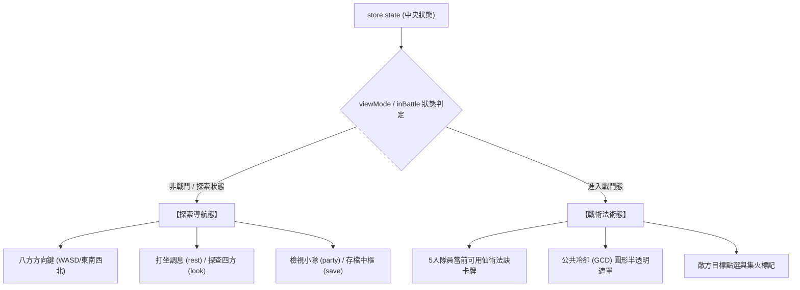

# 🏛️ 前端 FE-4: 城鎮中樞與動作列面板深度手冊 (Town Hub & Action Bar Manual)

> **模組編號**：FE-4  
> **系統類型**：前端表現層模組  
> **核心定位**：管理文字 MUD 模式下的城鎮中樞（Town Panel）視圖、NPC 互動名片、出口方位網格，以及底部快捷動作列（Action Bar Panel）在探索與戰鬥狀態間的無縫變形。

---

## 🏛️ 一、模組架構與視圖職責劃分

本模組涵蓋兩大關鍵面板元件：
1. **城鎮中樞面板 (`town-panel.js`)**：在文字 MUD 模式（`viewMode === 'TOWN'`）下主導右側資訊佈局，取代傳統純命令列黑底白字，以現代卡片化形式呈現修仙市集氛圍。
2. **快捷動作列面板 (`action-bar-panel.js`)**：常駐於螢幕底部，依據當前遊戲模式（探索 vs 戰鬥）動態變形為完全不同的功能形態。

---

## 🏘️ 二、城鎮中樞面板詳解 (`town-panel.js`)

城鎮中樞由三個子區塊構成：

```
┌────────────────────────────────────────────────────────┐
│                   城鎮中樞面板佈局                     │
├────────────────────────────────────────────────────────┤
│ 【 桃源村客棧 · 暖心雅間 】                            │
│ 空氣中瀰漫著剛蒸熟的靈米清香與古雅的安神木檀味...     │
├────────────────────────────────────────────────────────┤
│ 【 房內修士與仙民 】                                   │
│  ┌────────────────────┐   ┌────────────────────┐       │
│  │  客棧掌櫃 · 佟掌柜 │   │  流浪劍客 · 鐵牛   │       │
│  │  [交談] [購買補給] │   │  [對話] [邀請入隊] │       │
│  └────────────────────┘   └────────────────────┘       │
├────────────────────────────────────────────────────────┤
│ 【 四方出路 】                                         │
│  [ ↑ 北: 客棧後廚 ]  [ ↓ 南: 村落廣場 ]  [ → 東: 靈泉] │
└────────────────────────────────────────────────────────┘
```

### 1. 房間資訊與動態描述
- 呈現當前房間名稱與氣候環境描述，文字支援淡雅呼吸漸變。

### 2. 生靈名片卡牌 (NPC Cards)
- 根據房間生靈清單動態生成卡片，每位生靈依身份掛載對應之純資料驅動操作按鈕（`data-action`）：
  - **商人 / 掌櫃**：點擊觸發 `open-shop-view` 展開貨棧商品選購清單。
  - **潛在夥伴**：好感度足夠時顯示 `recruit-companion` 邀請加入 5 人小隊。
  - **傳功長老**：點擊觸發 `dialogue-quest` 啟動主支線修仙劇情。

### 3. 出口按鈕網格 (Exits Navigation)
- 將房間 `exits` 拓撲關係渲染為方塊按鈕，點擊即自動向後端發送移動指令（如 `north`、`south`），無需手動鍵入英文單字。

---

## ⚡ 三、快捷動作列雙態變形機制 (`action-bar-panel.js`)

動作列位於主畫面最底層，採用 **狀態驅動之動態變形架構**：



### 1. 探索形態 (Exploration Mode)
- 面板呈現簡潔的指南針微型導航盤與常用快捷操作。
- 支援一鍵「原地打坐（回復氣血真元）」、「環顧四周」、「開啟背包」。

### 2. 戰鬥形態 (Combat Mode)
- 探索按鈕平滑縮回，瞬間切換為橫排仙術技能卡。
- **技能卡資訊**：法術名稱、真元 MP 消耗、五行屬性標記（如離火、厚土）。
- **冷卻反饋**：施放法術後，卡牌上方自動覆蓋半透明灰色遮罩，以倒數秒數與旋轉光圈呈現剩餘冷卻時間。

---

## 📱 四、響應式佈局適配 (`style-06-shop-and-responsive.css`)

- **桌機大螢幕（Width $\ge 1024\text{px}$）**：
  終端日誌、DRPG 視口與城鎮中樞採左右並排雙欄設計，資訊密度最高。
- **平板與行動端（Width $< 1024\text{px}$）**：
  自動重排為單欄垂直堆疊架構，字級保底 $\ge 13\text{px}$，按鈕點擊熱區擴大至 $44\times 44\text{px}$，杜絕誤觸。

---

## 🔗 五、代表檔案清單

| 檔案路徑 | 模組定位 | 關鍵導出項目 |
| :--- | :--- | :--- |
| `static/js/panels/town-panel.js` | 城鎮中樞主控制器 | `renderTownPanel()`, `renderNpcCard()` |
| `static/js/panels/action-bar-panel.js` | 底部快捷動作列控制器 | `renderActionBar()`, `switchActionBarMode()` |
| `static/css/style-05-town-and-hub.css` | 城鎮卡牌與出口網格樣式 | `.town-hub`, `.npc-card`, `.exit-grid` |
| `static/css/style-06-shop-and-responsive.css` | 貨棧清單與行動端響應式排版 | `.shop-grid`, `@media (max-width: 1024px)` |

---

## 🚀 六、未來架構演進與現代化擴充規劃 (Future Roadmap & Scalability)

為使城鎮生活氛圍與底部動作列在不同平台（PC、Steam Deck、手機）均具備現代主機級交互質感，確立以下四大演進方向：

### 1. 🎯 現代主機級操作與沉浸體驗 (Gamepad & Immersion)
- **Gamepad API 隨插即玩控制器支援**：
  全面接入標準手柄協議（Xbox / PlayStation / Switch Pro 手把）。左搖桿控制城鎮移動與地牢步進，右搖桿環視，十字鍵與 ABXY 映射技能法術，讓玩家在客廳大螢幕或掌機上享受主機級順滑遊玩手感。
- **動態 NPC 水墨微動態立繪 (Spine / CSS Bone Animation)**：
  重要 NPC（佟掌櫃、傳功長老）名片支援微幅呼吸起伏水墨立繪，交談時觸發專屬表情切換（如親切笑顏、警覺蹙眉），市井代入感倍增。

### 2. 🛡️ 穩定性與無障礙標準 (Accessibility & Keyboard Nav)
- **全介面純鍵盤無障礙導航 (100% Keyboard Navigable)**：
  遵循 WCAG 2.1 AA 規範，城鎮出口網格、NPC 互動按鈕與快捷操作列皆配備 `:focus-visible` 耀金焦點光圈。玩家僅靠鍵盤方向鍵與 `Enter` / `Space` 即可暢行無阻通關，完全擺脫對滑鼠點擊的依賴。

### 3. ⚡ 效能與大量實體虛擬滾動 (Virtual List Optimization)
- **大量 NPC 與物品虛擬化列表 (DOM Virtualization)**：
  在大型宗門大殿或宗門坊市中可能同時存在上百位同門修士與散落靈物。列表引入虛擬滾動算法（Virtual Scroll），畫面外卡片自動卸載，DOM 實體節點始終壓制在 15 個以內，記憶體消耗恆定。

### 4. 🔌 可擴充性與自定義按鍵 (Keybinding Rebind Engine)
- **玩家自訂快捷鍵與招式配置槽 (Custom Keybinding & Action Bar)**：
  提供可視化改鍵設定介面。玩家可依個人手感將「1~5 技能鍵」自定義為 QERFT，並支援將常用丹藥、辟邪靈茶拖曳進自訂快捷槽，實現高度個性化的戰術操作佈局。
