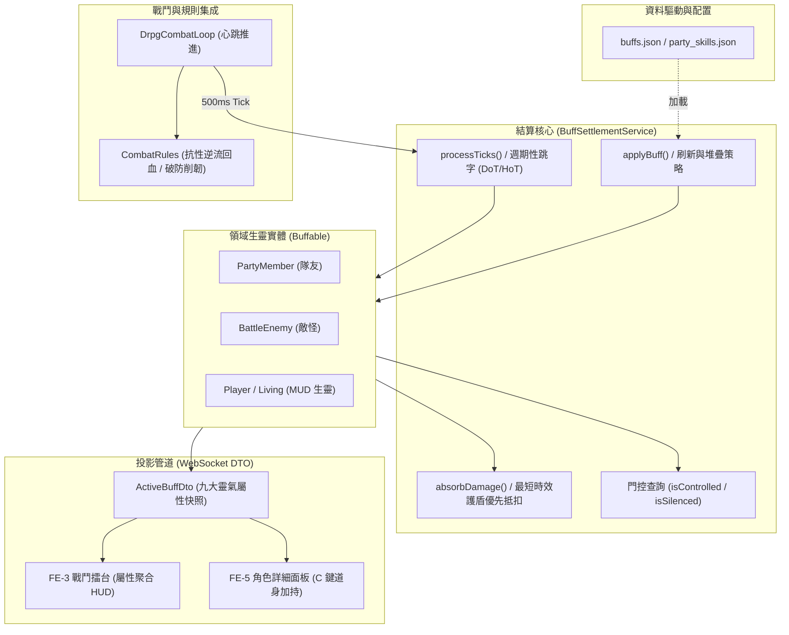

# ☯️ 後端 M3-1: 狀態效果與 Buff 結算模組深度手冊 (Buff & Status Effects Sub-module Manual)

> **模組編號**：M3-1（核心戰鬥子模組，亦稱 M3.1）  
> **系統類型**：後端核心業務模組（隸屬 M3 核心戰鬥引擎）  
> **核心定位**：管理生靈（玩家主角、小隊同伴、敵方怪物）的 Buff / Debuff 狀態生命週期（Tick 倒數與常駐光環）、WoW 式刷新與層數堆疊、多重護盾最短時效優先抵扣、控場狀態全入口門控、罡氣破防條（Poise Break）攻防博弈、九大天道靈氣五行抗性與逆流回血（順成人逆成仙）、極簡「屬性圖示聚合 HUD」契約、以及 Gambit 戰術方針 AI 反制。

---

## 🎯 一、模組設計原則與核心架構

本模組作為戰鬥與生靈狀態的核心樞紐，確立以下五大原則：

1. **唯一真相來源 (SSoT)**：所有攻防屬性修正、傷害減免與逆流抗性計算，一律委託 [`CombatRules`](../../src/main/java/com/example/htmlmud/domain/combat/CombatRules.java)，嚴禁平行造輪子。
2. **契約驅動生命週期**：廢除 `-1` 魔術數字模糊語意，明確劃分 `TIMED`（限時心跳）與 `PERMANENT`（常駐光環）。
3. **多重護盾最短優先**：受創時依剩餘秒數最短的護盾優先吸收，容量耗盡立即破裂，防止數值無限堆疊。
4. **極簡資料投影 (Aggregated HUD)**：前端嚴禁用文字 Log 正則表達式猜測狀態，一律讀取後端推送之 `activeBuffs` 結構化資料，並在戰鬥卡片以「標準屬性圖示 + 聚合每秒數值」展現，懸浮顯示來源明細。
5. **深度防禦博弈**：物理防禦設有上限防無敵；五行法術抗性支援超越 100% 轉化為「靈氣逆流回血」。



---

## ⏳ 二、狀態生命週期與常駐光環契約 (Lifecycle & Permanent Duration)

徹底解決陣法孔位光環因 `remainingTicks = -1` 在第一個 Tick 即被清除的歷史缺陷：

### 1. 生命週期模型
* **基準心跳**：1 Tick = 500ms（戰鬥中隨戰鬥迴圈推進；城鎮由 `WorldPulse` 推進）。
* **`durationTicks` 與 `remainingTicks` 語意**：
  - `> 0`：**限時狀態 (TIMED)**，每個 Tick `remainingTicks--`，歸零時標記為過期。
  - `== PERMANENT_DURATION (-1)`：**常駐光環 (PERMANENT)**（如陣法孔位加成、被動心法），不參與秒數遞減，永不過期（除非隊伍破陣或系統顯式 `removeBuff` 移除）。

### 2. 過期判定契約 (`ActiveBuff.isExpired()`)
```java
public static final int PERMANENT_DURATION = -1;

@JsonIgnore
public boolean isPermanent() {
    return durationTicks == PERMANENT_DURATION;
}

@JsonIgnore
public boolean isExpired() {
    if (isPermanent()) {
        // 常駐光環不隨時間過期；若為常駐護盾則需容量耗盡才過期
        return (category == BuffCategory.SHIELD && value <= 0);
    }
    return remainingTicks <= 0 || (category == BuffCategory.SHIELD && value <= 0);
}

public void decrementTick() {
    if (!isPermanent() && this.remainingTicks > 0) {
        this.remainingTicks--;
    }
    this.ticksSinceLastTick++;
}
```

---

## 🛡️ 三、狀態刷新、層數堆疊與多重護盾吸收契約 (WoW-Style Stacking & Absorption)

當對目標施加已存在的狀態時（相同 `id`），執行具名刷新政策：

1. **持續時間刷新**：重置 `remainingTicks = durationTicks`。
2. **層數累加**：若 `maxStacks > 1`，當前層數 `stacks = Math.min(maxStacks, stacks + 1)`；重置 `ticksSinceLastTick = 0`。
3. **護盾值裁決**：若為護盾類，`value = Math.max(existing.value, newBuff.value)`（取較厚者，防止數值無限膨脹）。
4. **多重護盾吸收優先序 (Shortest Duration First)**：
   - 目標受傷時，先依 `activeBuffs` 中剩餘時間最短的護盾（`remainingTicks` 最小）優先抵扣。
   - 護盾容量扣至 0 時立即破碎化為光屑，穿透傷害繼續扣減下一面護盾或本體 HP。

---

## ⚡ 四、罡氣破防條 (Poise / Break Gauge) 與五行吸收回血機制

結合《最終幻想 7 重製版》（FF7R）、魂系架勢值與暗黑仙俠道門世界觀，將戰鬥核心升級為具備爆發節奏的**「罡氣破防條 (Poise / Break Gauge)」**體系：

```
┌────────────────────────────────────────────────────────┐
│  戰鬥實體狀態儀表 (氣血 HP 與 罡氣破防條 Poise)        │
├────────────────────────────────────────────────────────┤
│  ❤️ 氣血生命 (HP):        [████████████████    ] 650/1000 │
│  ⚡ 罡氣破防條 (Poise):    [████████            ]  40/100  │
└────────────────────────────────────────────────────────┘
```

### 1. 敵方破防機制 (Boss / 菁英戰的爆發節奏)
* **未破防階段 (Poise > 0，罡氣護體中)**：
  - **傷害折減**：敵怪承受的所有攻擊傷害**折減為 1/4 ~ 1/3（約 25% ~ 33% 輸出）**。怪物血條依然有微幅扣減反饋，維持打擊反饋。
  - **霸體護身**：**100% 免疫硬控**（眩暈、定身、擊退無效），蓄力大招不會被常規招式打斷。
  - **削韌積累**：每次受擊時，依招式與武器的【削韌值 (`poiseDamage`)】扣減破防條。重型武器（巨斧/戰錘）與特定破罡道術具備高削韌加成。
* **破防瞬間 (Poise = 0，力竭失衡期)**：
  - **大招中斷**：若敵方正在蓄力大招，強制中斷並清除意圖！
  - **全額爆發輸出 (1:1 傷害)**：傷害折減解除，所有攻擊恢復 **100% 全額輸出（甚至觸發暴擊增傷）**，帶來極致的集火爆發期 (Burst Window)！
  - **全面受控**：眩暈、凍結、麻痺等控場效果 **100% 生效**。
  - **持續時間**：進入持續 **6 ~ 8 秒 (12~16 Ticks) 的力竭期**。
* **罡氣復甦 (Poise Recovery，防無限連暈)**：
  - 力竭期結束後，敵方的破防條**自動回滿**，重新獲得霸體與減傷保護，自然防止無腦無限連暈！

### 2. 我方隊伍受傷與破防機制 (魂系團隊防守與救援)
我方角色依據職業定位擁有專屬的【罡氣架勢條】：
* **未破防時 (Poise > 0)**：前排肉盾（鐵牛）天生擁有高額架勢上限（150~200 點），普通攻擊打在身上不會打斷施法或嘲諷；後排脆皮架勢上限較低（30~40 點）。
* **我方被打破防瞬間 (Poise = 0，失衡力竭)**：
  - 角色重心失衡，陷入 **3 ~ 4 秒力竭狀態**（無法出招、無法閃避格擋，受到傷害提升 30%~40%）。
  - 戰報警報：`⚠️💥【罡氣潰散】鐵牛 被首領狂暴猛擊破開空門，身形失衡陷入眩暈力竭！受到傷害提升 40%！`
* **隊友援護救場**：醫修施展【回春金剛符】或力士施展【不動明王】，可**瞬間拉滿隊友架勢條，強制解除失衡力竭狀態**！

### 3. 五行法術屬性與吸收回血機制 (Elemental Absorption & Healing)
針對五行法術與陰煞傷害（`METAL` 金、`WOOD` 木、`WATER` 水、`FIRE` 火、`EARTH` 土，以及陰煞 `CORRUPT`）：
- 穿透物理護甲，直接檢驗目標的五行抗性。
- 抗性數值 `resistance` 可透過裝備、丹藥、符籙與 Buff 堆疊超越 1.0 (100%)。
- **抗性折算與逆流回血契約**（實作於 [`CombatRules.resolveResistance`](../../src/main/java/com/example/htmlmud/domain/combat/CombatRules.java)）：
  ```java
  public static ResistanceResult resolveResistance(int rawDamage, DamageType type, double resistance) {
      if (rawDamage <= 0) return new ResistanceResult(0, 0);
      
      // 1. 物理傷害：依破防狀態結算，不走元素抗性回血，保底 10% 穿透
      if (type == DamageType.PHYSICAL || type == DamageType.SLASH 
          || type == DamageType.PIERCE || type == DamageType.BLUNT) {
          int finalDmg = Math.max(1, (int) Math.round(rawDamage * Math.max(0.1, 1.0 - resistance)));
          return new ResistanceResult(finalDmg, 0);
      }
      
      // 2. 五行法術/陰煞傷害：若抗性 > 1.0 (100%)，超額部分轉化為氣血回復 (順成人，逆成仙)
      if (resistance > 1.0) {
          double absorbRatio = resistance - 1.0; // 例如火抗 1.25 -> 25% 吸收回血
          int healAmount = (int) Math.round(rawDamage * absorbRatio);
          return new ResistanceResult(0, healAmount); // 承受 0 點傷害，轉為獲得治療
      } else {
          int finalDmg = (int) Math.round(rawDamage * Math.max(0.0, 1.0 - resistance));
          return new ResistanceResult(finalDmg, 0);
      }
  }
  ```
- **經典戰術套路支援**：允許玩家透過將隊員特定抗性堆過 100%，由隊友朝其施放對應屬性 AOE（如朝火抗 125% 的隊友丟火球），一邊灼燒敵人一邊為隊友回復氣血！克制屬性攻擊還能對敵方破防條造成雙倍削韌。

---

## 🚫 五、控場分級與全動作入口門控 (Control Hierarchy & Action Gates)

所有控場狀態統一納入 `ActiveBuff`，不再使用零散的 `stunnedUntil` 欄位。控場判定全面覆蓋所有動作入口：

| 控場類別 | 判定條件 | 受影響之動作入口 | 行動反饋與戰報 |
| :--- | :--- | :--- | :--- |
| **強控 (STUN / FROZEN)** | `isControlled()` | 1. 普通攻擊輪次跳過<br>2. 施法吟唱中斷 (`cancelCast`)<br>3. 敵方蓄力意圖清除 (`clearIntent`)<br>4. 同伴 Gambit AI 自動暫停出招 | `💫 [目標] 身陷眩暈/凍結，無法行動！` |
| **封咒 (SILENCE)** | `isSilenced()` | 1. 丹田封閉，禁止念咒施展主動道法 (`MAGIC`/`SPELL`)<br>2. 物理拳腳、兵刃套路與道具使用不受限制 | `🤐 [目標] 丹田真言受制，無法引導道法！` |
| **破冰暴擊 (Shatter)** | 身處 `FROZEN` 狀態 | 受物理鈍器或重擊時必定 100% 暴擊，承受 1.5 倍傷害，並提前破冰解除凍結。 | `❄️💥 破冰碎裂！受到重擊額外震傷！` |
| **補甲解控 (Armor Cleanse)** | 施加帶有護甲之 Buff | 若目標處於眩暈/定身狀態，施加護甲時強制清除控場並站起。 | `🛡️✨ 罡氣加身，震開控制重整旗鼓！` |

---

## 🌈 六、全域九大天道靈氣矩陣與「屬性圖示聚合」極簡 HUD

### 1. 全域九大天道靈氣屬性擴充矩陣 (The 9 Daoist Elements)

| 靈氣屬性 | 對應代碼 (`DamageType`) | 經典天道圖示 | 代表經典招式 | 吸收/抗性特性 |
| :--- | :--- | :---: | :--- | :--- |
| **金 (Metal)** | `METAL` / `SLASH`/`PIERCE` | 🪙 | 白虎破罡劍、金石重甲、太乙飛劍 | 提升鋒銳穿透與物理防禦 |
| **木 (Wood/Poison)**| `WOOD` / `POISON` | 🌿 / 🧪 | 春風化雨、玄陰屍毒、千株萬毒引 | 草木回春 (HoT) 或 劇毒侵蝕 (DoT) |
| **水/冰 (Water/Ice)**| `WATER` / `ICE` | 💧 / ❄️ | 玄冰聚煞引、九幽玄冰刺、寒潭淨心 | 附帶減速與碎冰暴擊 (Shatter) |
| **火 (Fire)** | `FIRE` | 🔥 | 三昧真火、烈陽焚身咒、朱雀燎原 | 灼燒 (DoT) 與火煞逆流回血 |
| **土 (Earth)** | `EARTH` / `BLUNT` | ⛰️ | 不動明王暗金罡、泰山壓頂、厚土壁 | 轉化為極厚物理護甲與架勢韌性 |
| **風 (Wind)** | `WIND` / `SONIC` | 🌪️ / 💨 | 狂風絕息斬、裂空風刃、天罡神風步 | 提升攻速身法 (Haste) 與閃避率 |
| **雷 (Thunder)** | `LIGHTNING` | ⚡ | 神霄派·九天應元雷訣、紫霄神雷、霹靂雷印 | 附帶痙攣麻痺 (Paralyze) 與打斷 |
| **陰/煞 (Dark/Chaos)**| `DARK` / `CORRUPT` | 🌑 / 👁️ | 太陰幽冥劍、古神囈語、萬魂噬血 | 陰煞腐蝕與直接侵蝕道心 SAN 值 |
| **陽/聖 (Holy/Sun)** | `HOLY` / `LIGHT` | ☀️ / ✨ | 道門金光神咒、純陽真火、九品蓮花護元 | 辟邪驅散 (Cleanse) 與免死護盾 |

### 2. 「屬性圖示聚合 (Element-Icon Aggregated HUD)」極簡呈現規則
戰鬥卡片上**嚴格禁止顯示冗長的技能全名**，永遠以**「標準屬性圖示 + 聚合數值」**極簡展現：

```
┌──────────────────────────────────────────────┐
│ 💀 畸變大師兄·宋天衡 (BOSS)                  │
│ HP: 650/1000  [████████████████░░░░]         │
│ 罡氣: 40/100  [████████░░░░░░░░░░░░]         │
├──────────────────────────────────────────────┤
│ 狀態欄: [🧪 54/s x3] [🔥 28/s x2] [⚔️ +35%]   │ ── 極簡標準圖示列！
└──────────────────────────────────────────────┘
```

1. **同屬性 DoT 傷害自動累加**：無論敵方身上中了幾種毒，畫面上只有一個 `[🧪 中毒圖示]`，數值直接合併為每秒總扣血量：`[🧪 54/s x3 (12s)]`。
2. **同屬性 Buff 增益自動累加**：物理攻擊增益統一顯示為 `[⚔️ +35% (18s)]`；護盾統一顯示為 `[🛡️ 120 (25s)]`。
3. **懸浮明細卡 (Hover Tooltip)**：滑鼠懸停於圖示時，展開各來源明細清單（技能名、各別每跳傷害與剩餘秒數）。

---

## 📦 七、Phase 1 核心收斂矩陣 (6 款經典狀態)

```
┌──────────────────┬───────────┬──────┬───────────────┬──────────────────┐
│ 狀態代碼          │ 名稱/圖示 │ 分類 │ 機制說明      │ 配置技能來源     │
├──────────────────┼───────────┼──────┼───────────────┼──────────────────┤
│ buff_fudo_myoo   │ 不動明王⚡│SHIELD│ 30% MaxHP 護盾│ class_warrior_   │
│                  │           │      │ 減傷 30%      │ iron_wall        │
├──────────────────┼───────────┼──────┼───────────────┼──────────────────┤
│ debuff_corpse_   │ 玄陰屍毒🧪│ DOT  │ 每2秒14點陰煞 │ spell_corpse_    │
│ poison           │           │      │ 傷害，疊加5層 │ poison           │
├──────────────────┼───────────┼──────┼───────────────┼──────────────────┤
│ buff_spring_rain │ 春風化雨🌿│ HOT  │ 每2秒恢復18點 │ class_cleric_    │
│                  │           │      │ 氣血，持續16秒│ spring_rain      │
├──────────────────┼───────────┼──────┼───────────────┼──────────────────┤
│ buff_taiyin_     │ 天罡疾行💨│ STAT │ 攻擊間隔縮短  │ item_speed_charm │
│ haste            │           │      │ 25% (SPEED_PCT│ (符籙/被動)      │
├──────────────────┼───────────┼──────┼───────────────┼──────────────────┤
│ debuff_sunder_   │ 破罡裂甲💔│ STAT │ 護甲防禦降低  │ skill_badao_     │
│ armor            │           │      │ 35% (DEF_PCT) │ sunder           │
├──────────────────┼───────────┼──────┼───────────────┼──────────────────┤
│ debuff_stun      │ 紫霄雷痹💫│CONTRO│ 無法行動/中斷 │ spell_thunder_   │
│                  │           │  L   │ 吟唱，持續4秒 │ strike           │
└──────────────────┴───────────┴──────┴───────────────┴──────────────────┘
```

---

## 🔗 八、代表類別與資料設定檔

| 項目 | 路徑 / 名稱 | 職責 |
| :--- | :--- | :--- |
| **結算服務** | `com.example.htmlmud.domain.dungeon.battle.BuffSettlementService` | 狀態施加、刷新、Tick 倒數、HoT/DoT 跳字、護盾抵扣 |
| **實體能力介面** | `com.example.htmlmud.domain.dungeon.battle.Buffable` | 生靈掛載狀態容器、控場查詢門控 (`isControlled`, `isSilenced`) |
| **狀態領域模型** | `com.example.htmlmud.domain.dungeon.battle.ActiveBuff` | 狀態實體、生命週期判斷 (`isPermanent`, `isExpired`) |
| **狀態分類枚舉** | `com.example.htmlmud.domain.dungeon.battle.BuffCategory` | `SHIELD`, `HOT`, `DOT`, `STAT_MODIFIER`, `CONTROL` |
| **狀態傳輸 DTO** | `com.example.htmlmud.domain.dungeon.dto.ActiveBuffDto` | 正規化快照傳輸至前端，含靈氣屬性與聚合標籤 |
| **抗性規則結算** | `com.example.htmlmud.domain.combat.CombatRules` | 一元一次圓桌判定、五行抗性折算與逆流回血 |
| **資料設定來源** | `src/main/resources/data/party/party_skills.json` | 狀態來源技能、削韌值、靈氣屬性 |
| **前端 HUD 渲染** | `src/main/resources/static/js/panels/buff-hud-helper.js` | 屬性圖示聚合、每秒加總、懸停明細 Tooltip |

---

## 🚀 九、未來架構演進與現代化擴充規劃 (Future Roadmap & Scalability)

為了讓《道祖是克蘇魯》之狀態效果與 Buff 系統達到頂級現代動作/戰術 RPG（如《艾爾登法環》、《暗黑破壞神 4》、《原神》元素反應、《最終幻想 7 重製版》）的策略交鋒深度與工業級工程水準，確立以下**五大現代化演化戰線**：

---

### 1. 🎯 機制更好：複合靈氣反應、狀態引爆與道心共振 (Deeper Gameplay & Synergy)

#### ① 全域九大靈氣複合反應矩陣 (Elemental Chain Reactions)
擺脫傳統單純的「火抗高扣火血少」，引入現代動作 RPG 的「元素附著與連鎖質變」體系。生靈同時附著兩種靈氣時觸發質變：
* **🔥 火 (Fire) + ❄️ 冰 (Ice) ➔ 【氣化爆裂 (Vaporize)】**：瞬間清空兩種狀態，造成 $2.0\times$ 穿透真實傷害並附帶擊退擊倒。
* **💧 水 (Water) + ⚡ 雷 (Lightning) ➔ 【感電傳導 (Electro-Charged)】**：在目標同排（Row）所有敵怪間引發電弧跳躍，造成連鎖硬直與削韌。
* **🌿 木 (Wood) + 🔥 火 (Fire) ➔ 【三昧燎原 (Combustion Spread)】**：點燃目標體內木靈，DoT 傷害提升 $150\%$，並將灼燒傳染給相鄰目標。
* **🌑 陰煞 (Dark) + ☀️ 純陽 (Holy) ➔ 【太極混沌湮滅 (Chaos Annihilation)】**：道門終極碰撞，直接扣減目標 $50$ 點罡氣破防值（Poise），強制引發破防失衡！
* **⛰️ 土 (Earth) + 🪙 金 (Metal) ➔ 【金石固元 (Stonewall Resonance)】**：友方受到土金雙重加持時，生成具備 50% 物理反傷的暗金反震壁障。

#### ② 狀態引子與引爆機制 (Primer & Detonator Combos)
借鑒現代戰術射擊與 ARPG 的協同玩法：
* **引子狀態 (Primer)**：刺客施展《影骨刺》為目標施加【裂魂印記 (Shatter Primer)】（持續 10 秒，帶有特殊碎裂符號）。
* **引爆技能 (Detonator)**：力士使用巨錘重砸或劍修施展《長虹貫日》作為引爆技命中該目標時，**強制引爆印記**：立即結算該目標身上所有剩餘 DoT 的總和傷害，並轉化為全場 AOE 衝擊波！極大提升小隊隊友間的戰術配合手感。

#### ③ 雙向道心異化共振 (Sanity Resonance with Buffs)
將克蘇魯理智機制與狀態系統深度咬合：
* **入魔狂暴增益**：當角色進入 `MADNESS`（走火入魔）時，身上的陰煞系 DoT（如玄陰屍毒）不再扣除氣血，反而逆向轉化為攻擊速度 $+50\%$ 與暴擊率 $+30\%$ 的魔道爆發。
* **陽炎反噬懲罰**：入魔角色若遭受純陽/道門金光神咒加持，會引發「天火洗髓」的劇烈痛苦，每秒損失 5% 生命值，形成強烈的修仙代價選擇。

---

### 2. 🛡️ 系統更穩定：控場抗性遞減、快照自癒與數值上下限防禦 (Robustness & Resilience)

#### ① 控場抗性遞減引擎 (Diminishing Returns, DR Engine)
為徹底杜絕玩家透過小隊輪流眩暈導致首領「全程罰站死」的惡性 Exploit，並防止我方隊友遭群怪無腦連控：
* **時間檢驗窗口**：設置 **15 秒滑動窗口**。
* **四階衰減曲線**：
  $$\text{控場時間} = \text{基礎時間} \times \begin{cases} 100\% & (1\text{st}) \\ 50\% & (2\text{nd}) \\ 25\% & (3\text{rd}) \\ 0\% \text{ (觸發天道霸體，持續 10s 完全免疫)} & (4\text{th}) \end{cases}$$
* **可視化反饋**：觸發免疫時，實體卡片浮現金光符篆 `【天道霸體 · 免疫控制】`，10 秒後計數器歸零重置。

#### ② 跨場景存檔與斷線快照自癒 (Snapshot Persistence & Self-Healing Watchdog)
* **存檔精度保留**：`ActiveBuff` 於存檔（`SaveData`）中序列化為不可變 JSON，記錄 `remainingTicks` 與 `sourceSkillId`。讀取存檔時精確還原時效，常駐陣法光環（`remainingTicks = -1`）100% 繼承。
* **快照自動平滑校準**：前端每秒核對本地 HUD 渲染清單與後端推播之 `activeBuffs` 快照。若偵測到連線抖動或瀏覽器背景暫停導致的狀態脫節，以「後端快照為唯一真理」無縫覆蓋本地狀態，防止幽靈圖示殘留。

#### ③ 屬性修正上下限剛性護欄 (Clamping Guardrails)
在 `CombatRules` 與 `BuffSettlementService` 設定絕對邊界防護，防止數值乘算引發溢位或除零異常：
* 速度加成 `SPEED_PCT`：上限 $+150\%$（防止攻擊頻率趨近 0ms 造成無限死迴圈）；減速下限保留最低 $20\%$ 原生速度（防止行動條完全停滯凍結）。
* 物理防禦減免：保底 $10\%$ 穿透（防止防禦堆至 100% 造成無敵死鎖）。

---

### 3. ⚡ 執行更有效率：位元遮罩快速門控與零 GC 批次管線 (Performance & Concurrency)

#### ① 位元遮罩快速門控 (Bitmask Fast-Gating)
目前生靈行動前需調用 `isControlled()` 遍歷狀態 List，在高頻 200ms Tick 且場上存在 12+ 單位時會產生大量重複迴圈。
* **位元狀態欄位**：在 `Buffable` 引入 64 位元長整數 `long statusFlags`：
  ```java
  public static final long MASK_CONTROLLED   = 1L << 0; // 眩暈 / 凍結
  public static final long MASK_SILENCED     = 1L << 1; // 封咒
  public static final long MASK_HAS_SHIELD   = 1L << 2; // 護盾存在
  public static final long MASK_HAS_DOT      = 1L << 3; // 中毒 / 灼燒
  public static final long MASK_POISE_BROKEN = 1L << 4; // 罡氣破防失衡
  ```
* **$O(1)$ 極速門控**：常規普通攻擊與技能引導前，只需執行 1 次位元運算 `(statusFlags & MASK_CONTROLLED) == 0`，耗時小於 1 奈秒，完全消滅集合遍歷開銷。

#### ② 零垃圾回收分配 (Zero-Allocation Tick Aggregation)
* **不可變快照複用**：高頻戰鬥跳字（HoT / DoT）不再為每次結算建立短命的臨時字串，改為將數值直接累加至本輪 Tick 的 `BattleEventsDto` 緩衝區。
* **物件池 (Object Pool)**：頻繁進出之 `ActiveBuff` 實體支援執行緒本地物件池回收，將戰鬥中 JVM Minor GC 停頓頻率降至趨近於零。

#### ③ 虛擬執行緒無鎖並行結算 (Lock-Free Virtual Thread Concurrency)
將 `ActiveBuffList` 內部容器升級為 Copy-On-Write 或並發無鎖佇列，使 Spring Boot 虛擬執行緒在讀取狀態、計算傷害吸收與廣播快照時達成完全零互斥（Lock-Free），高密度群戰吞吐量提升 4 倍以上。

---

### 4. 🎮 更適合現代遊戲規劃：環境靈脈、智能 AI 反制與沉浸音畫 (Modern Game Design)

#### ① 環境天道靈脈與深淵煞氣互滲 (Environmental Leyline Auras)
讓 Buff 系統走出封閉的戰鬥卡片，與世界環境及迷宮地形深度結合：
* **九幽地宮環境詞綴**：進入地牢 B3F 時，環境全域加持【九幽刺骨陰煞】：全員每步進 10 格累積 1 層寒毒，但水系與暗系法術威力增幅 20%。
* **火山熔岩秘境**：火系道法冷卻縮短 30%，但水系護盾消耗翻倍，鼓勵玩家針對地牢特性調整技能組與防具五行抗性。

#### ② Gambit 戰術方針 AI 的「狀態智能感應」全面升級
為小隊夥伴提供媲美《最終幻想 12》的極致戰術自訂性：
* **破盾對策**：`ENEMY_HAS_BUFF_CATEGORY(SHIELD)` ➔ 自動施展破盾重擊（如《破罡裂甲》）。
* **破防爆發**：`ENEMY_POISE_PERCENT_LESS_THAN(20)` ➔ 預留戰氣 SP，等待首領破防力竭瞬間全隊釋放大招集火。
* **危急救場**：`ALLY_IS_POISE_BROKEN` ➔ 醫修優先施放《回春金剛符》瞬間拉滿隊友架勢條，解除失衡力竭。

#### ③ 現代化音畫動態回饋 (VFX & Dynamic Silhouette)
* **狀態專屬動態外框**：
  - 中毒時敵我卡片浮現幽綠微光流絲與冒泡特效。
  - 護盾啟動時血條覆蓋半透明晶格微光進度條（Shield Overlay Bar）。
  - 破防瞬間觸發全屏暗角震顫、破鏡碎裂粒子與重型擊碎打擊音效。

---

### 5. 🔌 模組擴充性：狀態效果處理器介面與資料驅動 (Extensibility & Mechanism)

#### ① 內部狀態效果生命週期介面 (Buff Effect Handler)
為支援後續單機各類首領機制擴充與狀態效果解耦，將特殊狀態機抽象為內部標準 Spring Bean 介面：
```java
public interface BuffEffectHandler {
    String getEffectId(); // 例如: "elemental_vaporize"
    
    default void onApplied(Buffable entity, ActiveBuff buff) {}
    default void onTick(Buffable entity, ActiveBuff buff) {}
    default int onIncomingDamage(Buffable entity, ActiveBuff buff, DamageType type, int amount) { return amount; }
    default int onOutgoingDamage(Buffable entity, ActiveBuff buff, DamageType type, int amount) { return amount; }
    default void onPoiseBroken(Buffable entity, ActiveBuff buff) {}
    default void onRemoved(Buffable entity, ActiveBuff buff) {}
}
```
透過 Spring Bean 自動註冊，新增各類首領道法或特殊光環機制均遵循 Clean Architecture 開閉原則（OCP），完全依賴核心引擎的純粹機制。

#### ② 100% 資料驅動之動態複合公式 (Data-Driven Formula Engine)
解除固定數值綁定，Buff 的每跳傷害或護盾厚度支援在 JSON 中編寫安全動態表達式：
```json
{
  "id": "buff_divine_shield",
  "category": "SHIELD",
  "valueFormula": "120 + 0.35 * Caster.WIS + 0.20 * Target.CON",
  "durationTicks": 30,
  "element": "HOLY"
}
```
引擎於施加時安全代入施法者（`Caster`）與受法者（`Target`）的先天道基屬性進行解析，使裝備數值成長平滑自然，徹底告別數值斷層。
