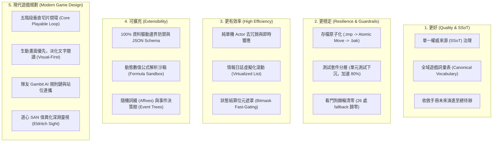
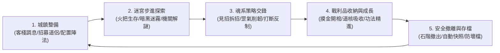

# 專案文檔體系、系統架構與現代遊戲規劃深度審查報告 (Claude Review)

> **審查日期**：2026-10-20  
> **審查基準**：全專案 324 項單元與整合測試 100% 綠燈通過、Java 25 (Preview)、Spring Boot 4.1.1、Vanilla ES6 前端。  
> **審查範圍**：
> 1. 根目錄三大核心架構文件：[`ARCHITECTURE.md`](file:///c:/Workspace/my_practice/practice_mud/ARCHITECTURE.md)、[`GEMINI.md`](file:///c:/Workspace/my_practice/practice_mud/GEMINI.md)、[`ACTIVE_TASKS.md`](file:///c:/Workspace/my_practice/practice_mud/ACTIVE_TASKS.md)（含對照 [`CHANGELOG.md`](file:///c:/Workspace/my_practice/practice_mud/CHANGELOG.md)、[`README.md`](file:///c:/Workspace/my_practice/practice_mud/README.md)）。
> 2. `docs/` 完整體系：概覽層（[`docs/overview/`](file:///c:/Workspace/my_practice/practice_mud/docs/overview/) 5 篇）、手冊層（[`docs/manual/`](file:///c:/Workspace/my_practice/practice_mud/docs/manual/) 16 篇）、長遠藍圖（[`docs/plans/FUTURE_IMPROVEMENTS.md`](file:///c:/Workspace/my_practice/practice_mud/docs/plans/FUTURE_IMPROVEMENTS.md)）、參考素材庫（[`docs/references/`](file:///c:/Workspace/my_practice/practice_mud/docs/references/)）、靜態範本（[`docs/templates/`](file:///c:/Workspace/my_practice/practice_mud/docs/templates/)）與 [`docs/UI_PAGE_STRUCTURE.md`](file:///c:/Workspace/my_practice/practice_mud/docs/UI_PAGE_STRUCTURE.md)。
> 3. 後端原始碼與前端實況交叉校驗（包含實體模型、Enum 定義、WebSocket、排程週期、靜態資源目錄）。  
> **文件定位**：本文件作為整合架構評估與演進指引報告，收錄於 `docs/references/`，供後續文件治理、代碼重構與玩法迭代對齊決議。

---

## 📌 目錄 (Table of Contents)

1. [執行摘要與總體評估](#1-執行摘要與總體評估)
2. [實地代碼與文檔交叉校驗：現存脫節與矛盾盤點](#2-實地代碼與文檔交叉校驗現存脫節與矛盾盤點)
3. [五大向度深度重構與優化建議](#3-五大向度深度重構與優化建議)
   - [3.1 更好 (Higher Quality)：權威來源收斂與詞彙分層治理](#31-更好-higher-quality權威來源收斂與詞彙分層治理)
   - [3.2 更穩定 (More Resilient)：防損存檔、門禁機制與測試分層](#32-更穩定-more-resilient防損存檔門禁機制與測試分層)
   - [3.3 更有效率 (High Efficiency)：單機性能優化、零 GC 與虛擬滾動](#33-更有效率-high-efficiency單機性能優化零-gc-與虛擬滾動)
   - [3.4 可擴充 (Extensible)：純資料驅動邊界、公式引擎與驗證體系](#34-可擴充-extensible純資料驅動邊界公式引擎與驗證體系)
   - [3.5 更適合現代遊戲規劃 (Modern Game Design)：沉浸博弈與單機單體玩法深耕](#35-更適合現代遊戲規劃-modern-game-design沉浸博弈與單機單體玩法深耕)
4. [核心檔案具體修訂建議對照表](#4-核心檔案具體修訂建議對照表)
5. [分階段實施路線圖 (P0 ~ P3)](#5-分階段實施路線圖-p0--p3)

---

## 1. 執行摘要與總體評估

本專案具備罕見且高水準的文檔體系，從憲法（`GEMINI.md`）、架構藍圖（`ARCHITECTURE.md`）、迭代看板（`ACTIVE_TASKS.md`）到 16 本深入模組手冊，展示了嚴格的規範意識。特別是近期推進的 **「純單機單體化演進戰略 (Single-Player Monolith Transition / Path X)」**，成功斬斷了諸多歷史遺留的多人 MUD 假帳與膠水代碼，全專案達到 324 項測試 100% 綠燈的健康基準。

然而，隨著快速迭代，專案出現了典型的「**文檔膨脹與實作漂移 (Documentation Drift)**」：
1. **事實脫節**：代碼已經重構或刪除的類別（例如 SP-07 刪除的 `SkillBridgeService`、`SaveData` 升級為 v3、`MudContext` 升級為 `ScopedValue`），在多份架構文件與模組手冊中仍作為核心概念被詳細描述。
2. **多頭馬車與重複維護**：16 本模組手冊各自維護冗長的「未來演進規劃」，與總待辦 [`FUTURE_IMPROVEMENTS.md`](file:///c:/Workspace/my_practice/practice_mud/docs/plans/FUTURE_IMPROVEMENTS.md) 嚴重重複，造成數值與路徑不同步。
3. **概念混淆**：五行天道靈氣（元素家族）、`DamageType`（底層傷害類型）、狀態標籤（Status Tags）與 Buff 分類在各手冊間缺乏統一字典。
4. **前端實作與文檔存在落差**：文檔描述了完善的 `websocket.js` 指數退避重連與 15 秒保活 Ping，但目前前端實際是由 `index.html` 的內嵌 `<script>` 建立原始 WebSocket，重連代碼被註解，且無 Ping 機制。

本報告針對上述痛點，提出具體修訂對策，推動文檔體系邁向「簡練、可信、自洽、指導性強」的現代商業遊戲規格。

---

## 2. 實地代碼與文檔交叉校驗：現存脫節與矛盾盤點

經由靜態分析與原始碼深度檢索，以下為目前文檔與程式庫實際狀態的關鍵矛盾對照：

| 檢驗項目 | 代碼庫實際現況 (Ground Truth) | 文檔中之記載描述 | 衝突位置與影響評估 |
| :--- | :--- | :--- | :--- |
| **技能橋接服務** | **已物理刪除** [`SkillBridgeService.java`](file:///c:/Workspace/my_practice/practice_mud/src/main/java/com/example/htmlmud/domain/service/)（於 SP-07 完成除役，改為 [`UnifiedSkill`](file:///c:/Workspace/my_practice/practice_mud/src/main/java/com/example/htmlmud/domain/party/model/UnifiedSkill.java) 原地結算） | 仍列為核心服務與縮放機制：<br>• [`ARCHITECTURE.md:119`](file:///c:/Workspace/my_practice/practice_mud/ARCHITECTURE.md#L119)<br>• [`MODULES_MAP.md:125`](file:///c:/Workspace/my_practice/practice_mud/docs/overview/MODULES_MAP.md#L125)<br>• [`後端_M5:27`](file:///c:/Workspace/my_practice/practice_mud/docs/manual/後端_M5_技能境界與修煉模組_SKILL_AND_PROGRESSION.md#L27) | **高危**。讀者與新進 AI 會誤以為存在該類別，試圖修改或呼叫不存在的方法。 |
| **上下文機制** | [`MudContext.java`](file:///c:/Workspace/my_practice/practice_mud/src/main/java/com/example/htmlmud/domain/context/MudContext.java) 全面採用 **Java 25 `ScopedValue`**：<br>`public static final ScopedValue<Player> CURRENT_PLAYER = ScopedValue.newInstance();` | [`後端_M9:48`](file:///c:/Workspace/my_practice/practice_mud/docs/manual/後端_M9_虛擬執行緒Actor通訊模組_ACTOR_AND_PROTOCOL.md#L48) 記載為「專案提供 `MudContext`（基於 `InheritableThreadLocal`）」 | **中危**。技術規格滯後，未能反映專案在 Java 25 現代特性上的演進成果。 |
| **存檔版本治理** | [`SaveData.java:21`](file:///c:/Workspace/my_practice/practice_mud/src/main/java/com/example/htmlmud/domain/save/model/SaveData.java#L21) 之 `CURRENT_SCHEMA_VERSION = 3`（SP-03 移除了 `personalInventory` 雙寫） | • [`後端_M8:41`](file:///c:/Workspace/my_practice/practice_mud/docs/manual/後端_M8_存檔與歷史快照模組_SAVE_AND_PERSISTENCE.md#L41) 範例 JSON 仍寫 `"schemaVersion": 2`<br>• [`ARCHITECTURE_SUMMARY.md:94`](file:///c:/Workspace/my_practice/practice_mud/docs/overview/ARCHITECTURE_SUMMARY.md#L94) 記載遷移為（v0 $\to$ v1 $\to$ v2） | **中危**。存檔遷移管線已實作 2 $\to$ 3 遷移，手冊未同步更新至 v3。 |
| **小隊行囊容量** | [`PartyInventory.java:16`](file:///c:/Workspace/my_practice/practice_mud/src/main/java/com/example/htmlmud/domain/party/model/PartyInventory.java#L16) 定義 `DEFAULT_CAPACITY = 30;` | • [`ACTIVE_TASKS.md:12`](file:///c:/Workspace/my_practice/practice_mud/ACTIVE_TASKS.md#L12) 宣稱「確立小隊 40 格行囊為唯一真實載體」<br>• [`後端_M1:79`](file:///c:/Workspace/my_practice/practice_mud/docs/manual/後端_M1_探索與世界模組_WORLD_AND_EXPLORATION.md#L79) 亦寫「40 格小隊公共儲物袋」<br>• M6 / FE-5 / ARCHITECTURE 則寫 30 格 | **中危**。數值標準不一，造成玩法平衡與測試斷言混亂。應統一確定為 30 格或 40 格並全域同步。 |
| **裝備槽位枚舉** | 代碼枚舉為 [`EquipmentSlot.java`](file:///c:/Workspace/my_practice/practice_mud/src/main/java/com/example/htmlmud/domain/model/enums/EquipmentSlot.java)：<br>`MAIN_HAND, OFF_HAND, HEAD, BODY, FEET, ACCESSORY_1, ACCESSORY_2` (5+2 結構) | • [`後端_M6:40`](file:///c:/Workspace/my_practice/practice_mud/docs/manual/後端_M6_物品背包與經濟模組_ITEM_AND_ECONOMY.md#L40) 寫成 `EquipSlot`（`ACCESSORY`, `RING`）<br>• [`UI_PAGE_STRUCTURE.md:324`](file:///c:/Workspace/my_practice/practice_mud/docs/UI_PAGE_STRUCTURE.md#L324) 亦使用舊版符號 | **中危**。不符合第一紅線（不可推測、嚴格枚舉對齊），手冊枚舉名稱與代碼脫節。 |
| **傷害類型與五行** | [`DamageType.java`](file:///c:/Workspace/my_practice/practice_mud/src/main/java/com/example/htmlmud/domain/model/enums/DamageType.java) 具備 20 種繼承樹枚舉（包含 `PHYSICAL` 派生與 `MAGIC` 派生） | • [`後端_M3:96`](file:///c:/Workspace/my_practice/practice_mud/docs/manual/後端_M3_核心戰鬥引擎模組_COMBAT_ENGINE.md#L96) 稱「九大傷害類型」<br>• [`後端_M3-1:195`](file:///c:/Workspace/my_practice/practice_mud/docs/manual/後端_M3-1_狀態效果與Buff結算模組_BUFF_AND_STATUS_EFFECTS.md#L195) 稱「九大天道靈氣」<br>• 多處將傷害類型、元素家族與抗性混為一談 | **中危**。缺乏抽象分層，混淆了「物理/法術/真實」等傷害分類與「金木水火土風雷陰陽」元素屬性。 |
| **戰鬥迴圈週期** | • [`DrpgCombatLoop.java:585`](file:///c:/Workspace/my_practice/practice_mud/src/main/java/com/example/htmlmud/domain/dungeon/battle/DrpgCombatLoop.java#L585) 實際每輪執行 `Thread.sleep(500);`<br>• [`ActiveBuff.java:41`](file:///c:/Workspace/my_practice/practice_mud/src/main/java/com/example/htmlmud/domain/dungeon/battle/ActiveBuff.java#L41) 基準為 1 Tick = 500ms<br>• [`WorldPulse.java:30`](file:///c:/Workspace/my_practice/practice_mud/src/main/java/com/example/htmlmud/infra/server/WorldPulse.java#L30) 為 `@Scheduled(fixedRate = 100)` | • 文檔多處（M3, M4, ARCHITECTURE）宣稱「半即時迴圈基於 200ms Tick 頻率推進戰鬥時間線」<br>• M1 稱「WorldPulse 世界心跳 3秒/Tick」 | **低危**。排程語意模糊，未清楚區分底層伺服器排程（100ms）、戰鬥迴圈（500ms）、Buff 心跳（500ms）與世界生靈心跳（3s）。 |
| **前端通訊架構** | 實際連線位於 [`index.html:668-700`](file:///c:/Workspace/my_practice/practice_mud/src/main/resources/static/index.html#L668-L700) 內嵌 `<script>`，重連邏輯被註解，無 Ping 心跳 | • [`前端_FE1:90`](file:///c:/Workspace/my_practice/practice_mud/docs/manual/前端_FE1_核心狀態與事件管線_CORE_STATE_AND_PIPELINE.md#L90) 宣稱存在獨立模組 `network/websocket.js`<br>• 宣稱實作 15s 文字 Ping 與指數退避重連 | **中危**。文檔描述了理想目標（FE-1 規範），但實際程式尚未抽離獨立成檔，且容錯重連被註解。 |
| **測試數量基準** | 全專案實際測試數量為 **324 項測試**（78 個測試類別，全數通過） | • [`GEMINI.md:144`](file:///c:/Workspace/my_practice/practice_mud/GEMINI.md#L144) 記載為 304 項<br>• [`QUICKSTART.md:33`](file:///c:/Workspace/my_practice/practice_mud/docs/overview/QUICKSTART.md#L33) 記載為 304 項<br>• 僅 [`ACTIVE_TASKS.md`](file:///c:/Workspace/my_practice/practice_mud/ACTIVE_TASKS.md) 正確記載為 324 項 | **低危**。易變數值未快照化，多份文件數字滯後。 |
| **樣式檔案現況** | 根目錄 `static/css/` 仍殘留 122 KB 之巨石 [`style.css`](file:///c:/Workspace/my_practice/practice_mud/src/main/resources/static/css/style.css)；另外存在 4 個 legacy HTML 檔 | • [`index.html`](file:///c:/Workspace/my_practice/practice_mud/src/main/resources/static/index.html) 實際已使用 `style-01` ~ `style-07`<br>• 手冊 FE-6 將樣式拆分表述為 6 個模組與 7 層樣式流兩種說法 | **低危**。舊檔案未除役增加混淆，術語需統一。 |

---

## 3. 五大向度深度重構與優化建議

為解決上述問題，並契合「純單機單體暗黑修仙 DRPG」的定位，建議從以下五大向度進行文檔與架構治理：



---

### 3.1 更好 (Higher Quality)：權威來源收斂與詞彙分層治理

#### 1. 貫徹單一權威來源 (SSoT) 治理原則
文檔體系龐大時，最大的敵人是「在多處記錄同一個事實」。必須嚴格確立權限分界：
- **專案憲法**：[`GEMINI.md`](file:///c:/Workspace/my_practice/practice_mud/GEMINI.md) 僅存放不可動搖的第一紅線、不可刪除保護鎖、全域開發約束與按需載入矩陣。
- **當前看板**：[`ACTIVE_TASKS.md`](file:///c:/Workspace/my_practice/practice_mud/ACTIVE_TASKS.md) 是唯一執行中的微任務清單，保持精簡，任務完成即行歸檔。
- **架構規格**：[`ARCHITECTURE.md`](file:///c:/Workspace/my_practice/practice_mud/ARCHITECTURE.md) 是現行系統架構唯一來源。
- **模組手冊**：[`docs/manual/`](file:///c:/Workspace/my_practice/practice_mud/docs/manual/) 專注於「已實作且已驗證」的模組行為、API、DTO 與欄位說明，**徹底移除各手冊末尾長達數百行的「未來架構演進規劃」**，將候選提案統一收攏至總待辦。
- **待辦武器庫**：[`docs/plans/FUTURE_IMPROVEMENTS.md`](file:///c:/Workspace/my_practice/practice_mud/docs/plans/FUTURE_IMPROVEMENTS.md) 是所有長期待辦與未決議提案的唯一載體。

#### 2. 建立「全域遊戲詞彙表 (Canonical Vocabulary)」消除歧義
在 `docs/overview/` 新增或於 `ARCHITECTURE.md` 確立權威詞彙映射表，徹底消滅跨文件術語矛盾：

```
【傷害類型 DamageType】（物理/法術/真實分類）
  ├── PHYSICAL (實體物理): SLASH (揮砍), PIERCE (穿刺), BLUNT (鈍擊), METAL (金石)
  ├── MAGIC (靈氣道法): FIRE, ICE, WATER, LIGHTNING, WIND, EARTH, WOOD, POISON, HOLY/LIGHT, DARK/CORRUPT
  └── TRUE (天道真實傷害，穿透護甲抗性)

【天道元素家族 (九大靈氣)】（戰鬥抗性、生剋與逆流回血維度）
  ├── 五行天道: 金 (Metal)、木 (Wood)、水 (Water)、火 (Fire)、土 (Earth)
  ├── 乾坤氣象: 風 (Wind)、雷 (Lightning)
  └── 陰陽造化: 陰煞 (Dark/Corrupt)、純陽 (Holy/Light)

【狀態效果標籤 StatusTags】（技能機制判定）
  └── INTERRUPT, STUN, SILENCE, PARRY, CLEANSE, TAUNT, DISPEL

【狀態分類 BuffCategory】（生命週期與結算邏輯）
  └── SHIELD (護盾), HOT (持續治療), DOT (持續傷害), STAT_MODIFIER (屬性修正), CONTROL (控場門控)
```

#### 3. 前端術語三維度標準化
文檔在描述前端時，嚴格杜絕混用「模組」二字：
- **JS 核心模組 (6 大模組)**：`app.js`, `store.js`, `town-panel.js`, `dungeon-panel.js`, `battle-panel.js`, `party-modal.js`。
- **畫面視覺區塊 (7 大 Panels)**：`#top-nav-bar` (Header), `#town-nav-panel`, `#dungeon-radar-panel`, `#battle-arena-panel`, `#party-hud-dock`, `#log` (Terminal), `footer` (ActionBar)。
- **樣式串流 (7 層 CSS)**：`style-01-tokens` 至 `style-07-battle-fx`。

---

### 3.2 更穩定 (More Resilient)：防損存檔、門禁機制與測試分層

#### 1. 檔案式存檔原子寫入與崩潰防禦 (Atomic Save & Crash Guard)
目前單機存檔直接寫入 `saves/slot_*.json`。面對現代單機遊戲玩家突發斷電、強制關閉處理程序等場景，必須落盤標準的三步原子保護機制：
1. **寫入臨時檔**：先將序列化字串寫入 `saves/slot_X.json.tmp`。
2. **驗證完整性**：確認 JSON 語法閉合且結尾包含預期標記。
3. **OS 級原子替換**：調用 `java.nio.file.Files.move(tmp, target, StandardCopyOption.ATOMIC_MOVE, StandardCopyOption.REPLACE_EXISTING)`，並將原檔案移至 `slot_X.json.bak`。
4. **自動修復管線**：開機或讀檔時若偵測到主檔損壞（0 位元組或解析失敗），無縫回滾讀取 `.bak`，並在 HUD 提示玩家「已自備份恢復進度」。

#### 2. 測試工程分層加速 (Test Suite Tiering)
目前專案擁有 324 項測試，其中有 48 個測試類別標註了重量級的 `@SpringBootTest`。每次執行完整測試耗時達 25 秒以上，影響 TDD 節奏：
- **下沉純領域測試 (Fast Domain Tests)**：
  戰鬥圓桌判定（`DefenseResolver`）、傷害抗性結算（`CombatRules`）、經驗值公式（`XpProgressionService`）、陣法孔位運算（`FormationEngine`）、Gambit AI 邏輯等純數學與純物件模型，**全面改寫為純 JUnit 5 單元測試**（不啟動 Spring Context），反饋時間壓低至 1~2 秒。
- **保留整合測試 (Integration Tests)**：
  僅 WebSocket 連線、資料庫持久化、開機啟動校驗保留 `@SpringBootTest`。

#### 3. 看門狗門禁棘輪清零 (Ratchet Zeroing)
目前 [`ArchitectureGuardrailsTest.java`](file:///c:/Workspace/my_practice/practice_mud/src/test/java/com/example/htmlmud/domain/validation/ArchitectureGuardrailsTest.java) 鎖定了 26 處 `new TemplateCatalog()` 的靜默 fallback 基準。
- 建議在 Milestone 3 中透過 Spring 建構子依賴注入將該上限逐步壓減至 **0 處**，杜絕代碼在庫中存在任何靜默容錯的空 Catalog 實例。

---

### 3.3 更有效率 (High Efficiency)：單機性能優化、零 GC 與虛擬滾動

#### 1. 單機虛擬執行緒 Actor 去冗餘與超低延遲
在純單機單體架構下，世界只存在唯一的玩家小隊：
- **消除多人廣播負擔**：SP-04 已將 `Room.players` 重構為單一引用 `Player protagonist`，後續應將全域事件廣播直接改為單一引用通知，杜絕 `foreach` 遍歷與集合複製。
- **無鎖化狀態讀取**：單機 WebSocket 推送全景狀態 `DrpgStateDto` 時，直接自記憶體模型讀取不可變 Record 快照，避免鎖爭奪。

#### 2. 前端情報日誌虛擬滾動 (Virtualized Log Scrolling)
目前情報日誌為了防止記憶體膨脹，強制限制保留 200 行（`MAX_LOG_HISTORY_LINES = 200`），導致長時間冒險的歷史訊息遺失：
- **引入 Virtualized DOM 渲染**：利用純 Vanilla JS 計算滾動容器高度，僅在 DOM 中掛載目前可視區域的 30~40 個 `<div>` 節點。記憶體佔用固定，且支援玩家回溯翻閱成千上萬行探險紀錄。

#### 3. 戰鬥結算位元遮罩與零 GC 設計
高頻戰鬥迴圈（500ms Tick）在多個敵我單位同時存在時，頻繁的物件配置會引起 JVM Minor GC 微幅卡頓：
- **位元遮罩快速門控 (Bitmask Gating)**：在生靈模型引入 `long statusFlags`，使用 `(statusFlags & MASK_CONTROLLED) != 0` 取代遍歷 `activeBuffs` List，將控場判定加速至 1 奈秒以內。
- **不可變事件複用**：戰鬥飄字與結算事件採用不可變 Record，避免短命物件產生。

---

### 3.4 可擴充 (Extensible)：純資料驅動邊界、公式引擎與驗證體系

#### 1. 守護 100% 資料驅動第一紅線 (Data-Driven Guardrails)
專案第一紅線嚴禁硬編碼。所有關卡、怪物、技能、裝備、數值一律由 `src/main/resources/data/**/*.json` 驅動：
- **新增內容 SOP 嚴格檢驗**：擴充任何新技能、新樓層或新夥伴時，嚴格遵守「只需新增 JSON 配置，零 Java 代碼改動」。
- **開機強校驗升級**：升級 [`DataIntegrityValidator`](file:///c:/Workspace/my_practice/practice_mud/src/main/java/com/example/htmlmud/domain/validation/DataIntegrityValidator.java)，增加地牢圖例、掉落物存在性、技能標籤合法性的雙向驗證，任何斷鏈於啟動時 Fail-Fast 報錯。

#### 2. 安全公式解析沙箱 (Formula Evaluation)
目前技能威力與成長主要由固定倍率計算。若未來支援更豐富的修仙百藝或裝備詞綴：
- 引入安全、預編譯的抽象語法樹（AST）輕量表達式引擎，將 JSON 中的 `"120 + 0.35 * Caster.SPI + 0.20 * Target.CON"` 在開機時預編譯為委派，兼顧資料擴充彈性與運算極速。

#### 3. 隨機古神詞綴體系 (Procedural Affixes)
為增加地牢探索與刷寶的長線耐玩度：
- 在 JSON 定義前綴庫（`affix_prefix.json`）與後綴庫（`affix_suffix.json`）。地牢掉落裝備時動態組合生成，無需為每把武器獨立建立 Java 類別或靜態設定檔。

---

### 3.5 更適合現代遊戲規劃 (Modern Game Design)：沉浸博弈與單機單體玩法深耕

#### 1. 核心五階段垂直切片閉環 (Core Playable Loop)
現代單機遊戲必須具備高度可玩、反饋即時的體驗閉環。所有系統開發皆應圍繞以下核心循環展開：



每一階段必須具備清晰的：**玩家目標**、**操作選擇**、**失敗代價** 與 **視覺反饋**。

#### 2. 生動畫面呈現，徹底淡化文字訊息依賴 (Visual-First UI/UX)
本專案的現代化核心願景是由「文字 MUD」全面轉化為「生動沉浸的視覺化 DRPG」：
- **後端推送結構化事件**：所有戰況（命中、閃避、破防、打斷、五行逆流）皆以 DTO 事件形式推送，前端透過專屬動畫、打擊飄字（FCT）與螢幕微震呈現，**嚴禁依賴玩家閱讀右側文字 Log 來獲知戰況**。
- **敵方行動預告可讀性**：
  怪物在釋放毀滅性絕技前，展開 2~3 秒的青藍/猩紅蓄力條（Telegraph Bar），明確標註「可打斷（Interruptible）」，給予玩家極致的見招拆招博弈成就感。
- **簡化情報日誌**：文字 Log 回歸單行乾淨提示（如：`🚶 小隊向東穿過石廊，抵達【廢棄礦道】。`），杜絕多行 ASCII 表格刷屏。

#### 3. 隊友 Gambit 戰術方針 AI (減輕 5 人小隊操作負擔)
借鑒《Final Fantasy XII》與《暗黑地牢》：
- 玩家掌控主角核心操作，其餘 4 名招募夥伴（鐵牛、凌霜、燕青、墨衍）由宣告式 Gambit 規則鏈自主驅動（例如：`隊友血量 < 35% -> 施展回春術`；`目標處於蓄力吟唱中 -> 施展太白斷空打斷技`）。
- 既保有 5 人小隊的大規模協同深度，又杜絕單人操作 5 名角色的微操手忙腳亂。

#### 4. 道心理智 (SAN 值) 異化深淵靈視
突破傳統 RPG 僅將 SAN 值作為負面懲罰條的陳舊設計：
- 當 SAN 值跌破 30% 時，觸發「不可名狀靈視」：介面呈現暗紫低語與視角畸變，怪物攻擊狂暴化，**但能看見一般狀態下隱形的古修士道藏暗門、隱蔽寶箱與太古神兵**！讓玩家在「理智安全」與「瘋狂貪婪」之間進行心理博弈。

---

## 4. 核心檔案具體修訂建議對照表

為便於後續將建議精確落地，以下為指定關鍵檔案的具體修訂指示清單：

| 檔案路徑 | 當前存在問題 | 建議具體修訂方向 |
| :--- | :--- | :--- |
| [`ARCHITECTURE.md`](file:///c:/Workspace/my_practice/practice_mud/ARCHITECTURE.md) | 1. 第 119 行仍列出已刪除的 `SkillBridgeService`。<br>2. 戰鬥迴圈標註為 200ms，未釐清與 500ms Tick 之關係。<br>3. 歷史文字仍殘留部分雙軌術語。 | 1. 刪除 `SkillBridgeService` 引用，改為標註 `UnifiedSkill` 模型。<br>2. 澄清排程層次（WorldPulse 100ms/3s, CombatLoop 500ms, Buff 500ms）。<br>3. 在章節 6 明確標註 SP-01 ~ SP-07 之收斂成果。 |
| [`GEMINI.md`](file:///c:/Workspace/my_practice/practice_mud/GEMINI.md) | 1. 第 144 行測試基準記載為 304 項（現為 324 項）。<br>2. 模組載入矩陣第 113 行仍提及 `SkillBridgeService`。 | 1. 更新測試基準數字為 324 項（附帶 2026-10-20 基準日期）。<br>2. 移除技能橋接膠水代碼指針，指引至 `PartyMember.skills`。 |
| [`ACTIVE_TASKS.md`](file:///c:/Workspace/my_practice/practice_mud/ACTIVE_TASKS.md) | 1. 第 12 行宣稱小隊「40 格公共行囊」，與代碼 `DEFAULT_CAPACITY = 30` 矛盾。<br>2. 當前焦點 SP-08 (戰鬥引擎大一統) 與 SP-09 (共享金庫) 待推進。 | 1. 決定將容量統一（若定為 40 格，則同步修改代碼常數；若為 30 格則修正看板）。<br>2. 維持 Checkbox 微任務推進模式，完成 SP-08 與 SP-09。 |
| [`docs/manual/後端_M5_...md`](file:///c:/Workspace/my_practice/practice_mud/docs/manual/後端_M5_技能境界與修煉模組_SKILL_AND_PROGRESSION.md) | 1. 全篇核心章節二大量引用 `SkillBridgeService.scaleSkill()`。<br>2. 末尾包含冗長的未來規劃。 | 1. 全面重構章節二，改為介紹 `UnifiedSkill` 與 `PartyMemberSkill` 的內聚升級與動態威力縮放。<br>2. 將未來演進章節收斂至 `FUTURE_IMPROVEMENTS.md`。 |
| [`docs/manual/後端_M6_...md`](file:///c:/Workspace/my_practice/practice_mud/docs/manual/後端_M6_物品背包與經濟模組_ITEM_AND_ECONOMY.md) | 1. 裝備槽位枚舉寫成 `EquipSlot`（`ACCESSORY`, `RING`），與代碼 `EquipmentSlot`（`ACCESSORY_1`, `ACCESSORY_2`）脫節。 | 1. 更正為代碼真實枚舉 `EquipmentSlot`。<br>2. 更新 5+2 裝備結構說明與雙飾品欄位語意。 |
| [`docs/manual/後端_M8_...md`](file:///c:/Workspace/my_practice/practice_mud/docs/manual/後端_M8_存檔與歷史快照模組_SAVE_AND_PERSISTENCE.md) | 1. 範例 JSON 仍寫 `"schemaVersion": 2`，漏掉 2 $\to$ 3 遷移說明。<br>2. 仍殘留個人背包雙寫描述。 | 1. 更新範例至 `schemaVersion: 3`，移除 `personalInventory`。<br>2. 補充 `SaveMigrationPipeline` 之 2 $\to$ 3 遷移說明。 |
| [`docs/manual/後端_M9_...md`](file:///c:/Workspace/my_practice/practice_mud/docs/manual/後端_M9_虛擬執行緒Actor通訊模組_ACTOR_AND_PROTOCOL.md) | 1. 第 48 行記載 `MudContext` 使用 `InheritableThreadLocal`。 | 1. 更新為 Java 25 現代特性 `ScopedValue<Player> CURRENT_PLAYER`。<br>2. 說明 `ScopedValue.runWhere(...)` 之安全無洩漏生命週期。 |
| [`docs/manual/前端_FE1_...md`](file:///c:/Workspace/my_practice/practice_mud/docs/manual/前端_FE1_核心狀態與事件管線_CORE_STATE_AND_PIPELINE.md) | 1. 描述了獨立的 `websocket.js` 模組，但實際上位於 `index.html` 內嵌腳本中。 | 1. 標註現狀與重構目標：排期將 `index.html` 內嵌之 WebSocket 腳本徹底抽離為獨立的 ES6 模組 `static/js/network/websocket.js`，並解除重連代碼註解。 |
| [`docs/overview/MODULES_MAP.md`](file:///c:/Workspace/my_practice/practice_mud/docs/overview/MODULES_MAP.md) | 1. 第 125 行、第 243 行仍提及 `SkillBridgeService`。<br>2. 前端模組路徑部分未反映最新拆分檔案。 | 1. 移除過期膠水服務引用。<br>2. 更新端到端流程中的時序步驟。 |
| [`docs/plans/FUTURE_IMPROVEMENTS.md`](file:///c:/Workspace/my_practice/practice_mud/docs/plans/FUTURE_IMPROVEMENTS.md) | 1. 體積高達 159 KB (1,390 行)，章節結構深。<br>2. 歷史完成項目佔比大（§0 ~ §8, §12, §14 大部分已完成）。 | 1. 將已完成的歷史 Phase 移至 `CHANGELOG.md` 歸檔，維持總待辦之精簡專注。<br>2. 統一各子項格式：唯一 ID、玩家/工程問題、驗收標準 (DoD)。 |
| [`docs/templates/game-config-architecture.txt`](file:///c:/Workspace/my_practice/practice_mud/docs/templates/game-config-architecture.txt) | 早期草稿，包含 Groovy/Lua 腳本、多區域頻道等已除役概念。 | 在文檔頂部加入明確的「【歷史草稿／非現行規範】」標籤，避免誤導開發者。 |

---

## 5. 分階段實施路線圖 (P0 ~ P3)

依據影響程度與投資報酬率，建議依照以下四個階段有序推進改善：

```
┌────────────────────────────────────────────────────────┐
│ Phase P0: 消除事實脫節與代碼死引用 (Immediate Fixes)    │
│ • 清除文檔中 SkillBridgeService 殘留                   │
│ • 更新 MudContext 為 ScopedValue                       │
│ • 同步 SaveData schemaVersion = 3                      │
│ • 校準全域測試數量基準 (324 項全綠)                    │
└───────────────────────────┬────────────────────────────┘
                            │
                            ▼
┌────────────────────────────────────────────────────────┐
│ Phase P1: 契約一致性與關鍵防線健全 (Consistency & Guard)│
│ • 統一小隊行囊容量常數 (確定 30 或 40 格並同步)         │
│ • 校正手冊 EquipmentSlot 枚舉 (MAIN_HAND, ACCESSORY_1/2)│
│ • 建立全域遊戲詞彙表 (DamageType vs 九大靈氣 vs 狀態)  │
│ • 實裝存檔原子替換 (.tmp -> move -> .bak) 寫入保護     │
│ • 前端 WebSocket 抽離獨立成檔並實裝斷線重連            │
└───────────────────────────┬────────────────────────────┘
                            │
                            ▼
┌────────────────────────────────────────────────────────┐
│ Phase P2: 文檔精簡與架構現代化收斂 (Streamlining)       │
│ • 將 16 本模組手冊未來章節收斂至 FUTURE_IMPROVEMENTS  │
│ • 測試分層下沉：純演算法轉為純單元測試 (縮短至 2 秒)   │
│ • 實施 SP-08 (戰鬥引擎大一統) 與 SP-09 (共享金庫)       │
│ • 清理靜態目錄歷史巨石 style.css 與 legacy HTML 檔案   │
└───────────────────────────┬────────────────────────────┘
                            │
                            ▼
┌────────────────────────────────────────────────────────┐
│ Phase P3: 現代單機遊戲深度玩法落地 (Modern Game Depth)  │
│ • 夥伴 Gambit 規則鏈 AI 介面與資料驅動引擎             │
│ • 首領轉階段 (Boss Phases) 與敵方可讀蓄力打斷反制窗口   │
│ • 地牢火把光照生存資源博弈                             │
│ • 道心 SAN 值異化深淵靈視 (Eldritch Sight) 隱藏探索    │
└────────────────────────────────────────────────────────┘
```

---

## 6. 結語

本專案在單體模組化（Modular Monolith）、Java 25 現代特性運用、以及純單機 DRPG 玩法轉型上展現了極佳的工程底蘊。本次審查所指出的矛盾與漂移，是高速迭代過程中的自然現象。只要嚴格落實 **「單一權威來源 (SSoT)」**、**「清除過期膠水概念」**、**「對齊真實代碼枚舉」** 並圍繞 **「純單機小隊沉浸探索」** 深耕核心閉環，本專案必將成為兼具極致工程品質與豐富遊戲性的現代修仙 DRPG 典範之作。
