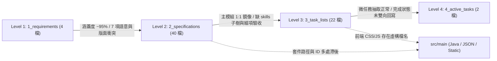

# 📑 `docs/` 四層級文件體系對齊度全量審查與改善建議報告

- **審查範圍**：`practice_mud/docs/` 目錄下排除 `0_archive/` 之全部 **71 份 Markdown 文件**（含 `docs/README.md`、`0_references/` 4 份報告、`1_requirements/` 4 份、`2_specifications/` 40 份、`3_task_lists/` 22 份、`4_active_tasks/` 2 份），並交叉核對根目錄 [`GEMINI.md`](../../GEMINI.md)、[`.agents/rules/documentation_alignment_guardrails.md`](../../.agents/rules/documentation_alignment_guardrails.md) 以及 `src/main/` 實體程式碼與靜態 JSON 資料。
- **自動化基準檢測**：
  - 內部連結腳本 [`check-doc-links.ps1`](../../scripts/check-doc-links.ps1)：**PASS**（共檢驗 498 條 Markdown 相對連結，0 斷鏈）。
  - 單檔行數守則（上限 300 行，高內聚特例 400 行）：**PASS**（最高為 [`M3_1_BUFF_AND_STATUS_EFFECTS.md`](../2_specifications/backend/M3_1_BUFF_AND_STATUS_EFFECTS.md) 共 391 行）。

> [!IMPORTANT]
> **總體結論：模組骨架與宏觀追溯已達 ~90% 對齊，但「跨層語意細節、Phase 3 重構後的套件/檔案路徑、17 專精樹新舊體系切換、以及 L3 ↔ L4 任務勾選同步」仍存在結構性漂移，尚未達到 100% 單一真相源（SSoT）閉環。**
> 相較於 `2026-10-23` 的歷史審查報告（[`Claude_Review.md`](./Claude_Review.md)），專案已大幅補齊 6 大營地設施、17 專精樹分檔、地牢存檔鎖/滅團結算規格及 R1~R11 追溯矩陣；然而在局部改寫與代碼 Package-by-Feature 重構後，出現了「新舊規格並存」與「文檔滯後於代碼」的新一輪落差。

---

## 🗺️ 一、四層級對齊現況總覽矩陣



| 檢驗維度 | 判定 | 核心現況摘要 |
| :--- | :---: | :--- |
| **1. `L2` 是否完整包含 `L1`？** | ⚠️ **宏觀涵蓋，局部衝突** | 五大支柱、6 大營地設施、17 專精樹、Poise 破防、40 格行囊、存檔安全鎖均已落入 L2；但 **PC 桌機版面出現 4 種衝突配置**、**手機底部 5 Tab 漏接**、**SAN 門檻與幻覺規則矛盾**、**道基五維縮寫分裂**、**強殖基因雙軌養成定位未明**。 |
| **2. `L2` 內部是否自洽無矛盾？** | ❌ **存在語法錯誤與契約分裂** | [`ITEM_SCHEMA.md`](../2_specifications/data_schemas/ITEM_SCHEMA.md#L63-L64) 漏寫 `},` 導致 JSON 無效；技能 `treeId`、合體技 `id` 與 `comboRole` 列舉在 L2 三處互異；[`M3`](../2_specifications/backend/M3_COMBAT_ENGINE.md#L84-L89) 與 [`M3_1`](../2_specifications/backend/M3_1_BUFF_AND_STATUS_EFFECTS.md#L128-L136) 破防減傷/時長數值衝突；Phase 3 重構後舊 `domain.*` 路徑大量殘留。 |
| **3. `L3` 是否完整包含 `L2`？** | ⚠️ **骨架 1:1，細項漏接與雙軌並存** | 10 後端 + 6 前端 + 3 Schema 均有對應清單與 R1~R11 矩陣；但 `skills/` 19 檔未納入目錄樹與鏡像表、舊「32 賽博天賦節點」與新「17 專精樹」並存、[`M3_1`](../3_task_lists/backend/M3_1_BUFF_AND_STATUS_TASKS.md) 漏列 DR 遞減與破防減傷、存在 L2 無依據之孤兒任務與虛構前端 CSS/JS 路徑。 |
| **4. `L4` 是否對齊 `L3` 與 `L1`？** | ⚠️ **部分脫節** | [`ACTIVE_TASKS.md`](../4_active_tasks/ACTIVE_TASKS.md#L40) 已勾選 `[x] Task 3 (VS-01-CYBER-SKILLS)`，但 L3 對應之 `Task M3-1` 與 `SKILL-SCHEMA-1` 仍為 `[ ]`；[`SPRINT_GOAL.md`](../4_active_tasks/SPRINT_GOAL.md#L32-L45) 仍寫舊版「16 項賽博技能」且正例違反 Option C 仙俠先行原則。 |
| **5. 文件與實體 Code/Data 對齊** | ⚠️ **路徑與檔名漂移** | 自動存檔檔名出現 `autosave.json`（實作）vs `slot_auto.json`（L2/L3）vs `slot_0`（L3）三種寫法；測試總數出現 `324` / `376+` / `388` / `395` 四種數字；根目錄 [`GEMINI.md`](../../GEMINI.md#L5) 存在 2 條失效路徑。 |

---

## 🔍 二、層級一檢驗：`2_specifications` (L2) 是否完整包含 `1_requirements` (L1)？

### ✅ 已完整承接並對齊之處（約 95% 核心業務域）
1. **營地六大機能設施與 Option C 認知透鏡**：L1 [`GAMEPLAY_CORE_LOOPS.md`](../1_requirements/GAMEPLAY_CORE_LOOPS.md#L44-L53) 定義的六大設施已於 L2 [`M1_TOWN_HUB_AND_FACILITIES.md`](../2_specifications/backend/M1_TOWN_HUB_AND_FACILITIES.md#L37-L87) §2.1~§2.7 完整規劃，且與實體資料 [`facilities.json`](../../src/main/resources/data/zones/newbie_village/facilities.json#L1-L189) 的 `<30% / 30%~70% / >70%` 三階 `lenses` 一致。
2. **四大淵源 × 17 專精技能樹與四階合體技**：L1 [`CYBERPUNK_CULTIVATION_SPEC.md`](../1_requirements/CYBERPUNK_CULTIVATION_SPEC.md#L35-L203) 的 17 棵樹（68 招主動 + 17 插槽）、16 雙星、8 三才、5 大四象領域與 15 種 5 人動態終結技，均已下沉至 `docs/2_specifications/skills/` 共 19 份規格檔。
3. **地牢探索、存檔鎖與滅團懲罰**：L1 [`GAMEPLAY_CORE_LOOPS.md`](../1_requirements/GAMEPLAY_CORE_LOOPS.md#L64-L66) 的火把視野、撤離點限制、地牢禁手動存檔與滅團遺失未鑑定戰利品，已由 [`M2_DRPG_DUNGEON.md`](../2_specifications/backend/M2_DRPG_DUNGEON.md#L45-L96) 與 [`M8_SAVE_AND_PERSISTENCE.md`](../2_specifications/backend/M8_SAVE_AND_PERSISTENCE.md#L72-L86) 完整承接。

### ❌ L1 → L2 的 7 項缺口與語意衝突

| 編號 | 問題主題 | L1 最高規範依據 | L2 規格漏接或衝突現況 |
| :---: | :--- | :--- | :--- |
| **G1-1** | **PC 桌機版面出現 4 套衝突規格** | [`UI_UX_REQUIREMENTS.md`](../1_requirements/UI_UX_REQUIREMENTS.md#L29-L44) §2：**左欄＝迷霧雷達與羅盤、中欄＝主視口、右欄＝5 人小隊、底欄＝唯讀敘事日誌**。 | ① [`FRONTEND_LAYOUT_GUIDE.md`](../2_specifications/frontend/FRONTEND_LAYOUT_GUIDE.md#L18-L36) 對齊 L1；<br>② [`FE2_DRPG_VIEWPORT_RENDERER.md`](../2_specifications/frontend/FE2_DRPG_VIEWPORT_RENDERER.md#L18-L19) 卻寫左為 `#dungeon-viewport`、右為 `#dungeon-radar`；<br>③ [`FE4_TOWN_HUB_AND_ACTION_BAR.md`](../2_specifications/frontend/FE4_TOWN_HUB_AND_ACTION_BAR.md#L108-L109) 寫**左側為敘事日誌**、底部為動作列；<br>④ [`UI_PAGE_STRUCTURE.md`](../2_specifications/frontend/UI_PAGE_STRUCTURE.md#L171) 仍寫日誌面板「**100% 全高貫通右舞台**」（舊 MUD 殘留）。 |
| **G1-2** | **手機直向底部 5 分頁常駐導航列漏接** | [`UI_UX_REQUIREMENTS.md`](../1_requirements/UI_UX_REQUIREMENTS.md#L48-L55) §3：要求底部常駐 Tab Bar（`【遠征】【小隊】【行囊】【技能】【存檔】`）與 120px 滑動日誌。 | 僅 [`FRONTEND_LAYOUT_GUIDE.md`](../2_specifications/frontend/FRONTEND_LAYOUT_GUIDE.md#L51) 概念提及，下游 [`FE4`](../2_specifications/frontend/FE4_TOWN_HUB_AND_ACTION_BAR.md)、[`FE5`](../2_specifications/frontend/FE5_PARTY_EQUIPMENT_AND_MODALS.md)、[`FE6`](../2_specifications/frontend/FE6_CSS_TOKENS_AND_THEMES.md) 皆無組件 DOM 契約、路由切換與響應式樣式規格。 |
| **G1-3** | **SAN 精神護盾門檻、狀態名與低 SAN 幻覺衝突** | [`GAMEPLAY_CORE_LOOPS.md`](../1_requirements/GAMEPLAY_CORE_LOOPS.md#L101) §5.1：錨定 Option A，僅在 **SAN 歸零**時附加單一輕度 Debuff `【精神萎靡】(-15% 傷害)`，無狂亂或侵入式干擾。 | ① [`M4_PARTY_AND_FORMATION.md`](../2_specifications/backend/M4_PARTY_AND_FORMATION.md#L66-L68) 多出 L1 未定義的 `SAN <= 25 【神識動搖 (WEAKENED)】(-10%)`，且將 `SAN = 0` 標為 `CHAOS`（與 [`M3_1`](../2_specifications/backend/M3_1_BUFF_AND_STATUS_EFFECTS.md#L293) 標為 `WEAKENED` 衝突）；<br>② [`M3`](../2_specifications/backend/M3_COMBAT_ENGINE.md#L232) 寫 `SAN < 30% 靈視視界畸變與滅團風險`、[`FE5`](../2_specifications/frontend/FE5_PARTY_EQUIPMENT_AND_MODALS.md#L34) 寫 `< 50% 精神震懾虛弱`；<br>③ [`MODULES_MAP.md`](../2_specifications/MODULES_MAP.md#L290-L291) 仍規劃「低 SAN 幻覺與偽裝寶箱怪」。 |
| **G1-4** | **「零打字指令／廢除方位出口」殘留破窗** | [`UI_UX_REQUIREMENTS.md`](../1_requirements/UI_UX_REQUIREMENTS.md#L14-L15) §1.2、[`GAMEPLAY_CORE_LOOPS.md`](../1_requirements/GAMEPLAY_CORE_LOOPS.md#L102) §5.2：100% 移除打字命令列與文字房間移動。 | ① [`FE2`](../2_specifications/frontend/FE2_DRPG_VIEWPORT_RENDERER.md#L86-L97) 仍寫「輸入 `leave` 指令」及發送字串指令 `step w` / `turn a`；<br>② [`FE1`](../2_specifications/frontend/FE1_CORE_STATE_AND_PIPELINE.md#L96-L102) 仍保留 `saves quiet` 字串通道與 ANSI 終端轉義解碼；<br>③ [`UI_PAGE_STRUCTURE.md`](../2_specifications/frontend/UI_PAGE_STRUCTURE.md#L95) 仍綁定 `` ` `` / `~` 呼叫 `#dev-console`；<br>④ [`FE6`](../2_specifications/frontend/FE6_CSS_TOKENS_AND_THEMES.md#L55) 仍將「四方出口網格按鈕 `.exit-btn`」列為城鎮樣式（直接違反 [`FE4`](../2_specifications/frontend/FE4_TOWN_HUB_AND_ACTION_BAR.md#L128) §6.1）。 |
| **G1-5** | **道基五維屬性縮寫在跨層間分裂** | [`GAMEPLAY_CORE_LOOPS.md`](../1_requirements/GAMEPLAY_CORE_LOOPS.md#L86-L90) §4：定義體質 `CON`、真元 `ESS`、神識 `SPI`、根骨 `STR`、身法 `DEX`。 | [`M4`](../2_specifications/backend/M4_PARTY_AND_FORMATION.md#L55) 與 [`M9`](../2_specifications/backend/M9_STATE_PIPELINE_AND_EVENTS.md#L123) 用 `AGI` 代表身法；[`M5`](../2_specifications/backend/M5_SKILL_AND_PROGRESSION.md#L37) 用 `SPI/PER`；[`M3_1`](../2_specifications/backend/M3_1_BUFF_AND_STATUS_EFFECTS.md#L386) 公式用 `Caster.WIS`；而 L4 [`ACTIVE_TASKS.md`](../4_active_tasks/ACTIVE_TASKS.md#L103) 前端實作則對齊為 `STR, CON, DEX, INT (真元), WIS (神識)`。 |
| **G1-6** | **主角「異形強殖基因覺醒」雙軌養成機制未定錨** | [`WORLD_AND_LORE_BIBLE.md`](../1_requirements/WORLD_AND_LORE_BIBLE.md#L64-L66) §4.2 與 [`GAMEPLAY_CORE_LOOPS.md`](../1_requirements/GAMEPLAY_CORE_LOOPS.md#L22) §1 Pillar 5 將「特工晶片加載 `12% → 100%`」與「微量異形強殖基因覺醒」並列為主角雙核心成長線。 | L2 僅為「特工晶片加載度 (`agentChipLoad`)」建立 [`CognitiveProxyService`](../../src/main/java/com/example/htmlmud/town/CognitiveProxyService.java) 與 DTO 欄位；「強殖基因覺醒」究竟是已併入第 14 樹 [`TREE_14_CHITIN_BLADE.md`](../2_specifications/skills/4_cthulhu/TREE_14_CHITIN_BLADE.md) + 道骨插槽，還是另有主角專屬覺醒槽位（如 [`SPRINT_GOAL.md`](../4_active_tasks/SPRINT_GOAL.md#L44) 所稱「微量強殖基因槽」），L2 [`M5`](../2_specifications/backend/M5_SKILL_AND_PROGRESSION.md) 未予明文裁決。 |
| **G1-7** | **Option C「仙俠先行（<30% 純仙俠）」在 L2 技能名與地牢資料輕微破功** | [`CYBERPUNK_CULTIVATION_SPEC.md`](../1_requirements/CYBERPUNK_CULTIVATION_SPEC.md#L6) 規定 UI 技能名稱一律採東方仙俠風格，突破 `>70%` 才揭示底層科技/代碼。 | ① L1/L2 的 [`TREE_10`](../2_specifications/skills/3_high_tech/TREE_10_TIME_OVERCLOCK.md#L24-L25) ~ [`TREE_13`](../2_specifications/skills/3_high_tech/TREE_13_KINETIC_RAILS.md#L22-L25) 及 [`TREE_17`](../2_specifications/skills/4_cthulhu/TREE_17_NULL_VOID.md#L23-L25) 在「仙俠正式名」欄位直接出現 `子彈時間`、`量子觀測`、`天道宕機`、`電磁`、`全息`、`記憶體洩漏`、`空指針`、`格式化` 等現代資訊詞彙；<br>② [`mozhu_mines_b1f.json`](../../src/main/resources/data/dungeons/mozhu_mines_b1f.json#L28-L83) 基礎地塊描述直接暴露「母神卵鞘偽地殼」、「外星生化腐殖」、「外神神經管道」，且 [`DUNGEON_SCHEMA.md`](../2_specifications/data_schemas/DUNGEON_SCHEMA.md) 未支援地塊 `lenses` 轉譯；<br>③ 序章第 3 階段在 [`WORLD_AND_LORE_BIBLE.md`](../1_requirements/WORLD_AND_LORE_BIBLE.md#L93-L95) 為「煉丹房反殺大師兄」，在 [`DUNGEON_SCHEMA.md`](../2_specifications/data_schemas/DUNGEON_SCHEMA.md#L175) 則改編為礦坑底層「虛月血肉祭壇·宋天衡」。 |

> [!NOTE]
> **關於 L1 自身的邊界衛生**：[`docs/README.md`](../README.md#L101) 規定 L1 嚴禁寫死具體程式類別與 JSON 欄位名，但 [`GAMEPLAY_CORE_LOOPS.md`](../1_requirements/GAMEPLAY_CORE_LOOPS.md#L18-L22) 仍直接寫入 `CombatRules`、`DrpgCombatLoop`、`party_skills.json`、`schemaVersion 3`，[`UI_UX_REQUIREMENTS.md`](../1_requirements/UI_UX_REQUIREMENTS.md#L68) 寫入 `.torch-darkness-vignette`，建議一併純化為概念術語或改為指向 L2 手冊連結。

---

## 🛠️ 三、層級二內部檢驗：`2_specifications` (L2) 自洽性與代碼真相源核對

### 1. 資料架構（Data Schemas）與技能子樹之內部契約分裂
- **JSON Schema 語法損毀**：[`ITEM_SCHEMA.md`](../2_specifications/data_schemas/ITEM_SCHEMA.md#L63-L64) 第 63 行 `"affixPool"` 結尾缺少 `},` 即直接接續第 64 行 `"lenses"`，非合法 JSON。
- **專精樹 `treeId` 雙重命名**：[`SKILL_SCHEMA.md`](../2_specifications/data_schemas/SKILL_SCHEMA.md#L47)（及 L171、L232、L250）使用簡寫 `tree_overclock`、`tree_chitin`、`tree_water`、`tree_fire`、`tree_wood`；但 [`M5_SKILL_AND_PROGRESSION.md`](../2_specifications/backend/M5_SKILL_AND_PROGRESSION.md#L50-L66)、[`SYNERGY_AND_COMBOS.md`](../2_specifications/skills/SYNERGY_AND_COMBOS.md#L181) 與 [`TREE_01` ~ `TREE_17`](../2_specifications/skills/README.md#L21-L37) 全部使用 `tree_time_overclock`、`tree_chitin_blade`、`tree_water_frost`、`tree_fire_flame`、`tree_wood_life`。
- **傳奇合體技 `id` 與數值出現「三方分歧」**：
  - 以【太極水火·兩儀陰陽寂滅印】為例：[`SKILL_SCHEMA.md`](../2_specifications/data_schemas/SKILL_SCHEMA.md#L225-L236) 寫 `"id": "combo_2p_taiji_water_fire"`（倍率 `2.0`）；[`SYNERGY_AND_COMBOS.md`](../2_specifications/skills/SYNERGY_AND_COMBOS.md#L175-L185) 寫 `"id": "combo_water_fire_taiji"`（倍率 `2.5`、`poiseDamage: 60`）；而實際 [`party_skills.json`](../../src/main/resources/data/party/party_skills.json#L3-L12) 主鍵卻是 `"combo_water_fire_taichi"`（透過 `aliases` 兼容 `taiji`）。
  - 四象領域【太乙混元·五行四象破天劍煞界】在 [`SKILL_SCHEMA.md`](../2_specifications/data_schemas/SKILL_SCHEMA.md#L259-L263) 為 `"domain_4p_elemental_cascade"`（消耗 `90`），在 [`SYNERGY_AND_COMBOS.md`](../2_specifications/skills/SYNERGY_AND_COMBOS.md#L210-L219) 為 `"domain_quad_celestial_blade"`（消耗 `100`）。
- **`comboRole` 列舉值越界**：[`SKILL_SCHEMA.md`](../2_specifications/data_schemas/SKILL_SCHEMA.md#L69-L70) 與實作 [`PartyMemberSkill.ComboRole`](../../src/main/java/com/example/htmlmud/party/PartyMemberSkill.java#L141-L145) 僅允許 `NONE / PRIMER / DETONATOR`；但 [`TREE_01`](../2_specifications/skills/1_cultivator/TREE_01_GOLD_SWORD.md#L23-L25) ~ [`TREE_17`](../2_specifications/skills/4_cthulhu/TREE_17_NULL_VOID.md#L23-L25) 規格表在「連攜角色」欄大量填入 `TACTICAL`、`ULTIMATE`、`BUFF`、`CONTROL`、`INTERRUPT`、`STEALTH`、`DEFENSE`、`PURIFY`、`EXECUTE`、`HEAL`、`BARRIER`、`POISE_BREAK`（混淆了 `comboRole` 與戰術 `tags`）。
- **其他數值不一致**：
  - **破防減傷與時長**：[`M3_COMBAT_ENGINE.md`](../2_specifications/backend/M3_COMBAT_ENGINE.md#L84-L89) 寫未破防正常受擊、破防持續 `3~5 秒` 並享 `1.5x` 暴擊；[`M3_1_BUFF_AND_STATUS_EFFECTS.md`](../2_specifications/backend/M3_1_BUFF_AND_STATUS_EFFECTS.md#L128-L136) 卻寫未破防僅受 **25%~33% (1/4~1/3)** 傷害、破防持續 **`6~8 秒 (12~16 Ticks)`**。
  - **地牢 `dangerRate` 型別**：[`M2_DRPG_DUNGEON.md`](../2_specifications/backend/M2_DRPG_DUNGEON.md#L61) 寫浮點數 `0.15`，[`DUNGEON_SCHEMA.md`](../2_specifications/data_schemas/DUNGEON_SCHEMA.md#L48) 與實作 [`mozhu_mines_b1f.json`](../../src/main/resources/data/dungeons/mozhu_mines_b1f.json#L88) 為整數百分比 `15`。
  - **單檔內部前後不一**：[`M1_TOWN_HUB_AND_FACILITIES.md`](../2_specifications/backend/M1_TOWN_HUB_AND_FACILITIES.md#L5) 頁首與第 18-22 行 Mermaid 圖仍寫舊版「5 大賽博設施（裝備工坊、賽博晶片實驗室…）」，第 37 行卻改為「6 大仙俠設施（百煉堂、靈台藏經閣、宗門外門集市…）」。
  - **視圖枚舉名稱**：[`M9_STATE_PIPELINE_AND_EVENTS.md`](../2_specifications/backend/M9_STATE_PIPELINE_AND_EVENTS.md#L145) 使用 `viewMode: "TOWN_HUB"`，其餘手冊（`M8`、`FE1`、`FE4`、`FRONTEND_LAYOUT_GUIDE`）皆使用 `"TOWN"`。

### 2. Phase 3 Package-by-Feature 重構後的套件與路徑漂移
後端已完成一級模組封裝（`town`, `dungeon`, `combat`, `party`, `progression`, `item`, `template`, `save`, `pipeline`），但多份 L2 文件仍停留在重構前路徑或虛構類別：
- [`ARCHITECTURE_SUMMARY.md`](../2_specifications/ARCHITECTURE_SUMMARY.md#L39-L46) §1 仍描述舊四層目錄，並在 §4.4（第 114-115 行）將「拆分 `domain.service`」列為未來演進方向。
- [`M2`](../2_specifications/backend/M2_DRPG_DUNGEON.md#L118-L122)、[`M4`](../2_specifications/backend/M4_PARTY_AND_FORMATION.md#L134-L135)、[`M6`](../2_specifications/backend/M6_ITEM_AND_ECONOMY.md#L112-L116) 仍引用舊套件 `domain.dungeon.*`、`domain.service.PartyService`、`domain.world.service.CognitiveProxyService` 與舊路徑 `data/items.json`。
- [`M9_STATE_PIPELINE_AND_EVENTS.md`](../2_specifications/backend/M9_STATE_PIPELINE_AND_EVENTS.md#L242-L247) 列出的 `DrpgActionDispatcher`、`DrpgWebSocketHandler`、`application.service.GameStateBroadcastService` 與實際類別（`pipeline.CommandDispatcher`、`pipeline.MudWebSocketHandler`、`pipeline.GameStateBroadcastService`）不符。
- [`MODULES_MAP.md`](../2_specifications/MODULES_MAP.md#L73) 寫 `data/hub/facilities.json`（實為 `data/zones/newbie_village/facilities.json`）、第 208 與 214 行寫不存在的 `static/js/state/store.js`（實為 `js/core/state-store.js`）與 `static/js/panels/action-bar-panel.js`；[`FE3`](../2_specifications/frontend/FE3_BATTLE_ARENA_AND_FX.md#L110) 寫 `js/helpers/buff-hud-helper.js`（實為 `js/core/buff-hud-helper.js`）。
- **自動存檔實體檔名漂移**：實作 [`SaveGameService.java`](../../src/main/java/com/example/htmlmud/save/SaveGameService.java#L106) 為 `saves/autosave.json`，[`M8_SAVE_AND_PERSISTENCE.md`](../2_specifications/backend/M8_SAVE_AND_PERSISTENCE.md#L35) 卻寫 `saves/slot_auto.json`。

### 3. 已完工機制滯留於 L2「未來路線圖 (Future Roadmap)」與違憲提案
- **已實作卻仍標未來路線圖**：Gambit 自動戰術鏈、元素反應、Primer/Detonator、Poise 破防與蓄力打斷、火把照明、裝備隨機詞綴、屬性對比 Tooltip、存檔 `.bak` 與遷移管線，在 [`MODULES_MAP`](../2_specifications/MODULES_MAP.md#L280-L315)、[`M3`](../2_specifications/backend/M3_COMBAT_ENGINE.md#L255-L275)、[`M3_1`](../2_specifications/backend/M3_1_BUFF_AND_STATUS_EFFECTS.md#L280-L315)、[`M4`](../2_specifications/backend/M4_PARTY_AND_FORMATION.md#L140-L150)、[`M6`](../2_specifications/backend/M6_ITEM_AND_ECONOMY.md#L120-L135)、[`FE3`](../2_specifications/frontend/FE3_BATTLE_ARENA_AND_FX.md#L117-L130)、[`FE5`](../2_specifications/frontend/FE5_PARTY_EQUIPMENT_AND_MODALS.md#L115-L128) 中仍被放在「未來演進路線圖」，違反 guardrails 四級狀態標籤規範。
- **違反架構憲法之路線圖**：[`M7_DATA_DRIVEN_TEMPLATES.md`](../2_specifications/backend/M7_DATA_DRIVEN_TEMPLATES.md#L115-L116) §6.1 提議 `WatchService` 動態熱重載，直接抵觸 [`GEMINI.md`](../../GEMINI.md#L13) §1.1 與 [`ARCHITECTURE_SUMMARY.md`](../2_specifications/ARCHITECTURE_SUMMARY.md#L117) 禁止動態熱重載之紅線；[`M6`](../2_specifications/backend/M6_ITEM_AND_ECONOMY.md#L129) 仍出現多人連線殘留語彙「依全服消耗量波動物價」。
- **章節編號與排版筆誤**：[`FRONTEND_LAYOUT_GUIDE.md`](../2_specifications/frontend/FRONTEND_LAYOUT_GUIDE.md#L9-L11) 重複標題；[`M2`](../2_specifications/backend/M2_DRPG_DUNGEON.md#L105-L114) 重複 `## 五`；[`M3`](../2_specifications/backend/M3_COMBAT_ENGINE.md#L237-L255) 重複 `## 八`；[`M6`](../2_specifications/backend/M6_ITEM_AND_ECONOMY.md#L51-L84) 重複 `## 三`；[`FE3`](../2_specifications/frontend/FE3_BATTLE_ARENA_AND_FX.md#L74-L117) 章節跳號 `五 → 七 → 八 → 七`；[`TREE_09_PLASMA_CORE.md`](../2_specifications/skills/2_engineer/TREE_09_PLASMA_CORE.md#L20) 表頭錯字 `CD / 前討`（應為 `前搖`）。

---

## 📋 四、層級三檢驗：`3_task_lists` (L3) 是否完整包含 `2_specifications` (L2)？

### ✅ 已建立之治理優勢
- [`3_task_lists/README.md`](../3_task_lists/README.md#L15-L74) 已建立完整的 19 模組 1:1 連結（舊版標籤錯名問題已修復）與 **R1 ~ R11 端到端需求追溯矩陣**，且獨立維護了 [`CODE_CONVERGENCE_AND_REFACTORING_TASKS.md`](../3_task_lists/CODE_CONVERGENCE_AND_REFACTORING_TASKS.md) 追蹤架構重構。

### ❌ L2 → L3 的 6 大覆蓋缺口與任務失真

1. **目錄索引漏列 `skills/` 19 檔與前端雙導覽規格**：
   - [`docs/README.md`](../README.md#L29-L56) 全域目錄樹完全漏列 `2_specifications/skills/`（19 個檔案）與 `3_task_lists/CODE_CONVERGENCE_AND_REFACTORING_TASKS.md`。
   - [`3_task_lists/README.md`](../3_task_lists/README.md#L17-L54) 的模組對照表未顯式列出 [`skills/README.md`](../2_specifications/skills/README.md)、[`SYNERGY_AND_COMBOS.md`](../2_specifications/skills/SYNERGY_AND_COMBOS.md)、[`FRONTEND_LAYOUT_GUIDE.md`](../2_specifications/frontend/FRONTEND_LAYOUT_GUIDE.md) 與 [`UI_PAGE_STRUCTURE.md`](../2_specifications/frontend/UI_PAGE_STRUCTURE.md) 的承接清單歸屬。
2. **新舊兩套技能體系在 L3 並存衝突**：
   - [`M5_SKILL_AND_PROGRESSION_TASKS.md`](../3_task_lists/backend/M5_SKILL_AND_PROGRESSION_TASKS.md#L5) 頁首仍寫「四大賽博修仙流派、超頻階級 (0~3)」，且待辦 `Task M5-1`（第 46-48 行）仍規劃「**32+ 賽博天賦樹分支加點（各流派 8 節點）**」，與同檔下方的 `Task M5-4 ~ M5-7`（17 專精樹 × Tier 1~4 + Socket）正面重疊衝突。
   - [`SKILL_SCHEMA_TASKS.md`](../3_task_lists/data_schemas/SKILL_SCHEMA_TASKS.md#L5) 頁首仍描述舊 `0~3` 超頻模型；其 `Task SKILL-SCHEMA-3` 尚未完成，但 L2 [`SKILL_SCHEMA.md`](../2_specifications/data_schemas/SKILL_SCHEMA.md) 已先行改寫為新模型，卻未標註 `【已決議待實作】`（導致與現行 [`PartyMemberSkill.java`](../../src/main/java/com/example/htmlmud/party/PartyMemberSkill.java#L133-L154) 雙軌欄位混雜）。
3. **L2 有明確規格、但 L3 完全漏列待辦之項目**：
   - **[`M3_1_BUFF_AND_STATUS_TASKS.md`](../3_task_lists/backend/M3_1_BUFF_AND_STATUS_TASKS.md)**：完全未追蹤 L2 [`M3_1`](../2_specifications/backend/M3_1_BUFF_AND_STATUS_EFFECTS.md) §4.2「隊員破防硬直與隊友救援秒回韌性」及 §9.2「控場遞減免疫引擎（DR Engine 15s 視窗）、`BuffEffectHandler` 介面化、`valueFormula` 動態公式引擎」。
   - **[`M1_TOWN_HUB_TASKS.md`](../3_task_lists/backend/M1_TOWN_HUB_TASKS.md) / [`M6_ITEM_AND_ECONOMY_TASKS.md`](../3_task_lists/backend/M6_ITEM_AND_ECONOMY_TASKS.md)**：M1 §2.1 規劃百煉堂「數值強化 (`UPGRADE` / Refinement)」，但 `Task M6-2` 僅列拆解與詞綴重鑄，漏列裝備數值強化；M1 §3 的「NPC 樹狀對話與好感度交付」亦無對應任務追蹤。
   - **前端手機版常駐 5 分頁 Tab Bar**：`FE1 ~ FE6` 清單皆無對應任務。
4. **L3 存在無 L1/L2 依據之「孤兒任務」或違規任務**：
   - [`M3_COMBAT_ENGINE_TASKS.md`](../3_task_lists/backend/M3_COMBAT_ENGINE_TASKS.md#L51-L53) 的 `Task M3-2 (COMBAT-ACTION-RELOAD: 兵刃熱量/耐久度過載換彈循環)` 在 L1 與 L2 皆無任何規格依據；且 `Task M3-1`（第 49 行）寫 `skill_time_tier1_step` 破防 `25`，與 L2 [`TREE_10`](../2_specifications/skills/3_high_tech/TREE_10_TIME_OVERCLOCK.md#L22) 的 `15 Poise` 不一致。
   - [`M3_1_BUFF_AND_STATUS_TASKS.md`](../3_task_lists/backend/M3_1_BUFF_AND_STATUS_TASKS.md#L40-L42) 的 `Task M3_1-1 (AURA-RESONANCE: 前後排陣眼光環Buff)` 在 L2 `M3_1` 無對應規格。
   - [`M2_DRPG_DUNGEON_TASKS.md`](../3_task_lists/backend/M2_DRPG_DUNGEON_TASKS.md#L52-L54) 的 `Task M2-2 (低 SAN 幻覺與偽裝寶箱怪)` 違反 L1 SAN Option A 簡化裁決。
   - [`M7_DATA_DRIVEN_TEMPLATES_TASKS.md`](../3_task_lists/backend/M7_DATA_DRIVEN_TEMPLATES_TASKS.md#L38-L40) 一方面宣稱 `完成度：100% 🟢`（第 6 行），一方面又保留違反 `GEMINI.md` 紅線的 `- [ ] Task M7-1 (本地開發資料熱重載通道 + ~ 終端)`。
5. **L3 前端清單存在大量虛構／過時 CSS 與 JS 檔名**：
   - [`FE6_CSS_TOKENS_TASKS.md`](../3_task_lists/frontend/FE6_CSS_TOKENS_TASKS.md#L13-L19)、[`FE2_DRPG_VIEWPORT_TASKS.md`](../3_task_lists/frontend/FE2_DRPG_VIEWPORT_TASKS.md#L14)、[`FE5_PARTY_EQUIPMENT_TASKS.md`](../3_task_lists/frontend/FE5_PARTY_EQUIPMENT_TASKS.md#L18) 引用不存在的 `style-01-tokens.css`、`style-02-layout.css`、`style-03-dungeon-view.css`、`style-04-battle-arena.css`、`style-06-modals-and-forms.css`（實際 `static/css/` 為 `style-01-tokens-and-shell.css`、`style-02-combat-arena.css`、`style-03-battle-actions.css`、`style-04-main-menu.css`、`style-05-town-and-hub.css`、`style-06-shop-and-responsive.css`、`style-07-modals-and-fx.css`）。
   - [`3_task_lists/README.md`](../3_task_lists/README.md#L38-L41)、[`FE1_CORE_STATE_TASKS.md`](../3_task_lists/frontend/FE1_CORE_STATE_TASKS.md#L14)、[`FE3_BATTLE_ARENA_TASKS.md`](../3_task_lists/frontend/FE3_BATTLE_ARENA_TASKS.md#L14-L15)、[`FE4_TOWN_HUB_TASKS.md`](../3_task_lists/frontend/FE4_TOWN_HUB_TASKS.md#L14) 引用不存在的 `store.js`、`action-bar-panel.js` 及錯誤目錄的 `js/battle-fx-director.js`、`js/floating-text.js`（實位於 `js/fx/`）。
6. **L3 內部完成狀態自相矛盾**：
   - **地牢存檔鎖與滅團存檔**：在 [`M2_DRPG_DUNGEON_TASKS.md`](../3_task_lists/backend/M2_DRPG_DUNGEON_TASKS.md#L39-L44)（`Task M2-3/M2-4`）與 [`CODE_CONVERGENCE_AND_REFACTORING_TASKS.md`](../3_task_lists/CODE_CONVERGENCE_AND_REFACTORING_TASKS.md#L58-L65)（`Task C2-1/C2-2`）皆已標 `[x]` 完工，但在 [`M8_SAVE_AND_PERSISTENCE_TASKS.md`](../3_task_lists/backend/M8_SAVE_AND_PERSISTENCE_TASKS.md#L42-L44) 的 `Task M8-2` 卻仍標 `[ ]` 未完成！
   - **[`FUTURE_IMPROVEMENTS.md`](../3_task_lists/FUTURE_IMPROVEMENTS.md) 嚴重失修**：
     - 第 41-140 行所有 `對應章節`（`§0.1` ~ `§26`）皆指向已刪除章節（懸空錨點）；
     - 同檔內 `CODE-01`（第 121 行）標 `🔲 待執行`，`DEADCODE-01`（第 132 行，完全同一件事）卻標 `✅ 已完成`；
     - `DATA-03`（第 83 行）標 `⚠️ 待落實`，`DATA-03-REVISIT`（第 130 行）卻標 `✅ 已完成`；
     - `PERSIST-01`（第 125 行）與 `FALLBACK-02`（第 116 行）標 `🔲 待執行`，但在 [`M8`](../2_specifications/backend/M8_SAVE_AND_PERSISTENCE.md#L114) 與 [`ACTIVE_TASKS.md`](../4_active_tasks/ACTIVE_TASKS.md#L172-L184) 中早已標記完工。

---

## 🎯 五、層級四檢驗：`4_active_tasks` (L4) 與全域治理對齊現況

1. **L4 完工狀態未回寫 L3（違反雙向同步規則）**：
   - [`ACTIVE_TASKS.md`](../4_active_tasks/ACTIVE_TASKS.md#L40-L43) 中 `Task 3 (VS-01-CYBER-SKILLS)` 已標記 `[x]` 完成，但對應之上游 L3 任務 [`M3_COMBAT_ENGINE_TASKS.md`](../3_task_lists/backend/M3_COMBAT_ENGINE_TASKS.md#L48) (`Task M3-1`) 與 [`SKILL_SCHEMA_TASKS.md`](../3_task_lists/data_schemas/SKILL_SCHEMA_TASKS.md#L39) (`Task SKILL-SCHEMA-1`) 仍停留在 `[ ]`。
   - 黑暗走格扣減 SAN 數值：[`ACTIVE_TASKS.md`](../4_active_tasks/ACTIVE_TASKS.md#L162) 歷史紀錄寫「黑暗扣減 5 點 SAN」，與 L2 [`M2_DRPG_DUNGEON.md`](../2_specifications/backend/M2_DRPG_DUNGEON.md#L54) 的「每走 5 步扣 1 點 SAN」不一致。
2. **[`SPRINT_GOAL.md`](../4_active_tasks/SPRINT_GOAL.md) 滯後於最新 L1 規範**：
   - 第 45 行仍寫「逐步將 **16 項賽博修仙技能**實裝」，未更新為 L1 的「四大淵源 17 專精樹」。
   - 第 32 行將 `⚡【特工晶片超頻】視網膜綠色代碼爆閃...` 列為標準日誌正例，未標註此表現僅限特工晶片加載度突破（`>70%`）後觸發，易誤導開發者在序章（`12%` 加載度）違反 Option C 純仙俠表象原則。
   - 第 20 行寫「自問以下五個問題」，實際僅列 4 點且編號重複為 `1, 2, 3, 3`（第 30、34 行）。
3. **全域測試基準數字與根目錄 [`GEMINI.md`](../../GEMINI.md) 斷鏈**：
   - 測試數量在 [`GEMINI.md`](../../GEMINI.md#L160) 為 `324`、[`ACTIVE_TASKS.md`](../4_active_tasks/ACTIVE_TASKS.md#L15-L62) 同檔內混出現 `388` / `376+` / `395`、[`3_task_lists/README.md`](../3_task_lists/README.md#L5) 為 `395`。
   - [`GEMINI.md`](../../GEMINI.md#L5) 與第 50 行指向不存在的 `./docs/3_task_lists/CHANGELOG.md`（實為根目錄 `./CHANGELOG.md`）與 `./docs/3_task_lists/future_improvements_history.md`（實為 `./docs/0_archive/future_improvements_history.md`），因 [`check-doc-links.ps1`](../../scripts/check-doc-links.ps1) 只掃描 `docs/` 而漏檢。

---

## 🚀 六、具體改善建議與優先級實施路線（P0 ~ P3）

> [!WARNING]
> **治理審批提醒**：依據專案《三大層級遞進治理與使用者審批鐵律》，以下所有針對 L1 / L2 / L3 / L4 文件的修改建議，**均待您審閱拍板後才會動手執行**；本次審查未修改任何專案檔案。

### 🔴 P0：關鍵規格裁決與破窗修復（消除實作歧義與語法損毀）
1. **修復 Schema 語法與統一技能契約**：
   - 補上 [`ITEM_SCHEMA.md`](../2_specifications/data_schemas/ITEM_SCHEMA.md#L63) 遺漏的 `},`。
   - 統一 [`SKILL_SCHEMA.md`](../2_specifications/data_schemas/SKILL_SCHEMA.md)、[`SYNERGY_AND_COMBOS.md`](../2_specifications/skills/SYNERGY_AND_COMBOS.md) 與 [`party_skills.json`](../../src/main/resources/data/party/party_skills.json) 的 `treeId`（採 `tree_time_overclock` 等完整名）及合體技主鍵 `id`；將 `TREE_01 ~ TREE_17` 表格的「連攜角色」拆清為 `連攜角色 (NONE/PRIMER/DETONATOR)` 與 `戰術標籤 (tags)`（或擴充 `ComboRole` 定義）。
   - 為 L2 尚未落入 Java/JSON 的新欄位統一標註 `【已決議待實作】` 四級狀態標籤。
2. **拍板 5 項跨層核心設計定錨**：
   - **PC 桌機版面**：以 L1 [`UI_UX_REQUIREMENTS.md`](../1_requirements/UI_UX_REQUIREMENTS.md#L29-L44)（左雷達、中視口、右小隊、底日誌）為唯一基準，修正 `FE2`、`FE4`、`UI_PAGE_STRUCTURE` 與 `FE6`（移除 `.exit-btn` 四方出口）。
   - **SAN 規則**：以 L1 Option A 為準，清理 `M4` 的 `SAN <= 25` 多餘階層、`M3`/`FE5` 的舊門檻描述，並廢除 `MODULES_MAP` 與 `Task M2-2` 的「低 SAN 幻覺／偽裝寶箱怪」。
   - **破防（Poise Break）數值**：裁決以 [`M3`](../2_specifications/backend/M3_COMBAT_ENGINE.md#L84-L89)（未破防正常受擊、破防 3~5s 享 1.5x）或 [`M3_1`](../2_specifications/backend/M3_1_BUFF_AND_STATUS_EFFECTS.md#L128-L136)（未破防 25~33% 減傷、破防 6~8s）為準（建議對齊現行 `CombatRules.java` 實作）。
   - **道基五維縮寫**：統一全層級縮寫（對齊代碼 `STR / CON / DEX / INT / WIS` 並於 L1 標註對應仙俠名，或統一 L1 `CON / ESS / SPI / STR / DEX`）。
   - **主角強殖基因覺醒定位**：於 L1/L2 `M5` 明確裁決「併入 `TREE_14` 強殖幾丁質樹 + 核心插槽」或「獨立養成進度條」。

### 🟠 P1：校準代碼真相源路徑與補齊 L2 → L3 追蹤缺口
1. **全面刷新真實套件與檔案路徑**：
   - 更新 `ARCHITECTURE_SUMMARY`、`MODULES_MAP`、`M2`、`M4`、`M6`、`M9`、`FE3` 中的後端 Package-by-Feature 路徑與前端 `static/js/`、`static/css/` 真實檔名；修正 `M8` 與 `M8_TASKS` 的自動存檔檔名為實作之 `saves/autosave.json`；修正 `M1` 頁首與 Mermaid 圖為 6 大仙俠設施；統一 `M9` 的 `viewMode: "TOWN"` 與 `M2` 的 `dangerRate: 15`。
2. **清理 L2「未來路線圖」滯留項與違憲熱重載**：
   - 將 Gambit、詞綴、Poise、火把、`.bak` 等已完工項目移出「未來路線圖」改標 `【現行已驗證】`；移除 `M7` §6.1 與 `Task M7-1` 的動態熱重載提案（使 `M7_TASKS` 名實相符達 100%）。
3. **補齊與收斂 L3 任務清單**：
   - 於 `docs/README.md` 與 `3_task_lists/README.md` 補入 `2_specifications/skills/`（19 檔）及前端佈局雙指南映射；
   - 於 `FE4_TASKS` / `FE6_TASKS` 補列「手機直向底部 5 分頁常駐導航列」待辦；於 `M3_1_TASKS` 補列「DR 控場遞減、隊員破防救援、動態公式引擎」待辦；於 `M1_TASKS` / `M6_TASKS` 補齊「百煉堂數值強化 (`UPGRADE`)」與「NPC 對話樹交付」；
   - 移除或歸檔舊版 `Task M5-1`（32 賽博天賦節點）與無規格依據之 `Task M3-2`（兵刃換彈）。

### 🟡 P2：同步 L3 ↔ L4 看板狀態與清理歷史債表
1. **雙向勾選同步**：將已完工之 `M8_TASKS` `Task M8-2`、`M3_TASKS` `Task M3-1`、`SKILL_SCHEMA_TASKS` `Task SKILL-SCHEMA-1` 同步勾選 `[x]`。
2. **重整 [`FUTURE_IMPROVEMENTS.md`](../3_task_lists/FUTURE_IMPROVEMENTS.md) 與 [`SPRINT_GOAL.md`](../4_active_tasks/SPRINT_GOAL.md)**：清除懸空 `§` 章節錨點與重複衝突列（`CODE-01`/`DEADCODE-01`、`DATA-03`、`PERSIST-01`、`FALLBACK-02`）；將 `SPRINT_GOAL.md` 更新為 17 專精樹與 Option C 分階敘事正例。
3. **單一化測試基準宣稱**：僅在 `3_task_lists/README.md` 維護單一測試基準數字（或改寫為「以 `.\test.ps1` 實跑綠燈為準」），並修復 [`GEMINI.md`](../../GEMINI.md#L5) 兩條失效路徑。

### 🟢 P3：升級自動化防漂移腳本（根治未來復發）
建議擴充 [`check-doc-links.ps1`](../../scripts/check-doc-links.ps1)（不引入外部依賴，純 PowerShell 即可達成）：
1. **納入根目錄 [`GEMINI.md`](../../GEMINI.md) 連結檢查**；
2. **新增反引號實體路徑校驗**：自動掃描 `docs/` 中形如 `` `src/main/...` ``、`` `static/css/style-*.css` ``、`` `static/js/...` ``、`` `data/.../*.json` `` 的路徑字串並執行 `Test-Path`，從根本杜絕虛構 CSS/JS/Java 路徑寫入 L2/L3；
3. **新增 L2 Data Schema JSON 語法校驗**：自動擷取 `data_schemas/*.md` 內的 ` ```json ` 區塊並執行 `ConvertFrom-Json`，防止如 `ITEM_SCHEMA.md` 漏逗號問題再次發生。
