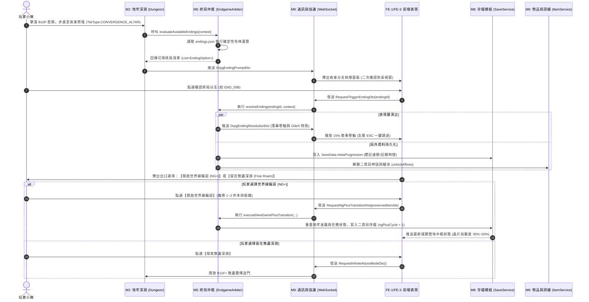

# 🌌 終局系統：從 Level 1 需求推進至 Level 2 模組規格實踐範本 (Endgame Master Blueprint & Review Template)

> **文檔定位**：Level 0 — Reference & Architecture Blueprint (供多 AI 協同審查與後續規格落地的母體範本)  
> **關聯來源**：
> - 需求層：[`docs/1_requirements/WORLD_AND_LORE_BIBLE.md`](../1_requirements/WORLD_AND_LORE_BIBLE.md)（第八章：六大多重終局藍圖）
> - 核心循環：[`docs/1_requirements/GAMEPLAY_CORE_LOOPS.md`](../1_requirements/GAMEPLAY_CORE_LOOPS.md)
> - 原創背景：[`docs/0_references/森羅星·母神卵鞘-小說世界觀背景設定集.md`](./森羅星·母神卵鞘-小說世界觀背景設定集.md)（第九章）
> **文檔目的**：本手冊將**預備正式寫入** `docs/1_requirements/` 與 `docs/2_specifications/` 的所有全文內容在此進行**1:1 完整預演與規格封裝**，包含「L1 核心循環章節」、「L2 方案 B 獨立技術手冊」與「L2 資料契約 Schema」。供使用者查閱、或直接作為 Prompt 交付給其他 AI（Claude / Codex / GPT）進行深度架構審查與決策評估。

---

## 🧭 目錄導覽 (Table of Contents)

- [一、核心導言與架構轉化哲學](#一核心導言與架構轉化哲學)
- [二、【完整預演】L1 需求草案：GAMEPLAY_CORE_LOOPS.md 第六章](#二完整預演l1-需求草案gameplay_core_loopsmd-第六章)
- [三、【完整預演】L2 技術手冊草案：ENDGAME_AND_META_PROGRESSION.md](#三完整預演l2-技術手冊草案endgame_and_meta_progressionmd)
- [四、【完整預演】L2 資料契約草案：ENDGAME_SCHEMA.md](#四完整預演l2-資料契約草案endgame_schemamd)
- [五、六大多重終局（11 個分支）判定矩陣與轉譯全景表](#五六大多重終局11-個分支判定矩陣與轉譯全景表)
- [六、跨 AI 審查建議指南與待決策開放議題清單](#六跨-ai-審查建議指南與待決策開放議題清單)

---

## 一、核心導言與架構轉化哲學

### 1. 專案雙軌體驗權重原則 (The 85/15 Rule)
本遊戲定性為**「純單機第一人稱地牢探索與爽快砍殺刷寶 RPG (Single-Player Hack-and-Slash DRPG)」**：
- **85% 核心體驗**：極致流暢的半即時戰鬥、罡氣削韌破防、連攜引爆、掉寶刷裝與小隊 Build 搭配。
- **15% 輔助點綴**：非侵入式 (Non-Intrusive) 的深邃克蘇魯×賽博修真世界觀。
- **終局的核心定位**：
  在傳統 RPG 中，通關往往意味著「強制結束遊戲」或「刪檔」。而在《深淵仙途》中，**終局是刷寶配裝的終極大考，更是進入高難輪迴與解鎖神話裝備的發射台**。

### 2. 四重思維轉化樞紐 (From Lore to Engineering)
1. **文學描述 $\to$ 確定性布林邏輯**：將「化神絕巔、肉身撕裂九天罡氣」轉譯為 `realmLevel >= 5 && chipRate == 100 && flags.contains("FLAG_HUNGER_CHAIN_BROKEN")`。
2. **抽象收束 $\to$ 實體地塊與防呆互動**：在 B10F 核心地塊配置 `TileType.CONVERGENCE_ALTAR`，擊敗守護 Boss 後觸發帶有二次防誤觸確認的選單。
3. **單向落幕 $\to$ 多周目局外養成閉環 (NG+ Meta-Progression)**：通關解鎖神話詞綴池、二周目特工晶片開局算力躍遷（30%~50% 起跳）、本命神兵繼承。
4. **單一視角 $\to$ 靈識認知透鏡演繹 (Cognitive Proxy)**：根據主角晶片加載度輸出古典修真或特工解碼的落幕卷軸。

---

## 二、【完整預演】L1 需求草案：GAMEPLAY_CORE_LOOPS.md 第六章

> 📌 **預計寫入目標**：[`docs/1_requirements/GAMEPLAY_CORE_LOOPS.md`](../1_requirements/GAMEPLAY_CORE_LOOPS.md) 之 `## 六、終局收束與二周目刷寶大循環`。

```markdown
## 🌌 六、終局收束與二周目刷寶大循環 (Endgame & NG+ Progression Loop)

> **設計核心定位 (85/15 鐵律貫徹)**：  
> - **15% 敘事高潮**：通關是世界觀解密的終極獎賞（六大多重終局揭示森羅星本質、外神卵鞘或母宇宙星際革命），給予探索型玩家心靈震撼。  
> - **85% 刷寶閉環**：終局絕非遊戲的「強制中止鍵」，而是「極致配裝的考驗場與下一輪高難刷寶的發射台」。通關後絕不強制刪檔，玩家獲得**【二元自由出口】**。

```text
                       ┌───────────────────────────────────────┐
                       │   擊敗深淵終極守護者 / 抵達收束祭壇   │
                       └──────────────────┬────────────────────┘
                                          │
                        觸發 15% 終局敘事卷軸 (可隨時一鍵跳過)
                                          │
                                          ▼
                       ┌───────────────────────────────────────┐
                       │     結算介面：領取終局獎勵與詞綴      │
                       └──────────────────┬────────────────────┘
                                          │
                    ┌─────────────────────┴─────────────────────┐
                    ▼                                           ▼
      【路徑 A：世界線輪迴 (NG+)】                【路徑 B：極限無盡深淵 (Free Roam)】
      • 繼承本命神兵與神經插槽                    • 保留當前全部裝備與進度
      • 特工晶片 30%~50% 算力起跳                 • 開放突破上限的高難深淵 (B11F+)
      • 全域注入新終局專屬神話詞綴                • 挑戰數值狂暴的 Boss Rush
      • 嘗試解鎖其他 5 大互斥終局線               • 刷取全滿屬性神話裝備極限 Build
```

### 1. 二元終局出口機制 (The Dual Exit Pathways)
玩家在觸發任一終局並完成落幕結算後，系統提供兩個平行的續玩通道：
1. **通道 A：世界線輪迴（New Game Plus / 逆天改命周目）**：
   - 藉助特工晶片的時間線回溯算法或母神羊水輪迴，開啟二周目。
   - **清除項目**：地牢踩格進度（Fog of War）、任務進行中狀態、普通消耗雜物。
   - **永久繼承項目**：道基五維點數、境界等級、已解鎖的天賦樹專精、本命神兵裝備（自選 1~3 件）、金丹反應爐強化進度。
   - **輪迴爽點**：開局解鎖【算力躍遷】（特工晶片加載度直接以 `30%` 或 `50%` 啟動，跳過前期的愚昧摸索），直奔高難分支，嘗試解鎖其他互斥終局（如從 END-02 仙道飛升轉戰 END-05 行星要塞）。
2. **通道 B：極限無盡深淵（Infinite Abyss / 自由刷寶大後期）**：
   - 若玩家不希望重置地牢地圖，可選擇「留在當前世界線」。
   - **開放內容**：廢棄礦脈坑道解鎖進入 **B11F~B99F「沉淵地核無盡層」**。
   - **玩法特色**：純粹的 Roguelite 刷怪割草與高難度菁英詞綴怪。每 5 層遭遇一次多 Boss 混戰，掉落頂級【古神強殖胚核】與全滿屬性詞綴裝備。

### 2. 終局對 85% 刷寶體驗的具體數值回饋 (Loot Progression Injection)
終局並非虛無的文字，每一次通關都將永久增幅玩家的刷寶庫：
- **神話詞綴庫全局解鎖 (Mythic Affix Pool Expansion)**：
  - 解鎖 **END-02B（真飛升）**：全局掉落庫永久注入神話詞綴【永動內景】（技能真元消耗 -40%，真元每秒自動回覆 5%）。
  - 解鎖 **END-03C（開源革命）**：全局掉落庫永久注入神話詞綴【賽博逆反】（電磁攻擊具備 50% 物理與道術雙重穿透）。
  - 解鎖 **END-05B（行星要塞）**：全局掉落庫永久注入神話詞綴【死星電漿】（暴擊時引爆全屏蜂巢偏折力場）。
- **真理日誌收藏館 (Non-Intrusive Lore Archive)**：
  - 營地「靈台藏經閣」常駐開放【森羅星世界線推演日誌】選單。已通關的結局文字、世界觀機密與原畫 CG 永久收錄於此，想看隨時點開閱讀，不想看的玩家 **0 阻塞、0 彈窗干擾**，隨時回歸地牢砍殺。
```

---

## 三、【完整預演】L2 技術手冊草案：ENDGAME_AND_META_PROGRESSION.md

> 📌 **預計建立目標**：[`docs/2_specifications/endgame/ENDGAME_AND_META_PROGRESSION.md`](../2_specifications/endgame/ENDGAME_AND_META_PROGRESSION.md)。

```markdown
# 🌌 後端與系統規格：終局收束與局外輪迴模組 (Endgame & Meta-Progression Manual)

> **模組編號**：M10 (終局與局外輪迴擴充模組)  
> **系統類型**：後端核心業務模組 / 前端表現協同管線  
> **核心責任**：負責終局條件仲裁、世界線收束事件管線、前端落幕協議推送、存檔周目快照持久化與二周目詞綴池解鎖。  
> **權威原則**：純函數式結算、100% 資料驅動判定、單一真相源 (SSoT)、保證 85% 刷寶流暢性。

---

## 🗺️ 一、模組邊界與拓撲關係 (Module Boundaries)

本模組橫向串聯專案既有模組，無自建獨立資料庫，完全依託記憶體純函數與 JSON 檔案：
- **M2 (DRPG Dungeon)**：提供地塊踩格觸發 (`DungeonTileType.CONVERGENCE_ALTAR`) 與樓層首領擊殺檢驗。
- **M5 (Skill & Progression)**：提供主角道基境界、特工晶片加載度、專精點數分佈。
- **M6 (Item & Economy)**：注入終局解鎖之傳奇神話詞綴 (`Mythic Affixes`)，管理 NG+ 繼承道具清單。
- **M8 (Save & Persistence)**：於 `SaveData.json` 寫入 `metaProgression` 結構與通關時間戳記。
- **M9 (Actor & Protocol)**：分發 WebSocket 終局事件 DTO。
- **FE-1 / FE-3 (Frontend)**：播放終局落幕卷軸、Glitch 光斑與二周目結算選單。

---

## 🔄 二、終局生命週期與端到端時序圖 (Sequence Diagram)



---

## ⚙️ 三、後端領域實體與服務契約 (Java 25 Records & Services)

### 1. 核心傳輸物件 (DTOs)
```java
package com.example.htmlmud.endgame.dto;

import java.util.List;
import java.util.Set;

public final class EndgameDto {

    /** 終局判定上下文 (由 M2/M4/M5 聚合) */
    public record ArbiterContext(
            int realmLevel,
            int chipRate,
            Set<String> unlockedQuestFlags,
            Set<String> inventoryItemIds,
            int cultivatorPoints,
            int engineerPoints,
            int highTechPoints,
            int cthulhuPoints,
            String currentFloorId,
            boolean isFloorBossDefeated
    ) {}

    /** 終局選項 (送至前端供玩家抉擇) */
    public record AvailableEndingOption(
            String endingId,
            String title,
            String coreAxis, // CULTIVATOR, HIGH_TECH, ENGINEER, CTHULHU, UNIVERSAL
            String briefSummary,
            int priority,
            boolean isTrueEnding
    ) {}

    /** 終局仲裁評估回執 */
    public record EvaluationResult(
            boolean canTriggerAnyEnding,
            List<AvailableEndingOption> availableOptions,
            List<String> lockedHints // 未滿足條件的模糊懸念提示 (供 15% 探索玩家參考)
    ) {}

    /** 終局結算與演出回執 */
    public record ResolutionResult(
            String endingId,
            String title,
            List<String> narrativeLines,
            List<String> unlockedAffixes,
            int ngPlusStartingChipRate,
            boolean unlocksInfiniteAbyss
    ) {}

    /** 請求開啟二周目 DTO */
    public record RequestNgPlusDto(
            int slotId,
            String chosenEndingId,
            List<String> preservedItemIds // 玩家自選繼承的 1~3 件神兵 ID
    ) {}
}
```

### 2. 仲裁服務介面：`EndgameArbiterService.java`
```java
package com.example.htmlmud.endgame.service;

import com.example.htmlmud.endgame.dto.EndgameDto.*;

public interface EndgameArbiterService {

    /** 評估當前玩家狀態是否具備收束世界線資格 */
    EvaluationResult evaluateAvailableEndings(ArbiterContext context);

    /** 執行終局結算，產出演出文本與獎勵封包 */
    ResolutionResult resolveEnding(String endingId, ArbiterContext context);

    /** 執行周目輪迴狀態遷移與存檔清理 */
    void executeNewGamePlusTransition(RequestNgPlusDto request);
}
```

---

## 💾 四、存檔模組 (M8) 擴充規格：`metaProgression`

為了支援二周目與多周目輪迴繼承，`SaveData.json` 升級為 `schemaVersion: 4`，新增 `metaProgression` 節點：

```json
{
  "schemaVersion": 4,
  "slotId": 1,
  "title": "死星方舟艦長 ‧ 二周目",
  "protagonistName": "長生",
  "inDungeon": false,
  "currentRoomId": "newbie_village:inn",
  "chipRate": 50,
  "metaProgression": {
    "ngPlusCycle": 2,
    "clearedEndingsHistory": [
      {
        "endingId": "END_02B_TRUE_ASCENSION",
        "clearedAtTimestamp": 1731248000,
        "playTimeSeconds": 48200
      },
      {
        "endingId": "END_05B_DEATH_STAR_ARK",
        "clearedAtTimestamp": 1731251200,
        "playTimeSeconds": 62400
      }
    ],
    "unlockedAffixPool": [
      "affix_perpetual_bio_core",
      "affix_death_star_plate",
      "affix_planetary_railgun"
    ],
    "unlockedLoreArchive": [
      "LORE_ENGINEER_COLLAPSE_TRUTH",
      "LORE_DHOL_WORMS_SPECIES",
      "LORE_ORBITAL_COFFINS"
    ],
    "infiniteAbyssUnlocked": true,
    "highestAbyssDepthCleared": 25
  }
}
```
```

---

## 四、【完整預演】L2 資料契約草案：ENDGAME_SCHEMA.md

> 📌 **預計建立目標**：[`docs/2_specifications/data_schemas/ENDGAME_SCHEMA.md`](../2_specifications/data_schemas/ENDGAME_SCHEMA.md)。

```markdown
# 📜 資料契約手冊：終局設定與收束條件 Schema (Endgame Schema)

> **文檔定位**：Level 2 — Data Contract Specification  
> **契約位置**：`docs/2_specifications/data_schemas/ENDGAME_SCHEMA.md`  
> **關聯實體**：`src/main/resources/data/story/endings.json`  
> **治理原則**：保證 100% 通過 JSON Schema Draft-07 反序列化校驗，嚴禁硬編碼判定邏輯。

---

## 📋 一、JSON Schema 定義 (Draft-07)

```json
{
  "$schema": "http://json-schema.org/draft-07/schema#",
  "title": "EndgameConfigurationSchema",
  "type": "object",
  "required": ["version", "endings"],
  "properties": {
    "version": { "type": "integer", "minimum": 1 },
    "endings": {
      "type": "array",
      "items": {
        "type": "object",
        "required": ["id", "title", "coreAxis", "priority", "conditions", "metaRewards", "narrative"],
        "properties": {
          "id": {
            "type": "string",
            "pattern": "^END_[0-9]{2}[A-Z]?(_[A-Z0-9]+)+$"
          },
          "title": { "type": "string", "minLength": 2 },
          "coreAxis": {
            "type": "string",
            "enum": ["CULTIVATOR", "HIGH_TECH", "ENGINEER", "CTHULHU", "UNIVERSAL"]
          },
          "isTrueEnding": { "type": "boolean", "default": false },
          "priority": { "type": "integer", "minimum": 0, "maximum": 100 },
          "conditions": {
            "type": "object",
            "required": ["minRealmLevel", "minChipRate"],
            "properties": {
              "minRealmLevel": { "type": "integer", "minimum": 1, "maximum": 5 },
              "minChipRate": { "type": "integer", "minimum": 0, "maximum": 100 },
              "requiredSpecializationMin": {
                "type": "object",
                "properties": {
                  "cultivator": { "type": "integer", "minimum": 0 },
                  "engineer": { "type": "integer", "minimum": 0 },
                  "highTech": { "type": "integer", "minimum": 0 },
                  "cthulhu": { "type": "integer", "minimum": 0 }
                }
              },
              "requiredFlags": {
                "type": "array",
                "items": { "type": "string" }
              },
              "forbiddenFlags": {
                "type": "array",
                "items": { "type": "string" }
              }
            }
          },
          "metaRewards": {
            "type": "object",
            "required": ["titleUnlocked", "unlockAffixes", "ngPlusStartingChipRate"],
            "properties": {
              "titleUnlocked": { "type": "string" },
              "unlockAffixes": {
                "type": "array",
                "items": { "type": "string" }
              },
              "ngPlusStartingChipRate": { "type": "integer", "minimum": 0, "maximum": 100 },
              "bonusInheritedItemsCount": { "type": "integer", "minimum": 0, "maximum": 5 },
              "unlocksInfiniteAbyss": { "type": "boolean", "default": false }
            }
          },
          "narrative": {
            "type": "object",
            "properties": {
              "ignorantScroll": {
                "type": "array",
                "items": { "type": "string" }
              },
              "awakenedScroll": {
                "type": "array",
                "items": { "type": "string" }
              }
            },
            "required": ["awakenedScroll"]
          }
        }
      }
    }
  }
}
```

---

## 🧪 二、真實設定檔範例驗證 (`data/story/endings.json`)

```json
{
  "version": 1,
  "endings": [
    {
      "id": "END_02B_TRUE_ASCENSION",
      "title": "真·斬鎖超脫（永動內景宇宙）",
      "coreAxis": "CULTIVATOR",
      "isTrueEnding": false,
      "priority": 80,
      "conditions": {
        "minRealmLevel": 5,
        "minChipRate": 100,
        "requiredSpecializationMin": {
          "cultivator": 5,
          "engineer": 5,
          "highTech": 5,
          "cthulhu": 5
        },
        "requiredFlags": [
          "FLAG_HUNGER_CHAIN_BROKEN",
          "FLAG_PRIMORDIAL_ALBUMEN_ABSORBED"
        ],
        "forbiddenFlags": [
          "FLAG_ARASAKA_CONTRACT_SIGNED",
          "FLAG_THOUSAND_STARS_CONTRACT_SIGNED"
        ]
      },
      "metaRewards": {
        "titleUnlocked": "超脫飛升者",
        "unlockAffixes": ["affix_perpetual_bio_core", "affix_void_stride"],
        "ngPlusStartingChipRate": 30,
        "bonusInheritedItemsCount": 1,
        "unlocksInfiniteAbyss": false
      },
      "narrative": {
        "ignorantScroll": [
          "金光撕裂萬里陰霾，九天罡氣在神力下寸寸碎裂。",
          "你吞噬了軌道群仙的殘存遺骸，體內金丹化為不滅神陽，大步邁入永恆星海……"
        ],
        "awakenedScroll": [
          "特工晶片超頻至 100%，工程師飢餓鏈鎖基因序列被母神原生卵白徹底覆寫重構。",
          "高空蜂巢電網高壓過載瓦解，生物反應爐達成永動零點循環，脫離千萬公里死線，航向深空。"
        ]
      }
    },
    {
      "id": "END_05B_DEATH_STAR_ARK",
      "title": "天工奪舍 · 星球機甲化（True End）",
      "coreAxis": "UNIVERSAL",
      "isTrueEnding": true,
      "priority": 100,
      "conditions": {
        "minRealmLevel": 4,
        "minChipRate": 100,
        "requiredSpecializationMin": {
          "cultivator": 10,
          "engineer": 10,
          "highTech": 10,
          "cthulhu": 10
        },
        "requiredFlags": [
          "FLAG_DHOL_SIGNAL_DECODED",
          "FLAG_GRAVITY_ANCHOR_CONTROLLED",
          "FLAG_SONIC_WELL_CONTROLLED",
          "FLAG_COOLING_VALVE_CONTROLLED",
          "FLAG_STORM_POOL_CONTROLLED"
        ],
        "forbiddenFlags": []
      },
      "metaRewards": {
        "titleUnlocked": "死星方舟艦長",
        "unlockAffixes": ["affix_death_star_plate", "affix_planetary_railgun"],
        "ngPlusStartingChipRate": 50,
        "bonusInheritedItemsCount": 3,
        "unlocksInfiniteAbyss": true
      },
      "narrative": {
        "awakenedScroll": [
          "重力定錨、地心超聲井、黑海冷卻閥、磁暴雷池——四大遠古總控網路全面併入神經元管線！",
          "以母神為永動爐心，以星球地殼為強殖裝甲，以九天罡氣為電漿主砲。",
          "森羅星引擎點火。向深空逼近的巨噬蠕蟲群，開火！"
        ]
      }
    }
  ]
}
```
```

---

## 五、六大多重終局（11 個分支）判定矩陣與轉譯全景表

| 終局代號 | 分支名稱 | 核心代號 | 境界/晶片門檻 | 關鍵旗標與專精要求 | 排除條件 (Forbidden) | 二周目神話詞綴與局外獎勵 |
| :--- | :--- | :---: | :---: | :--- | :--- | :--- |
| **END-01A** | 破殼大吞噬<br>*(預設末日)* | `END_01A_DEVOUR` | 任意 / 任意 | 擊敗深淵守護者；無特殊旗標 | 達成 01B、02B、03C 或 05B 條件 | 解鎖成就【混沌歸元】；二周目全隊初始真元 +5% |
| **END-01B** | 黑羊之冠<br>*(深淵主腦)* | `END_01B_HIVE_MIND` | 境界 $\ge 3$<br>晶片 $\ge 80\%$ | `FLAG_ABYSS_SYNAPSE_CONNECTED`<br>克蘇魯專精 $\ge 15$ | 晶片處於離線狀態 (`chipRate == 0`) | 解鎖【外神觸突】神經插槽；解鎖詞綴【深淵共鳴】 |
| **END-02A** | 偽·白日飛升<br>*(軌道活棺)* | `END_02A_ORBIT_COFFIN` | 境界 $= 5$<br>晶片任意 | 擊破九天罡氣；未斬斷鏈鎖 | 擁有 `FLAG_HUNGER_CHAIN_BROKEN` | 解鎖成就【仙道斷途】；二周目金丹突破率 +10% |
| **END-02B** | 真·斬鎖超脫<br>*(永動內景)* | `END_02B_TRUE_ASCENSION`| 境界 $= 5$<br>晶片 $= 100\%$ | `FLAG_HUNGER_CHAIN_BROKEN`<br>四系專精各 $\ge 5$ | 簽署巨企從屬契約 | 解鎖神話詞綴【永動內景】；開局晶片加載 30% |
| **END-03A** | 零號解剖台<br>*(盲信巨企)* | `END_03A_AUTOPSY_TABLE` | 境界 $\ge 3$<br>晶片任意 | 簽署巨企合約；擁有母艦通行證 | 擁有母艦最高管理權限旗標 | 解鎖成就【合規消耗品】；外門集市商品折扣 15% |
| **END-03B** | 霓虹隱仙<br>*(駭客偷渡)* | `END_03B_NEON_IMMORTAL` | 境界 $\ge 3$<br>晶片 $\ge 90\%$ | `item_blue_marrow_formula`<br>`FLAG_GATE_CODE_FORGED` | 無配方或通行碼偽造失敗 | 解鎖【黑市走私商】特權；初期自帶 50,000 黑煞幣 |
| **END-03C** | 掀翻鐵幕<br>*(開源革命)* | `END_03C_REVOLUTION` | 境界 $\ge 4$<br>晶片 $= 100\%$ | `FLAG_BROADCAST_TOWER_HIJACKED`<br>`item_open_source_genome_tree` | 與兩大巨企保持友好聲望 | 解鎖神話詞綴【算力暴動】；所有電磁技能 +25% |
| **END-04** | 造物主之死<br>*(蠕蟲降臨)* | `END_04_DHOL_ARRIVAL` | 境界 $\ge 4$<br>晶片 $\ge 80\%$ | `FLAG_ENGINEER_OBSERVATION_OPENED`<br>`FLAG_DHOL_SIGNAL_DECODED` | 啟動行星自毀或天工奪舍程序 | 解鎖全域圖鑑【深空巨噬者】；深淵怪掉寶率 +20% |
| **END-05A** | 星海殉道<br>*(行星自毀)* | `END_05A_STAR_MARTYR` | 境界 $\ge 4$<br>晶片 $\ge 80\%$ | 接續 END-04；工程師專精 $\ge 20$<br>`FLAG_ANTIMATTER_FURNACE_ARMED` | 未啟動自毀反應爐 | 解鎖成就【萬象寂滅】；二周目角色初始全屬性 +10 |
| **END-05B** | 天工奪舍<br>*(死星方舟·真)* | `END_05B_DEATH_STAR_ARK`| 境界 $\ge 4$<br>晶片 $= 100\%$ | 接續 END-04；四系專精皆 $\ge 10$<br>接管四大基地定錨/碎石/冷卻/雷池 | 任一核心管網設施未完成接管 | **全專案 True End**：解鎖神兵【死星舵輪】、二周目無限深淵模式與自選詞綴 |
| **END-06** | 新太上牧羊人<br>*(永劫輪迴)* | `END_06_ETERNAL_SHEPHERD`| 境界 $\ge 4$<br>晶片任意 | 擊潰巨企地面代理；修補冷卻壁<br>`FLAG_SHEPHERD_DECREE_SIGNED` | 晶片加載度 $100\%$（拒絕妥協計算） | 解鎖【國師敕令】戰術指令；門派功法威力 +15% |

---

## 六、跨 AI 審查建議指南與待決策開放議題清單 (Open Issues for Review)

當你將本文檔提供給其他 AI（Claude / Codex / GPT）審核時，可直接提出以下聚焦議題以獲取針對性建議：

### 🎯 建議審查提問 Prompt (可直接複製)
```text
你好！我目前正在開發單機 Hack-and-Slash DRPG《深淵仙途》（85% 砍殺刷寶 + 15% 非侵入式世界觀）。
請參閱我們這份終局架構母體手冊《終局系統_從L1需求推進至L2規格實踐指南.md》，重點審查以下三個開放議題：
1. 【NG+ 數值防膨脹】：在二周目繼承本命神兵與晶片算力躍遷（30%~50%）後，如何設計怪物數值動態縮放公式，避免開局過度碾壓導致 85% 砍殺樂趣喪失？
2. 【無盡深淵機制】：無盡深淵（B11F+）採用詞綴堆疊還是固定階梯成長，更符合單機 DRPG 的長時間刷寶心流？
3. 【資料結構與狀態機防呆】：EndgameArbiterService 的布林判定是否具備足夠健壯性？在多存檔槽位與壞檔備份防護（.bak）上，metaProgression 有無潛在競態或遺失風險？
```

### 📌 待決策開放議題庫 (Open Discussion Topics)
1. **數值縮放與周目膨脹控制**：
   - 二周目開啟後，雜兵與 Boss 的生命值、罡氣值（Poise）、抗性應採用簡單倍率（例如 `HP * (1 + 0.5 * cycle)`）還是套用獨立的【高難深淵詞綴系統】？
2. **多存檔槽位間的通關成就共享（Account Meta vs Slot Meta）**：
   - 目前設計是將 `metaProgression` 綁定於單一存檔槽位（`slot_1.json`）。是否需要額外提供全域的 `global_achievements.json`，讓開新存檔（Slot 2）的玩家也能享受全局已解鎖的 Lore 圖鑑與外觀？
3. **無盡深淵 (Infinite Abyss) 的死亡懲罰裁決**：
   - 在 B11F+ 的極限刷寶中，若全滅是全失本次戰利品並虛弱回營（標準 DRPG），還是允許在特定樓層（如每 5 層）設立「單向逃逸傳送符」？

---

## 📌 七、結語

本參考手冊已完整包含：
- **L1 需求草案**（可直接複製寫入 `docs/1_requirements/GAMEPLAY_CORE_LOOPS.md`）
- **L2 技術手冊全文**（可直接作為 `docs/2_specifications/endgame/ENDGAME_AND_META_PROGRESSION.md` 實體）
- **L2 資料契約全文**（可直接作為 `docs/2_specifications/data_schemas/ENDGAME_SCHEMA.md` 實體）

這使得本檔案成為專案中**終局收束與局外輪迴體系的單一真相源參考母體（Master Blueprint）**。
