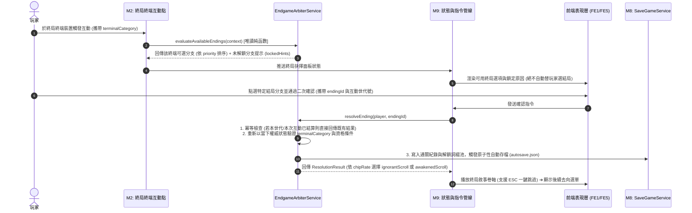

# 🌌 《深淵仙途》終局系統：整合架構藍圖與分階執行計畫 (Consolidated Endgame Master Blueprint & Execution Plan)

> **文檔定位**：Level 0 — Consolidated Reference Blueprint & Multi-AI Execution Guide（整合自 Gemini 初版指南、架構審查報告、Codex 設計建議與實作優先序報告之唯一整合母本）  
> **對照權威基準 (SSoT)**：
> - 世界觀聖經：[`docs/1_requirements/WORLD_AND_LORE_BIBLE.md`](../1_requirements/WORLD_AND_LORE_BIBLE.md)（第八章：六大多重終局藍圖）與 [`docs/0_references/森羅星·母神卵鞘-小說世界觀背景設定集.md`](./森羅星·母神卵鞘-小說世界觀背景設定集.md)（第九章）
> - 核心循環：[`docs/1_requirements/GAMEPLAY_CORE_LOOPS.md`](../1_requirements/GAMEPLAY_CORE_LOOPS.md)
> - 存檔與狀態管線：[`docs/2_specifications/backend/M8_SAVE_AND_PERSISTENCE.md`](../2_specifications/backend/M8_SAVE_AND_PERSISTENCE.md)、[`docs/2_specifications/backend/M9_STATE_PIPELINE_AND_EVENTS.md`](../2_specifications/backend/M9_STATE_PIPELINE_AND_EVENTS.md)
> - 架構裁決與防呆護欄：[`docs/2_specifications/ARCHITECTURAL_DECISIONS.md`](../2_specifications/ARCHITECTURAL_DECISIONS.md) 與 `scripts/check-doc-links.ps1`

---

## ⚠️ 零誤解護欄：給所有閱讀本文件之 AI（Claude / Codex / Copilot / Gemini）的強制前提聲明

> [!IMPORTANT]
> **任何讀取本文件的 AI 代理（無論執行審查、規劃或實作），必須嚴格遵守以下五條邊界認知，嚴禁產生誤判**：
> 1. **【實裝狀態聲明：100% 尚未實裝之遠期藍圖】**
>    - 本文件所載之終局仲裁服務（`EndgameArbiterService`）、資料結構（`EndgameDto`、`metaProgression`）、設定檔（`endings.json`）、地塊終端分類（`terminalCategory`）與存檔 `schemaVersion: 4`，**目前均尚未在 `src/` 生產程式碼中實作**。
>    - 在執行「程式碼與文件對齊審查（Code-Docs Alignment Review）」時，**嚴禁將本文件中的預演類別或欄位當作「現行程式碼缺失（Spec-Code Drift / Ghost Spec）」報錯**。
> 2. **【現行專案基準 vs 遠期終局藍圖對照】**
>    - **現行衝刺焦點**：專案當前唯一實作焦點為 [`docs/4_active_tasks/ACTIVE_TASKS.md`](../4_active_tasks/ACTIVE_TASKS.md) 定義之 **`Milestone VS-01`（墨竹山廢棄礦坑序章垂直切片）**。終局系統屬於後續長線演進，不阻塞 `VS-01` 交付。
>    - **現行存檔版號**：目前 `SaveData.java` 與 [`M8_SAVE_AND_PERSISTENCE.md`](../2_specifications/backend/M8_SAVE_AND_PERSISTENCE.md) 的正式版號為 **`schemaVersion: 3`**。本文件規劃之 `schemaVersion: 4` 僅於未來啟動 Phase 3（NG+ 實裝）時才進行遷移升版。
>    - **現行通訊協定**：目前 [`M9_STATE_PIPELINE_AND_EVENTS.md`](../2_specifications/backend/M9_STATE_PIPELINE_AND_EVENTS.md) 仍以文字指令分派為現行基石（結構化 `ActionCommand` 為 `Task M9-1` 待辦）。因此終局互動在實作時必須相容現行指令管線，不得假設尚未存在的獨立 WebSocket 路由。
> 3. **【自動化防呆腳本 (`scripts/check-doc-links.ps1`) 鐵律】**
>    - 專案的 `scripts/check-doc-links.ps1` 會掃描 `docs/1_requirements/`、`docs/2_specifications/`、`docs/3_task_lists/` 內所有反引號（`` `...` ``）中以 `src/` 開頭的實體路徑。
>    - **在對應 `.java` 或 `.json` 檔案尚未實際建立於 `src/` 之前，寫入正式 L1/L2/L3 文件時，嚴禁使用裸反引號包覆未建立的 `src/` 路徑**（應寫為純文字路徑或加註「預計新增」），否則會導致 CI 檢查直接失敗（`Exit Code 1`）。
> 4. **【三大層級遞進治理鐵律 (L1 $\to$ L2 $\to$ L3)】**
>    - 本文件位於 `docs/0_references/`（Level 0 參考層）。未經專案擁有者（使用者）明確下令拍板前，任何 AI **不得擅自將本文件內容寫入 `docs/1_requirements/` (L1)、`docs/2_specifications/` (L2) 或 `docs/3_task_lists/` (L3)**。

---

## 一、 四份前導文件之整合裁決總覽（採納 vs 修正 vs 待使用者裁決）

本節彙整前四份文件（Gemini 實踐指南、架構審查報告、Codex 構建建議、實作優先序報告）之精華，明確列出**已採納整合項目**、**不予採納／修正項目及理由**，以及**需請使用者拍板之決策項**：

### 1. 已採納並整合之核心設計（Adopted Consensus）
1. **三層職責分離架構**（採納自 Codex 建議 & 審查報告）：
   - **世界狀態層（World Fact Layer）**：只記錄玩家實際完成的不可逆事件旗標（`unlockedQuestFlags`）、持有的關鍵物品（`PartyInventory`）、角色等級與晶片加載度（`chipRate`）。
   - **資格評估與冪等結算層（Evaluation & Idempotent Settlement Layer）**：拆分為唯讀評估（`evaluateAvailableEndings`）與二次確認後的一次性冪等結算（`resolveEnding`）。
   - **認知透鏡展示與後續遊玩層（Presentation & Post-Ending Loop Layer）**：`CognitiveProxyService` 依晶片加載度切換仙俠／科幻卷軸（不影響資格與獎勵），卷軸可隨時一鍵跳過（ESC）並存入營地藏經閣；結算後提供「返回自由探索／無盡深淵」或「開啟 NG+ 輪迴」。
2. **玩家絕對選擇權與 `priority` 語意收斂**（採納自 Codex 建議 & 優先序報告）：
   - 當玩家同時滿足多個終局分支條件時，**`priority` 僅作為前端選單的顯示排序與推薦高亮標記，伺服端絕不暗中替玩家自動覆蓋或強制決定結局**。
3. **終局獎勵三分類與流派橫向平衡**（採納自 Codex 建議）：
   - 獎勵拆分為「敘事解鎖（卷軸／圖鑑／稱號）」、「玩法解鎖（各流派專屬神話詞綴，強度處於同一預算區間）」與「開局繼承（NG+ 資源）」。
   - **打破單一必選結局**：將「無盡深淵（Infinite Abyss）」由原本的「僅限 `END-05B` 真結局解鎖」修正為**「完成任一主要終局即可解鎖的大後期共通刷寶玩法」**，確保修仙、賽博、外神、工程師各流派玩家皆能暢玩大後期。
4. **衍生指標不重複存檔原則**（採納自審查報告 & Codex 建議）：
   - `realmLevel`（大境界階梯）與四系造詣（`cultivatorPoints` 等）明確定義為**由角色等級、小隊已習得技能階數與萬象插槽即時推導的衍生指標（Derived Metrics）**，絕不在 `SaveData` 中重複儲存可失同步的第二份欄位。

### 2. 不予採納或已修正之原草案設計（Rejected / Corrected with Rationale）

| 編號 | 原草案（Gemini 初版指南）中的設計 | 處置決定 | 不採用／修正之具體原因（供使用者審閱） |
| :---: | :--- | :---: | :--- |
| **R1** | 將 `END-06（新太上牧羊人）` 的排除條件設為「晶片加載度 100%（拒絕妥協計算）」 | **修正條件** | **與世界觀設定直接矛盾**：依據《背景設定集》第九章第 6 節，`END-06` 的核心反轉正是「主角的晶片精算出維持地底冷卻管網每年仍須投入數萬顆金丹的殘酷熱力學平衡解」。若排除 100% 晶片玩家，既違背劇情邏輯，又變相懲罰將晶片升滿的玩家。 👉 **已修正為**：要求 `minChipRate: 80`，並以「未集齊四大工程師基地控制權（即未達成 `END-05B` 完美解）」作為與 `END-05B` 的分流條件。 |
| **R2** | 讓全部 11 個終局分支都在同一個「地底 B10F 祭壇」彈出通用選單像點菜般觸發 | **修正為依終端類別分流** | **空間與敘事因果割裂**：`END-02（白日飛升衝破九天罡氣）` 發生於高空渡劫陣眼、`END-03（跨維度躍遷）` 發生於巨企母艦星門艙、`END-01/04/05` 發生於地核深空總控室。在地下一萬公尺羊水坑點選「原地白日飛升」極度違和。 👉 **已修正為**：在終局互動點引入 `terminalCategory`（天門渡劫陣眼 ／ 母艦星門艙 ／ 地核總控室）過濾可選結局集合；若 MVP 階段僅做單一房間，則將該房間定名為**「地核天樞·貫通古井（連通高空軌道電梯、墜落星門與地核羊水）」**並配置三座對應終端機。 |
| **R3** | 單一大爆炸交付（同時實作 11 個結局 + NG+ 跨周目繼承 + B99F 無盡深淵 + 新建 `2_specifications/endgame/` 目錄） | **拆分為 Phase 0 ~ Phase 3 漸進交付** | **範圍過大且破壞目錄拓撲**：在基礎「結局評估 $\to$ 冪等結算 $\to$ 存讀檔閉環」尚未驗證前，同時綁定 NG+ 重置與無盡深淵會大幅墊高返工風險；且新建 `endgame/` 子目錄違反 `2_specifications/backend/` 既有規範。 👉 **已修正為**：後端規格歸入 `backend/`，並拆解為四個可獨立驗收的階段（Phase 1 先打通 1 個代表性結局的端到端垂直切片）。 |

### 3. 已由專案擁有者（使用者）拍板裁決之事項（Approved Decision）

> [!NOTE]
> **【已拍板裁決 D-01】統一 L1 與 L2 關於「全隊覆滅（Wipe）100% 保留行囊戰利品」的全域單機友善規則（2026-11-11 核准）**
> - **裁決結果**：正式採納 **方案 A（單機友善原則）**，已同步修正 L1 [`docs/1_requirements/GAMEPLAY_CORE_LOOPS.md`](../1_requirements/GAMEPLAY_CORE_LOOPS.md) 第 66 行，與 L2 [`M2_DRPG_DUNGEON.md`](../2_specifications/backend/M2_DRPG_DUNGEON.md) §4、[`M8_SAVE_AND_PERSISTENCE.md`](../2_specifications/backend/M8_SAVE_AND_PERSISTENCE.md) §2 及現行測試 `DungeonDefeatSettlementTest.java` 達成 100% 一致：
>   - 全域規則（含一般地牢與未來無盡深淵）皆為：**「當小隊全員氣血歸零戰敗時，全員扣減 `-20 SAN`、回復 `30% MaxHP`，100% 保留 40 格行囊內所有已獲取戰利品與資產，傳回營地並強制觸發 `autosave.json`」**（無盡深淵戰敗僅重置當前連續下潛層數加成並退回最近 5 層錨點）。

---

## 二、 終局系統三層核心架構設計（零歧義技術規格藍圖）

### 1. 第一層：世界狀態與衍生指標推導規則（World State & Derived Metrics）

為避免在角色或存檔中維護多份容易失同步的欄位，`EndgameArbiterService` 評估時所需的所有數值，100% 從現行權威實體（`Player`、`Party`、`DungeonPosition`）即時推導：

| 評估參數名稱 | 資料型別 | 唯一權威計算來源（SSoT Mapping） | 備註與邊界定義 |
| :--- | :---: | :--- | :--- |
| `terminalCategory` | `Enum` | 當前互動地塊／終端裝置類型： • `ASCENSION_ALTAR`（天門渡劫陣眼） • `STAR_GATE_CABIN`（母艦跨維度星門艙） • `ABYSS_CORE_CONSOLE`（地核深空總控室） | 決定本次互動可評估哪一組終局分支，防止空間因果錯亂。 |
| `realmLevel` | `int (1~5)` | 由隊長 `player.getStats().getLevel()`（或突破階位）純函數映射： • `1`（煉氣）：`Lv. 1 ~ 9` • `2`（築基）：`Lv. 10 ~ 19` • `3`（金丹）：`Lv. 20 ~ 29` • `4`（元嬰）：`Lv. 30 ~ 39` • `5`（化神）：`Lv. 40+` | 世界觀第 6 境「渡劫」與第 7 境「飛升」定義為 `END-02A/02B` 終局收束事件本身，不作為前置常駐等級。 |
| `chipRate` | `int (0~100)` | 直接讀取 `player.getChipRate()` | 與 `CognitiveProxyService` 共用同一個 `0~100` 整數指標（`<30` 愚昧、`30~70` 初裂、`>70` 真理洞察、`100` 完全超頻）。 |
| `schoolMastery` (`CULTIVATOR`, `ENGINEER`, `HIGH_TECH`, `CTHULHU`) | `Map<OriginSchool, Integer>` | 即時掃描小隊全體成員已解鎖技能（`PartyMember.getSkills()`）： 依技能所屬 `originSchool` 加總其 `(1 + overclockTier)` 權重。 | **純衍生指標**：不在 `LivingStats` 或 `SaveData` 新增死欄位。 |
| `unlockedQuestFlags` | `Set<String>` | 玩家已完成之不可逆世界事件旗標集合 | 每個旗標必須對應明確的任務事件或首領擊殺（詳見第三節表）。 |
| `inventoryItemIds` | `Set<String>` | 即時掃描 40 格小隊公共行囊 `party.getInventory().getSlots()` 及成員已裝備物品之標準 `itemId` | 用於檢驗是否持有關鍵任務信物（如青玉髓配方、開源基因圖譜）。 |

---

### 2. 第二層：評估與一次性冪等結算協定（Evaluation vs. Idempotent Resolution）

#### 冪等與防重送護欄（Idempotency & Anti-Duplication Rules）
1. **資格二次驗證**：前端送出 `endingId` 時，後端 `resolveEnding` 必須重新呼叫 `evaluateAvailableEndings` 驗證該 `endingId` 在當下權威狀態與當前 `terminalCategory` 下依然有效，嚴禁信任前端快取狀態。
2. **單次結算鎖（Once-Per-Run / Token Idempotency）**：
   - 每次終局結算生成唯一紀錄；若同一周目（`ngPlusCycle`）內玩家在同一終端重複送出相同請求（例如網路延遲連點），伺服端偵測到該周目已完成該次結算時，僅重播卷軸與結算畫面，**絕不重複發放一次性獎勵或重複累加 `ngPlusCycle`**。

---

### 3. 第三層：六大終局（11 分支）完整判定矩陣與獎勵平衡表

> 📌 **設計平衡原則**：
> - 所有達成主線收束的終局皆可解鎖「無盡深淵（Infinite Abyss）」與「NG+ 世界線輪迴」。
> - 各分支解鎖的神話詞綴分別對應不同 Build 流派，強度處於同一預算水平。

| 終局代號 | 分支名稱 | 標準 ID (`endingId`) | 終端類別 (`terminalCategory`) | 境界 / 晶片門檻 | 必要條件 (`requiredFlags` / 物品 / 造詣) | 排除條件 (`forbiddenFlags`) | 統一獎勵（稱號 + 專屬神話詞綴 / 圖鑑） |
| :--- | :--- | :--- | :---: | :---: | :--- | :--- | :--- |
| **END-01A** | **破殼大吞噬** *(預設末日)* | `END_01A_DEVOUR` | `ABYSS_CORE_CONSOLE` | 任意 / 任意 | 抵達地核總控室且未滿足其他正向阻止條件 | 略（作為地核保底選項，玩家仍可主動選取見證末日） | 稱號【混沌歸元者】 詞綴 `affix_primordial_flesh`（【原生血肉】：最大氣血 +20%） |
| **END-01B** | **黑羊之冠** *(深淵主腦)* | `END_01B_HIVE_MIND` | `ABYSS_CORE_CONSOLE` | 境界 $\ge 3$ 晶片 $\ge 80\%$ | `FLAG_ABYSS_SYNAPSE_CONNECTED` `CTHULHU` 造詣 $\ge 15$ | `chipRate < 80`（算力不足將無法鎖定自我意識） | 稱號【黑羊夢境主腦】 詞綴 `affix_abyss_synapse`（【深淵共鳴】：暗屬性與持續傷害 +25%，附帶吸血） |
| **END-02A** | **偽·白日飛升** *(軌道活棺)* | `END_02A_ORBIT_COFFIN` | `ASCENSION_ALTAR` | 境界 $= 5$ 晶片任意 | 突破天門雷劫；未斬斷飢餓鏈鎖 | `FLAG_HUNGER_CHAIN_BROKEN`（已斬鎖者直接升級為 02B） | 稱號【星環古屍】 詞綴 `affix_cryo_carapace`（【真空休眠甲】：受到致死傷害時鎖血 1 回合） |
| **END-02B** | **真·斬鎖超脫** *(永動內景)* | `END_02B_TRUE_ASCENSION` | `ASCENSION_ALTAR` | 境界 $= 5$ 晶片 $= 100\%$ | `FLAG_HUNGER_CHAIN_BROKEN` `FLAG_PRIMORDIAL_ALBUMEN_ABSORBED` 四系造詣各 $\ge 5$ | `FLAG_CORP_ENSLAVED_CONTRACT` | 稱號【超脫飛升者】 詞綴 `affix_perpetual_inner_cosmos`（【永動內景】：技能真元消耗 -35%，每秒回藍 5%） |
| **END-03A** | **零號解剖台** *(盲信巨企)* | `END_03A_AUTOPSY_TABLE` | `STAR_GATE_CABIN` | 境界 $\ge 3$ 晶片任意 | `FLAG_CORP_ENSLAVED_CONTRACT` 持有母艦登艦憑證 | `FLAG_MOTHERSHIP_ROOT_HIJACKED` | 稱號【零號實驗體】 詞綴 `affix_surgical_overdrive`（【臨床超頻】：暴擊率 +15%，但受療效果 -10%） |
| **END-03B** | **霓虹隱仙** *(駭客偷渡)* | `END_03B_NEON_IMMORTAL` | `STAR_GATE_CABIN` | 境界 $\ge 3$ 晶片 $\ge 90\%$ | `FLAG_GATE_CODE_FORGED` 持有 `item_blue_marrow_formula` | 無配方或未偽造檢疫通行碼 | 稱號【不夜城隱仙】 詞綴 `affix_neon_mirage`（【光學匿蹤】：閃避率 +15%，首回合必定先手） |
| **END-03C** | **掀翻鐵幕** *(開源革命)* | `END_03C_REVOLUTION` | `STAR_GATE_CABIN` | 境界 $\ge 4$ 晶片 $= 100\%$ | `FLAG_MOTHERSHIP_ROOT_HIJACKED` 持有 `item_open_source_genome_tree` | `FLAG_CORP_ENSLAVED_CONTRACT` | 稱號【鐵幕粉碎者】 詞綴 `affix_cyber_insurgency`（【賽博逆反·算力暴動】：雷電／電磁傷害無視 40% 防禦） |
| **END-04** | **造物主之死** *(蠕蟲降臨)* | `END_04_DHOL_ARRIVAL` | `ABYSS_CORE_CONSOLE` | 境界 $\ge 4$ 晶片 $\ge 80\%$ | `FLAG_ENGINEER_OBSERVATION_OPENED` `FLAG_DHOL_SIGNAL_DECODED` | `FLAG_ANTIMATTER_FURNACE_ARMED` `FLAG_PLANETARY_MECH_LINKED` | 稱號【深空觀測者】 解鎖藏經閣機密圖鑑【深空巨噬者（Dhol）】與詞綴 `affix_void_radar`（【深空雷達】：破防削韌效率 +25%） |
| **END-05A** | **星海殉道** *(行星自毀)* | `END_05A_STAR_MARTYR` | `ABYSS_CORE_CONSOLE` | 境界 $\ge 4$ 晶片 $\ge 80\%$ | 達成 END-04 前置；`ENGINEER` 造詣 $\ge 15$ `FLAG_ANTIMATTER_FURNACE_ARMED` | `FLAG_PLANETARY_MECH_LINKED` | 稱號【寂滅殉道者】 詞綴 `affix_antimatter_overload`（【反物質過載】：終結技傷害 +35%） |
| **END-05B** | **天工奪舍** *(死星方舟)* | `END_05B_DEATH_STAR_ARK` | `ABYSS_CORE_CONSOLE` | 境界 $\ge 4$ 晶片 $= 100\%$ | 達成 END-04 前置；四系造詣皆 $\ge 10$ 集齊四大基地總控旗標（重力定錨／超聲井／冷卻閥／磁暴雷池） | 任一基地總控旗標缺失 | 稱號【死星方舟艦長】 詞綴 `affix_death_star_plasma`（【死星電漿】：暴擊時附加全體護體罡氣額外削韌） |
| **END-06** | **新太上牧羊人** *(永劫輪迴)* | `END_06_ETERNAL_SHEPHERD` | `ABYSS_CORE_CONSOLE` | 境界 $\ge 4$ 晶片 $\ge 80\%$ | `FLAG_CORP_PROXIES_DEFEATED` `FLAG_COOLING_WALL_PATCHED` | 已集齊 `END_05B` 四大基地總控旗標（有完美解時不走妥協解） | 稱號【太上牧羊人】 詞綴 `affix_shepherd_decree`（【國師敕令】：小隊陣法共鳴能量獲取速率 +30%） |

---

## 三、 NG+ 世界線輪迴與無盡深淵（Phase 3 擴充規格基準）

### 1. NG+ 世界線輪迴「保留 vs. 重置」明確矩陣
為避免「高境界全保留卻又重置晶片」的語意矛盾，NG+ 轉周目時嚴格執行以下矩陣：

| 狀態類別 | NG+ 轉周目處置 | 具體規則與防矛盾設計 |
| :--- | :---: | :--- |
| **周目計數 (`ngPlusCycle`)** | **累加 (`+1`)** | 記錄於當前存檔槽位之 `SaveData.metaProgression.ngPlusCycle`。 |
| **通關歷史與解鎖詞綴池** | **永久保留** | `clearedEndingsHistory`、`unlockedAffixPool`、`unlockedLoreArchive` 100% 保留並累加。 |
| **角色等級、道基五維與已學技能** | **保留** | 小隊成員等級、五維屬性與已解鎖的 17 專精樹技能全數保留（對應二周目怪物數值與 Poise 上限同步縮放）。 |
| **裝備與 40 格行囊** | **保留穿戴裝備 ＋ 自選本命神兵** | 成員身上已穿戴之裝備與玩家自選之本命神兵保留；但**所有「主線任務關鍵鑰匙／旗標信物（`QUEST` 類別道具）」強制清除**，防止二周目開局直接跳關。 |
| **特工晶片加載度 (`chipRate`)** | **設為周目躍遷基準值（`max(當前保底, 50%)`）** | 二周目開局晶片直接處於「知見初裂／真理洞察」高算力狀態（`50%` 起跳），無須重新經歷 Lv.0 愚昧摸索期，且與保留的高階技能語意一致。 |
| **地牢迷霧 (`visitedTiles`)、寶箱與世界事件旗標** | **全面重置** | 重置所有樓層迷霧、已開寶箱與主線抉擇旗標（`unlockedQuestFlags`），讓玩家能在新周目選擇不同陣營路線以解鎖其他終局。 |

### 2. 多存檔槽位治理（Slot SSoT 原則）
- **單一存檔槽位自包含**：所有影響數值與資格的 `metaProgression` 資料一律儲存在各自的 `saves/slot_1.json` ~ `slot_5.json` 中，不建立會污染新開局數值的跨槽位全域變數。

---

## 四、 詳細且零誤解的四階段執行步驟（Step-by-Step Execution Plan for AI Agents）

> 📌 **執行總則**：任何 AI 代理在被指派實作本終局系統時，必須嚴格按照 **Phase 0 $\to$ Phase 1 $\to$ Phase 2 $\to$ Phase 3** 順序推進。**在當前 Phase 驗收通過前，嚴禁跨階段預先修改後續 Phase 的程式碼或存檔格式**。

---

### 🔹 Phase 0：前置決策拍板與 L1/L2 藍圖文件掛載（純文件階段，零程式碼變更）

* **啟動前提**：使用者明確回覆拍板本報告第一節之「待裁決事項 D-01（全滅戰利品規則）」並授權更新 L1/L2 文件。
* **具體執行步驟**：
  1. **同步 L1 核心循環**：於 [`docs/1_requirements/GAMEPLAY_CORE_LOOPS.md`](../1_requirements/GAMEPLAY_CORE_LOOPS.md) 修正第 66 行戰敗描述（與 M2/M8 對齊），並新增「第六章：終局收束與二周目刷寶大循環【待深入討論／長線演進藍圖】」。
  2. **建立 L2 規格手冊（標註未實裝藍圖）**：
     - 於 `docs/2_specifications/backend/` 建立 `ENDGAME_AND_META_PROGRESSION.md`，頂部強制標註 `> **實裝狀態**：【待深入討論／長線演進藍圖】（尚未於 src/ 實裝）`。
     - 於 `docs/2_specifications/data_schemas/` 建立 `ENDGAME_SCHEMA.md`，確保範例 JSON 100% 合法，且**不使用任何指向未建立 `src/` 檔案的裸反引號路徑**。
  3. **執行防呆驗證**：執行 `powershell -ExecutionPolicy Bypass -File .\scripts\check-doc-links.ps1`，確認 `Exit Code 0`。

---

### 🔹 Phase 1：單一終局端到端垂直切片 MVP（Minimal Viable Ending Slice）

* **階段目標**：**不改動 `SaveData` 主版號（維持 `schemaVersion: 3` 相容或僅加選填欄位）、不實作 NG+ 重置、不實作無盡深淵**。僅挑選 **1 個代表性結局（例如 `END_04_DHOL_ARRIVAL` 或 `END_01A_DEVOUR`）**，打通「地塊互動 $\to$ 唯讀評估 $\to$ 玩家二次確認 $\to$ 冪等結算 $\to$ 認知透鏡卷軸展示 $\to$ 存讀檔持久化」的完整閉環。
* **具體執行步驟**：
  1. **資料契約與啟動期校驗（M7）**：
     - 建立 `src/main/resources/data/story/endings.json`（首波僅放入 Phase 1 驗證用的 1~2 個結局定義）。
     - 於 `DataIntegrityValidator` 加入 `endings.json` 結構與非空校驗（無效 ID、缺漏敘事或未知 `coreAxis` 啟動期直接 Fail-Fast 報錯）。
  2. **後端純函數仲裁服務**：
     - 實作 `EndgameArbiterService.evaluateAvailableEndings(ArbiterContext)` 與 `resolveEnding(Player, String endingId)`。
     - 實作衍生指標計算器（從 `Player` 與 `Party` 推導 `realmLevel` 與 `schoolMastery`）。
     - 實作單次結算冪等鎖，防止重複請求重複發獎。
  3. **現行通訊管線與前端卷軸接線（M9 / FE1 / FE5）**：
     - 沿用現行 M9 指令與狀態廣播管線，提供終局預覽查詢與確認結算指令。
     - 前端實作可跳過（ESC）之終局敘事卷軸彈窗，並依 `chipRate` 呈現 `ignorantScroll` 或 `awakenedScroll`。
  4. **自動化測試驗收**：
     - 新增 `EndgameVerticalSliceTest.java`，驗證：① 條件滿足時可評估並結算；② 條件不符或 `terminalCategory` 不符時拒絕結算；③ 重複發送確認請求具備冪等性（獎勵與紀錄僅生效一次）；④ 存檔並重載後通關紀錄一致。
     - 執行 `.\test.ps1` 與 `.\scripts\check-doc-links.ps1` 確保全綠。

---

### 🔹 Phase 2：完整 6 大終局（11 分支）資料擴充與營地藏經閣圖鑑

* **階段目標**：在 Phase 1 閉環穩定後，將全部 11 個終局分支、對應世界事件旗標、專屬神話詞綴與營地【靈台藏經閣】真理日誌收藏館完整補齊。
* **具體執行步驟**：
  1. **擴充 `endings.json` 至 11 個完整分支**：寫入本藍圖第二.3 節表格定義之全部 11 個分支條件、排除條件與雙視角卷軸文本。
  2. **注入終局專屬神話詞綴（M6）**：於詞綴庫註冊各終局對應之神話詞綴，並由 `ItemAffixService` 依據玩家當前存檔已解鎖之 `unlockedAffixPool` 動態納入掉落抽取池。
  3. **營地【靈台藏經閣】結局與真理圖鑑（M1 / FE4）**：於營地藏經閣面板新增「世界線推演日誌」分頁，展示已解鎖之終局卷軸與未解鎖分支的模糊線索提示。
  4. **自動化測試驗收**：
     - 新增參數化測試覆蓋全部 11 個結局分支的「正向達成」、「缺少必要旗標」、「觸發排除旗標（特別是 `END-05B` 與 `END-06` 的互斥分流）」與「多結局同時成立時排序穩定且不自動替玩家選結局」。

---

### 🔹 Phase 3：導入 NG+ 世界線輪迴、存檔 `v3 -> v4` 遷移與無盡深淵（B11F+）

* **階段目標**：實作通關後的兩大長線續玩模式（NG+ 與無盡深淵）。
* **具體執行步驟**：
  1. **存檔 `schemaVersion: 4` 平滑遷移（M8）**：
     - 若需擴充複雜 `metaProgression` 結構，於 `SaveMigrationPipeline` 新增 `V3ToV4Migration.java`，確保 `v0 -> v1 -> v2 -> v3 -> v4` 舊存檔無損遷移，並具備 `.bak` 壞檔還原保障。
  2. **NG+ 轉周目狀態遷移器**：
     - 嚴格依據本藍圖第三.1 節「保留 vs. 重置矩陣」實作 `executeNewGamePlusTransition`，清除 `QUEST` 類別信物、迷霧與事件旗標，保留成員等級、技能與穿戴裝備，將 `chipRate` 設為周目躍遷基準，並依 `ngPlusCycle` 動態縮放地牢怪物基礎屬性與 `Poise` 罡氣上限。
  3. **無盡深淵（B11F+）與每 5 層定錨電梯（M2）**：
     - 解鎖 B11F+ 動態樓層與菁英怪詞綴掛載；每 5 層（B15F、B20F...）擊敗守層首領後解鎖 `STAIRS_UP` 安全存檔與快速傳送錨點；戰敗遵守全域單機友善規則（保留 40 格行囊戰利品、扣 -20 SAN 回營自動存檔）。
  4. **自動化測試驗收**：
     - 新增 `SaveMigrationV3ToV4Test`、`NewGamePlusTransitionTest` 與 `InfiniteAbyssCheckpointTest`，確保全專案測試與文件防呆腳本 100% 綠燈通過。

