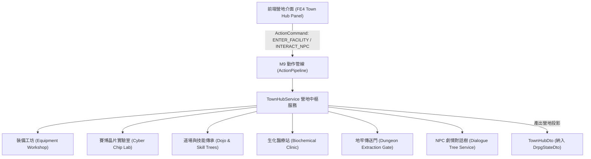

# 🏛️ 後端 M1: 營地中樞與功能設施模組手冊 (Town Hub & Facilities Manual)

> **模組編號**：M1  
> **系統類型**：後端核心業務模組  
> **核心定位**：管理純單機 DRPG 營地（如黑煞宗採掘營、地下避難所、黑市據點）的選單式功能設施（裝備工坊、晶片實驗室、道場修煉、醫療站、地牢傳送門）與 NPC 劇情對話交互契約，徹底取代舊有 MUD 房間 exits 與文字移動機制。

---

## 🏛️ 一、模組職責與架構全覽

在純單機 Hack-and-slash DRPG 架構下，城鎮不再是文字 MUD 走房間的拓撲網絡，而是冒險者整備、劇情推進與戰略決策的**選單式安全營地中樞 (Town Hub)**：



### 核心職責劃分
1. **設施狀態與開放條件**：依據玩家主線劇情進度與營地聲望，動態解鎖設施功能（如初章解鎖黑市鐵匠，擊敗首領解鎖神經晶片插槽改造）。
2. **小隊全面休整與補給**：提供一鍵恢復全隊氣血（HP）與真元（MP），清空地牢負面狀態，重置消耗品。
3. **NPC 劇情與委託交互**：管理營地 NPC（如礦奴長老、叛逃巨企工程師、黑煞宗監工）的樹狀對話、主支線任務交付與好感度/情報交易。
4. **地牢傳送中繼 (Dungeon Gate)**：負責地牢樓層選擇、難度詞綴配置、小隊出發確認，並平滑將遊戲狀態切換至 `M2_DRPG_DUNGEON`。

---

## 🏬 二、五大核心營地設施規格 (Facilities Specification)

營地包含五大機能設施，全部採用 100% 資料驅動範本配置 (`facilities.json`)：

### 1. 裝備工坊 (The Forge & Scrap Workshop)
- **職責**：
  - **分解與提煉 (Salvage)**：將地牢刷出的廢棄法寶與賽博殘骸分解為強化合金與靈能晶石。
  - **數值強化 (Refinement)**：消耗礦石提升武器物理傷害與防具護甲韌性。
  - **詞綴重鑄 (Affix Reforge)**：洗鍊稀有裝備的隨機詞綴（如提升削韌效率、增加連鎖暴擊率）。

### 2. 賽博晶片實驗室 (Cybernetic Chip Lab)
- **職責**：
  - **前世特工晶片調試 (Agent Core Overclock)**：消耗外神髓液與算力點數，提升主角特工晶片的核心超頻能力。
  - **神經插槽鑲嵌 (Socketing)**：為隊員解鎖神經插槽，安裝特殊晶片（如「子彈時間反制插槽」、「元素共振超導晶片」）。

### 3. 道場與傳功室 (Cultivation Dojo)
- **職責**：
  - **技能天賦樹重置與加點 (Skill Mastery)**：自由調整四大流派技能點數，零成本洗點以鼓勵玩家自由實驗技能構建（Synergy）。
  - **連招戰術方針配置 (Gambit Auto-Tactics)**：設定隊員在半即時戰鬥中的 AI 觸發條件（如「敵方處於破防狀態時優先釋放重力裂變」）。

### 4. 生化醫療站 (Biochemical Clinic)
- **職責**：
  - **基因修復與強化 (Gene Infusion)**：利用地牢採掘的外神卵鞘精華進行基因強殖，獲得永久被動屬性加成。
  - **行囊補給配置 (Supplies Packing)**：出征前配置小隊火把數量、納米修復劑與興奮劑。

### 5. 地牢傳送門 (Dungeon Extraction Portal)
- **職責**：
  - **區域選擇**：選擇進入目標地牢（如「黑煞宗地底礦脈・深坑一階」）。
  - **出征安全校驗**：檢查小隊是否編制完整、行囊是否有必要照明物資，確認後進入第一人稱 3D 走格子視圖。

---

## 💬 三、NPC 劇情對話與任務分發機制 (Dialogue & Quests)

NPC 交互徹底廢除 MUD 文字指令（如 `look npc`、`ask elder about sword`），全部由結構化 JSON 驅動：

### 對話樹範本結構 (`dialogues.json`)
```json
{
  "dialogueId": "npc_elder_ore_mine_intro",
  "npcId": "elder_kuang_nu",
  "npcName": "採礦奴隸長老・鐵手",
  "avatar": "assets/npcs/elder_ironhand.webp",
  "introText": "咳咳...小子，看你的眼神，你的神經晶片覺醒了？別出聲，宗門那幫執事就在礦井上方監視著...",
  "options": [
    {
      "optionId": "opt_ask_chip",
      "text": "【詢問】你認得我腦中的晶片？",
      "condition": "quest.vs01_awakening == ACTIVE",
      "nextDialogueId": "npc_elder_chip_secret"
    },
    {
      "optionId": "opt_trade_ore",
      "text": "【交易】用剛挖出的血晶原石換取補給",
      "action": "OPEN_FACILITY_SHOP"
    },
    {
      "optionId": "opt_leave",
      "text": "【離開】保持警戒，轉身離去",
      "action": "CLOSE_DIALOGUE"
    }
  ]
}
```

---

## 🔄 四、狀態契約與全景投影 (State Contract)

營地狀態以純單機 DTO 的形式聚合於 `DrpgStateDto`：

```java
public record TownHubDto(
    String hubId,                  // 如 "hub_ore_mine_shelter"
    String hubName,                // 如 "黑煞宗廢棄下層礦脈避難所"
    String backgroundScene,        // 背景場景圖資源路徑
    String atmosphericAudio,       // 營地背景氛圍音效
    List<FacilityInfoDto> facilities, // 可用設施清單（名稱、圖標、解鎖狀態）
    List<NpcSummaryDto> activeNpcs,   // 駐留 NPC 名單
    CurrentDialogueDto currentDialogue // 當前進行中的對話（若有，否則 null）
) {}
```

---

## 🔗 五、代表類別與資料結構

| 項目 | 路徑 / 名稱 | 職責 |
| :--- | :--- | :--- |
| **營地服務** | `com.example.htmlmud.domain.service.TownHubService` | 設施路由、休整結算與傳送進入地牢 |
| **對話服務** | `com.example.htmlmud.domain.service.DialogueService` | 劇情對話節點判定與獎勵派發 |
| **設施資料** | `src/main/resources/data/hub/facilities.json` | 營地機能設施參數與解鎖條件 |
| **對話資料** | `src/main/resources/data/hub/dialogues.json` | NPC 劇情樹、分支選項與任務掛鉤 |
| **狀態投影** | `com.example.htmlmud.adapter.dto.TownHubDto` | 傳遞至前端渲染之唯讀營地狀態 |

---

## 🎯 六、純單機 Hack-and-slash DRPG 規範守衛

1. **嚴禁引入房間拓撲 (No Room Exits)**：營地內部禁止實作方塊房間移動與 exits 關係，一律以選單與設施按鈕呈現。
2. **極速進入砍殺 (Frictionless Combat Transition)**：從營地整備到進入地牢只需一次點擊，無任何繁瑣命令行，保證玩家隨時投入地牢砍殺刷寶循環。
3. **安全庇護所原則 (Absolute Safe Zone)**：營地內不觸發任何即時戰鬥或野怪入侵，保證玩家在整備時擁有絕對平靜的心流體驗。
