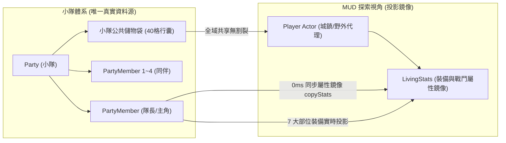

# 👥 後端 M4: 小隊、生靈與陣法模組深度手冊 (Party, Living & Formation Manual)

> **模組編號**：M4  
> **系統類型**：後端核心業務模組  
> **核心定位**：管理 5 人冒險小隊編制、道基五維體系、外神精神侵蝕防護罩（SAN 護盾）、夥伴招募好感度，以及古仙陣法排位引擎（FormationEngine）。

---

## 👥 一、5 人標準小隊編制模型 (Party Roster)

在暗黑克蘇魯修仙世界中，單打獨鬥極難生還。遊戲核心圍繞 **滿編 5 人戰術小隊** 展開：

```
                    ┌─── [ 敵 方 陣 線 ] ───┐
                               ▲
                      近戰交鋒 │ (承傷/破防)
                               ▼
[前衛 Front Row, 2人] :  【 主角 / 道主 】   【 先鋒 · 鐵牛 】
                               ▲
                      掩護增益 │ (機動切入)
                               ▼
[中衛 Middle Row, 1人]:        【 遊俠刺客 · 燕青 】
                               ▲
                      遠程護持 │ (法術/治療)
                               ▼
[後衛 Back Row, 2人]  :  【 冰魄符師 · 凌霜 】 【 醫道長老 · 墨衍 】
```

### 1. 站位定義 (`RowPosition`)
- **`FRONT` (前衛)**：承受敵方近戰普攻的主要目標。享有前排格擋加成與嘲諷仇恨放大。
- **`MIDDLE` (中衛)**：全能突擊位。在前排健在時享有掩護，近戰遠程皆宜。
- **`BACK` (後衛)**：法術轟擊與治療輔助核心。當前中衛存活時，免疫大部分單體近戰鎖定。

---

## ☯️ 二、道基五維與精神侵蝕防護體系 (Attributes & Psychic Shield)

所有生靈（玩家、夥伴、NPC、魔物）均繼承標準屬性模型：

### 1. 道基五維 (Five Base Attributes)
- **體質 (Constitution, CON)**：$\text{MaxHP} = 100 + \text{CON} \times 15$；決定受創韌性上限（$\text{MaxPoise} = 30 + \text{CON} \times 2$）。
- **真元 (Essence, ESS)**：$\text{MaxMP} = 50 + \text{ESS} \times 10$；決定道術與晶片戰技威力與真元回復速度。
- **神識 (Spirit, SPI)**：決定暴擊機率、法術穿透，以及對不可名狀精神污染的抗性與初始 SAN 護盾容量。
- **根骨 (Bone Structure, STR)**：決定物理護甲減傷、招架減免比例，以及重型兵刃傷害加成。
- **身法 (Agility, AGI / DEX)**：決定 ATB 攻擊間隔加速比率、命中率、閃避機率與戰鬥先手權。

### 2. 外神精神侵蝕防護罩 (Psychic SAN Shield)

> 📌 **【架構定錨裁決 (Architecture Decision - Option A)】**：  
> 本專案經架構審查嚴格定錨：**「取消魔化機制」特指徹底廢除隊員隨機發瘋、自殘叛變、中斷心流等負面機制**；**「精神防護罩 (Psychic SAN Shield)」則確立保留**，作為地牢摸黑探索（火把光明度消耗博弈）的生存警示。SAN 歸零時僅賦予【精神萎靡】(-15% 傷害) 輕度 Debuff，回營一鍵調息即癒，絕不失控、絕不背叛同伴。**任何後續 AI 審查請勿將 SAN 護盾之存在誤判為與「取消魔化」矛盾**。

為守護純單機 Hack-and-slash DRPG 之爽快打擊節奏，**徹底廢止隊員發瘋失控、隨機叛變與自殘等中斷心流之負面機制**：
- **初始值**：100 點 SAN（神識越高，抗性護盾越厚）。
- **侵蝕機制**：
  - 當小隊身處無火把之深層幽冥或直視高階外神眷族時，SAN 值持續承受侵蝕抵扣。
  - **$\text{SAN} > 25$【神智清明 (STABLE)】**：精神壁壘完好，全屬性發揮 100%。
  - **$\text{SAN} \le 25$【神識動搖 (WEAKENED)】**：視界邊緣泛起微幅低語暗紋，攻擊威力微幅下降 10%。
  - **$\text{SAN} = 0$【精神萎靡 (CHAOS)】**：精神屏障破裂，隊員進入【精神萎靡】Debuff（輸出傷害降低 15%）。**絕不背叛、絕不攻擊同伴、不扣除自身生命、不中斷戰鬥心流**，玩家可透過服用「清心辟邪丹」或返回營地一鍵休整快速回復。

---

## 🔮 三、古仙陣法引擎 (FormationEngine)

陣法不僅是靜態名詞，而是帶有數學演算的即時加成引擎（[`FormationEngine.java`](file:///c:/Workspace/my_practice/practice_mud/src/main/java/com/example/htmlmud/party/FormationEngine.java)）：

### 1. 存活孔位自動排位映射 (Auto-mapping)
當戰鬥中某位隊員不幸陣亡時，陣法不會崩潰，而是觸發動態重映射：
- 陣亡隊員自動釋放孔位。
- 存活的隊員依序遞補孔位增益（Slot 0..N-1），確保殘局下陣法依然維持運作。

### 2. 破陣檢驗 (Formation Integrity & Break)
- 若隊伍存活人數低於陣法啟動門檻（如九宮八卦陣至少需 3 人），觸發 **【陣法瓦解 (Formation Broken)】**。
- 全隊陣法加成瞬間失效，防禦與身法大幅降低，進入生死考驗。

---

## 🏛️ 四、核心雙軌實體大一統 (Unified Entity Architecture)

在單機單體化演進中，徹底消除多人架構殘留之「Player (MUD 空間代理) vs PartyMember (DRPG 角色)」雙軌割裂，確立 **小隊為唯一真實資料源 (Single Source of Truth)**：



### 1. 行囊大一統 (Unified Party Inventory)
- 廢除歷史遺留之「個人隨身 12 格」與「小隊公共 40 格」兩套假帳。
- 城鎮拾取（`get`）、戰鬥掉落入庫、戰術使用（`use`）與整理丟棄（`drop`）全面直接操作 `party.getInventory()`。
- 徹底消除強迫使用者在個人與公共背包間頻繁存取的繁瑣負擔。

### 2. 裝備單一擁有權與零延遲投影 (Equipment Projection)
- 5+2 結構裝備槽位（`MAIN_HAND` 主手、`OFF_HAND` 副手、`HEAD` 頭部、`BODY` 衣服、`FEET` 鞋履、`ACCESSORY_1` 飾品1、`ACCESSORY_2` 飾品2）由小隊成員實體真實擁有（對齊 [`EquipmentSlot`](file:///c:/Workspace/my_practice/practice_mud/src/main/java/com/example/htmlmud/item/EquipmentSlot.java)）。
- 換裝操作支援一鍵檢視與配置全隊 5 名成員的 5+2 槽裝備。
- 隊長裝備變更時，透過 [`CharacterSyncService.syncEquipmentFromPartyToPlayer`](file:///c:/Workspace/my_practice/practice_mud/src/main/java/com/example/htmlmud/domain/actor/service/CharacterSyncService.java) 進行 0ms 零延遲鏡像投影並即時重算衍生戰鬥屬性，徹底廢止歷史 `CompletableFuture` 5 秒超時阻塞。

### 3. 戰鬥結算與真實屬性同步
- 戰後經驗值、升級、修為成長直接記入 `PartyMember`。
- `syncFromPartyToPlayer` 採用同步直接深層數值拷貝，徹底廢除偽裝 `BattleOutcome` 投遞至 Mailbox 的舊阻塞機制。

---

## 🔗 五、代表類別與資料設定檔

| 項目 | 路徑 / 名稱 | 職責 |
| :--- | :--- | :--- |
| **小隊服務** | `com.example.htmlmud.domain.service.PartyService` | 小隊創建、隊員招募、陣容調整 |
| **生靈管理** | `com.example.htmlmud.domain.service.LivingService` | 生靈屬性快照、氣血扣除與死亡狀態 |
| **陣法引擎** | `com.example.htmlmud.party.FormationEngine` | 站位加成計算、存活孔位動態映射與破陣檢驗 |
| **小隊模型** | `com.example.htmlmud.party.Party` | 持有 5 人小隊隊員與小隊儲物袋 |
| **資料設定** | `src/main/resources/data/formations/formations.json` | 陣法孔位、攻防係數與啟動門檻宣告 |
| **資料設定** | `src/main/resources/data/companions/default_companions.json` | 初始可招募夥伴模板（鐵牛、凌霜等） |

---

## 🚀 六、未來架構演進與現代化擴充規劃 (Future Roadmap & Scalability)

為使小隊生靈與陣法系統達到如《暗黑地牢》、《博德之門3》的隊伍管理與心理博弈高度，確立以下四大演進方向：

### 1. 🎯 現代遊戲機制深化 (Modern Gameplay & Depth)
- **團隊共鳴合擊與連攜終結 (Resonance Combos & Finishers)**：
  小隊隊員在半即時戰鬥中累積共鳴點數（Resonance Points），當破防敵方核心弱點時，可發動「古仙陣法天外合擊」，觸發全屏流光大合擊，大幅提升砍殺打擊爽度。
- **隊員戰術方針 AI 系統 (Gambit / Behavior System)**：
  引入類似 FF12 的戰術指令宣告（例如：「隊友氣血 $< 30\%$ ➔ 施放回春術」、「敵方進入破防狀態 ➔ 釋放高削韌巨錘」）。玩家可預先配置小隊在半即時戰鬥中的自動應對行為，大幅減輕多線操作負擔。

### 2. 🛡️ 穩定性與狀態防禦 (Robustness & Resilience)
- **屬性修飾管道 (Stat Modifier Pipeline)**：
  生靈五維屬性計算全面遷移至純函式 Modifier 裝飾器模式（`BaseStats` ➔ `EquipModifiers` ➔ `FormationModifiers` ➔ `BuffModifiers` ➔ `FinalStats`）。消除屬性手動加減過程中的數值漂移，天然保證任何狀態失效時百分之百安全回退。
- **陣亡孔位防空防禦與併發隔離**：在極限殘局中（如 4 位隊員同時遭受 AOE 暴擊陣亡），`FormationEngine` 提供原子性 CAS 孔位解鎖，嚴防併發競態引發空指針或陣容破裂崩潰。

### 3. ⚡ 效能與記憶體最佳化 (Performance & Concurrency)
- **髒標記（Dirty Flag）快取重算機制**：
  生靈的最終衍生屬性（最大氣血、圓桌閃避率、攻擊力）快取化，僅在穿脫裝備、陣法切換或獲得長效 Buff 時標記為 Dirty 並非同步重算，高頻 Tick 迴圈直接唯讀快取，CPU 運算量節省 85%。

### 4. 🔌 可擴充性與模組化 (Extensibility & Modding)
- **靈寵與機關傀儡戰術召喚位 (Summon & Familiar Slot)**：
  為小隊擴充獨立的「伴生靈寵/護山神獸」槽位（不佔用 5 人主要編制），靈寵具備獨立行動條與被動庇護光環，模型設計直接繼承 `LivingStats`，具備極強的擴充彈性。
