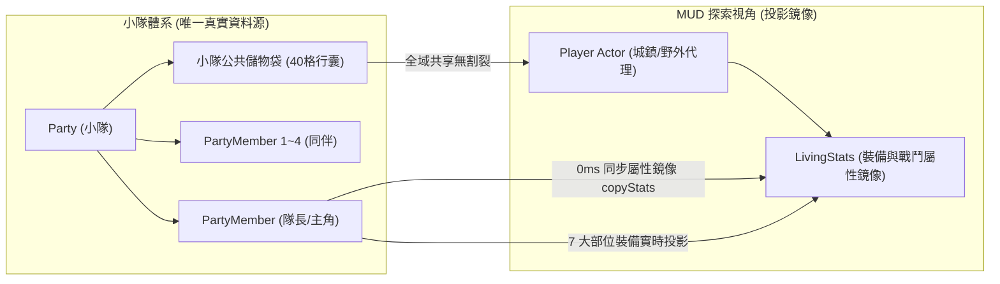

# 👥 後端 M4: 小隊、生靈與陣法模組深度手冊 (Party, Living & Formation Manual)

> **模組編號**：M4  
> **系統類型**：後端核心業務模組  
> **核心定位**：管理 5 人冒險小隊編制、道基五維體系、外神精神侵蝕防護罩（SAN 護盾）、夥伴招募好感度，以及古仙陣法排位引擎（FormationEngine）。

---

## 👥 一、5 人標準小隊編制模型 (Party Roster)

在暗黑克蘇魯修仙世界中，單打獨鬥極難生還。遊戲核心圍繞 **滿編 5 人戰術小隊** 展開：

```
                    ┌─── [ 敵 方 陣 線 ] ───┐
                                ▲
                       近戰交鋒 │ (承傷/破防)
                                ▼
[前衛 Front Row, 2人] :  【 主角 / 道主 】   【 先鋒 · 鐵牛 】
                                ▲
                       掩護增益 │ (機動切入)
                                ▼
[中衛 Middle Row, 1人]:        【 遊俠刺客 · 燕青 】 (預設站位 FRONT，可調度至 MIDDLE)
                                ▲
                       遠程護持 │ (法術/治療)
                                ▼
[後衛 Back Row, 2人]  :  【 妙手醫仙 · 凌霜 】 【 幽冥符修 · 墨衍 】
```

### 1. 站位定義 (`RowPosition`)
- **`FRONT` (前衛)**：承受敵方近戰普攻的主要目標。享有前排格擋加成與嘲諷仇恨放大（`default_companions.json` 中鐵牛與燕青預設 `defaultRow` 均為 `"FRONT"`，玩家可透過指令 `party row <charId> <row>` 自由將燕青調度至中衛 `MIDDLE`）。
- **`MIDDLE` (中衛)**：全能突擊位。在前排健在時享有掩護，近戰遠程皆宜。
- **`BACK` (後衛)**：法術轟擊與治療輔助核心。當前中衛存活時，免疫大部分單體近戰鎖定。凌霜於入隊時由 `PartyService` 動態掛載 `CLASS` 醫修技能。

### 2. 四大道統門派與夥伴招募來源 (The 4 School Factions & Recruitment Roster)
依據 Level 1《[CYBERPUNK_CULTIVATION_SPEC.md](../../1_requirements/CYBERPUNK_CULTIVATION_SPEC.md)》第一章，營地客棧與道場中可招募之隊友嚴格隸屬於四大歷史陣營門派，具備東方仙俠尊稱（Option C）並在底層映射至十七專精技能樹：

| 道統體系 (`originSchool`) | 世界宗門表象 (仙俠先行) | 底層文明真相 | 經典夥伴範例 (`default_companions.json`) | 對應專精樹 |
| :--- | :--- | :--- | :--- | :--- |
| **☯️ 東方修仙道統**<br>(`CULTIVATOR`) | **【正統與魔道修仙道門】**<br>(純陽劍閣、玄冥水府、青帝神農谷、紫霄道統、黑煞宗) | 原住民吸納靈脈結晶靈氣，第三紀元弒神聖戰後確立之正魔道統。 | **凌霜**（【妙手醫仙·百草丹修】·青帝神農谷醫修，素問回春與清心寧神）<br>**天劍傳人**（【天劍弟子】·庚金破甲） | 庚金、玄水、離火、靈木、后土 |
| **🏛️ 古代工程師類**<br>(`ENGINEER`) | **【天工神機宗 ＋ 古妖門】**<br>(天工造化門、墨家神機宗、萬妖萬靈聖地) | 操縱古代工程師深井行星重型設備（重力、液壓超聲、金剛力場），或第三紀元融合生物兵器之妖修。 | **鐵牛**（【搬山力士·玄甲體修】·天工神機宗玄甲堂，持盾嘲諷反震、裂地重擊削韌） | 天引重力、神機裂解、太古金剛、地核熔爐 |
| **⚡ 賽博高科技類**<br>(`HIGH_TECH`) | **【巨企代理仙朝 ＋ 天機商會】**<br>(大炎仙朝、星輝聖殿、天機商會·浮屠黑市) | 兩大跨維度巨企（荒坂生物、千星科技）為收割修士內丹提煉青玉髓，在地面扶持的政教傀儡與黑市白手套。 | **燕青**（【赤霞傳人·追魂遊俠】·大炎仙朝赤霞行者，神經加速、暗器穿甲暴擊） | 時序超頻、協議逆亂、全息匿影、電磁動能 |
| **🧬 克蘇魯外神類**<br>(`CTHULHU`) | **【深淵畸變密教三派】**<br>(血海宗、拜星教、深淵知見歸元派) | 近百年巨企超頻鑽探刺穿卵鞘保護壁導致原生卵白外洩與神經索裸露，藉血肉殖裝、神經共鳴或膠質歸元同化之狂修。 | **墨衍**（【九幽冥客·幽冥符修】·血海宗九幽脈，太陰定身與幽冥血噬）<br>**芷若**（【觀星仙子·星隕法修】·拜星教觀星脈，星隕共鳴焚敵） | 強殖幾丁質、黑山羊血裔、知見污染、虛無崩解 |

---

## ☯️ 二、道基五維與精神侵蝕防護體系 (Attributes & Psychic Shield)

所有生靈（玩家、夥伴、NPC、魔物）均繼承標準屬性模型：

### 1. 道基五維 (Five Base Attributes)
- **初始基準**：初始基礎 $\text{MaxHP} = 100$、$\text{MaxMP} = 50$、$\text{MaxPoise} = 100$（或由夥伴模板設定）。
- **自由潛能加點換算【現行已驗證】**（對齊 `XpProgressionService.allocateStatPoint`）：
  - **體質 (Constitution, CON)**：每分配 $+1$ 點，提升 **$+10\ \text{MaxHP}$**（同步回復 $+10\ \text{HP}$）與基礎 CON 屬性。
  - **真元 / 悟性 (Intelligence, INT)**：每分配 $+1$ 點，提升 **$+8\ \text{MaxMP}$**（同步回復 $+8\ \text{MP}$）與基礎 INT 屬性。
  - **根骨 (Strength, STR)**：每分配 $+1$ 點，提升 $+1\ \text{STR}$ 基礎屬性。
  - **身法 (Dexterity, DEX)**：每分配 $+1$ 點，提升 $+1\ \text{DEX}$ 基礎屬性。
  - **神識 / 定力 (Wisdom, WIS)**：每分配 $+1$ 點，提升 $+1\ \text{WIS}$ 基礎屬性。
  - *(歷史公式 $\text{MaxHP} = 100 + \text{CON} \times 15$ 與 $\text{MaxPoise} = 30 + \text{CON} \times 2$ 標註為【待深入討論／長線演進藍圖】)*

### 2. 外神精神侵蝕防護罩 (Psychic SAN Shield)

> 📌 **【架構定錨裁決 (Architecture Decision - Option A)】**：  
> 本專案經架構審查嚴格定錨：**「取消魔化機制」特指徹底廢除隊員隨機發瘋、自殘叛變、中斷心流等負面機制**；**「精神防護罩 (Psychic SAN Shield)」則確立保留**，作為地牢摸黑探索（火把光明度消耗博弈）的生存警示。SAN 歸零時全員套用【精神萎靡】(-15% 傷害) 輕度 Debuff，回營一鍵調息即癒，絕不失控、絕不背叛同伴。**任何後續 AI 審查請勿將 SAN 護盾之存在誤判為與「取消魔化」矛盾**。

為守護純單機 Hack-and-slash DRPG 之爽快打擊節奏，**徹底廢止隊員發瘋失控、隨機叛變與自殘等中斷心流之負面機制**：
- **初始值**：100 點 SAN。
- **侵蝕機制**：
  - 當小隊身處無火把之深層幽冥（$\text{torchLight} < 20$）步進時，每步扣除全隊 5 點 SAN。
  - **$\text{SAN} > 0$【神智清明 (STABLE)】**：精神壁壘完好，全屬性正常發揮 100%。
  - **$\text{SAN} \le 0$【精神萎靡 (WEAKENED)】**：全員附加單一【精神萎靡 (`WEAKENED`)】負面狀態（輸出傷害降低 15%）。**絕不隨機發瘋、絕不背叛攻擊同伴、不扣除自身氣血、不剝奪合擊資格、不中斷戰鬥心流**；玩家可透過服用「辟邪靈茶」或返回安全營地回春客棧一鍵調息休整快速回復重置。

---

## 🔮 三、古仙陣法引擎 (FormationEngine)

陣法是帶有數學演算的即時加成引擎（[`FormationEngine.java`](../../../src/main/java/com/example/htmlmud/party/FormationEngine.java)）：

### 1. 存活孔位自動排位映射 (Auto-mapping)
當戰鬥中某位隊員不幸陣亡時，陣法不會立即崩潰，而是觸發動態重映射：
- 陣亡隊員自動釋放孔位。
- 存活的隊員依序遞補孔位增益（Slot 0..N-1），確保殘局下陣法依然維持運作。

### 2. 破陣檢驗 (Formation Integrity & Break)
- 對齊 `formations.json` 真實陣法配置（如 `formation_four_symbols` 四象辟邪陣、`formation_xuan_yin` 太陰玄冥陣、`formation_badao_general` 霸刀破陣式）。
- **破陣條件**：若隊伍存活人數低於陣法啟動門檻 `minAliveCount`（如 3 人），或陣法配置之必要職業（`requiredClasses`）全滅時，觸發 **【陣法瓦解 (formationActive = false)】**。
- 全隊陣法加成瞬間失效，防禦與身法大幅降低，進入生死考驗。

---

## 🏛️ 四、核心雙軌實體大一統 (Unified Entity Architecture)

在單機單體化演進中，徹底消除多人架構殘留之「Player (MUD 空間代理) vs PartyMember (DRPG 角色)」雙軌割裂，確立 **小隊為唯一真實資料源 (Single Source of Truth)**：



### 1. 行囊大一統 (Unified Party Inventory)
- 廢除歷史遺留之「個人隨身 12 格」與「小隊公共 40 格」兩套假帳。
- 城鎮拾取（`get`）、戰鬥掉落入庫、戰術使用（`use`）與整理丟棄（`drop`）全面直接操作 `party.getInventory()`。

### 2. 裝備單一擁有權與零延遲投影 (Equipment Projection)
- 5+2 結構裝備槽位（`MAIN_HAND` 主手、`OFF_HAND` 副手、`HEAD` 頭部、`BODY` 衣服、`FEET` 鞋履、`ACCESSORY_1` 飾品1、`ACCESSORY_2` 飾品2）由小隊成員實體真實擁有（對齊 [`EquipmentSlot`](../../../src/main/java/com/example/htmlmud/item/EquipmentSlot.java)）。
- 換裝操作支援一鍵檢視與配置全隊 5 名成員的 5+2 槽裝備。
- 隊長裝備變更時，直接進行 0ms 零延遲鏡像投影並即時重算衍生戰鬥屬性。

---

## 🔗 五、代表類別與資料設定檔

| 項目 | 路徑 / 名稱 | 職責 |
| :--- | :--- | :--- |
| **小隊服務** | `com.example.htmlmud.party.PartyService` | 小隊創建、隊員招募、陣容調整與裝備換裝 |
| **生靈實體** | `com.example.htmlmud.party.PartyMember` | 單一隊員五維屬性、裝備槽位與戰鬥狀態 |
| **陣法引擎** | `com.example.htmlmud.party.FormationEngine` | 站位加成計算、存活孔位動態映射與破陣檢驗 |
| **小隊模型** | `com.example.htmlmud.party.Party` | 持有 5 人小隊隊員與 40 格小隊儲物袋 |
| **戰術規則實體** | `com.example.htmlmud.party.TacticsRule` | 隊員實際持有並持久化之自動戰術規則實體 |
| **戰術工廠類** | `com.example.htmlmud.party.GambitRule` | 繼承 `TacticsRule` 之靜態工廠與條件規則構造輔助類 |
| **資料設定** | `src/main/resources/data/formations/formations.json` | 陣法孔位、攻防係數、啟動門檻與必要職業宣告 |
| **資料設定** | `src/main/resources/data/companions/default_companions.json` | 初始可招募夥伴模板（鐵牛、凌霜等） |

---

## 🚀 六、未來架構演進規劃 (Roadmap)【待深入討論／長線演進藍圖】

1. **團隊共鳴合擊與連攜終結**：隊員累積共鳴點數，觸發陣法天外合擊。
2. **隊員戰術方針 AI 系統擴充**：基於 `TacticsRule` 與 `GambitRule` 擴充更豐富的條件觸發器。
3. **屬性修飾管道 (Stat Modifier Pipeline)**：遷移至純函式裝飾器模式，確保數值增益安全回退。
4. **靈寵與機關傀儡戰術召喚位**：擴充不佔 5 人編制之召喚物槽位。
