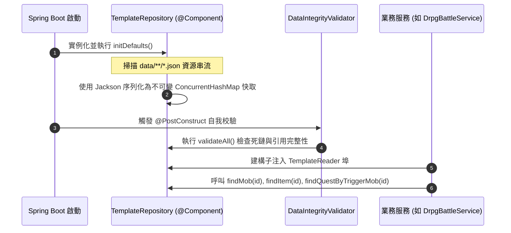

# 🗄️ 後端 M7: 100% 資料驅動模板模組深度手冊 (Data-Driven Templates Manual)

> **模組編號**：M7  
> **系統類型**：後端核心業務模組  
> **核心定位**：專案第一紅線基石，管理全域 JSON 模板目錄佈局、TemplateRepository 載入快取、TemplateReader 依賴反轉，以及開機自我校驗流水線。

---

## 📜 一、架構核心哲學：代碼即引擎，資料即世界

本專案將 **「100% 資料驅動不可篡改」** 定為專案第一紅線：
1. **Java 程式碼純淨性**：Java 類別只負責通用演算、狀態機調度與通訊協定，**不包含任何遊戲特例字串或特定數值**。
2. **策劃資料宣告化**：所有地圖、首領、對白、陣法、掉落、商店完全由 JSON 設定檔宣告。
3. **熱插拔與擴展性**：新增全新副本或技能，只需新增 JSON 設定檔，即可自動被系統識別與加載。

---

## 📂 二、資料檔案結構全覽

所有資料檔集中存放於 `src/main/resources/data/`：

```
src/main/resources/data/
├── zones/                              # 區域營地與據點設定
│   ├── newbie_village/                 # 桃源新手村安全營地
│   │   ├── facilities.json             # 選單式營地功能設施與對話
│   │   ├── mobs.json                   # 營地 NPC 與駐留人員實例
│   │   └── shops.json                  # 貨棧商品與補給配方
│   ├── mozhu_mines/                    # 墨竹山外圍
│   └── taiyin_tomb/                    # 太陰古塚地宮
│
├── dungeons/                           # DRPG 第一人稱地牢地圖
│   ├── mozhu_mines_b1f.json            # 墨竹礦坑一層 (10x10 網格、exitRoomId、遇敵率)
│   └── taiyin_tomb_b1f.json            # 太陰古塚一層 (10x10 網格、出口、地貌 legend)
│
├── party/                              # 小隊戰鬥技能
│   └── party_skills.json               # 5人隊友技能（威力、冷卻、真元消耗、削韌值、五行傷害類型）
│
├── companions/                         # 可招募夥伴模板
│   └── default_companions.json         # 鐵牛、燕青、凌霜、墨衍的道基五維與初始技能
│
├── formations/                         # 古仙陣法模板
│   └── formations.json                 # 四象辟邪陣、太陰玄冥陣、霸刀破陣式的站位增益與啟動門檻
│
├── global/                             # 全域跨區域共享資料庫
│   ├── items/                          # 裝備、法寶、丹藥與素材屬性模板
│   │   └── weapons/weapons.json        # 武器分類資料
│   ├── skills/                         # 技能範本定義
│   ├── classes.json                    # 職業、境界突破與道基成長曲線
│   ├── races.json                      # 種族基礎屬性
│   └── weapon_config.json              # 武器槽位與係數
│
└── quests.json                         # 通用任務與劇情台詞 (擊殺觸發、台詞對話、獎勵)
```

---

## ⚙️ 三、載入、快取與依賴反轉流水線



### 1. `TemplateRegistryPort` 與 `TemplateReader`
- **`TemplateRegistryPort`**：宣告寫入與註冊介面（僅限啟動時載入器呼叫）。
- **`TemplateReader`**：純唯讀查詢介面（`findItem`、`findMob`、`findShopByRoomId`、`findQuestByTriggerMob`）。
- **優點**：所有業務服務只依賴唯讀的 `TemplateReader`，杜絕任何業務邏輯在運行時意外污染或修改靜態模板。

---

## 🔍 四、開機自我校驗防護網 (DataIntegrityValidator)

為了防止 JSON 中寫錯 ID 導致執行期崩潰，專案內建 **`DataIntegrityValidator`**，在 Spring Boot 啟動時自動進行 9 大範疇稽核：

1. **物品範疇 (Items)**：校驗全域物品格式、數值邊界與品質。裝備未宣告 `equipSlot` 時記錄為警告（`warning`）。
2. **怪物範疇 (Mobs)**：檢查怪物掉落物 ID、穿戴裝備 ID、種族存在性與技能合法性。
3. **房間範疇 (Rooms)**：驗證房間 `exits` 指向目標真實存在，怪物刷新模板已定義，嚴防「走進虛空」。
4. **商店範疇 (Shops)**：驗證貨棧販售物品 ID 於全域物品庫中已註冊。
5. **夥伴範疇 (Companions)**：校驗初始夥伴五維屬性、預設站位與配置技能真實存在。
6. **陣法範疇 (Formations)**：驗證陣法 `minAliveCount`、孔位加成與必要職業（`requiredClasses`）合法性。
7. **地牢範疇 (Dungeons)**：驗證地牢二維圖例、尺寸、`exitRoomId` 營地中繼點與怪物池存在性。
8. **技能範疇 (Skills)**：校驗技能模板橋接、`overclockTier` 等級與合法 `DamageType` 枚舉。
9. **開局物資範疇 (Starting Kits)**：驗證主角預設開局裝備與物資 ID 合法性。

> 📌 **【錯誤阻斷等級】**：  
> 缺少非關鍵欄位（如裝備未指定 slot）記錄為 `warning`；若存在斷鏈引用（如不存在的出口、掉落物、怪物 ID）或無效 `DamageType` 記錄為 `error`，並於 `failFast = true` 時拋出 `DataValidationException` 阻斷應用啟動！

---

## 🔗 五、代表類別與資料設定檔

| 項目 | 路徑 / 名稱 | 職責 |
| :--- | :--- | :--- |
| **模板快取庫** | `com.example.htmlmud.template.TemplateRepository` | JSON 解析、快取持有與模板註冊 |
| **唯讀讀取埠** | `com.example.htmlmud.template.TemplateReader` | 業務層純唯讀存取介面（依賴反轉） |
| **資料校驗器** | `com.example.htmlmud.template.DataIntegrityValidator` | 開機 9 大範疇完整性自檢（死鏈、引用合法性） |
| **資料目錄** | `src/main/resources/data/**/*.json` | 全專案宣告式靜態設定真相源 |

---

## 🚀 六、未來架構演進規劃 (Roadmap)【待深入討論／長線演進藍圖】

1. **靜態啟動快取與可視化編輯器標準協議**：提供 OpenAPI / JSON Schema 規範，串接第三方編輯器。
2. **JSON Schema 語法嚴格校驗層【已決議待實作】**：引入標準 JSON Schema（draft-07）對每一類設定檔進行靜態型別與必填宣告檢查。
3. **純記憶體索引與開機自我校驗**：啟動階段完成全量 JSON 拓撲掃描與反序列化，執行期 0 次重複磁碟 I/O。
