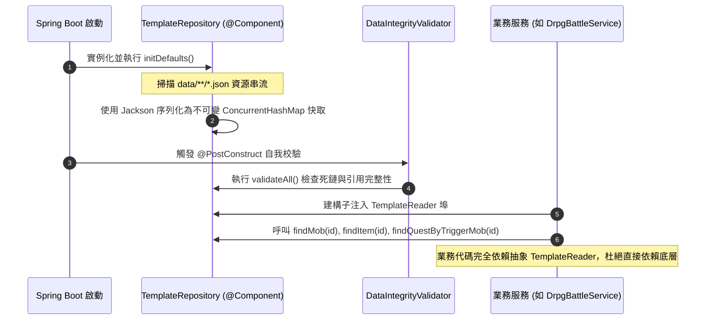

# 🗄️ 後端 M7: 100% 資料驅動模板模組深度手冊 (Data-Driven Templates Manual)

> **模組編號**：M7  
> **系統類型**：後端核心業務模組  
> **核心定位**：專案第一紅線基石，管理全域 JSON 模板目錄佈局、TemplateRepository 載入快取、TemplateReader 依賴反轉，以及開機自我校驗流水線。

---

## 📜 一、架構核心哲學：代碼即引擎，資料即世界

傳統 RPG 常犯的架構硬傷是將怪物數值、首領名稱、裝備槽位或任務對話硬編碼在 Java 程式碼中（例如 `if ("甲".contains(name))` 或 `if (mobId.equals("boss_xxx"))`）。

本專案將 **「100% 資料驅動不可篡改」** 定為專案第一紅線：
1. **Java 程式碼純淨性**：Java 類別只負責通用演算、狀態機調度與通訊協定，**不包含任何遊戲特例字串或特定數值**。
2. **策劃資料宣告化**：所有地圖、首領、對白、陣法、掉落、商店完全由 JSON 設定檔宣告。
3. **熱插拔與擴展性**：新增一個全新副本（如雪亭鎮古剎），只需新增 JSON 設定檔，即可自動被系統識別與加載，無需重新編譯 Java 程式碼！

---

## 📂 二、資料檔案結構全覽

所有資料檔集中存放於 `src/main/resources/data/`：

```
src/main/resources/data/
├── zones/                              # 區域營地與據點設定
│   ├── newbie_village/                 # 桃源新手村安全營地
│   │   ├── facilities.json             # 選單式營地功能設施與對話
│   │   ├── mobs.json                   # 營地 NPC 與駐留人員實例
│   │   └── shops.json                  # 貨棧商品、修復與強化配方
│   ├── mozhu_mines/                    # 墨竹山外圍
│   ├── taiyin_tomb/                    # 太陰古塚地宮
│   ├── silverleaf/                     # 銀葉村
│   └── snow/                           # 雪亭鎮
│
├── dungeons/                           # DRPG 第一人稱地牢地圖
│   ├── mozhu_mines_b1f.json            # 墨竹礦坑一層 (10x10 網格、exitRoomId、遇敵率)
│   └── taiyin_tomb_b1f.json            # 太陰古塚一層 (10x10 網格、出口、地貌 legend)
│
├── party/                              # 小隊戰鬥技能
│   └── party_skills.json               # 5人隊友技能（威力、冷卻、真元消耗、削韌值、五行傷害類型）
│
├── companions/                         # 可招募夥伴模板
│   └── default_companions.json         # 鐵牛、燕青、凌霜、墨衍的道基五維與初始技能
│
├── formations/                         # 古仙陣法模板
│   └── formations.json                 # 九宮八卦陣、北斗七星陣的站位增益與仇恨倍率
│
├── quests.json                         # 通用任務與劇情台詞 (擊殺觸發、台詞對話、獎勵)
├── items.json                          # 全域法寶、飛劍、防具、靈藥模板
└── classes/classes.json                # 職業、境界突破與道基成長曲線
```

---

## ⚙️ 三、載入、快取與依賴反轉流水線



### 1. `TemplateRegistryPort` 與 `TemplateReader`
- **`TemplateRegistryPort`**：宣告寫入與註冊介面（僅限啟動時載入器呼叫）。
- **`TemplateReader`**：純唯讀查詢介面（`findItem`、`findMob`、`findShopByRoomId`、`findQuestByTriggerMob`）。
- **優點**：所有業務服務（如 `DrpgBattleService`、`ShopCommand`、`MozhuMinesQuestListener`）只依賴唯讀的 `TemplateReader`，杜絕任何業務邏輯在運行時意外污染或修改靜態模板！

---

## 🔍 四、開機自我校驗防護網 (DataIntegrityValidator)

為了防止策劃或開發者在 JSON 寫錯一個 ID（例如房間出口指向不存在的房間、怪物掉落未定義的物品），專案內建 **`DataIntegrityValidator`**，在 Spring Boot 啟動時自動進行全面稽核：

1. **房間出口連通性驗證**：檢查每間房的 `exits` 指向的 `targetId` 是否真實存在，嚴防「走進虛空」。
2. **物品掉落完整性驗證**：檢查怪物 `mobPool` 與寶箱掉落物 ID 是否在 `items.json` 中已註冊。
3. **裝備槽位完整性驗證**：確保所有可穿戴裝備皆具備明確的 `equipSlot` 枚舉，杜絕前端中文名稱推測。
4. **技能五行與標籤驗證**：確認所有技能具備合法的 `DamageType` 與冷卻數值。

若有任何關鍵錯誤，驗證器會直接在控制台拋出致命警告，將 Bug 扼殺在編譯與啟動階段！

---

## 🔗 五、代表類別與資料設定檔

| 項目 | 路徑 / 名稱 | 職責 |
| :--- | :--- | :--- |
| **模板快取庫** | `com.example.htmlmud.template.TemplateRepository` | JSON 解析、快取持有與模板註冊 |
| **唯讀讀取埠** | `com.example.htmlmud.template.TemplateReader` | 業務層純唯讀存取介面（依賴反轉） |
| **資料校驗器** | `com.example.htmlmud.template.DataIntegrityValidator` | 開機完整性自檢（死鏈、引用合法性） |
| **轉接適配器** | `com.example.htmlmud.domain.repository.DrpgTemplateAdapter` | DRPG 專屬資料轉接與適配 |
| **資料目錄** | `src/main/resources/data/**/*.json` | 全專案宣告式靜態設定真相源 |

---

## 🚀 六、未來架構演進與現代化擴充規劃 (Future Roadmap & Scalability)

作為專案第一紅線的基石，資料驅動架構將持續向現代商業引擎（如 Unreal / Unity ScriptableObject）的靈活性演進：

### 1. 🎯 現代遊戲機制深化 (Modern Gameplay & Depth)
- **非中斷動態熱重載 (Live Hot-Reloading Pipeline)**：
  開發環境或運維管理下，整合檔案系統監聽器（`WatchService`）。當策劃修改 `skills.json` 或 `mozhu_mines_b1f.json` 存檔時，自動重新載入對應範本並原子性替換記憶體快取。無需重啟 Spring Boot，正在運行的遊戲世界即時套用新平衡性數值！
- **可視化地圖/技能編輯器標準協議**：
  提供 OpenAPI / JSON-LD 規範，方便串接第三方 Web 地圖編輯器（如 Tiled）或策劃試算表，一鍵匯出為標準專案 JSON。

### 2. 🛡️ 穩定性與狀態防禦 (Robustness & Resilience)
- **JSON Schema 語法嚴格校驗層 (JSON Schema Validation)**：
  引入標準 JSON Schema（Draft 2020-12）對每一類設定檔進行語法樹檢查。若缺少關鍵欄位（如 `exitRoomId`、`poiseDamage`）或數值越界，在建構與啟動階段精確指出檔案名稱與行號，將錯誤消滅於執行前。
- **孤島與環狀引線死鎖防禦**：升級 `DataIntegrityValidator`，增加圖論拓撲環路檢測（Cycle Detection），防止房間出口形成死鎖迷宮或階梯指向循環黑洞。

### 3. ⚡ 效能與啟動最佳化 (Performance & Validation)
- **純記憶體索引與開機自我校驗**：
  在 `TemplateRepository` 啟動階段完成全量 JSON 拓撲掃描與反序列化，建立雙向別名與索引表，於單元測試中由 `DataIntegrityValidator` 進行完整性防禦，執行期 0 次重複磁碟 I/O。

### 4. 🚫 過度設計正式除役宣告 (Decommissioned Over-Engineering Scope)
- ❌ **二進位預編譯快取 (MessagePack / FlatBuffers)**：已除役，維持標準可讀 JSON 檔案驅動。
- ❌ **第三方動態 Mod 載入器**：已除役，所有資料完全由 `src/main/resources/data/**/*.json` 單一真相源驅動。
