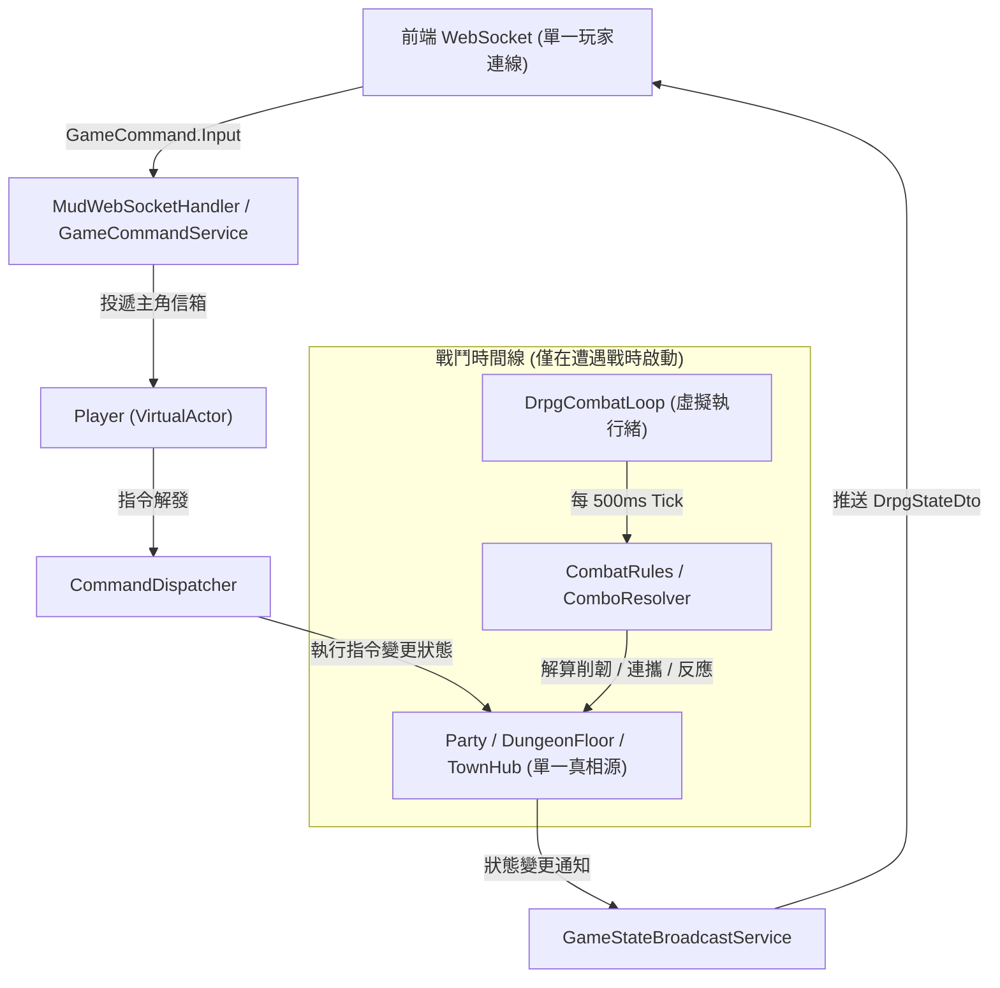

# ⚡ 後端 M9: 單機 DRPG 狀態管線與事件協定模組深度手冊 (State Pipeline & Events Manual)

> **模組編號**：M9  
> **系統類型**：後端核心系統模組  
> **核心定位**：**專為純單機第一人稱 Hack-and-Slash DRPG 設計的本機低延遲通訊與狀態管線**。  
> **架構原則**：**以現行輕量「文字指令輸入協定 (`GameCommand.Input`)」、「單一全景狀態推送契約 (`DrpgStateDto`)」與「虛擬執行緒戰鬥時間線 (`DrpgCombatLoop`)」為核心支柱，未來長線演進朝向「純結構化 DRPG 動作協定」推進**。

---

## 🏛️ 一、架構背景與設計哲學

本專案已全面確立為 **純單機單體 DRPG (Single-Player Monolith DRPG)**，因此通信與事件調度系統的核心特徵為：
1. **現行傳入協定【現行已驗證】**：前端透過 WebSocket 發送 `{"type": "INPUT", "text": "<command>"}`，對應後端 Java record `com.example.htmlmud.protocol.GameCommand.Input(String text)`；由 `MudWebSocketHandler` 經 `GameCommandService` 投遞至單機主角 `Player`（`VirtualActor`）信箱，再由 `CommandDispatcher` 分發予各 `PlayerCommand`（如 `DungeonCommand`、`TownFacilityCommand`、`PartyCommand`、`DrpgBattleCommand`、`SaveCommand`、`ShopCommand`、`TalkCommand`）。
2. **極致響應的單機狀態管線 (State Pipeline)**：任何遊戲邏輯變更（走格移動、施法命中、穿換裝備、營地休息、存檔）完成後，後端透過 `GameStateBroadcastService` 組裝單一全景契約 `DrpgStateDto` 統一推送，前端進行單向視圖投影。
3. **輕量虛擬執行緒時間線 (Virtual Thread Timeline)**：利用 Java 21/25 Virtual Threads 驅動戰鬥 500ms Tick 迴圈 (`DrpgCombatLoop`)，代碼直觀、零鎖競爭、零回調地獄，天然免除多玩家併發複雜度。

---

## 🔄 二、本機 WebSocket 通訊流程

前後端透過極簡的本機全雙工 WebSocket（預設端點：`ws://localhost:8080/ws`）互動：

```text
[前端 視圖層 (websocket.js / app.js)]                               [後端 業務引擎 (CommandDispatcher)]
          │                                                                      │
          │ ────────── 1. 本機握手連線 (Local Handshake) ────────────────────────> │
          │ <───────── 2. 連線就緒 (Connection Ready: SESSION_ATTACHED) ────────── │
          │                                                                      │
          │ ────────── 3. 文字指令包裝 (GameCommand.Input: "step w" / "torch") ───> │
          │                                                                      │
          │ <───────── 4. 情境敘事文字日誌 (NARRATIVE / SYSTEM 日誌事件) ───────── │
          │ <───────── 5. 戰鬥打擊事件 (BattleEventsDto - 飄字/震屏/打斷反饋) ──── │
          │ <───────── 6. 單一全景狀態快照 (DrpgStateDto - 地牢/營地/小隊/戰況) ── │
          │                                                                      │
          │ ────────── 7. 本機心跳保活 Ping (每 30 秒) ──────────────────────────> │
```

---

## 🎮 三、傳入動作協定規範 (Action Protocol)

### 1. 現行已驗證傳入協定【現行已驗證】
現行前後端通訊統一封裝為 `GameCommand.Input` JSON：
```json
{
  "type": "INPUT",
  "text": "<command>"
}
```
由 `CommandDispatcher` 映射至具體語意指令：
- **走格移動**：`step w`（前進）、`step s`（後退）、`step a`（左轉）、`step d`（右轉）
- **地塊探索**：`dungeon inspect`（調查前方）、`dungeon interact`（互動機關）、`dungeon light` / `torch`（點火把）
- **戰鬥戰技**：`battle cast <charId> <skillId> <targetIdx>`、`battle finisher`（發動陣眼終結技）
- **營地設施**：`town_facility <facilityId> <action>`（如 `town_facility fac_inn rest`、`shop buy ...`）
- **小隊整備**：`equip <charId> <slot> <bagIndex>`、`unequip <charId> <slot>`、`party row <charId> <row>`
- **存檔管理**：`save <slot>`、`save restore <slot>`

---

### 2. 結構化動作協定【待深入討論／長線演進藍圖】
為進一步消除前端指令字串拼接，未來長線規劃推進為高階結構化動作 JSON：

#### ① 地牢移動與互動 (`MOVE` / `INTERACT` / `EXTRACT`)
```json
{ "action": "MOVE", "direction": "FORWARD" } // FORWARD, BACKWARD, TURN_LEFT, TURN_RIGHT
{ "action": "INTERACT" } // 開啟寶箱、解除陷阱、破拆暗門
{ "action": "EXTRACT" } // 站在階梯或傳送陣時安全撤離返回營地
```

#### ② 戰鬥戰技與終結技 (`CAST_SKILL` / `FORMATION_FINISHER`)
```json
{
  "action": "CAST_SKILL",
  "actorId": "char-hero",
  "skillId": "skill_time_tier1_step",
  "targetId": "mob-001"
}
{ "action": "FORMATION_FINISHER", "targetId": "all_enemies" }
```

#### ③ 營地設施與對話 (`TOWN_FACILITY` / `INTERACT_NPC`)
```json
{
  "action": "TOWN_FACILITY",
  "facility": "INN",
  "subAction": "REST"
}
{
  "action": "INTERACT_NPC",
  "npcId": "elder_kuang_nu",
  "optionId": "opt_ask_chip"
}
```

#### ④ 裝備與道基潛能 (`EQUIP` / `ALLOCATE_POTENTIAL` / `SAVE_GAME`)
```json
{ "action": "EQUIP", "memberId": "char-hero", "slot": "MAIN_HAND", "bagIndex": 0 }
{ "action": "ALLOCATE_POTENTIAL", "memberId": "char-hero", "attribute": "CON", "points": 1 }
{ "action": "SAVE_GAME", "slot": 1 }
```

---

## 📦 四、單一全景狀態契約：`DrpgStateDto`

後端透過 `GameStateBroadcastService` 統一組裝派發，嚴格對齊 `DrpgStateDto.java` 真實結構：

```json
{
  "type": "DRPG_STATE",
  "mode": "DUNGEON", // "TOWN" (營地中樞) 或 "DUNGEON" (地牢遠征)
  
  // 1. 營地中樞視角 (當 mode == "TOWN" 時非空)
  "town": {
    "zoneId": "newbie_village",
    "zoneName": "黑煞宗採掘營 ‧ 下層避難所",
    "roomId": "inn",
    "roomName": "避難所通鋪柴房",
    "description": "空氣中瀰漫著辟邪香與機油混合的刺鼻氣味...",
    "safeZone": true,
    "exits": [],
    "npcs": [ { "id": "elder_kuang_nu", "name": "採礦長老 ‧ 鐵手", "description": "..." } ],
    "items": [],
    "hub": {
      "zoneId": "newbie_village",
      "zoneName": "黑煞宗採掘營 ‧ 下層避難所",
      "description": "深入礦脈千米之下的雜役避煞營地...",
      "chipRate": 25,
      "perceptionTier": "MORTAL", // MORTAL, AWAKENED, TRANSCENDENT
      "facilities": [
        {
          "id": "fac_forge", "name": "百煉堂", "facilityType": "FORGE", "icon": "⚒️",
          "description": "長老爐火純青，傳承神兵開光與法寶注靈之法。",
          "npcId": "blacksmith_liu", "npcName": "鐵匠老劉",
          "targetDungeons": [], "actions": ["reforge", "upgrade"],
          "isOpen": true, "glitch": false
        }
      ]
    }
  },

  // 2. 地牢遠征視角 (當 mode == "DUNGEON" 時非空)
  "dungeon": {
    "floorId": "mozhu_mines_b1f",
    "floorName": "墨竹礦脈地下深度一階",
    "x": 2, "y": 7,
    "direction": "NORTH", "directionArrow": "▲",
    "width": 10, "height": 10,
    "tiles": [ [ "#", ".", "◇" ] ],
    "visited": [ [ false, true, true ] ],
    "forwardInspection": "前方三步為堅硬玄岩，石縫滲出暗紅組織...",
    "dangerLevel": 35,
    "dangerStatus": "SAFE",
    "openedChests": [ [ false, false, true ] ],
    "tileNames": [ [ "玄岩岩壁", "碎石通道", "已開啟的古修遺骸" ] ],
    "torchLight": 85,
    "torchStatus": "BRIGHT", // BRIGHT, DIM, DARKNESS
    "torchIcon": "🔥"
  },

  // 3. 5 人標準戰術小隊 (含 40 格小隊共用行囊與靈石)
  "party": {
    "name": "墨竹勘探隊",
    "formationName": "四象辟邪陣",
    "formationEnergy": 45, // 0~100 終結技共鳴進度
    "ultimateSkillName": "四象混元辟邪印",
    "canCastUltimate": false,
    "formationActive": true,
    "coin": 1250, // 小隊靈石 / 碎銀
    "inventory": {
      "capacity": 40,
      "usedCount": 2,
      "slots": [
        {
          "slotIndex": 0, "itemId": "item_torch", "name": "辟邪火把",
          "quantity": 8, "type": "CONSUMABLE", "quality": "COMMON",
          "affixes": [], "poiseBreakPower": 0
        },
        {
          "slotIndex": 1, "itemId": "item_black_alloy_blade", "name": "玄鐵百煉飛劍",
          "quantity": 1, "type": "WEAPON", "quality": "RARE",
          "affixes": [ { "type": "POISE_BREAK", "value": 15, "description": "+15 削韌力" } ],
          "poiseBreakPower": 15
        }
      ]
    },
    "availableFormations": [ ... ],
    "members": [
      {
        "id": "char-hero", "name": "長生", "roleTitle": "隊長", "row": "FRONT",
        "hp": 85, "maxHp": 100, "mp": 45, "maxMp": 50, "sp": 100, "maxSp": 100,
        "san": 85, "maxSan": 100, "sanState": "CALM", "sanLevel": "NORMAL",
        "resourceType": "SP", "currentResource": 100, "maxResource": 100,
        "alive": true, "skills": [ ... ], "equippedWeapon": { ... }, "equippedArmor": { ... },
        "equipment": { "MAIN_HAND": { ... }, "BODY": { ... } },
        "level": 3, "exp": 120, "nextLevelExp": 320, "freeStatPoints": 2,
        "str": 14, "con": 12, "dex": 10, "intStat": 10, "wis": 10,
        "isOnGcd": false, "remainingGcdMs": 0,
        "isCasting": false, "castingSkillName": null,
        "castingDurationMs": 0, "castingRemainingMs": 0
      }
    ]
  },

  // 4. 遭遇戰擂台 (僅在遭遇魔物時啟動)
  "battle": {
    "inBattle": true,
    "battleState": "IN_PROGRESS",
    "selectedTargetIndex": 0,
    "logs": [ "鐵牛發動【破陣斬】，對畸變採礦機甲造成 42 點物理傷害！" ],
    "enemies": [
      {
        "index": 0, "id": "mob-001", "name": "畸變採礦機甲",
        "hp": 240, "maxHp": 400, "row": "FRONT", "alive": true,
        "isTarget": true, "isStunned": false, "threat": 10,
        "isLarge": false, "size": 1, "slot": "CENTER",
        "isCasting": true, "castDurationMs": 2500, "castRemainingMs": 800,
        "isInterruptible": true, "poise": 10, "maxPoise": 80, "isPoiseBroken": false,
        "shield": 0, "activeBuffs": [],
        "currentAction": "重械猛砸", "actionProgressPercent": 68, "interruptible": true
      }
    ]
  }
}
```

---

## ⚡ 五、輕量虛擬執行緒時間線架構

為杜絕傳統多執行緒鎖競爭與響應式編程的晦澀斷點，M9 採用 **Java 21/25 Virtual Threads + 信箱事件分發**：



- **極簡與高可靠**：無分佈式跨節點負擔，所有狀態變更在單一 JVM 內完成，排查錯誤與編寫單元測試直觀。
- **隨開即停**：戰鬥觸發時啟動虛擬執行緒輪詢；戰鬥結束即刻優雅停止 (`running = false`)，釋放運算資源。

---

## 🔗 六、代表類別清單

| 項目 | 路徑 / 名稱 | 職責 |
| :--- | :--- | :--- |
| **指令分發器** | `com.example.htmlmud.pipeline.CommandDispatcher` | 接收解發文字輸入指令，路由至地牢、小隊、戰鬥或城鎮服務 |
| **WebSocket 處理器** | `com.example.htmlmud.pipeline.MudWebSocketHandler` | 本機連線生命週期、連線綁定與文字日誌推送 |
| **狀態廣播器** | `com.example.htmlmud.pipeline.GameStateBroadcastService` | 全景狀態組裝與 `DrpgStateDto` JSON 推送 |
| **會話註冊表** | `com.example.htmlmud.pipeline.SessionRegistry` | 管理本機會話連線與通道對應關係 |
| **戰鬥時間線迴圈** | `com.example.htmlmud.combat.DrpgCombatLoop` | 虛擬執行緒驅動的 500ms 半即時戰鬥結算 |
| **全景契約 DTO** | `com.example.htmlmud.dungeon.DrpgStateDto` | 前後端全域資料交換唯一契約 |
