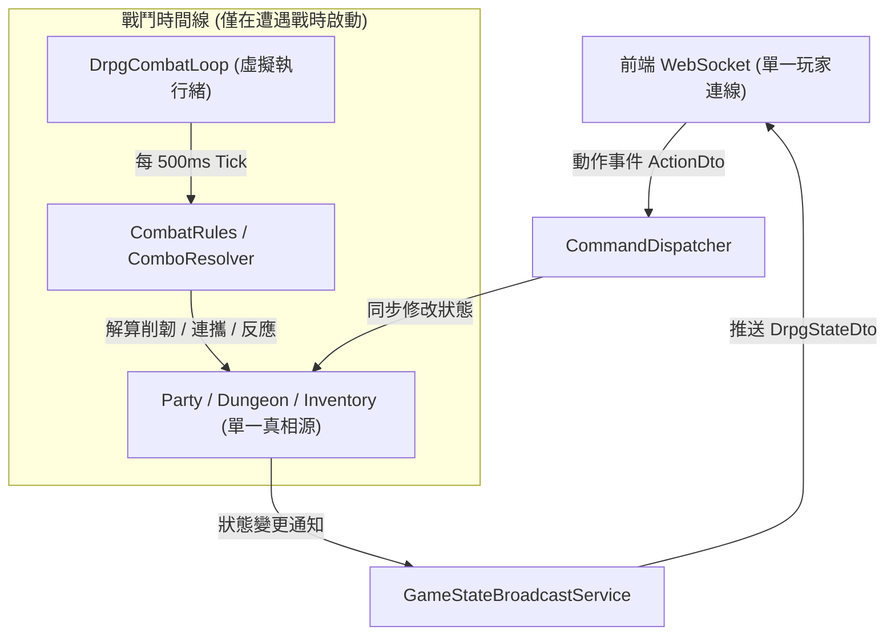

# ⚡ 後端 M9: 單機 DRPG 狀態管線與事件協定模組深度手冊 (State Pipeline & Events Manual)

> **模組編號**：M9  
> **系統類型**：後端核心系統模組  
> **核心定位**：**專為純單機第一人稱 Hack-and-Slash DRPG 設計的本機低延遲通訊與狀態管線**。  
> **設計原則**：**徹底除役 MUD 指令解析器與多實體 Actor 信箱，以「結構化 DRPG 動作協定 (Action Protocol)」、「單一全景狀態推送契約 (`DrpgStateDto`)」與「輕量虛擬執行緒時間線迴圈」為三大支柱**。

---

## 🏛️ 一、架構背景與設計哲學

本專案已全面確立為 **純單機單體 DRPG (Single-Player Monolith DRPG)**，因此通信與事件調度系統的核心目標是：
1. **零文字命令行負擔**：不再解析 `"look"`, `"step n"`, `"kill rat"` 等 MUD 字符串，完全由前端按鈕、鍵盤映射（W/A/S/D）與選單發送**結構化動作 JSON**。
2. **極致響應的單機狀態管線 (State Pipeline)**：任何遊戲邏輯變更（移動踩格、施法命中、穿換裝備、營地休息）完成後，後端透過單一全景契約 `DrpgStateDto` 統一推送，前端僅作單向視圖投影。
3. **輕量虛擬執行緒時間線 (Virtual Thread Timeline)**：利用 Java 21/25 Virtual Threads 驅動戰鬥 500ms Tick 迴圈 (`DrpgCombatLoop`)，代碼直觀、零鎖競爭、零回調地獄，天然免除多玩家併發複雜度。

---

## 🔄 二、本機 WebSocket 通訊流程

前後端透過極簡的本機全雙工 WebSocket（預設端點：`ws://localhost:8080/ws`）互動：

```text
[前端 視圖層 (websocket.js)]                                      [後端 業務引擎 (CommandDispatcher)]
          │                                                                      │
          │ ────────── 1. 本機握手連線 (Local Handshake) ────────────────────────> │
          │ <───────── 2. 連線就緒 (Connection Ready) ─────────────────────────── │
          │                                                                      │
          │ ────────── 3. DRPG 結構化動作事件 (如 MOVE / CAST_SKILL) ─────────────> │
          │                                                                      │
          │ <───────── 4. 情境敘事文字日誌 (Narrative Text Event) ─────────────── │
          │ <───────── 5. 戰鬥打擊事件 (BattleEventsDto - 飄字/震屏/打斷反饋) ──── │
          │ <───────── 6. 單一全景狀態快照 (DrpgStateDto - 地牢/小隊/戰況) ────── │
          │                                                                      │
          │ ────────── 7. 本機心跳保活 Ping (每 30 秒) ──────────────────────────> │
```

---

## 🎮 三、DRPG 結構化動作協定規範 (Action Protocol)

前端向後端派發的請求一律為標準 JSON 物件：

### 1. 地牢走格移動動作 (`MOVE`)
```json
{
  "action": "MOVE",
  "direction": "FORWARD" // 可為 "FORWARD" (前進), "BACKWARD" (後退), "TURN_LEFT" (左轉), "TURN_RIGHT" (右轉)
}
```

### 2. 地塊互動與撤離動作 (`INTERACT` / `EXTRACT`)
```json
{
  "action": "INTERACT" // 調查當前地塊：開啟寶箱、解除機關陷阱、破拆暗門
}
```
```json
{
  "action": "EXTRACT" // 當站在向上石階或傳送陣時安全撤離地牢，結算戰利品返回營地中樞
}
```

### 3. 戰鬥戰技施放動作 (`CAST_SKILL`)
```json
{
  "action": "CAST_SKILL",
  "actorId": "char-1",
  "skillId": "skill_time_tier1_step",
  "targetId": "mob-001"
}
```

### 4. 陣眼終結技發動動作 (`FORMATION_FINISHER`)
```json
{
  "action": "FORMATION_FINISHER",
  "targetId": "all_enemies"
}
```

### 5. 營地選單設施交互 (`TOWN_FACILITY`)
```json
{
  "action": "TOWN_FACILITY",
  "facility": "INN", // 可為 "INN" (客棧調息), "SHOP" (集市補給/買賣), "FORGE" (工坊注靈/強化), "DOJO" (道場洗點/Gambit), "LAB" (晶片超頻), "PORTAL" (傳送啟程)
  "subAction": "REST", // 如 "REST", "BUY", "SELL", "REFORGE", "OVERCLOCK", "ENTER_DUNGEON"
  "payload": { ... }
}
```

### 6. NPC 劇情對話交互 (`INTERACT_NPC`)
```json
{
  "action": "INTERACT_NPC",
  "npcId": "elder_kuang_nu",
  "optionId": "opt_ask_chip" // 選項 ID，或若初次對話則省略 optionId
}
```

### 7. 裝備穿脫與物品使用 (`EQUIP` / `UNEQUIP` / `USE_ITEM`)
```json
{
  "action": "EQUIP",
  "memberId": "char-1",
  "slot": "MAIN_HAND",
  "itemId": "item_black_alloy_blade"
}
```
```json
{
  "action": "USE_ITEM",
  "itemId": "item_torch", // 如火把點火回復光明度、辟邪靈茶回滿 SAN
  "targetMemberId": "char-1"
}
```

### 8. 道基五維潛能分配 (`ALLOCATE_POTENTIAL`)
```json
{
  "action": "ALLOCATE_POTENTIAL",
  "memberId": "char-1",
  "attribute": "CON", // CON (體質), ESS (真元), SPI (神識), STR (根骨), AGI (身法)
  "points": 1
}
```

### 9. 本地存檔管理 (`SAVE_GAME` / `LOAD_GAME`)
```json
{
  "action": "SAVE_GAME",
  "slot": "slot_1" // slot_1 ~ slot_5
}
```

---

## 📦 四、單一全景狀態契約：`DrpgStateDto`

後端透過 `GameStateBroadcastService` 統一組裝派發，嚴格對齊專案 **五大核心目標**：

```json
{
  "type": "DRPG_STATE",
  "viewMode": "DUNGEON", // "TOWN" (營地選單) 或 "DUNGEON" (地牢遠征)
  
  // 1. 地牢遠征視角 (當 viewMode == "DUNGEON" 時非空 - 世界觀介紹 & DRPG 走格)
  "dungeon": {
    "floorId": "black_vein_b1f",
    "floorName": "黑煞宗地底礦脈一層 (外神卵鞘偽地殼)",
    "x": 2, "y": 7,
    "direction": "NORTH", "directionArrow": "▲",
    "width": 10, "height": 10,
    "tiles": [ [ "#", ".", "..." ] ],
    "visited": [ [ false, true, "..." ] ],
    "openedChests": [ [ false, false, "..." ] ],
    "torchLight": 85, // 火把光明度 (0~100)
    "torchStatus": "BRIGHT", // "BRIGHT" / "DIM" / "DARKNESS"
    "forwardInspection": "石壁摸起來如同堅韌的角質皮革，石縫正滲出暗紅黏稠組織..."
  },

  // 2. 營地中樞視角 (當 viewMode == "TOWN" 時非空 - 六大功能設施)
  "townHub": {
    "hubId": "hub_ore_mine_shelter",
    "hubName": "黑煞宗採掘營 ‧ 下層避難所",
    "facilities": [
      { "id": "FAC_FORGE", "name": "百煉堂 (裝備工坊)", "unlocked": true },
      { "id": "FAC_DOJO", "name": "靈台藏經閣 (晶片實驗室)", "unlocked": true },
      { "id": "FAC_TACTICS", "name": "雜役演武道場 (戰術方針)", "unlocked": true },
      { "id": "FAC_MARKET", "name": "宗門外門集市 (貨棧交易)", "unlocked": true },
      { "id": "FAC_INN", "name": "回春客棧／通鋪柴房 (全隊休整)", "unlocked": true },
      { "id": "FAC_PORTAL", "name": "廢棄礦脈坑道 (地牢啟程)", "unlocked": true }
    ],
    "activeNpcs": [ { "id": "elder_kuang_nu", "name": "採礦長老 ‧ 鐵手" } ]
  },

  // 3. 5 人標準戰術小隊 (小隊戰鬥 & 養成)
  "party": {
    "partyId": "party-hero-01",
    "activeFormation": {
      "id": "nine_palaces_eight_trigrams",
      "name": "九宮八卦陣",
      "resonanceProgress": 45, // 0~100 終結技共鳴進度
      "canCastFinisher": false
    },
    "members": [
      {
        "id": "char-hero", "name": "李長生 (主角)", "row": "FRONT",
        "hp": 850, "maxHp": 1000, "mp": 200, "maxMp": 300,
        "san": 85, "maxSan": 100, // 外神精神侵蝕防護罩
        "poise": 70, "maxPoise": 100, // 罡氣破防值
        "gcdRemainingMs": 0,
        "activeBuffs": [ ... ],
        "skills": [ ... ],
        "equipment": { ... } // 5+2 結構
      }
    ]
  },

  // 4. 40 格小隊共用儲物袋 (刷寶養成 & 40格背包)
  "inventory": {
    "capacity": 40,
    "coins": 1250, // 碎銀 / 靈石
    "items": [
      { "slot": 0, "id": "item_torch", "name": "辟邪火把", "count": 8 },
      { "slot": 1, "id": "item_black_alloy_blade", "name": "玄鐵百煉飛劍", "count": 1 }
    ]
  },

  // 5. 遭遇戰擂台 (僅在遭遇魔物時啟動 - 半即時戰鬥)
  "battle": {
    "inBattle": true,
    "battleId": "bat-9901",
    "enemies": [
      {
        "id": "mob-001", "name": "畸變礦奴 ‧ 斷指", "level": 3,
        "hp": 240, "maxHp": 400, "poise": 10, "maxPoise": 80,
        "isCasting": true, "castingAction": "重械猛砸", "castProgress": 65,
        "activeBuffs": [ ... ]
      }
    ]
  }
}
```

---

## ⚡ 五、輕量虛擬執行緒時間線架構

為杜絕傳統多執行緒鎖競爭與 Reactor 響應式編程的晦澀斷點，M9 採用 **Java 21/25 Virtual Threads + 單一調度管線**：



- **極簡與高可靠**：沒有分佈式、沒有跨節點發信，所有狀態變更在單一 JVM 內完成，排查錯誤與編寫單元測試極其直觀。
- **隨開即停**：戰鬥觸發時啟動虛擬執行緒輪詢；戰鬥結束即刻優雅停止 (`running = false`)，釋放運算資源。

---

## 🔗 六、代表類別清單

| 項目 | 路徑 / 名稱 | 職責 |
| :--- | :--- | :--- |
| **指令分發器** | `com.example.htmlmud.pipeline.CommandDispatcher` | 接收客戶端動作 JSON，分發至地牢、小隊或戰鬥服務 |
| **WebSocket 處理器** | `com.example.htmlmud.pipeline.MudWebSocketHandler` | 本機連線生命週期、心跳與文字日誌推送 |
| **狀態廣播器** | `com.example.htmlmud.pipeline.GameStateBroadcastService` | 全景狀態組裝與 `DrpgStateDto` JSON 推送 |
| **會話註冊表** | `com.example.htmlmud.pipeline.SessionRegistry` | 管理本機會話連線與通道對應關係 |
| **戰鬥時間線迴圈** | `com.example.htmlmud.combat.DrpgCombatLoop` | 虛擬執行緒驅動的 500ms 半即時戰鬥結算 |
| **全景契約 DTO** | `com.example.htmlmud.dungeon.DrpgStateDto` | 前後端全域資料交換唯一契約 |
