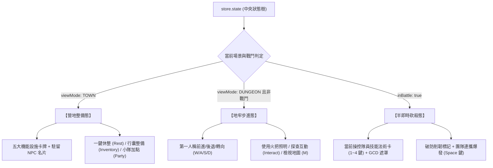

# 🏛️ 前端 FE-4: 營地中樞設施與動作列面板手冊 (Town Hub & Action Bar Manual)

> **模組編號**：FE-4  
> **系統類型**：前端表現層模組  
> **核心定位**：管理純單機 DRPG 安全營地中樞（Town Hub Panel）選單式視圖、機能設施卡片（裝備工坊、晶片實驗室、道場、醫療站、傳送門）、NPC 劇情名片與對話彈窗，以及常駐底部快捷動作列（Action Bar Panel）在「營地整備態 / 地牢步進態 / 半即時砍殺態」的無縫狀態切換。

---

## 🏛️ 一、模組架構與視圖職責劃分

本模組涵蓋兩大關鍵面板元件：
1. **營地中樞面板 (`town-panel.js`)**：在營地安全區（`viewMode === 'TOWN'`）主導中央與右側視圖佈局，呈現克蘇魯賽博修仙避難所市集氛圍，支援一鍵點擊進入機能設施與 NPC 對話。
2. **快捷動作列面板 (`action-bar-panel.js`)**：常駐於螢幕底層，純資料驅動（`data-action`），隨遊戲情境動態變換。



---

## 🏘️ 二、選單式營地中樞佈局 (`town-panel.js`)

徹底廢止 MUD 房間與 exits 出口概念，營地採用現代純單機 DRPG 典範卡片化佈局：

```
┌────────────────────────────────────────────────────────┐
│               黑煞宗地底礦脈・下層避難所               │
├────────────────────────────────────────────────────────┤
│ 【 營地設施 (Facilities) 】                            │
│  ┌──────────────┐  ┌──────────────┐  ┌──────────────┐  │
│  │ 裝備工坊     │  │ 晶片實驗室   │  │ 修煉道場     │  │
│  │ [分解/鍛造]  │  │ [超頻/插槽]  │  │ [洗點/Gambit]│  │
│  └──────────────┘  └──────────────┘  └──────────────┘  │
│  ┌──────────────┐  ┌──────────────────────────────┐    │
│  │ 生化醫療站   │  │ ⚡ 地牢傳送門 (Dungeon Gate)  │    │
│  │ [基因補完]   │  │ 【出征：黑煞宗地底礦脈一階】│    │
│  └──────────────┘  └──────────────────────────────┘    │
├────────────────────────────────────────────────────────┤
│ 【 駐留重要生靈 (NPCs) 】                              │
│  ┌────────────────────┐   ┌────────────────────┐       │
│  │  採礦長老・鐵手    │   │  黑市改裝商人・瘸狼│       │
│  │  [交談] [主線劇情] │   │  [黑市交易]        │       │
│  └────────────────────┘   └────────────────────┘       │
└────────────────────────────────────────────────────────┘
```

### 1. 機能設施卡牌點擊事件
所有按鈕均綁定原生純事件委派標記：
- `data-action="open-facility" data-facility-id="forge"`：喚出裝備分解與強化模態窗。
- `data-action="open-facility" data-facility-id="chip-lab"`：開啟前世特工晶片超頻與插槽鑲嵌。
- `data-action="open-facility" data-facility-id="dojo"`：自由調整技能點與隊員自動戰術（Gambit）。
- `data-action="enter-dungeon" data-dungeon-id="zone_ore_mine_b1"`：小隊出發進入地牢，視圖平滑切換至第一人稱視口。

### 2. NPC 劇情對話介面
點擊 NPC 卡片派發 `data-action="interact-npc"`：
- 彈出帶有頭像、克蘇魯賽博修仙背景與分支選項的對話視窗。
- 支援劇情推進、情報解鎖與物資交易。

---

## ⚡ 三、快捷動作列三態切換機制 (`action-bar-panel.js`)

動作列位於螢幕最下方，根據中央狀態進行瞬時切換：

### 1. 營地整備態 (Town Hub State)
- **快捷操作**：
  - `[R] 全隊休整`：立即補滿全員氣血（HP）與真元（MP）。
  - `[I] 小隊行囊`：開啟 40 格公用儲物袋與裝備穿戴。
  - `[P] 角色養成`：開啟 5 人小隊屬性加點與境界突破面板。
  - `[Enter] 出征地牢`：快速進入地牢傳送門。

### 2. 地牢步進態 (Dungeon Exploration State)
- **第一人稱視角控制**：
  - `[W] 前進` / `[S] 後退` / `[A] 左轉向` / `[D] 右轉向` / `[Q] 左平移` / `[E] 右平移`。
  - `[F] 空間互動`：開寶箱、啟動遠古遺跡開關、解除陷阱。
  - `[T] 消耗火把`：增加當前區域光明度，防範外神陰煞滋生。
  - `[M] 樓層地圖`：切換全螢幕已探明迷宮與標記點。

### 3. 半即時砍殺戰鬥態 (Hack-and-slash Combat State)
- **高頻戰術卡牌**：
  - `[1~4] 當前隊員法術`：即時施放四大流派技能，支援公共冷卻（GCD）光圈與真元耗損反饋。
  - `[Tab] 切換目標`：在敵群中切換當前鎖定集火目標。
  - `[Space] 團隊連攜合擊 (Link Strike)`：當敵方破防（Break）時高亮閃爍，點擊釋放全隊合擊奧義。
  - `[G] 啟用/暫停自動戰術 (Gambit Toggle)`：一鍵切換小隊託管戰鬥模式。

---

## 📱 四、響應式排版適配規範

- **桌機螢幕（Width $\ge 1024\text{px}$）**：
  左側為情境敘事日誌面板，中央為 3D 視口/設施卡牌矩陣，右側為小隊 5 人血條與狀態監控，底部為動作列。
- **掌機/行動端（Width $< 1024\text{px}$）**：
  自動收斂為垂直單欄，點擊按鈕保底 $44 \times 44\text{px}$，避免戰鬥高頻點擊誤觸。

---

## 🔗 五、代表檔案清單

| 檔案路徑 | 模組定位 | 關鍵導出項目 |
| :--- | :--- | :--- |
| `static/js/panels/town-panel.js` | 營地中樞主控制器 | `renderTownHub()`, `renderFacilities()`, `renderNpcs()` |
| `static/js/panels/action-bar-panel.js` | 底部快捷動作列控制器 | `renderActionBar()`, `syncActionBarMode()` |
| `static/css/style-05-town-and-hub.css` | 營地設施卡牌與 NPC 對話樣式 | `.town-hub-grid`, `.facility-card`, `.npc-dialogue-modal` |
| `static/css/style-06-shop-and-responsive.css` | 設施功能彈窗與響應式排版 | `.facility-modal`, `@media (max-width: 1024px)` |

---

## 🎯 六、純單機規範守衛

1. **嚴禁文字方向 exits 導航**：介面嚴格禁止出現任何 north/south 出口方塊或方位文字。
2. **零延遲功能響應**：點擊設施立即展示對應介面，無任何冗長等待或無效指令回傳。
3. **無縫戰鬥切換**：在戰鬥觸發時，動作列在 150ms 內完成平滑變形，第一時間提供技能釋放反饋。
