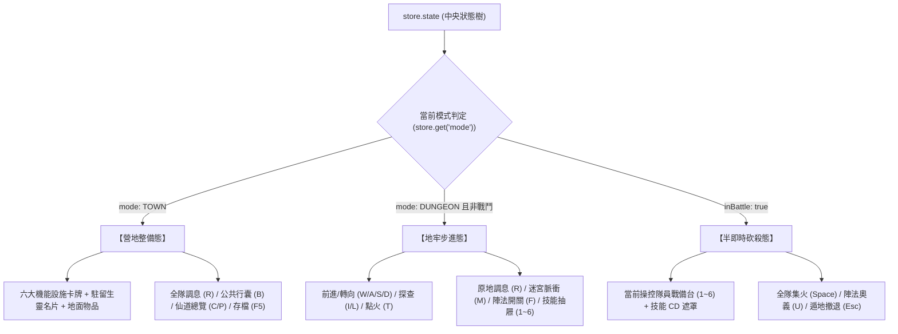

# 🏛️ 前端 FE-4: 營地中樞設施與動作列面板手冊 (Town Hub & Action Bar Manual)

> **模組編號**：FE-4  
> **系統類型**：前端表現層模組  
> **核心定位**：管理純單機 DRPG 安全營地中樞（Town Hub Panel）選單式視圖、機能設施卡片（裝備工坊、晶片實驗室、道場、醫療站、傳送門）、NPC 劇情名片與地面靈物，以及常駐底部快捷動作列在「營地整備態 / 地牢步進態 / 半即時砍殺態」的無縫狀態切換。

---

## 🏛️ 一、模組架構與視圖職責劃分

本模組涵蓋兩大關鍵面板元件：
1. **營地中樞面板 (`src/main/resources/static/js/panels/town-panel.js`)**：在營地安全區（`store.get('mode') === 'TOWN'`）主導主舞台視圖佈局，呈現克蘇魯賽博修仙避難所市集氛圍，支援一鍵點擊進入機能設施與身旁生靈互動。
2. **快捷動作列元件**：常駐於螢幕底層（整合於 `src/main/resources/static/index.html` 之 `#bottom-control-panel`，舊規劃檔 `static/js/panels/action-bar-panel.js`【歷史／已除役】），純資料驅動（`data-action`），隨遊戲情境動態變換。



---

## 🏘️ 二、選單式營地中樞佈局 (`town-panel.js`)

徹底廢止 MUD 房間與 exits 方位出口概念，營地採用現代純單機 DRPG 卡片化佈局：
- 主舞台容器為 `#town-nav-panel`（`.town-nav-panel.town-main-stage`）。
- 左側為 `#town-facilities-grid`（`.town-hub-grid`）與 `#town-perception-badge`（顯示 `晶片加載 X%` 與靈識位階）。
- 右側為 `#town-npcs-list`（駐留生靈列表）與 `#town-items-list`（地面遺落物品）。

```
┌────────────────────────────────────────────────────────────────────────┐
│                      黑煞宗地底礦脈・下層避難營地                      │
├────────────────────────────────────────────────────────────────────────┤
│ 【 營地設施 (Facilities) 】        │ 【 駐留重要生靈 (NPCs) 】         │
│  ┌──────────────┐  ┌──────────────┐ │  ┌────────────────────────────┐   │
│  │ 百煉堂       │  │ 靈台藏經閣   │ │  │ 採礦長老・鐵手             │   │
│  │ [鍛造/法寶]  │  │ [道骨/經法]  │ │  │ [交談] [主線指引]           │   │
│  └──────────────┘  └──────────────┘ │  └────────────────────────────┘   │
│  ┌──────────────┐  ┌──────────────┐ │  ┌────────────────────────────┐   │
│  │ 雜役演武道場 │  │ 宗門外門集市 │ │  │ 外門集市遊商・瘸狼         │   │
│  │ [陣法/戰術]  │  │ [交易/補給]  │ │  │ [貨棧買賣]                 │   │
│  └──────────────┘  └──────────────┘ │  └────────────────────────────┘   │
│  ┌──────────────┐  ┌──────────────┐ ├───────────────────────────────────┤
│  │ 回春客棧     │  │ ⚡ 廢棄礦脈  │ │ 【 地面遺留物 (Ground Items) 】   │
│  │ [調息/休整]  │  │ [坑道傳送門] │ │  [📦 儲物袋]  [📦 散落靈石]       │
│  └──────────────┘  └──────────────┘ │                                   │
└─────────────────────────────────────┴───────────────────────────────────┘
```

> 📌 **【靈識認知透鏡與表層仙俠先行渲染準則 (Option C)】**：  
> 營地設施文字預設 100% 採用古典仙俠稱謂。當後端 DTO 標記 `glitch: true` 時，前端為卡牌追加 `.facility-glitch` 樣式並渲染 `<span class="facility-glitch-badge">⚠️ 靈識異象</span>`；在認知晶片加載率提升後，動態揭露底層賽博本質。

### 1. 六大機能設施卡牌事件委派綁定
所有設施按鈕均遵循 CSP 零內聯 onclick 規範，透過事件委派派發：
- **回春客棧 (`fac_clinic`)**：`data-action="camp-rest"`，派發指令 `'camp_rest'`，一鍵回滿全員 HP/MP/SAN 並清除【精神萎靡】負面狀態。
- **廢棄礦脈坑道 (`fac_dungeon_portal`)**：`data-action="enter-dungeon"`，攜帶 `data-dungeon-id="mozhu_mines_b1f"` 或 `data-dungeon-id="taiyin_tomb_b1f"`，派發指令 `'dungeon enter <dungeonId>'` 進入對應地下迷宮。
- **雜役演武道場 (`fac_dojo`)**：`data-action="open-facility" data-facility-id="fac_dojo"`，子按鈕綁定 `data-action="open-menu" data-menu="PARTY"|"FORMATION"|"TACTICS"` 直接跳轉對應分頁。
- **百煉堂 (`fac_forge`)**：`data-action="open-facility" data-facility-id="fac_forge"`，派發 `'town_facility fac_forge'`（或喚出裝備強化換裝分頁）。
- **靈台藏經閣 (`fac_scripture`)**：`data-action="open-facility" data-facility-id="fac_scripture"`，派發 `'town_facility fac_scripture'`（或開啟道骨技能經法分頁）。
- **宗門外門集市 (`fac_market`)**：`data-action="open-facility" data-facility-id="fac_market"`，派發 `'town_facility fac_market'`（或打開集市買賣貨棧彈窗）。

### 2. 駐留生靈卡片與能力晶片
- 卡片結構為 `.npc-card`，敵對目標附加 `.is-hostile`，精英／首領分別標註 `.rank-elite` 或 `.rank-boss`。
- 透過 `normalizeTownCapability(cap, npc)` 將後端 capabilities（`SHOP`, `TALK`, `REST`, `RECRUIT`, `DISMISS`, `QUEST`, `FIGHT`）解析為規格化晶片按鈕：
  - `<button class="cap-chip cap-{type}" data-action="send-cmd" data-cmd="{command}">`
- 獨立分支劇情對話彈窗（`.npc-dialogue-modal`）標註為 `【已決議待實作】`。

---

## ⚡ 三、快捷動作列與鍵盤快捷鍵三態切換機制

底部快捷動作列（`#bottom-control-panel`）與全域鍵盤監聽（`src/main/resources/static/js/app.js` `initKeyboardControls`）嚴格依據中央狀態機進行三態無縫切換：

| 遊戲模式 / 情境 | 快捷鍵 | 綁定行為 / 派發指令 | 說明 |
| :--- | :--- | :--- | :--- |
| **營地整備態**<br>`mode === 'TOWN'` | `[R]` | `camp_rest` | 營地全隊調息，瞬間回滿 HP/MP/SAN 並除萎靡 |
| | `[B]` | `toggleBagDrawer()` | 開啟／關閉 40 格小隊公共儲物袋抽屜 |
| | `[C]` / `[P]` | `triggerPartyAction()` | 開啟仙道總覽小隊彈窗（角色屬性／裝備／陣法） |
| | `[F5]` | `openSaveModal()` | 喚出單機存檔／讀檔管理面板 |
| **地牢步進態**<br>`mode === 'DUNGEON'`<br>（非戰鬥） | `[W/A/S/D]` / 方向鍵 | `dungeon forward/turn-left/...` | 第一人稱走廊網格步進與轉向 |
| | `[I]` / `[L]` | `dungeon look` | 凝神探查正前方地塊詳情與機關 |
| | `[T]` | `dungeon torch` | 點燃火把（提升照明度，壓制外神陰煞湧動） |
| | `[R]` | `rest` | 地牢原地調息（需防範陰煞夜襲） |
| | `[M]` | `map` | 迷宮雷達脈衝／拓撲小地圖視圖切換 |
| | `[F]` | `formation toggle` | 切換當前陣法開關 |
| | `[1~6]` | `toggleMemberDrawer(idx)` | 展開對應隊員法術技能抽屜 |
| **半即時砍殺態**<br>`inBattle === true` | `[1~6]` | `selectCombatMember(idx)` | 切換當前操控隊員戰備指揮台 |
| | `[Space]` | `battle fight`（鍵盤）/ `battle focus`（按鈕） | 全隊集火攻擊當前鎖定敵方目標 |
| | `[U]` | `formation cast` | 施放當前戰陣奧義大招（如四象破煞、霸刀絕塵） |
| | `[T]` | `battle target 0` | 快速鎖定敵方陣列首位生靈目標 |
| | `[B]` | `toggleBagDrawer()` | 戰鬥中即時打開行囊取用丹藥符籙 |
| | `[C]` / `[P]` | `triggerPartyAction()` | 戰況小隊狀態檢視 |
| | `[Esc]` | `battle flee` | 嘗試施展五行遁地術脫離戰鬥撤退 |

---

## 📱 四、響應式排版適配規範

- **桌機寬螢幕（Width $\ge 900\text{px}$）**：
  - 雙主區水平佈局：左側為營地設施網格（2 列或 3 列卡牌）＋底部 5 人小隊戰備血條卡，右側為全高可摺疊情境敘事情報日誌（`#log-and-battle-area`，支援左右對調）。
- **平板與緊湊視窗（Width $< 900\text{px}$ / $< 800\text{px}$）**：
  - 斷點配置於 `src/main/resources/static/css/style-01-tokens-and-shell.css`（`@media (max-width: 899px)`）與 `src/main/resources/static/css/style-05-town-and-hub.css`（`@media (max-width: 800px)`）。
  - 自動收斂為垂直單欄流式排版，設施卡牌變為單列滿寬，按鈕觸控保底區域不小於 $40 \times 40\text{px}$，避免移動端或觸控操作誤觸。

---

## 🔗 五、代表檔案清單

| 檔案路徑 | 模組定位 | 關鍵導出項目 / 核心元素 |
| :--- | :--- | :--- |
| `src/main/resources/static/js/panels/town-panel.js` | 營地中樞設施控制器 | `renderTownNav()`, `renderTownHub()`, `renderFacilities()`, `normalizeTownCapability()` |
| `src/main/resources/static/index.html` | 頁面結構與常駐快捷動作列 DOM | `#town-nav-panel`, `#town-facilities-grid`, `#town-npcs-list`, `#town-items-list`, `.bottom-control-panel` |
| `src/main/resources/static/css/style-05-town-and-hub.css` | 營地中樞卡牌樣式與響應式規則 | `.town-nav-panel`, `.town-hub-grid`, `.facility-card`, `.facility-glitch`, `.npc-card`, `.cap-chip` |
| `src/main/resources/static/css/style-06-shop-and-responsive.css` | 集市交易貨棧彈窗樣式 | `.shop-modal-card`, `.shop-modal-goods-list`, `.shop-good-card` |

---

## 🎯 六、純單機規範守衛

1. **嚴禁文字方向 exits 導航**：介面嚴格禁止出現任何 north/south 方位出口方塊或 MUD 導向文字。
2. **零延遲功能響應**：點擊設施立即展示對應面板或發送命令，無任何冗餘輪詢等待。
3. **無縫模式切換**：在戰鬥、地牢與營地相互切換時，動作列與鍵盤事件在 150ms 內完成平滑狀態切換，保證戰鬥與探索指令瞬時反饋。
