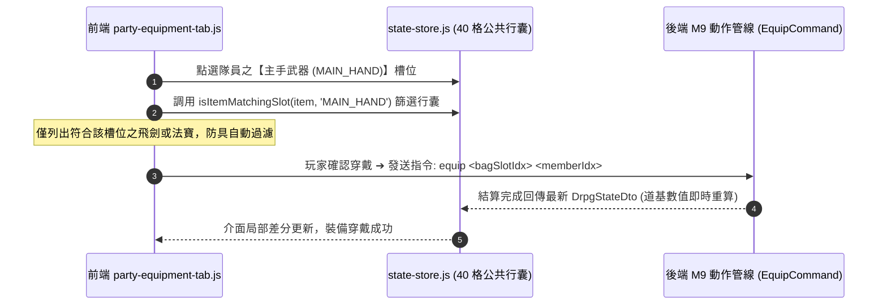

# 👥 前端 FE-5: 小隊裝備與存檔彈窗深度手冊 (Party Modals & Save Slots Manual)

> **模組編號**：FE-5  
> **系統類型**：前端表現層模組  
> **核心定位**：管理無框架純原生彈窗系統（Modals）、5 人小隊隊員數值與陣法切換介面、100% 資料驅動小隊裝備換裝分頁、五大存檔槽位與自動存檔面板，以及戰鬥勝利戰利品結算卡片。

---

## 🏛️ 一、模組架構與彈窗體系概覽

前端避免引入任何肥大第三方 UI 庫，以輕量級純原生 DOM + CSS 定位建立獨立彈窗體系。全系統涵蓋 `src/main/resources/static/js/modals/` 下全部 10 個核心彈窗模組及小隊狀態抬頭顯示器：

```
static/js/modals/
├── party-modal.js              # 仙道總覽小隊彈窗控制器 (主選單/隊員名冊/分頁切換)
├── party-equipment-tab.js      # 裝備換裝分頁 (100% 資料驅動 EQUIP_SLOT_DEFS)
├── party-skills-tab.js         # 道骨法術與技能配置分頁 (主動/被動/連攜奧義)
├── party-formation-tab.js      # 陣法典籍卡牌庫 ＋ 5×3 戰陣盤視覺化配置分頁
├── party-tactics-tab.js        # 隊員自動戰鬥邏輯與策略條件配置分頁 (Gambit)
├── bag-drawer.js               # 40 格小隊公共儲物袋抽屜面板
├── skill-drawer.js             # 地牢/戰鬥中隊員即時法術快捷抽屜
├── shop-modal.js               # 宗門貨棧與集市商人買賣彈窗
├── save-modal.js               # 單機五大槽位與自動存檔讀取/覆蓋/開局中樞
└── victory-modal.js            # 戰勝魔物後的修為結算與戰利品入庫翻牌動畫
static/js/panels/
└── party-hud-panel.js          # 常駐 5 人小隊戰備抬頭面板 (血條/道心/狀態光環)
```

- **無鎖遮罩層 (Backdrop)**：點擊彈窗外部暗色半透明遮罩區，或按下 `Esc` 鍵，自動安全關閉當前視窗。
- **資料即時同步**：彈窗開啟時自動自 `store.get('party')` 拉取最新小隊與背包數據，關閉時排空暫存。

---

## 👥 二、小隊管理彈窗與陣法配置 (`party-modal.js`)

提供修仙小隊的綜合指揮視圖：

1. **5 人小隊成員卡牌**：
   - 清楚呈現 2 前衛、1 中衛、2 後衛之站位排列。
   - 顯示即時氣血條（HP）、真元條（MP）與受創罡氣韌性上限。
2. **外神精神侵蝕警示 (Sanity & Weakened Status)**：
   - 依 Option A 精神萎靡規範，當隊員道心（SAN）降至 0 時附加單一【精神萎靡 (WEAKENED)】（全域傷害 -15%）；低 SAN 時卡牌邊框浮現暗紫符紋警示，直觀提示玩家及時服用「清心靈丹」或返回營地休整。
3. **戰陣配置分頁 (`party-formation-tab.js`)**：
   - 徹底摒棄傳統下拉式選單，採用**「陣法典籍卡牌庫 ＋ 5×3 戰陣盤」視覺化配置**。
   - 左側卡牌庫展示已收錄之陣法（四象辟邪陣、玄陰噬魂陣、霸刀破陣式等），右側為 5×3 戰陣盤與陣眼佔位。
   - 點擊「結陣」按鈕派發真實指令 `formation equip <formationId>`，由後端 `FormationEngine` 重新結算陣法增益與合擊加成。

---

## 🛡️ 三、純資料驅動裝備換裝分頁 (`party-equipment-tab.js`)

嚴格遵守專案第一紅線，裝備換裝介面**完全摒棄中文名稱推測**，全面依賴後端 `EquipmentSlot` 枚舉與前端 `EQUIP_SLOT_DEFS`（5+2 結構）：



- **裝備槽位覆蓋 (5+2 結構)**：
  - **5 大基礎部位**：主手武器（`MAIN_HAND`）、副手防具（`OFF_HAND`）、頭部盔甲（`HEAD`）、身軀道袍（`BODY`）、靴履護具（`FEET`）。
  - **2 大擴充飾品**：本命法寶（`ACCESSORY_1`）、輔佐靈寶（`ACCESSORY_2`）。飾品槽完整相容 `KEY_ITEM` 任務晶片與古仙殘片。
- **卸下裝備指令**：點擊已穿戴裝備槽旁卸下按鈕，派發指令 `unequip <slotAlias> <memberIdx>`（例如 `unequip MAIN_HAND 0`）。
- **數值動態 Tooltip**：滑鼠移至法寶上方時，即時展示「根骨 +15、身法 +8、削韌力 +12」等隨機詞綴明細。

---

## 💾 四、多槽位存檔與讀檔彈窗 (`save-modal.js`)

為單機沉浸式修仙體驗提供全方位存檔保護：

```
┌────────────────────────────────────────────────────────┐
│                   修仙存檔中樞                         │
├────────────────────────────────────────────────────────┤
│ 【 自動存檔 (AutoSave) 】                              │
│   • 墨竹礦坑一層 ‧ 練氣九層 (2026-10-15 11:30)         │
│   [ 讀取進度 ]                                         │
├────────────────────────────────────────────────────────┤
│ 【 手動獨立槽位 】                                     │
│   • 槽位 1: 太陰古塚深處 ‧ 築基一層 (已存檔) [讀取] [覆蓋]│
│   • 槽位 2: 空白存檔槽位                     [寫入]    │
│   • 槽位 3: 空白存檔槽位                     [寫入]    │
│   • 槽位 4: 空白存檔槽位                     [寫入]    │
│   • 槽位 5: 空白存檔槽位                     [寫入]    │
└────────────────────────────────────────────────────────┘
```

1. **槽位資訊預覽**：展示存檔名稱、當前境界、存檔時間戳、所在關卡位置。
2. **防誤觸二次確認**：覆蓋已存在之舊進度時，彈出模態二次確認提示，避免玩家誤操作遺失進度。

---

## 🏆 五、戰鬥勝利結算彈窗 (`victory-modal.js`)

當地下城遭遇戰魔物全數殲滅時自動觸發：
- **修為經驗分配動效**：經驗條自左向右蓄力填滿，若隊員突破境界則觸發破境特效。
- **戰利品翻牌展示**：將怪物掉落之靈石碎銀、妖丹靈草與極品法寶以覆蓋卡牌呈現，點擊單張翻開或點擊「全部揭曉 (`flipAllLoots`)」後自動收納入 40 格公共行囊。

---

## 🔗 六、代表檔案清單

| 檔案路徑 | 模組定位 | 關鍵導出項目 |
| :--- | :--- | :--- |
| `src/main/resources/static/js/modals/party-modal.js` | 小隊管理彈窗主控制器 | `openPartyModal()`, `closePartyModal()`, `togglePartyModal()`, `switchMainMenuTab()`, `openMainMenu()`, `renderPartyModal()` |
| `src/main/resources/static/js/modals/party-equipment-tab.js` | 裝備換裝分頁控制器 | `EQUIP_SLOT_DEFS`, `isItemMatchingSlot()`, `renderMemberEquipHtml()`, `renderMemberEquipmentView()`, `renderTeamEquipmentOverview()`, `renderEquipmentDiffPickerView()`, `openEquipPicker()`, `confirmEquipItem()`, `confirmUnequipItem()` |
| `src/main/resources/static/js/modals/party-skills-tab.js` | 技能經法配置分頁控制器 | `renderMemberSkillsView()`, `renderMemberSpellbook()`, `openSkillPicker()`, `confirmEquipSkill()`, `confirmUnequipSkill()` |
| `src/main/resources/static/js/modals/party-formation-tab.js` | 戰陣典籍與陣盤分頁控制器 | `renderFormationLibraryView()`, `renderTeamFormationView()`, `toggleFormationViewMode()` |
| `src/main/resources/static/js/modals/party-tactics-tab.js` | 自動戰術邏輯配置分頁 | `renderMemberTactics()`, `submitAddTactics()`, `toggleAddTacticsForm()` |
| `src/main/resources/static/js/modals/bag-drawer.js` | 40 格儲物袋抽屜控制器 | `toggleBagDrawer()`, `renderBagDrawer()` |
| `src/main/resources/static/js/modals/skill-drawer.js` | 隊員法術快捷抽屜控制器 | `renderSkillDrawer()`, `closeSkillDrawer()`, `castPartySkill()`, `switchSkillDrawerTab()` |
| `src/main/resources/static/js/modals/shop-modal.js` | 貨棧商人交易彈窗控制器 | `openShopModal()`, `toggleShopModal()`, `renderShopCatalogInLog()`, `triggerShopBuy()` |
| `src/main/resources/static/js/modals/save-modal.js` | 存檔多槽位管理控制器 | `openSaveModal()`, `closeSaveModal()`, `renderSaveSlots()`, `triggerSaveSlot()`, `triggerLoadSlot()`, `triggerDeleteSlot()` |
| `src/main/resources/static/js/modals/victory-modal.js` | 戰鬥勝利結算卡片控制器 | `isVictoryModalOpen()`, `showVictoryModal()`, `closeVictoryModal()`, `flipAllLoots()`, `flipLootCard()` |
| `src/main/resources/static/js/panels/party-hud-panel.js` | 常駐小隊狀態抬頭面板 | `renderPartyHud()`, `selectPartyMember()` |

---

## 🚀 七、未來架構演進規劃【待深入討論／長線演進藍圖】

1. **法寶屬性並排差分對比 Tooltip**：滑鼠懸停於儲物袋裝備時，左右並排展示已穿戴與目標裝備之詞綴差分（增益碧綠高亮、減益暗紅），並支援一鍵換裝推薦。
2. **小隊戰鬥配裝方案切換 (Loadout Presets)**：支援保存 3 套戰備方案（如破煞防禦流、純陽暴擊流），在營地一鍵切換全隊裝備與陣法配置。
3. **全域彈窗堆疊管理器 (Modal Stack Manager & Focus Trap)**：多層彈窗採用 LIFO 堆疊維護，`Esc` 鍵依序關閉最頂層模態，並鎖定焦點防止背景穿透。
4. **原生拖曳穿脫交互 (HTML5 Drag and Drop)**：支援將儲物袋內的法寶直接拖曳至角色卡牌槽位完成穿戴。
