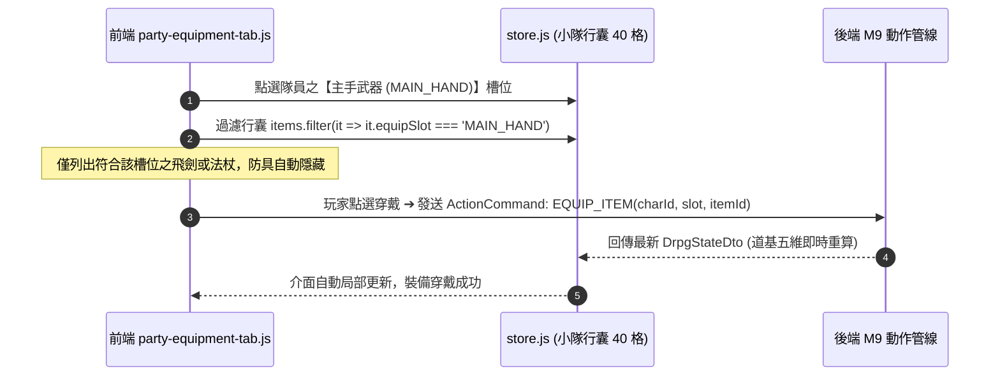

# 👥 前端 FE-5: 小隊裝備與存檔彈窗深度手冊 (Party Modals & Save Slots Manual)

> **模組編號**：FE-5  
> **系統類型**：前端表現層模組  
> **核心定位**：管理無框架純原生彈窗系統（Modals）、5 人小隊隊員數值與陣法切換介面、100% 資料驅動小隊裝備換裝分頁、五大存檔槽位與自動存檔面板，以及戰鬥勝利戰利品結算卡片。

---

## 🏛️ 一、模組架構與彈窗體系概覽

前端避免引入任何 UI 庫（如 Bootstrap 或 AntD），以輕量級純原生 DOM + CSS 定位建立獨立彈窗系統：

```
static/js/modals/
├── party-modal.js              # 5 人小隊數值總覽、陣法切換與隊員卡牌
├── party-equipment-tab.js      # 裝備換裝分頁 (100% 資料驅動 EquipSlot)
├── save-modal.js               # 五大槽位與自動存檔讀取/覆蓋中樞
└── victory-modal.js            # 戰勝魔物後的修為結算與戰利品入庫動畫
```

- **無鎖遮罩層 (Backdrop)**：點擊彈窗外部暗色半透明遮罩區，或按下 `Esc` 鍵，自動安全關閉當前視窗。
- **資料即時同步**：彈窗開啟時自動自 `store.state` 拉取最新小隊與背包數據，關閉時排空暫存。

---

## 👥 二、小隊管理彈窗 (`party-modal.js`)

提供修仙團隊的綜合指揮視圖：

1. **5 人小隊成員卡牌**：
   - 清楚呈現 2 前衛、1 中衛、2 後衛之站位排列。
   - 顯示即時氣血條（HP）、真元條（MP）與受創罡氣韌性上限。
2. **外神精神侵蝕警示 (Psychic Shield Warning)**：
   - 當隊員神識護盾（SAN）低於 50% 時，卡牌邊框浮現暗紫符紋警示，直觀提示玩家及時服用「清心靈丹」或返回營地休整，防範精神震懾虛弱。
3. **古仙陣法切換 (Formation Selector)**：
   - 下拉清單動態呈現已解鎖之仙門陣法（九宮八卦陣、北斗七星陣）。
   - 切換陣法即時發送結構化動作至後端 `FormationEngine` 重新結算站位攻防加成。

---

## 🛡️ 三、純資料驅動裝備換裝分頁 (`party-equipment-tab.js`)

嚴格遵守專案第一紅線，裝備換裝介面**完全摒棄中文名稱推測**，全面依賴後端 [`EquipmentSlot`](file:///c:/Workspace/my_practice/practice_mud/src/main/java/com/example/htmlmud/item/EquipmentSlot.java) 枚舉（5+2 結構，前端常數為 `EQUIP_SLOT_DEFS`）：



- **裝備槽位覆蓋 (5+2 結構)**：
  - **5 大基礎部位**：主手武器（`MAIN_HAND`）、副手防具（`OFF_HAND`）、頭部盔甲（`HEAD`）、身軀道袍（`BODY`）、靴履護具（`FEET`）。
  - **2 大擴充飾品**：本命法寶（`ACCESSORY_1`）、輔佐靈寶（`ACCESSORY_2`）。
- **屬性動態 Tooltip**：滑鼠移至法寶上方時，即時展示其增加之「根骨 +15、身法 +8、物理穿透 +10%」等詞綴明細。

---

## 💾 四、多槽位存檔與讀檔彈窗 (`save-modal.js`)

為單機沉浸式修仙體驗提供全方位存檔保護：

```
┌────────────────────────────────────────────────────────┐
│                   修仙存檔中樞                         │
├────────────────────────────────────────────────────────┤
│ 【 自動存檔 (AutoSave) 】                              │
│   • 墨竹礦坑一層 ‧ 練氣九層 (2026-10-15 11:30)         │
│   [ 讀取進度 ]                                         │
├────────────────────────────────────────────────────────┤
│ 【 手動獨立槽位 】                                     │
│   • 槽位 1: 太陰古塚深處 ‧ 築基一層 (已存檔) [讀取] [覆蓋]│
│   • 槽位 2: 空白存檔槽位                     [寫入]    │
│   • 槽位 3: 空白存檔槽位                     [寫入]    │
│   • 槽位 4: 空白存檔槽位                     [寫入]    │
│   • 槽位 5: 空白存檔槽位                     [寫入]    │
└────────────────────────────────────────────────────────┘
```

1. **槽位資訊預覽**：展示存檔名稱、當前境界、存檔時間戳、所在關卡位置。
2. **防誤觸防禦**：覆蓋已存在之舊進度時，彈出二次確認提示。

---

## 🏆 五、戰鬥勝利結算彈窗 (`victory-modal.js`)

當地下城首領或遭遇戰魔物全數殲滅時自動觸發：
- **修為經驗分配動效**：經驗條自左向右蓄力填滿，若觸發升級則浮現金色仙光。
- **戰利品展示卡片**：將怪物掉落之靈石碎銀、妖丹靈草與極品法寶逐一展示，點擊「收納入袋」後自動安全存入 40 格小隊儲物袋。

---

## 🔗 六、代表檔案清單

| 檔案路徑 | 模組定位 | 關鍵導出項目 |
| :--- | :--- | :--- |
| `static/js/modals/party-modal.js` | 小隊管理彈窗主控制器 | `openPartyModal()`, `renderPartyMembers()` |
| `static/js/modals/party-equipment-tab.js` | 裝備換裝分頁控制器 | `renderEquipmentTab()`, `filterBySlot()` |
| `static/js/modals/save-modal.js` | 存檔與讀檔多槽位控制器 | `openSaveModal(mode)`, `renderSaveSlots()` |
| `static/js/modals/victory-modal.js` | 戰鬥勝利結算卡片控制器 | `showVictoryModal(rewards)` |

---

## 🚀 七、未來架構演進與現代化擴充規劃 (Future Roadmap & Scalability)

為使小隊管理、裝備換裝與多槽位存檔具備現代商業級 3A RPG 的便利性與交互質感，確立以下四大演進方向：

### 1. 🎯 現代交互體驗與數值對比 (Modern UX & Loadout)
- **法寶屬性並排差分對比 Tooltip (Side-by-Side Stat Diff Tooltip)**：
  當滑鼠懸停於儲物袋中某件新法寶時，介面同時彈出「當前穿戴裝備」與「選中新裝備」的左右並排卡片。數值增益（如「根骨 +15 (+4)」）以碧綠高亮標註，折損數值以暗紅標註，一目了然；並提供「一鍵換裝推薦」功能。
- **小隊戰鬥配裝方案切換 (Loadout Presets)**：
  支援儲存 3 套戰備方案（如「破煞開荒防禦流」、「純陽極致暴擊流」、「五行抗性抗煞流」），在非戰鬥狀態下一鍵切換全隊裝備與陣法配置。

### 2. 🛡️ 穩定性與彈窗堆疊防禦 (Modal Stack & Focus Trap)
- **全域彈窗堆疊管理器 (Modal Stack Manager & Focus Trap)**：
  當「存檔彈窗」上方再次彈出「覆蓋存檔二次確認框」時，堆疊管理器自動維護層級陣列（LIFO）。按下 `Esc` 鍵只會精準關閉最頂層確認框，並鎖定鍵盤焦點在當前彈窗內部（Focus Trap），杜絕背景穿透點擊與狀態撕裂。

### 3. ⚡ 效能與局部 DOM 差分更新 (Granular DOM Patching)
- **隊員卡牌局部差分重繪 (Fine-Grained DOM Patching)**：
  換裝或升級時，依據角色 ID 僅更新變動的屬性數字與裝備槽圖標，避免調用 `innerHTML` 粗暴摧毀並重建整個 5 人小隊卡片，消除介面重繪閃爍與垃圾回收壓力。

### 4. 🔌 可擴充性與拖曳穿戴 (HTML5 Drag and Drop)
- **法寶拖曳穿脫交互 (Drag & Drop Gear Socketing)**：
  支援純原生 HTML5 Drag & Drop 規範。玩家可直接將儲物袋內的「太陰青銅古劍」拖曳至主角卡牌的武器槽完成穿戴，拖曳至地面完成丟棄，大幅提升桌面端遊玩之直觀度。
