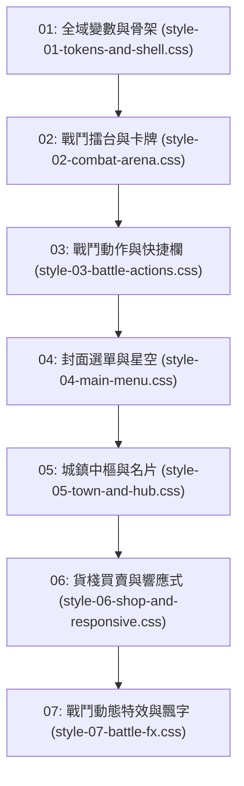

# 🎨 前端 FE-6: 七層樣式串流與視覺主題深度手冊 (CSS Tokens & Themes Manual)

> **模組編號**：FE-6  
> **系統類型**：前端表現層模組  
> **核心定位**：管理暗黑克蘇魯修仙全域視覺規範、CSS Custom Properties（設計變數 Tokens）、嚴格之七層 Cascade 依賴順序串流載入架構、無障礙字級排版標準，以及歷史樣式巨石解耦成果。

---

## 🏛️ 一、暗黑克蘇魯修仙設計美學與核心視覺色譜

《深淵仙途》融合了古典仙俠的縹緲出塵與洛夫克拉夫特式的不可名狀驚悚。視覺系統透過精準調配的色階變數營造沉浸式氛圍，全部定義於 `src/main/resources/static/css/style-01-tokens-and-shell.css` 之 `:root`：

| 色彩語意 / 變數名 | 代表色值 (Hex) | 應用場景與功能定位 |
| :--- | :--- | :--- |
| `--bg-color` | `#0b0d10` | 全域深黑星空背景底色 |
| `--sidebar-bg` | `#141820` | 側邊欄與情報日誌背景底色 |
| `--panel-bg` | `#1a202c` | 主舞台、彈窗面板與操作底層容器背景 |
| `--card-bg` | `#111622` | 生靈卡片、設施卡牌、裝備槽卡片背景 |
| `--text-color` | `#d1d5db` | 全域標準內文與次級標籤文字顏色 |
| `--accent-color` | `#10b981` | 成功高亮、翡翠回春生命狀態 |
| `--primary-color` / `--mp-color` | `#3b82f6` | 仙家真元法力 (MP)、主要互動按鈕高亮 |
| `--sp-color` | `#f59e0b` | 戰意能量 (SP)、金丹境界突破與精英金色標記 |
| `--hp-color` / `--danger-color` | `#ef4444` | 氣血生命 (HP)、危險警告與重創受損 |
| `--san-normal` | `#10b981` | 道心充盈 (SAN 70~100) |
| `--san-warning` | `#f59e0b` | 道心動搖 (SAN 30~69) |
| `--san-danger` | `#f97316` | 異象侵蝕 (SAN 1~29) |
| `--san-madness` | `#a855f7` | 外神狂亂／精神萎靡 (SAN = 0) |

---

## 🌊 二、七層 CSS 串流載入架構 (Cascade Order)

為徹底解決傳統 CSS 單一巨石檔案臃腫難以維護的痛點，專案將樣式拆分為 7 層獨立檔案，在 `src/main/resources/static/index.html` 內依順序串流載入：

### 各層職責與樣式範疇說明
1. **`src/main/resources/static/css/style-01-tokens-and-shell.css`**：
   - 定義 `:root` 所有 CSS Variables（色彩、字級、行高、佈局容器高度）。
   - 設定 `.game-container`、`.main-viewport`、`.terminal-panel` 視窗骨架與桌機/平板斷點（`@media (max-width: 899px)`）。
2. **`src/main/resources/static/css/style-02-combat-arena.css`**：
   - 戰鬥擂台 `.battle-arena-panel`、`.enemy-card`、`.enemy-hp-bar`、`.poise-bar-wrap` 與 `.enemy-cast-track` 吟唱條。
3. **`src/main/resources/static/css/style-03-battle-actions.css`**：
   - 戰鬥戰備甲板 `.battle-lower-combat-deck`、技能卡片 `.dock-skill-card`、冷卻遮罩 `.skill-cd-overlay` 與動作列。
4. **`src/main/resources/static/css/style-04-main-menu.css`**：
   - 封面選單與標題畫面 `.title-screen-overlay`、修仙標題漸層光暈與星空背景 `.title-stars-bg`。
5. **`src/main/resources/static/css/style-05-town-and-hub.css`**：
   - 營地中樞主舞台 `.town-nav-panel`、設施網格 `.town-hub-grid`、設施卡牌 `.facility-card`、異象故障 `.facility-glitch`、駐留生靈名片 `.npc-card`，以及斷點（`@media (max-width: 800px)`）。
6. **`src/main/resources/static/css/style-06-shop-and-responsive.css`**：
   - 貨棧商品陳列卡片 `.shop-modal-card`、商品清單 `.shop-modal-goods-list` 與 `.shop-good-card`。
7. **`src/main/resources/static/css/style-07-battle-fx.css`**：
   - 飄字動效 `@keyframes ft-float-up`、打擊數字 `.ftext`、破防碎裂 `.poise-broken`、打斷動效 `.react-interrupted`、畫面震動 `.arena-shake`，以及減弱動態規則（`@media (prefers-reduced-motion: reduce)`）。

---

## 📐 三、無障礙與排版標準規範

1. **字級規範階梯**：
   - `:root` 以 `--font-xs: 13px` 為全域字級基準 Token，徹底杜絕主體內容出現極小字：
     - `--font-xs: 13px`：輔助標籤、微型徽章（Badge）、最低字級標準（部分歷史緊湊角標與輔助標籤之 `9px~12px` 列為後續漸進收斂項）。
     - `--font-sm: 14px`：一般正文、按鈕、列表項目、NPC 對話。
     - `--font-base: 15px`：故事日誌、環境描述、重要戰報。
     - `--font-lg: 16px`：區域標題、隊員姓名、模態副標題。
     - `--font-xl: 18px`：一級大標題、視窗 Header。
2. **對比度標準**：
   - 遵循 WCAG AA 規範，內文 `--text-color` 與深色背景 `--bg-color` 之對比度維持在 $4.5:1$ 以上。
3. **流暢動效原則**：
   - 動態過渡時間控制在 $150\text{ms} \sim 300\text{ms}$，採用 `ease-out`。支援 `@media (prefers-reduced-motion: reduce)` 無障礙減弱動效模式。

---

## 🔗 四、代表檔案清單

| 檔案路徑 | 模組定位 | 關鍵樣式類別 / 媒體查詢 |
| :--- | :--- | :--- |
| `src/main/resources/static/css/style-01-tokens-and-shell.css` | 設計變數與視窗骨架 | `:root`, `.game-container`, `.main-viewport`, `@media (max-width: 899px)` |
| `src/main/resources/static/css/style-02-combat-arena.css` | 戰鬥擂台與生靈卡牌 | `.battle-arena-panel`, `.enemy-card`, `.enemy-hp-bar`, `.poise-bar-wrap`, `.enemy-cast-track` |
| `src/main/resources/static/css/style-03-battle-actions.css` | 戰鬥動作與快捷按鈕 | `.battle-lower-combat-deck`, `.dock-skill-card`, `.skill-cd-overlay` |
| `src/main/resources/static/css/style-04-main-menu.css` | 封面主選單與開局 | `.title-screen-overlay`, `.title-stars-bg` |
| `src/main/resources/static/css/style-05-town-and-hub.css` | 營地中樞設施與生靈名片 | `.town-nav-panel`, `.town-hub-grid`, `.facility-card`, `.npc-card`, `@media (max-width: 800px)` |
| `src/main/resources/static/css/style-06-shop-and-responsive.css`| 貨棧交易商品卡片 | `.shop-modal-card`, `.shop-modal-goods-list`, `.shop-good-card` |
| `src/main/resources/static/css/style-07-battle-fx.css` | 打擊飄字與震動特效 | `.ftext`, `.arena-shake`, `.poise-broken`, `.react-interrupted`, `@media (prefers-reduced-motion: reduce)` |

---

## 🚀 五、未來架構演進規劃【待深入討論／長線演進藍圖】

1. **三大修仙道門主題一鍵換膚 (Theme Presets)**：
   透過在 `<html>` 標籤注入 `data-theme` 屬性，提供【太陰幽冥·暗黑克系】、【青雲正道·水墨仙山】與【天外星蝕·萬劫血煞】三套風格變數切換。
2. **現代容器查詢 (CSS Container Queries `@container`)**：
   逐步以 `@container` 取代部分視口 `@media` 查詢，使 NPC 卡牌與戰鬥生靈元件無論置於主舞台或彈窗皆能自適應縮放。
3. **首屏關鍵樣式預加載 (Critical CSS Inlining)**：
   抽取 `style-01` 基礎排版與 `style-04` 標題畫面進行預加載，進一步提升首屏渲染效能。
