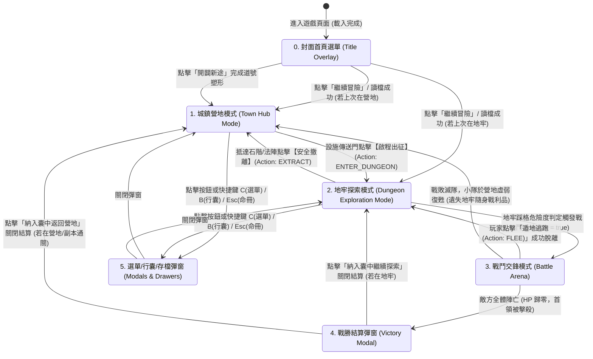

# 🖥️ 前端整體佈局與主視圖切換全景手冊 (Frontend Layout & View Transitions)

> **文件定位**：
> 本手冊為《深淵仙途》前端介面的**最高佈局架構與視圖狀態機指南**。
> 詳解頁面空間劃分、前端 6 大表現模組（FE-1 ~ FE-6）在畫面中的精確落點、三大主舞台互斥呈現機制，以及「何時頁面上有哪些模組、何時會切換到什麼模組」的完整狀態流轉規則。

---

## 🗺️ 一、頁面全景空間骨架圖 (Screen Layout Blueprint)

遊戲介面遵循現代單頁應用（SPA）的固定視窗比例骨架（無多餘頁面捲軸，內部區域獨立平滑滾動），嚴格對齊 Level 1《UI/UX 需求規格》與專案架構決策（D1）：

### 1. 現行已驗證佈局：左右雙主區架構（`index.html` 實作基準）【現行已驗證】

```
┌───────────────────────────────────────────────┬───────────────────────────────────┐
│              左區：主視口舞台與小隊卡         │          右區：情境敘事情報日誌   │
│             [FE-2 / FE-3 / FE-4 / FE-5]       │                 [FE-1]            │
├───────────────────────────────────────────────┼───────────────────────────────────┤
│ 【頂部資訊列 (header-panel)】                 │ 【歷程情報日誌 (message-log-panel)】│
│  探索模式、樓層座標、靈威條、主選單入口、換邊按鈕│ • 100% 全高貫通獨立平滑滾動       │
│ ───────────────────────────────────────────── │ • ANSI 彩色轉義渲染               │
│ 【中央主舞台 (二選一 / 戰鬥排他)】            │ • 迷霧探索、戰鬥跳字與交鋒歷程    │
│ • 城鎮營地態：六大設施卡牌 + 駐留 NPC 名片    │ • 支援「⮃ 換邊」左右對調位置      │
│ • 地牢探索態：3步透視視口 + 10x10 雷達迷宮    │                                   │
│ • 戰鬥交鋒態：5x5 敵方陣線 + 技能戰術快捷列   │                                   │
│ ───────────────────────────────────────────── │                                   │
│ 【左下：5 人小隊即時卡片】                    │                                   │
│ • 氣血 HP / 真元 MP / 罡氣 Poise 韌性條       │                                   │
│ • 快捷操作：調息休整、40 格公共行囊、存檔選單 │                                   │
└───────────────────────────────────────────────┴───────────────────────────────────┘
```
- **核心交互**：現行 `index.html` 採用左右雙主區設計，左側集中主舞台與小隊狀態卡，右側為全高貫通敘事日誌，點擊按鈕或快捷鍵即時互動，**徹底除役文字打字指令**；並提供 `⮃ 換邊` 按鈕支援玩家自由切換左右側重心。

### 2. 規劃演進佈局提案【待深入討論／已決議待實作】

#### (1) PC 橫向寬螢幕標準佈局（經典三欄式 DRPG 架構）【待深入討論／已決議待實作】

```
┌───────────────────────────┬───────────────────────────────────┬───────────────────────────┐
│     左欄：地牢導航與雷達   │          中欄：主視口與核心舞台    │     右欄：小隊狀態與操作  │
│         [FE-2 / FE-4]     │          [FE-2 / FE-3 / FE-4]     │         [FE-1 / FE-5]     │
├───────────────────────────┼───────────────────────────────────┼───────────────────────────┤
│ • 2D 網格迷霧地圖 (Fog)   │ 【探索態】                        │ • 5人小隊即時面板         │
│ • 當前座標 (X, Y) 與朝向  │ • 第一人稱 3D 靈境走廊透視視口    │   - 氣血 HP / 真元 MP     │
│ • 前進/後退/左轉/右轉方向盤│ • 前方 3 步景深透視與前瞻文字卡   │   - 罡氣 Poise 韌性條     │
│ • 鍵盤綁定：W / S / A / D  │ • 地塊互動：點擊【調查】/【解拆】 │   - 戰術能量 / 怒氣       │
│ • 火把光明度進度條        │ ───────────────────────────────── │ • 當前陣法與被動光環      │
│   (100% BRIGHT / 0% DARK) │ 【戰鬥態】                        │ • 快捷工具列 (點火/補藥)  │
│                           │ • 5x5 敵方陣列 (血條/蓄力/Poise)  │ • 戰鬥時切換為行動者技能  │
│ 【營地態】                │ ───────────────────────────────── │                           │
│ • 營地安全區導覽與時辰    │ 【營地態】                        │ 【營地態】                │
│ • 設施切換清單            │ • 六大設施卡片 (工坊/實驗室/道場/市集/客棧/地牢) │ • 全員休整狀態與好感度    │
├───────────────────────────┴───────────────────────────────────┴───────────────────────────┤
│                         底欄：克蘇魯文字情境敘事面板 (Narrative Event Log) [FE-1]            │
│  [15:30:12] 你手持火把邁進幽深礦道，石壁傳來肌肉纖維斷裂的沉悶低響，空氣中飄散著福馬林異香...  │
│  [15:30:15] ⚡【打斷!】特工晶片精準鎖定破綻，巨力戰士裂山斬斬斷守墓道奴施法前搖！             │
└───────────────────────────────────────────────────────────────────────────────────────────┘
```

#### (2) 手機直向自適應佈局（Knight & Dragon 風格）【待深入討論／已決議待實作】

```
┌────────────────────────────────────────────────────────┐
│ 頂部：樓層名稱、當前座標與 2D 縮略小雷達 [FE-2]       │
├────────────────────────────────────────────────────────┤
│ 中上部：主視口舞台 (探索走廊 / 戰鬥陣列 / 營地設施)   │
├────────────────────────────────────────────────────────┤
│ 中下部：情境動作區 (探索方向盤 / 戰鬥隊員技能列)       │
├────────────────────────────────────────────────────────┤
│ 底欄：滑動式文字情境敘事日誌 (約 120px) [FE-1]         │
├────────────────────────────────────────────────────────┤
│ 底部常駐 Tab Bar：【遠征】 【小隊】 【行囊】 【技能】 【存檔】│
└────────────────────────────────────────────────────────┘
```

---

## 🧩 二、前端 6 大表現模組（FE-1 ~ FE-6）在畫面的落點分配

| 模組編號 | 模組名稱 | 頁面實體容器 / 元件 | 出現時機 | 核心功能 |
| :--- | :--- | :--- | :--- | :--- |
| **FE-1** | 核心狀態與事件管線 | `static/js/core/state-store.js`（舊路徑 `static/js/state/store.js`【歷史／已除役】）, `static/js/network/websocket.js`, 底欄日誌 `#narrative-event-log` | **常駐全域** | 接收 WebSocket `DrpgStateDto`，派發全域 `data-action` 點擊事件，驅動全域單向資料流與唯讀敘事文字日誌。 |
| **FE-2** | DRPG 視口與雷達渲染器 | `#dungeon-radar-panel` (左欄) + `#viewport-canvas` (中欄) | **地牢非戰鬥探索態** | 第一人稱 3 步透視視口、10x10 雷達迷霧網格、前方景致描述、方向盤控制器與火把光影。 |
| **FE-3** | 戰鬥擂台與特效引擎 | `#battle-arena-panel` (中欄主舞台) + `#battle-fx-layer` | **戰鬥交鋒態** (`inBattle === true`) | 敵方 5x5 陣線、血條/罡氣韌性條/ATB 條、我方戰備指令與技能列、打擊飄字、破防爆裂動效。 |
| **FE-4** | 城鎮中樞與動作列面板 | `#town-hub-panel` (中欄設施卡片) + 情境操作按鈕 | **營地生活態** + **情境操作** | 六大機能設施選單、NPC 劇情對話卡片；情境快捷按鈕（探索快捷 vs 戰鬥法術列）。 |
| **FE-5** | 小隊裝備與存檔彈窗 | `#party-modal`, `#bag-drawer`, `#save-modal`, `#battle-victory-modal` | **彈窗觸發時** (按鍵或點擊) | 5 人小隊數值與裝備穿脫分頁、40 格公共行囊、5 大存檔槽位管理、戰勝結算翻牌。 |
| **FE-6** | 七層樣式串流與視覺主題 | `static/css/style-01-tokens-and-shell.css` ~ `style-07-battle-fx.css` | **全域樣式層** | 暗黑克系修仙色譜（玄青/幽藍/暗紅/琉璃金）、無障礙字級（$\ge 13\text{px}$）、RWD 響應式佈局。 |

---

## 🔄 三、何時切換？全場景狀態機切換流程圖 (State Machine Flow)

遊戲畫面依據後端推送之 `DrpgStateDto` 狀態，由 **中央狀態流（FE-1: state-store.js，舊檔名 store.js【歷史／已除役】）** 自動觸發主舞台與彈窗的無縫切換，**徹底除役文字打字命令**：



---

## ⏱️ 四、五大核心場景與頁面模組配置矩陣 (Timing & Composition Matrix)

下表清晰定義了在每一種遊戲狀態下，畫面上「存在什麼模組」以及「各模組處於何種狀態」：

| 場景情境 | 觸發時機與條件 | 左欄/左區 (導航/雷達/小隊) | 中欄/主舞台 (主視覺核心) | 右欄/右區 (小隊或情報日誌) | 底欄/日誌 (情境敘事日誌) | 覆蓋彈窗層 |
| :--- | :--- | :--- | :--- | :--- | :--- | :--- |
| **0. 封面選單** | 瀏覽器初次載入，未讀檔或剛開啟遊戲。 | 隱藏 | 隱藏 | 隱藏 | 隱藏 | **`#title-screen-overlay` [FE-6]**<br/>全螢幕暗黑星空封面、繼續/新遊戲/存檔按鈕。 |
| **1. 城鎮營地態** | `inBattle: false` 且 `viewMode: "TOWN"`。 | **營地導覽 [FE-4]**<br/>• 安全區標識<br/>• 設施切換選單 | **`#town-hub-panel` [FE-4]**<br/>• 六大機能設施卡牌<br/>• NPC 劇情對話卡牌 | **小隊狀態 [FE-1/5]**<br/>• 5 人狀態卡片<br/>• 一鍵全員調息休整 | **`#narrative-event-log`**<br/>• 營地修仙氛圍文案<br/>• 40 格公共行囊與休整紀錄 | 無（常態營地視圖） |
| **2. 地牢探索態** | `inBattle: false` 且 `viewMode: "DUNGEON"`。 | **`#dungeon-radar-panel` [FE-2]**<br/>• 10x10 暗黑迷霧雷達<br/>• 前後左右方向盤<br/>• 火把光明度進度條 | **透視視口 [FE-2]**<br/>• 第一人稱透視走廊<br/>• 前方 3 步景致卡<br/>• 點擊地塊互動 (開箱/解拆) | **小隊狀態 [FE-1/5]**<br/>• 5 人氣血/真元/Poise<br/>• SAN 精神護盾<br/>• 快捷工具 (點火/補藥) | **`#narrative-event-log`**<br/>• 石壁肌肉斷裂低響<br/>• 迷霧踩格探索日誌 | 無（常態地牢視圖） |
| **3. 戰鬥交鋒態** | `inBattle: true`。 | **戰況聚焦 [FE-2]**<br/>• 雷達收縮/鎖定<br/>• 戰術能量進度 | **`#battle-arena-panel` [FE-3]**<br/>• 敵方 5x5 陣列 (血條/韌性/ATB)<br/>• 我方戰備與技能卡 (1~4)<br/>• **`#battle-fx-layer`** (飄字/震動) | **小隊戰鬥態 [FE-1/5]**<br/>• 當前行動者高亮<br/>• 陣法共鳴點數 (天外合擊)<br/>• 支援 [Space] 連攜 | **`#narrative-event-log`**<br/>• 彩色暴擊/削韌廣播<br/>• ⚡【打斷!】戰況跳字 | 阻斷常規非戰鬥彈窗 |
| **4. 戰勝結算態** | 敵方全體氣血歸零，戰鬥大捷。 | 保持殘局背景 | 戰場結算高亮 | 經驗增長條亮起 | 戰報結算廣播 | **`#battle-victory-modal` [FE-5]**<br/>• 修為經驗精進進度條<br/>• 繳獲戰利品翻牌動畫<br/>• 納入囊中確認按鈕 |
| **5. 資訊彈窗態** | 玩家隨時點擊按鈕或按下 `C` (選單) / `B` (行囊) / `Esc` (命冊)。 | 底層探索/戰鬥主舞台保持原樣，疊加暗色半透明遮罩 (Backdrop) | 保持原樣 (遮罩覆蓋) | 保持原樣 (遮罩覆蓋) | 保持原樣 (遮罩覆蓋) | **對應彈窗展開 [FE-5]**<br/>• `party-modal` (小隊/裝備)<br/>• `bag-drawer` (40格行囊)<br/>• `save-modal` (五大存檔槽) |

---

## ⚡ 五、切換機制的底層程式驅動原理 (Under the Hood)

所有的視圖切換完全由 **資料驅動（Data-Driven）**，嚴禁在視圖層寫死複雜的分支跳轉：

1. **後端廣播 (`DrpgStateDto`)**：
   後端 `GameStateBroadcastService` 每次狀態變動時向 WebSocket 推送最新的單一全景 JSON。
2. **狀態樹監聽 (`state-store.js`)**（舊檔名 `store.js`【歷史／已除役】）：
   前端收到訊息後執行 `store.setState(dto)`，觀察者模式自動觸發通知。
3. **主舞台排他顯示 (`app.js` / `panels`)**：
   ```javascript
   function updateMainStageView(state) {
     const isBattle = state.battle && state.battle.inBattle;
     const viewMode = state.viewMode; // 'TOWN' or 'DUNGEON'

     // 1. 戰鬥優先權最高：若在戰鬥中，強制展示戰鬥擂台
     DOM.battleArenaPanel.classList.toggle('hidden', !isBattle);

     // 2. 非戰鬥狀態下，依據 viewMode 二選一
     DOM.townNavPanel.classList.toggle('hidden', isBattle || viewMode !== 'TOWN');
     DOM.dungeonRadarPanel.classList.toggle('hidden', isBattle || viewMode !== 'DUNGEON');

     // 3. 底部動作列情境組動態切換
     DOM.contextActionsBattle.classList.toggle('hidden', !isBattle);
     DOM.contextActionsTown.classList.toggle('hidden', isBattle || viewMode !== 'TOWN');
     DOM.contextActionsDungeon.classList.toggle('hidden', isBattle || viewMode !== 'DUNGEON');
   }
   ```
4. **純 CSS 類別控制 (`.hidden`)**：
   透過切換 `.hidden`（`display: none !important;`）實現高達 60 FPS 的瞬間無縫切換，零重排抖動，極致流暢！

---

## 🔗 六、相關手冊索引
- ⚡ 核心狀態與事件委派：[`FE1_CORE_STATE_AND_PIPELINE.md`](FE1_CORE_STATE_AND_PIPELINE.md)
- 🗺️ DRPG 視口與雷達手冊：[`FE2_DRPG_VIEWPORT_RENDERER.md`](FE2_DRPG_VIEWPORT_RENDERER.md)
- ⚔️ 戰鬥擂台與特效手冊：[`FE3_BATTLE_ARENA_AND_FX.md`](FE3_BATTLE_ARENA_AND_FX.md)
- 🏛️ 城鎮中樞與動作列表冊：[`FE4_TOWN_HUB_AND_ACTION_BAR.md`](FE4_TOWN_HUB_AND_ACTION_BAR.md)
- 👥 小隊彈窗與存檔手冊：[`FE5_PARTY_EQUIPMENT_AND_MODALS.md`](FE5_PARTY_EQUIPMENT_AND_MODALS.md)
- 🎨 七層樣式串流手冊：[`FE6_CSS_TOKENS_AND_THEMES.md`](FE6_CSS_TOKENS_AND_THEMES.md)

---

## 🚀 七、前端佈局未來現代化演進規劃 (Frontend Layout Roadmap)

為打造現代化頂級視覺體驗、兼具流暢度與無障礙沉浸感，規劃以下佈局演進策略：

### 1. 現代視覺規劃 (Modern Visuals & Immersion)
- **動態沉浸光影氛圍層 (Ambient Canvas Layer)**：
  - 在第一人稱廊道與戰鬥主舞台底層引入 60 FPS 輕量動態微粒子（暗黑煞氣游絲、幽冥磷火微光、靈氣氤氳流動），背景根據當前樓層與晝夜時辰自適應漸變。
- **自適應停靠型 HUD 面板 (Dockable & Customizable HUD)**：
  - 支援玩家自由調整 HUD 佈局：例如允許將底部 5 人隊伍卡片切換為側邊直排模式，或一鍵將情報日誌最小化為浮動膠囊，滿足大螢幕寬屏與行動端多樣化需求。

### 2. 穩定性與無障礙防禦 (Stability & Accessibility)
- **硬體加速雙軌自動降級防禦 (Hardware Acceleration Fallback)**：
  - 偵測客戶端 GPU 與設備幀率：在低配裝置或 `@media (prefers-reduced-motion)` 開啟時，自動關閉高開銷粒子特效與畫面晃動震顫，降級為純 CSS 靜態指示器，確保 FPS 永不低於 60。
- **全域鍵盤無障礙導航 (Full Keyboard Navigation & ARIA)**：
  - 為所有動態生成的按鈕、卡牌與彈窗補齊 ARIA 標籤與 Focus-Trap，支援純鍵盤 Tab 輪巡切換焦點與 Enter/Space 觸發操作。

### 3. 渲染效能調優 (Rendering Performance & 60 FPS)
- **虛擬化情報日誌捲軸 (Virtualized Log Scrolling)**：
  - 目前情報日誌限制為 200 行防爆記憶體；未來引進 Virtualized List 虛擬滾動技術，僅渲染螢幕可視區域的 30~40 個 DOM 節點，即便記錄上萬行冒險歷史，記憶體消耗亦恆定不變。
- **CSS Paint API 與離屏渲染 (Offscreen Rendering)**：
  - 2D 雷達與透視廊道採用 `OffscreenCanvas` 與 Web Worker 背景預算渲染，根除主 UI 線程的重排（Reflow）抖動。

### 4. 可擴充性與主題生態 (Extensibility & Theme Customization)
- **多套視覺主題無縫熱切換 (Dynamic Theme Switching)**：
  - 基於 CSS Tokens 支援一鍵熱更切換：【暗黑克系修仙 (預設)】、【太虛水墨仙俠】、【賽博古修霓虹】三大主題風格包，純資料驅動替換顏色與字型變數。
- **離線 PWA 支援 (Progressive Web App)**：
  - 封裝 Service Worker 離線快取靜態資源與音效檔，支援一鍵安裝至桌面，享受原生 App 等級的全螢幕沉浸遊戲體驗。
