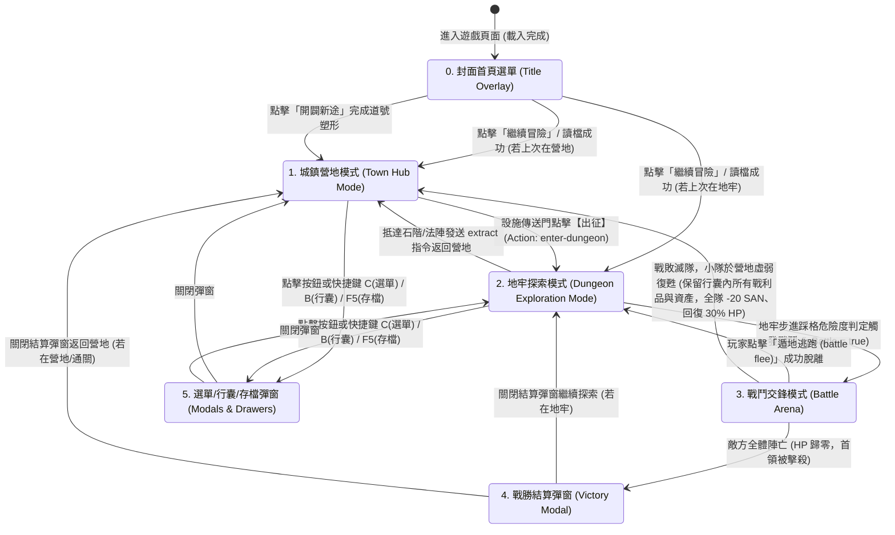

# 🖥️ 前端整體佈局與主視圖切換全景手冊 (Frontend Layout & View Transitions)

> **文件定位**：
> 本手冊為《深淵仙途》前端介面的**最高佈局架構與視圖狀態機指南**。
> 詳解頁面空間劃分、前端 6 大表現模組（FE-1 ~ FE-6）在畫面中的精確落點、三大主舞台互斥呈現機制，以及「何時頁面上有哪些模組、何時會切換到什麼模組」的完整狀態流轉規則。

---

## 🗺️ 一、頁面全景空間骨架圖 (Screen Layout Blueprint)

遊戲介面遵循現代單頁應用（SPA）的固定視窗比例骨架（無多餘頁面捲軸，內部區域獨立平滑滾動），嚴格對齊 Level 1《UI/UX 需求規格》與專案架構決策（D1）：

### 1. 現行已驗證佈局：左右雙主區架構（`src/main/resources/static/index.html` 實作基準）【現行已驗證】

```
┌───────────────────────────────────────────────┬───────────────────────────────────┐
│              左區：主視口舞台與小隊卡         │          右區：情境敘事情報日誌   │
│             [FE-2 / FE-3 / FE-4 / FE-5]       │                 [FE-1]            │
├───────────────────────────────────────────────┼───────────────────────────────────┤
│ 【頂部資訊列 (header-panel)】                 │ 【歷程情報日誌 (message-log-panel)】│
│  探索模式、樓層座標、靈威條、主選單入口、換邊按鈕│ • 100% 全高貫通獨立平滑滾動       │
│ ───────────────────────────────────────────── │ • ANSI 彩色轉義渲染               │
│ 【中央主舞台 (二選一 / 戰鬥排他)】            │ • 迷霧探索、戰鬥跳字與交鋒歷程    │
│ • 城鎮營地態：六大設施卡牌 + 駐留 NPC 名片    │ • 支援「⮃ 換邊」左右對調位置      │
│ • 地牢探索態：2D 迷霧雷達 + 前瞻探查與羅盤    │                                   │
│ • 戰鬥交鋒態：5x5 敵方陣線 + 技能戰術快捷列   │                                   │
│ ───────────────────────────────────────────── │                                   │
│ 【左下：5 人小隊即時卡片】                    │                                   │
│ • 氣血 HP / 真元 MP / 罡氣 Poise 韌性條       │                                   │
│ • 快捷操作：調息休整、40 格公共行囊、存檔選單 │                                   │
└───────────────────────────────────────────────┴───────────────────────────────────┘
```
- **核心交互**：現行 `index.html` 採用左右雙主區設計，左側集中主舞台與小隊狀態卡，右側為全高貫通敘事日誌（`#log-and-battle-area` / `#log`），點擊按鈕或快捷鍵即時互動，**徹底除役文字打字指令**；並提供 `⮃ 換邊` 按鈕支援玩家自由切換左右側重心。

### 2. 規劃演進佈局提案【待深入討論／長線演進藍圖】

#### (1) PC 橫向寬螢幕標準佈局（經典三欄式 DRPG 架構）【待深入討論／長線演進藍圖】

```
┌───────────────────────────┬───────────────────────────────────┬───────────────────────────┐
│     左欄：地牢導航與雷達   │          中欄：主視口與核心舞台    │     右欄：小隊狀態與操作  │
│         [FE-2 / FE-4]     │          [FE-2 / FE-3 / FE-4]     │         [FE-1 / FE-5]     │
├───────────────────────────┼───────────────────────────────────┼───────────────────────────┤
│ • 2D 網格迷霧地圖 (Fog)   │ 【探索態】                        │ • 5人小隊即時面板         │
│ • 當前座標 (X, Y) 與朝向  │ • 第一人稱 3D 靈境走廊透視視口    │   - 氣血 HP / 真元 MP     │
│ • 前進/後退/左轉/右轉方向盤│ • 前方 3 步景深透視與前瞻文字卡   │   - 罡氣 Poise 韌性條     │
│ • 鍵盤綁定：W / S / A / D  │ • 地塊互動：點擊【調查】/【解拆】 │   - 戰術能量 / 怒氣       │
│ • 火把光明度進度條        │ ───────────────────────────────── │ • 當前陣法與被動光環      │
│   (100% BRIGHT / 0% DARK) │ 【戰鬥態】                        │ • 快捷工具列 (點火/補藥)  │
│                           │ • 5x5 敵方陣列 (血條/蓄力/Poise)  │ • 戰鬥時切換為行動者技能  │
│ 【營地態】                │ ───────────────────────────────── │                           │
│ • 營地安全區導覽與時辰    │ 【營地態】                        │ 【營地態】                │
│ • 設施切換清單            │ • 六大設施卡片 (工坊/實驗室/道場/市集/客棧/地牢) │ • 全員休整狀態與好感度    │
├───────────────────────────┴───────────────────────────────────┴───────────────────────────┤
│                         底欄：文字情境敘事面板 [FE-1]                                     │
│  [15:30:12] 你手持火把邁進幽深礦道，石壁傳來肌肉纖維斷裂的沉悶低響，空氣中飄散著福馬林異香...  │
│  [15:30:15] ⚡【打斷!】特工晶片精準鎖定破綻，巨力戰士裂山斬斬斷守墓道奴施法前搖！             │
└───────────────────────────────────────────────────────────────────────────────────────────┘
```

#### (2) 手機直向自適應佈局（Knight & Dragon 風格）【待深入討論／長線演進藍圖】

```
┌────────────────────────────────────────────────────────┐
│ 頂部：樓層名稱、當前座標與 2D 縮略小雷達 [FE-2]       │
├────────────────────────────────────────────────────────┤
│ 中上部：主視口舞台 (探索走廊 / 戰鬥陣列 / 營地設施)   │
├────────────────────────────────────────────────────────┤
│ 中下部：情境動作區 (探索方向盤 / 戰鬥隊員技能列)       │
├────────────────────────────────────────────────────────┤
│ 底欄：滑動式文字情境敘事日誌 (約 120px) [FE-1]         │
├────────────────────────────────────────────────────────┤
│ 底部常駐 Tab Bar：【遠征】 【小隊】 【行囊】 【技能】 【存檔】│
└────────────────────────────────────────────────────────┘
```

---

## 🧩 二、前端 6 大表現模組（FE-1 ~ FE-6）在畫面的落點分配

| 模組編號 | 模組名稱 | 頁面實體容器 / 元件 | 出現時機 | 核心功能 |
| :--- | :--- | :--- | :--- | :--- |
| **FE-1** | 核心狀態與事件管線 | `src/main/resources/static/js/core/state-store.js`, `src/main/resources/static/js/network/websocket.js`, 右區情報日誌 `#log-and-battle-area` / `#log` | **常駐全域** | 接收 WebSocket `DrpgStateDto`，派發全域 `data-action` 點擊事件，驅動全域單向資料流與唯讀敘事文字日誌。 |
| **FE-2** | DRPG 視口與雷達渲染器 | `#dungeon-radar-panel`（包含 `#drpg-grid`、`#drpg-forward-inspect` 與 `.compass-grid`；`#viewport-canvas` 走廊畫布標註為【待深入討論／長線演進藍圖】） | **地牢非戰鬥探索態** | 2D 迷霧雷達網格、前方景致探查、方向盤控制器、火把光影與危險度進度條。 |
| **FE-3** | 戰鬥擂台與特效引擎 | `#battle-arena-panel` + `#battle-lower-combat-deck` | **戰鬥交鋒態** (`inBattle === true`) | 敵方 5x5 陣線、血條/罡氣韌性條/吟唱前搖條、我方戰備指令與技能列、打擊飄字、破防爆裂動效。 |
| **FE-4** | 城鎮中樞與動作列面板 | `#town-nav-panel`（內含 `#town-facilities-grid` 與 `#town-npcs-list`）+ `#bottom-control-panel` | **營地生活態** + **情境操作** | 六大機能設施選單、NPC 劇情互動名片；情境快捷按鈕（探索快捷 vs 戰鬥法術列）。 |
| **FE-5** | 小隊裝備與存檔彈窗 | `#party-modal`, `#bag-drawer`, `#save-modal`, `#victory-modal`, `party-hud-panel.js` | **彈窗觸發時** (按鍵或點擊) | 5 人小隊數值與裝備穿脫分頁、40 格公共行囊、5 大存檔槽位管理、戰勝結算翻牌。 |
| **FE-6** | 七層樣式串流與視覺主題 | `src/main/resources/static/css/style-01-tokens-and-shell.css` ~ `style-07-battle-fx.css` | **全域樣式層** | 暗黑克系修仙色譜（玄青/幽藍/暗紅/琉璃金）、無障礙字級（$\ge 13\text{px}$）、RWD 響應式佈局。 |

---

## 🔄 三、全場景狀態機切換流程圖 (State Machine Flow)

遊戲畫面依據後端推送之 `DrpgStateDto` 狀態，由 **中央狀態流（FE-1: `state-store.js`）** 自動觸發主舞台與彈窗的無縫切換，**徹底除役文字打字命令**：



---

## ⏱️ 四、五大核心場景與頁面模組配置矩陣 (Timing & Composition Matrix)

下表定義在每一種遊戲狀態下畫面上各模組的實體容器與呈現狀態：

| 場景情境 | 觸發時機與條件 | 左區主舞台核心元件 | 底部動作列情境按鈕 | 右區情境敘事日誌 | 覆蓋彈窗層 |
| :--- | :--- | :--- | :--- | :--- | :--- |
| **0. 封面選單** | 初次載入未讀檔 | 隱藏 | 隱藏 | 隱藏 | **`#title-screen-overlay` [FE-6]**<br/>全螢幕暗黑星空封面、開局/讀檔按鈕。 |
| **1. 城鎮營地態** | `inBattle: false` 且 `mode: "TOWN"`。 | **`#town-nav-panel` [FE-4]**<br/>• 六大機能設施卡牌<br/>• 駐留生靈名片<br/>• 地面遺留物 | **`#context-actions-town`**<br/>• 全隊調息 (R)<br/>• 公共行囊 (B)<br/>• 仙道總覽 (C/P)<br/>• 存檔選單 (F5) | **`#log-and-battle-area` / `#log` [FE-1]**<br/>• 營地修仙氛圍文案<br/>• 設施交互反饋日誌 | 無（常態營地視圖） |
| **2. 地牢探索態** | `inBattle: false` 且 `mode: "DUNGEON"`。 | **`#dungeon-radar-panel` [FE-2]**<br/>• 2D 迷霧雷達迷宮<br/>• 前瞻景致與互動按鈕<br/>• 火把照明度與危險度 | **`#context-actions-dungeon`**<br/>• 探查 (I/L)<br/>• 點火 (T)<br/>• 調息 (R)<br/>• 陣法 (F) | **`#log-and-battle-area` / `#log` [FE-1]**<br/>• 地牢探索文字描述<br/>• 踩格探索事件日誌 | 無（常態地牢視圖） |
| **3. 戰鬥交鋒態** | `inBattle: true`。 | **`#battle-arena-panel` [FE-3]**<br/>• 敵方 5x5 陣列 (血條/韌性/吟唱)<br/>• 下層我方戰備指揮甲板<br/>• 技能卡片 (1~6) 與 CD 遮罩 | **`#context-actions-battle`**<br/>• 全隊集火 (Space)<br/>• 陣法奧義 (U)<br/>• 鎖定目標 (T)<br/>• 遁地撤退 (Esc) | **`#log-and-battle-area` / `#log` [FE-1]**<br/>• 彩色暴擊/削韌廣播<br/>• ⚡【打斷!】戰況跳字 | 阻斷常規非戰鬥彈窗 |
| **4. 戰勝結算態** | 敵方全體 HP 歸零戰鬥勝利。 | 戰鬥殘局主舞台 | 禁用常規動作 | 戰勝收益廣播 | **`#victory-modal` [FE-5]**<br/>• 修為經驗精進進度條<br/>• 戰利品翻牌展示動畫<br/>• 全部揭曉與收納按鈕 |
| **5. 資訊彈窗態** | 隨時按下 `C` / `B` / `F5` 或點擊按鈕。 | 底層主舞台保持原樣，疊加暗色半透明遮罩 (Backdrop) | 保持原樣 | 保持原樣 | **對應彈窗展開 [FE-5]**<br/>• `party-modal` (小隊/裝備/陣法)<br/>• `bag-drawer` (40格行囊)<br/>• `save-modal` (五大存檔槽) |

---

## ⚡ 五、切換機制的底層程式驅動原理 (Under the Hood)

視圖切換完全由 **資料驅動（Data-Driven）**，由 `src/main/resources/static/js/app.js` 之 `updateDrpgView(payload)` 統一調度：

```javascript
export function updateDrpgView(payload) {
  if (!payload) return;

  const mode = payload.mode || (payload.dungeon ? 'DUNGEON' : 'TOWN');
  store.setState({ mode });

  const dungeonPanel = document.getElementById('dungeon-radar-panel');
  const townPanel = document.getElementById('town-nav-panel');
  const battlePanel = document.getElementById('battle-arena-panel');

  const inBattle = Boolean(payload.battle && payload.battle.inBattle);

  // 1. 同步更新全域標頭與底部快捷動作列
  updateGlobalHeader(payload);
  updateContextActionBar(mode, inBattle);

  // 2. 主舞台排他切換：戰鬥優先級最高
  if (inBattle) {
    if (dungeonPanel) dungeonPanel.classList.add('hidden');
    if (townPanel) townPanel.classList.add('hidden');
    if (battlePanel) battlePanel.classList.remove('hidden');
    store.setState({ lastBattle: payload.battle });
    renderBattleArena(payload.battle);
    toggleBattleMode(true);
  } else {
    if (battlePanel) battlePanel.classList.add('hidden');
    store.setState({ lastBattle: null });
    toggleBattleMode(false);

    if (mode === 'DUNGEON') {
      if (townPanel) townPanel.classList.add('hidden');
      if (dungeonPanel) dungeonPanel.classList.remove('hidden');
      if (payload.dungeon) renderDungeonRadar(payload.dungeon);
    } else {
      if (dungeonPanel) dungeonPanel.classList.add('hidden');
      if (townPanel) townPanel.classList.remove('hidden');
      if (payload.town) renderTownNav(payload.town);
    }
  }
}
```

- **純 CSS 類別控制 (`.hidden`)**：透過切換 `.hidden` 類別實現高達 60 FPS 的瞬間無縫切換，零重排抖動。

---

## 🔗 六、相關手冊索引
- ⚡ 核心狀態與事件委派：[`FE1_CORE_STATE_AND_PIPELINE.md`](FE1_CORE_STATE_AND_PIPELINE.md)
- 🗺️ DRPG 視口與雷達手冊：[`FE2_DRPG_VIEWPORT_RENDERER.md`](FE2_DRPG_VIEWPORT_RENDERER.md)
- ⚔️ 戰鬥擂台與特效手冊：[`FE3_BATTLE_ARENA_AND_FX.md`](FE3_BATTLE_ARENA_AND_FX.md)
- 🏛️ 城鎮中樞與動作列表冊：[`FE4_TOWN_HUB_AND_ACTION_BAR.md`](FE4_TOWN_HUB_AND_ACTION_BAR.md)
- 👥 小隊彈窗與存檔手冊：[`FE5_PARTY_EQUIPMENT_AND_MODALS.md`](FE5_PARTY_EQUIPMENT_AND_MODALS.md)
- 🎨 七層樣式串流手冊：[`FE6_CSS_TOKENS_AND_THEMES.md`](FE6_CSS_TOKENS_AND_THEMES.md)

---

## 🚀 七、前端佈局未來現代化演進規劃【待深入討論／長線演進藍圖】

1. **動態沉浸光影氛圍層 (Ambient Canvas Layer)**：
   在戰鬥與探索舞台底層引入 60 FPS 輕量動態微粒子（暗黑煞氣游絲、幽冥磷火微光），背景依樓層自適應漸變。
2. **全域鍵盤無障礙導航 (Full Keyboard Navigation & ARIA)**：
   為所有動態生成的按鈕、卡牌與彈窗補齊 ARIA 標籤與 Focus-Trap，支援純鍵盤 Tab 輪巡切換焦點。
3. **離線 PWA 支援 (Progressive Web App)**：
   封裝 Service Worker 離線快取靜態資源，支援一鍵安裝至桌面，享受原生 App 等級的全螢幕沉浸遊戲體驗。
