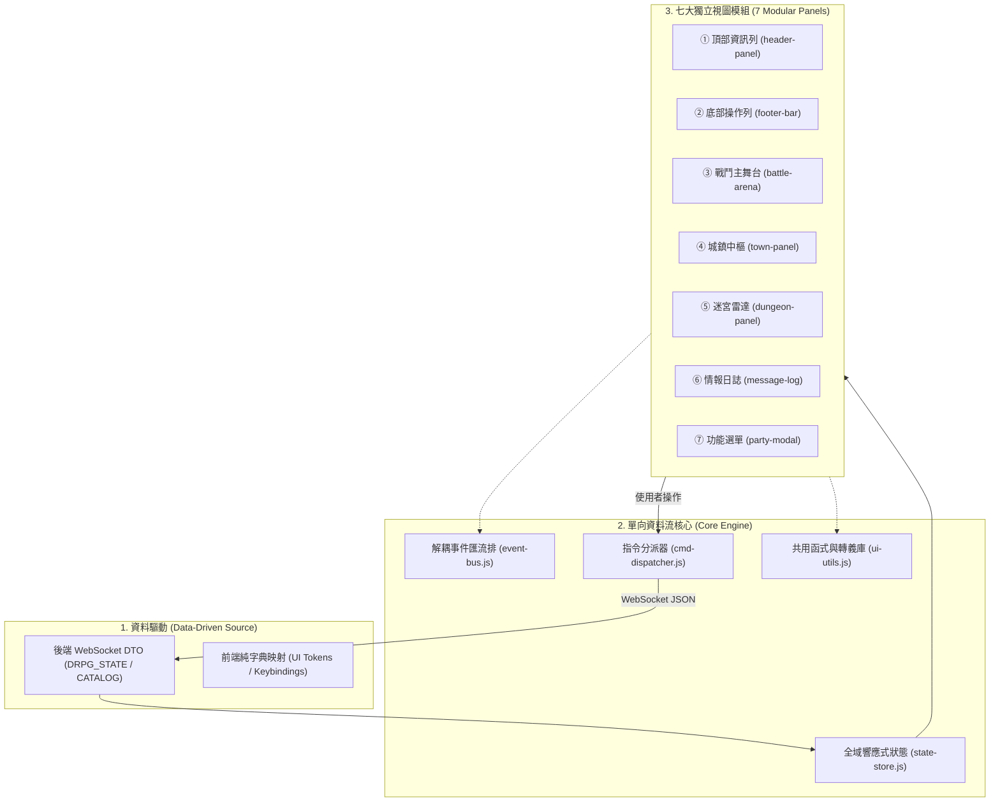

# 🖥️ 前端頁面結構與視圖模組化架構規範書
# (Frontend Page Architecture, Core Modules & Data-Driven Specifications)

> **文件定位**：
> 本文件定義 Web 前端核心架構原則、共用基礎庫（`constants.js`, `ui-utils.js`）、7 大視圖契約與資料驅動防範守則。
> **關聯專屬手冊導航**：
> - 🖥️ **宏觀佈局與場景狀態機**：請參閱 👉 [`FRONTEND_LAYOUT_GUIDE.md`](FRONTEND_LAYOUT_GUIDE.md)
> - 🎨 **6 大表現層模組手冊**：[`FE1_CORE_STATE`](FE1_CORE_STATE_AND_PIPELINE.md) ‧ [`FE2_VIEWPORT`](FE2_DRPG_VIEWPORT_RENDERER.md) ‧ [`FE3_ARENA`](FE3_BATTLE_ARENA_AND_FX.md) ‧ [`FE4_TOWN`](FE4_TOWN_HUB_AND_ACTION_BAR.md) ‧ [`FE5_MODALS`](FE5_PARTY_EQUIPMENT_AND_MODALS.md) ‧ [`FE6_THEMES`](FE6_CSS_TOKENS_AND_THEMES.md)

---

## 📌 目錄 (Table of Contents)

1. [核心架構哲學與三大開發鐵律](#1-核心架構哲學與三大開發鐵律)
2. [共用核心參數與函式庫規格 (constants.js & ui-utils.js)](#2-共用核心參數與函式庫規格)
3. [7 大核心視圖模組職責矩陣](#3-7-大核心視圖模組職責矩陣)
4. [前端資料驅動防禦守則 (Data-Driven Guardrails)](#4-前端資料驅動防禦守則)
5. [前端架構師核心建議 (Architect Recommendations)](#5-前端架構師核心建議)

---

## 1. 核心架構哲學與三大開發鐵律



### 1.1 佈局架構雙軌規範（對齊 D1 決策）
- **【現行已驗證】現行實作版面**：`index.html` 採左右雙主區佈局（左側主舞台＋左下 5 人小隊卡，右側全高可摺疊敘事情報日誌，支援 `⮃ 換邊` 按鈕左右對調）。所有操作均透過點擊按鈕與快捷鍵完成，**完全除役打字文字指令**。
- **【待深入討論／已決議待實作】規劃演進版面**：PC 經典三欄式（左欄雷達、中欄主舞台、右欄小隊、底欄日誌）與手機直向自適應 5 分頁常駐 Tab Bar（【遠征】 【小隊】 【行囊】 【技能】 【存檔】）。

### 鐵律一：嚴格資料驅動 (Strict Data-Driven)
- **禁止在 JS/CSS 中硬編碼遊戲業務規則**：職業名稱、部位限制、物品類別、數值加成、技能標籤、怪物類型等全數由後端提供。
- **UI 僅負責純粹投影 (Pure Projection)**：標籤、品階色彩、按鈕啟用/禁用狀態，必須直接取自後端 DTO 或由後端 metadata 宣告。

### 鐵律二：抽離共用參數與純粹函式 (Shared Utils & Constants)
- 杜絕重複造輪子：數值格式化、安全轉義、百分比換算、CSS 類別合成、鍵盤碼映射，一律收納至 `constants.js` 與 `ui-utils.js`。
- **純函式原則**：共用 Util 函式不得持有內部狀態，輸入確定則輸出確定。

### 鐵律三：全面消除 Inline JS 與高特異性 CSS
- HTML 結構**嚴禁出現 `onclick="..."`、`onkeypress="..."` 等內聯屬性**。
- 所有互動行為一律透過資料屬性（`data-action="..."`、`data-target="..."`）搭配**事件委派 (Event Delegation)** 集中處理。
- 樣式基於 CSS 變數（CSS Tokens），禁止以 inline style 覆蓋版面或字級。

---

## 2. 共用核心參數與函式庫規格

### 2.1 全域常數設定中樞 (`static/js/core/constants.js`)

```javascript
export const UI_CONSTANTS = Object.freeze({
  // 字級安全下限 (杜絕破版)
  MIN_FONT_SIZE_PX: 13,

  // 日誌最大留存行數
  MAX_LOG_HISTORY_LINES: 200,

  // 主選單 DQ/FF 規格
  MENU: {
    MAX_ITEMS_PER_PAGE: 20,
    BASE_WIDTH: 1600,
    BASE_HEIGHT: 900
  },

  // 快捷鍵定義 (Key Codes)
  KEYS: {
    MENU: ['c', 'C', 'p', 'P'],
    BAG: ['b', 'B'],
    INSPECT: ['i', 'I'],
    REST: ['r', 'R'],
    CONSOLE: ['`', '~'],
    ESCAPE: ['Escape'],
    SPACE: [' ']
  },

  // 資源條類型與預設風格 (與後端 CombatResourceType 對齊)
  RESOURCE_THEMES: {
    MP: { label: '真元', cssClass: 'resource-mp', color: 'var(--color-resource-mp)' },
    SP: { label: '戰氣', cssClass: 'resource-sp', color: 'var(--color-resource-sp)' },
    RAGE: { label: '怒氣', cssClass: 'resource-rage', color: 'var(--color-resource-rage)' },
    COMBO: { label: '連擊', cssClass: 'resource-combo', color: 'var(--color-resource-combo)' },
    SAN: { label: '理智', cssClass: 'resource-san', color: 'var(--color-resource-san)' }
  }
});
```

### 2.2 全域共用工具函式庫 (`static/js/core/ui-utils.js`)

```javascript
export const UiUtils = {
  // 1. 全域 DOM XSS 防禦轉義 (P0 安全核心)
  escapeHtml(str) {
    if (str === null || str === undefined) return '';
    return String(str)
      .replace(/&/g, '&amp;')
      .replace(/</g, '&lt;')
      .replace(/>/g, '&gt;')
      .replace(/"/g, '&quot;')
      .replace(/'/g, '&#039;');
  },

  // 2. 安全百分比計算 (避免除以零或溢出)
  calculatePercentage(current, max) {
    const curVal = Number(current) || 0;
    const maxVal = Number(max) || 1;
    if (maxVal <= 0) return 0;
    return Math.min(100, Math.max(0, Math.round((curVal / maxVal) * 100)));
  },

  // 3. 資源進度條樣板產生器
  createResourceBar(current, max, type = 'hp') {
    const pct = this.calculatePercentage(current, max);
    return `
      <div class="hud-bar-track hud-bar-${type}">
        <div class="hud-bar-fill" style="width: ${pct}%"></div>
        <span class="hud-bar-text">${current}/${max}</span>
      </div>
    `;
  },

  // 4. 裝備/技能品質標籤 CSS 類別解析 (由後端 quality 驅動)
  getQualityClass(quality) {
    const q = String(quality || 'COMMON').toUpperCase();
    const map = {
      POOR: 'quality-gray', COMMON: 'quality-white', UNCOMMON: 'quality-green',
      RARE: 'quality-blue', EPIC: 'quality-purple', LEGENDARY: 'quality-orange', MYTHIC: 'quality-red'
    };
    return map[q] || 'quality-white';
  }
};
```

---

## 3. 7 大核心視圖模組職責矩陣

遊戲視圖由 **7 大模組** 組合而成，三大主舞台（城鎮、地牢、戰鬥）互斥切換，詳見 [`FRONTEND_LAYOUT_GUIDE.md`](FRONTEND_LAYOUT_GUIDE.md)：

| 編號 | 視圖模組 | 對應 DOM 節點 | 核心業務職責 | 對應規格手冊 |
| :---: | :--- | :--- | :--- | :--- |
| **①** | **頂部資訊列** (`header-panel`) | `<header class="top-nav-bar">` | 探索模式、地圖名稱、陣法靈威條、主選單 (C) 入口、連線指示燈、換邊按鈕 | [`FE1`](FE1_CORE_STATE_AND_PIPELINE.md) / [`FE6`](FE6_CSS_TOKENS_AND_THEMES.md) |
| **②** | **底部操作列** (`footer-bar`) | `<footer class="bottom-control-panel">` | 固定高度 48~64px；情境化動作按鈕（探索: 調息/選單/40格行囊；戰鬥: 集火/奧義/遁地） | [`FE4`](FE4_TOWN_HUB_AND_ACTION_BAR.md) |
| **③** | **戰鬥交鋒主舞台** (`battle-panel`) | `<section class="battle-arena-panel">` | 敵方 5x5 怪物陣列、目標選取、破防削韌條、2px 交鋒微光線、我方 5x3 戰備甲板與 FCT 浮動大字 | [`FE3`](FE3_BATTLE_ARENA_AND_FX.md) |
| **④** | **城鎮營地中樞** (`town-panel`) | `<section class="town-nav-panel">` | 區域抬頭、選單式設施導航、身旁 NPC 卡片（交談/交易/切磋）與地面掉落物拾取 | [`FE4`](FE4_TOWN_HUB_AND_ACTION_BAR.md) |
| **⑤** | **迷宮雷達視窗** (`dungeon-panel`) | `<aside class="dungeon-radar-panel">` | 10x10 ASCII 矩陣迷宮雷達、迷霧遮蔽、第一人稱透視、凝神探查卡片 | [`FE2`](FE2_DRPG_VIEWPORT_RENDERER.md) |
| **⑥** | **歷程情報日誌** (`message-log-panel`) | `<div class="log-and-battle-area">` | 100% 全高貫通右舞台、ANSI 彩色轉義、平滑滾動至底、最大緩衝 200 行 | [`FE1`](FE1_CORE_STATE_AND_PIPELINE.md) |
| **⑦** | **功能選單彈窗** (`party-modal`) | `<div id="party-modal" class="modal-overlay">` | 固定 1600x900 / 滿版適配；8 大分頁（40 格公共行囊、裝備、技能、角色、隊伍、陣法、Gambit、系統存讀檔） | [`FE5`](FE5_PARTY_EQUIPMENT_AND_MODALS.md) |

---

## 4. 前端資料驅動防禦守則 (Data-Driven Guardrails)

### 4.1 嚴格禁止的反模式 (Anti-Patterns)
1. ❌ **以字串名稱猜測分類**：`if (item.name.includes("丹"))` $\to$ ✅ 必須讀取 `item.type === "CONSUMABLE"` 或 `item.isUsable === true`。
2. ❌ **以 NPC 名稱硬編碼互動**：`if (npc.name === "掌櫃") renderShop()` $\to$ ✅ 必須依 `npc.capabilities` 陣列動態渲染動作。
3. ❌ **以怪物名稱判斷首領**：`if (enemy.name === "宋天衡")` $\to$ ✅ 必須讀取 `enemy.rank === 'BOSS'` 或 `enemy.phaseThresholds`。
4. ❌ **使用內聯樣式覆蓋字級與顏色**：`style="color: red; font-size: 11px;"` $\to$ ✅ 必須採用 Token 類別，且字級嚴格遵守 $\ge 13\text{px}$。

---

## 5. 前端架構師核心建議 (Architect Recommendations)

1. **強制實施純資料投影 (Pure Projection)**：
   視圖層永遠只是後端狀態的「映射鏡子」。任何關於「能否施法」、「背包是否已滿」、「陣法是否啟用」的商業邏輯，後端均在 DTO 計算完畢並帶上旗標，前端只管讀值上樣式，杜絕前後端雙重邏輯漂移。
2. **字級底線與防禦佈局 (Defensive Layout)**：
   全專案嚴格貫徹 `font-size >= 13px`。內容超長時依序採用：**1. 獨立視口捲動 (`overflow-y: auto`) ➔ 2. 欄位折疊 ➔ 3. 文字省略 (`text-overflow: ellipsis`) + Hover Tooltip**，嚴禁以縮小字體硬塞。
3. **消除非同步競爭與避免整頁重繪 (DOM Performance)**：
   高頻戰鬥跳字與狀態更新，嚴禁頻繁整頁 `innerHTML = ...`，重要組件（如 HP 條、敵方 Buff 圖示）採用局部更新，維持 60 FPS 戰鬥體驗。
4. **全域無障礙與純鍵盤流暢遊玩 (Keyboard Navigation)**：
   確保全舞台均支援全鍵盤流暢操作（`WASD` 行動、`1~5` 技能、`Space` 集火、`C` 選單、`Esc` 關閉與退回、`~` 終端控制台）。
