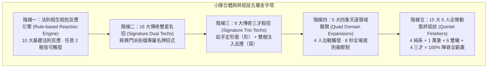

# 💥 小隊合體技、連攜反應與全隊終結技體系 (Synergy, Combos & Formations)

> **文檔層級**：Level 2 — Specifications (模組規劃層)  
> **上級指針**：👉 Level 1《[CYBERPUNK_CULTIVATION_SPEC.md](../../1_requirements/CYBERPUNK_CULTIVATION_SPEC.md)》  
> **對應模組**：👉 Level 2《[M5_SKILL_AND_PROGRESSION.md](../backend/M5_SKILL_AND_PROGRESSION.md)》與《[SKILL_SCHEMA.md](../data_schemas/SKILL_SCHEMA.md)》  
> **對應任務**：👉 Level 3《[M5_SKILL_AND_PROGRESSION_TASKS.md](../../3_task_lists/backend/M5_SKILL_AND_PROGRESSION_TASKS.md)》

---

## 🧭 一、核心設計哲學與階梯體系架構

本遊戲貫徹 **85% 爽快砍殺刷寶（Hack-and-Slash DRPG）vs 15% 非侵入式背景世界觀**，並嚴格遵循 **【仙俠先行 × 底層真相揭示】(Option C)** 呈現準則。

合體技與終結技體系由低至高劃分為五大階梯，兼具**「底層通用法則反應的無限相生相剋」**與**「頂層傳奇名招與 15 大動態陣法終結技的極致爽感」**：



---

## ⚡ 二、階梯一：法則相生相剋反應引擎 (Rule-based Reaction Engine)

當小隊中任意兩位角色在 3 秒內先後命中同一敵怪或區域時，後端 `ComboResolver` 自動比對技能標籤（`Primer` ➔ `Detonator`），依據下表 10 大通用法則公式自動結算化學反應：

| # | 法則反應名稱 | 元素/機制交織 | 反應類型 (`reactionType`) | 戰術機制與數值公式 | 底層真相 (`cyberLore`) |
|---|---|---|:---:|---|---|
| 01 | **【天道氣化·靈雲蒸發】** | 玄水 ＋ 離火 | `STEAM` | 造成 **2.0x 蒸氣爆發傷害**，全場瀰漫熱霧，敵怪命中率 -30% 持續 5 秒。 | 液冷冷卻液遭遇高熱等離子瞬態汽化，產生超臨界高壓熱氣流阻礙光學感測。 |
| 02 | **【星火燎原·熾木焚天】** | 離火 ＋ 靈木 | `SPREAD` | 燃燒 DoT 結算頻率翻倍，並將火毒 **100% 傳染至同排與相鄰** 敵怪。 | 活性真菌孢子富含有機油脂，遭遇熱能引發自催化加速燃燒反應。 |
| 03 | **【枯木逢春·靈雨寄生】** | 玄水 ＋ 靈木 | `GROWTH` | 治療效果提升 **+50%**，並在敵怪腳下催生靈藤，**束縛移動 2.5 秒**。 | 高純度水合培養基加速基因合成植物根鬚，實體纏繞金屬關節。 |
| 04 | **【熔金銷骨·離火淬刃】** | 庚金 ＋ 離火 | `MELT` | **融化目標 50% 護甲**，金系物理傷害 50% 轉化為無視防禦之真實灼燒傷害。 | 局域激光退火熱處理，破壞目標合金晶格硬度，引發熱應力形變。 |
| 05 | **【九幽凍土·泥淖陷仙】** | 后土 ＋ 玄水 | `MUD_LOCK` | 敵怪移動與攻擊速度暴跌 **-50%**，承受之削韌傷害（Poise Damage）提升 **1.5x**。 | 奈米磁流體在泥漿中凝固形成高黏度阻尼介質，大幅限制動力骨骼位移。 |
| 06 | **【奇異引力·電漿塌陷】** | 重力 ＋ 任意火/雷 | `GRAVITY_COLLAPSE` | 強制將全場分散敵怪 **牽引至中心點**，隨後引爆超高密度 AOE 爆裂。 | 微型重力塌陷核心將敵怪質量匯聚，引發電漿球向心對撞轟爆。 |
| 07 | **【生化超導·磁煞骨刃】** | 幾丁質 ＋ 電磁 | `SUPERCONDUCTOR` | 骨刃附加超導高頻電弧，對同列直線敵怪造成 **100% 暴擊貫穿**。 | 幾丁外骨骼表面塗覆超導釔鋇銅氧塗層，激發高頻感應切割電弧。 |
| 08 | **【血肉木馬·逆倫奪元】** | 黑山羊 ＋ 協議 | `BLOOD_TROJAN` | 成功打斷施法時，直接將該招消耗之真元 **100% 掠奪為我方全隊氣血**。 | 協調代碼注入異變生化代碼，截獲敵方供電總線並回哺給友軍生命維持模組。 |
| 09 | **【拉萊耶幻境·寒潭攝魂】** | 玄水 ＋ 知見 | `ABYSS_TERROR` | 極寒減速伴隨不可名狀囈語，敵怪陷入恐懼 **原地顫抖無法行動 3 秒**。 | 低溫刺激神經突觸與次聲波知見代碼同調，引發敵怪中樞系統災難性恐慌重啟。 |
| 10 | **【地煞炎魔·沸血焚山】** | 地核熔爐 ＋ 幾丁質 | `MAGMA_BLOOD` | 熔岩地形伴隨爆裂骨刺，踩踏熔岩之敵怪每秒引爆一次範圍血煞。 | 外星基因骨質微粒與地熱熔渣產生放熱鏈式反應，引發二次地表微爆。 |

---

## 🌟 三、階梯二：16 大傳奇雙星名招 (Signature Dual Techs)

當隊中特定經典拍檔攜手出招時，升格為專屬「傳奇雙星名招」，享有專屬全螢幕特效與巨額數值增益：

| # | 專精拍檔組合 | 仙俠正式名 | 戰術機制與數值公式 | 戰場反饋與削韌 | 底層真相 (`cyberLore`) |
|---|---|---|---|---|---|
| 01 | **玄冥真水 ＋ 九天離火** | **【太極水火·兩儀陰陽寂滅印】** | 水火同源碰撞，施加霜凍後瞬爆蒸發，引爆 3 段混元太極真火。 | 削韌 60 點，處於破防狀態造成 2.5x 爆裂。 | 雙向熱力學逆轉循環：急速超低溫驟冷後瞬間導入千度電漿，熱應力撕裂敵怪結構。 |
| 02 | **九天離火 ＋ 青帝靈木** | **【星火燎原·青木赤霞焚天訣】** | 點燃青木靈藤引發全場連環大爆，全體敵怪陷入火海持續 5 秒。 | 2.5x 火焰 AOE，削韌 45 點，同排全體傳染。 | 木質纖維富化氣溶膠完全燃燒，催化鏈式放熱衝擊波席捲戰區。 |
| 03 | **庚金劍煞 ＋ 九天離火** | **【九霄紫電·天罡奔雷裂空斬】** | 離火淬金引發超導紫電雷劫，電弧在同排敵人間跳躍 4 次。 | 2.8x 雷火傷害，削韌 50 點，附帶重度麻痺 2 秒。 | 金屬導軌高溫退火激發萬伏超導電弧，擊穿目標法拉第籠屏蔽。 |
| 04 | **玄冥真水 ＋ 青帝靈木** | **【靈泉逢春·碧落寄生回元露】** | 甘霖活化木系靈根，全隊立即回血 40%，敵怪播撒汲血寄生孢子。 | 全隊大急救，敵怪每秒被汲取 5% 最大氣血。 | 納米醫療機器人溶膠散佈，同調吞噬外周生物組織並合成高純度血清。 |
| 05 | **后土鎮嶽 ＋ 庚金劍煞** | **【天工開物·厚土金剛破陣錐】** | 土生萬物凝為巨型開山重錐，從天而降砸碎首領防線。 | 造成 70 點毀滅削韌，破防狀態下傷害提升 2.0x。 | 深井液壓開山衝壓機瞬態重構，以萬噸重力勢能貫穿地下防禦工事。 |
| 06 | **天引重力 ＋ 神機裂解** | **【乾坤碎嶽·太古黑洞八荒崩】** | 引力將敵怪壓縮至奇異點，液壓超聲波重錘當空砸下。 | 全場敵怪韌性（Poise）瞬間清零，強行倒地眩暈。 | 局部重力井約束敵怪自由度，隨後激發 20kHz 超聲波共振粉碎金屬骨架。 |
| 07 | **天引重力 ＋ 電磁動能** | **【星隕天降·高斯重力軌道炮】** | 重力定錨鎖死單體 Boss，外太空軌道電磁鎢棒超音速直擊。 | 單體真實傷害 4.5x，削韌 90 點，無視一切防禦。 | 軌道衛星群下行微波目標引導，動能毀滅棒以 8 馬赫直插敵方中樞。 |
| 08 | **太古金剛 ＋ 協議逆亂** | **【絕對防線·因果逆轉偏折罡】** | 蜂巢偏折力場吸收前排所有打擊，並透過協議反噬施法者。 | 6 秒內吸收 100% 傷害，並將敵方單體殺招 100% 彈回。 | 偏折反相器與入侵協議握手，逆向解構對手信號頻譜並反向過載發射源。 |
| 09 | **時序超頻 ＋ 全息匿影** | **【三千幻影·剎那因果無間刺】** | 抽幀進入時停，3 具全息分身與本體在四方盲區出刀。 | 100% 暴擊破空刺殺，削韌 55 點，無仇恨溢出。 | 視覺渲染線程注入偽造影格，特工在神經超頻下執行零延遲背刺。 |
| 10 | **時序超頻 ＋ 庚金劍煞** | **【光陰如梭·剎那千秋飛劍潮】** | 神經超頻使飛劍發射頻率暴增 300%，一息激射 12 柄飛劍。 | 飽和轟炸，造成 12 次快速穿甲切割，回滿自身真元。 | 微型伺服機構極限超頻，超音速電磁供彈模組傾瀉集束飛劍。 |
| 11 | **強殖幾丁質 ＋ 黑山羊血裔** | **【深淵降生·血肉太歲狂暴化】** | 幾丁外骨骼與黑山羊魔血交融，前排隊員化為白骨血煞魔人。 | 自身受創 50% 轉為吸血，攻擊力提升 80% 持續 10 秒。 | 活性魔血刺激外骨骼細胞失控增殖，生物內啡肽阻斷一切痛覺神經。 |
| 12 | **知見污染 ＋ 虛無崩解** | **【不可名狀·盲目痴愚空指針】** | 敵方全體理智崩潰自相殘殺，氣血低於 20% 且破防者直接抹除。 | 全場陷入恐懼混亂 4 秒，觸發斬殺直接處決。 | 記憶體堆疊空間覆寫外神混亂代碼，中斷向量表清零導致目標執行緒崩潰。 |
| 13 | **強殖幾丁質 ＋ 電磁動能** | **【生化超導·破空磁煞幾丁刃】** | 外骨骼骨刃通電充能，揮出長達五丈之電磁高頻震盪光刃。 | 一刀兩斷貫穿全列敵怪，造成 3.5x 暴擊穿甲。 | 生物幾丁質結晶嵌合超導線圈，激發次原子級別高頻電磁等離子切面。 |
| 14 | **黑山羊血裔 ＋ 協議逆亂** | **【血肉木馬·黑煞因果逆倫奪】** | 截獲敵方施法數據流並注入異變血疫，100% 打斷前搖。 | 掠奪敵怪全額真元注入我方全隊，敵怪沉默 3 秒。 | 底層總線注入奈米逆轉木馬病毒，逆轉供電迴路為友軍補給儲能。 |
| 15 | **后土鎮嶽 ＋ 太古金剛** | **【不動如山·八荒金剛神城壁】** | 地殼板塊拔起與金剛偏折力場融合，全隊獲得絕對掩體。 | 全隊獲得 6 秒 100% 物理與五行格擋護甲，全體免疫擊退。 | 地下加固液壓支柱與偏折能量矩陣錨定，構築微型前沿防空掩體。 |
| 16 | **地核熔爐 ＋ 強殖幾丁質** | **【地煞炎魔·沸血骨獄焚山破】** | 地核等離子引燃生化血肉，釋放沸血高溫骨刺風暴。 | 戰場化為熔融骨獄地形，敵怪移動受到持續撕裂與重度燃燒。 | 等離子高溫燒灼超生長骨刺陣列，產生飛濺高熱生物碎片封鎖戰區。 |

---

## 🔮 四、階梯三：8 大傳奇三才殺招 (Signature Trio Techs)

三樹連鎖合體技遵循 **【起手定形態（形） ＋ 雙樹注入反應（質）】** 架構：由一名發起者決定戰術範圍（風暴 AOE、巨箭貫穿、陣法壓制、護盾回哺），兩名協同者注入反應：

| # | 三才拍檔組合 | 仙俠正式名 | 起手 ➔ 注入連攜機制 | 戰術機制與全場反饋 | 底層真相 (`cyberLore`) |
|---|---|---|---|---|---|
| 01 | **玄水 ＋ 離火 ＋ 靈木** | **【萬毒天雨·碧落赤霞蒸仙煞】** | 靈木降雨起手 ➔ 水火碰撞蒸發 | 沸騰劇毒熱霧瀰漫全屏，每 0.5 秒結算三重 DoT，目標易傷 +40%。 | 劇毒化學噴劑遭遇高熱蒸發擴散，破壞生化呼吸器並腐蝕表層組織。 |
| 02 | **重力 ＋ 后土 ＋ 熔爐** | **【天星地煞·地核隕星破界崩】** | 重力聚怪 ➔ 后土拔起石牢 ➔ 熔爐爆發 | 全場怪強制吸入石牢並引爆等離子超新星，全屏破防昏迷 3 秒。 | 引力定錨約束 ➔ 封閉液壓防護艙 ➔ 核心等離子融毀微爆。 |
| 03 | **庚金 ＋ 時序 ＋ 電磁** | **【千星瞬影·萬劍超頻百步貫腦劫】** | 子彈時間抽幀 ➔ 電磁軌道鎖定 ➔ 庚金萬劍貫穿 | 單體 Boss 毀滅斬殺！100% 暴擊，削韌 120 點，無視一切防禦。 | 神經超頻抽幀鎖定目標死穴，磁軌加速飛劍矩陣以高超音速連續貫穿。 |
| 04 | **幾丁 ＋ 血裔 ＋ 虛無** | **【九幽冥胎·母神血肉空指針噬魂煞】** | 骨刃撕裂 ➔ 血裔寄生 ➔ 虛無抹除 | 擊殺敵怪時在原地誕生一隻助戰血肉魔仆，繼承擊殺者 50% 屬性。 | 外神生物代碼感染宿主死因，記憶體溢出錯誤重組為自我驅動傀儡。 |
| 05 | **協議 ＋ 全息 ＋ 庚金** | **【虛實莫辨·零日飛劍截脈殺】** | 全息幻影惑敵 ➔ 協議斷法 ➔ 庚金盲區刺殺 | 敵怪仇恨完全錯亂，施法 100% 被阻斷，背刺造成 4.0x 暴擊真實傷害。 | 欺騙式誘餌信號牽引射控系統，零日攻擊切斷後路，動能刃冷酷收割。 |
| 06 | **金剛 ＋ 血裔 ＋ 玄水** | **【血魄金剛·驚濤護法同生契】** | 蜂巢力場 ＋ 驚濤水盾 ＋ 魔血同調 | 全隊進入極限反擊姿態，全隊受擊 60% 傷害轉為自愈吸血持續 8 秒。 | 偏折護盾同調微流控生命迴路，將外來動能轉化為奈米修復電能。 |
| 07 | **重力 ＋ 協議 ＋ 知見** | **【混亂深淵·引力因果崩解囚籠】** | 重力黑洞聚怪 ➔ 協議斷網 ➔ 囈語灌腦 | 全場敵怪蓄力條清空，陷入極度恐慌，100% 機率自相殘殺 4 秒。 | 物理重力限制機動，射頻 EMP 斷開指揮鏈，次聲波知見代碼引發友軍誤擊。 |
| 08 | **神機 ＋ 熔爐 ＋ 電磁** | **【天基破陣·超導等離子動能衝擊】** | 液壓粉碎 ➔ 等離子熱融 ➔ 磁軌重炮 | 液壓碎甲 ➔ 融化外殼 ➔ 電磁重炮轟穿，全場敵怪 Poise 韌性瞬間清零。 | 三階工業破壞序列：機械碎石機破面、等離子氣割破壁、高斯質量彈貫穿。 |

---

## 🏛️ 五、階梯四：5 大四象天道領域展開 (Quad Domain Expansions)

四人合體技代表隊伍的戰略極限，固定歸納為 **5 大天道領域展開**，耗費 100 點戰陣能量，展開持續 8 秒的絕對規則壓制：

| 構成方向 | 領域名稱 (仙俠先行) | 底層真相 (特工加載突破) | 戰場絕對領域效果 (持續 8 秒) |
|---|---|---|---|
| **四系純修仙**<br>(五行任選 4 樹) | **【太乙混元·五行四象破天劍煞界】** | *[Element Overclock Cascade]* | 戰場化為萬劍領域，全場所有五行抗性清零，所有基礎技能冷卻減半，真元消耗歸零！ |
| **四系古代工程**<br>(重力+神機+金剛+熔爐) | **【造物神殿·行星地核定鼎陣列】** | *[Planetary Forge Singularity]* | 全隊獲得 100% 絕對無敵霸體，全場引力壓制敵怪倒地無法施法，地核高溫持續融甲。 |
| **四系賽博高科**<br>(時序+協議+全息+電磁) | **【天衍神念·千星矩陣絕對零日網】** | *[Mil-Spec Zero-Day EMP]* | **全場時間停滯 4 秒**，敵方全體斷網宕機（蓄力條清零），全隊下 3 次攻擊必 100% 暴擊真傷！ |
| **四系克蘇魯外神**<br>(幾丁質+血裔+知見+虛無)| **【不可名狀·森之黑山羊深淵肉相界】**| *[Biological Prime Abyssal Realm]*| 戰場化為蠕動血肉溫床，全隊吸血 100%，敵怪恐懼相殘，陣亡者被虛無吞噬轉化為全隊全滿血包。 |
| **跨界四象混搭**<br>(仙 ＋ 工 ＋ 科 ＋ 魔各一)| **【四極降魔·誅仙滅魂混天伏魔陣】** | *[Quad-Hybrid Core Purge]* | **全維度降維打擊**：聚合破防、時停、融甲與血祭，Boss 霸體強制清零，全隊負面全清並滿血滿藍！ |

---

## 🌌 六、階梯五：15 大 5 人全隊動態終結技矩陣 (15 Dynamic 5P Finishers)

後端 `ComboResolver` 不受限於死板的「3+2」或「2+3」人數比例，純粹根據出戰 5 人（含主角萬象陣眼與隊友副修道骨）所涵蓋的流派體系集合，自動窮盡分類為 **15 大動態形態**，達成 100% 陣容觸發覆蓋率：

### 1. 四大純粹極限型（單一體系 $\ge 4$ 人）
| # | 陣容體系標籤 | 終結技名稱 (仙俠先行 × 底層真相) | 戰術機制與砍殺爽點反饋 |
|---|---|---|---|
| 01 | **純修仙者隊**<br>($\ge 4$ `CULTIVATOR`) | **【萬劍歸宗·九天太乙誅仙劍陣】**<br>*[Plasma Super-Conductor Cascade]* | 漫天金色飛劍傾瀉，九大元素爆發，全隊 MP 回滿且 10 秒內技能零真元消耗。 |
| 02 | **純工程師隊**<br>($\ge 4$ `ENGINEER`) | **【大地沉淪·太古神山崩天闕】**<br>*[Planetary Core Gravity Singularity]* | 五座巨碑拔起引發黑洞坍縮，敵怪全體行動條鎖死 5 秒且 Poise 韌性清零。 |
| 03 | **純高科技隊**<br>($\ge 4$ `HIGH_TECH`) | **【天衍極限·千星神念天網劫】**<br>*[Mil-Spec Grid Overclock: 10000 FLOPS]* | 五大晶片超頻，**真·時停 3 秒**！無數激光切面打出 100% 暴擊真實傷害。 |
| 04 | **純克蘇魯隊**<br>($\ge 4$ `CTHULHU`) | **【森羅萬象·黑山羊母神血宴】**<br>*[Biological Prime: Macro-Cellular Eruption]* | 地面撕裂爆發千丈血肉觸手引爆全屏 DoT，傷害 100% 轉為治療，倒地隊友原地滿血復活。 |

### 2. 萬象混元型（4 大體系均衡各 1 人 ＋ 主角萬象）
| # | 陣容體系標籤 | 終結技名稱 (仙俠先行 × 底層真相) | 戰術機制與砍殺爽點反饋 |
|---|---|---|---|
| 05 | **萬象混元隊**<br>(仙+工+科+魔各1人) | **【大衍混元·諸天萬象開天闢地神劫】**<br>*[Protocol Genesis: Planetary Cold Reformat]* | **全維度無死角轟殺**：100% 削韌破防 ＋ 全元素擴散 ＋ 唱條打斷 ＋ 裂魂引爆 ＋ 全隊回滿！ |

### 3. 六大雙曜交織型（隊伍僅由 2 種體系構成，如 3+2、2+3 或 4+1）
| # | 雙體系組合 | 終結技名稱 (仙俠先行 × 底層真相) | 戰術機制與砍殺爽點反饋 |
|---|---|---|---|
| 06 | **修仙 ＋ 克蘇魯**<br>(仙魔雙曜) | **【太極血海·逆亂生死神魔印】**<br>*[Taiji Blood Abyss: Life-Death Inversion Seal]* | 清聖太極劍氣破除護甲，九幽血煞海潮吞噬氣血，斬殺敵怪並為全隊殘血隊友大急救。 |
| 07 | **高科技 ＋ 工程師**<br>(賽博神機) | **【天基軌道·萬鈞乾坤神機炮】**<br>*[Orbital Kinetic Strike: Terrestrial Anchor Array]* | 工程師地脈定錨引力鎖死，巨企天基衛星發射超音速鎢棒直擊，全屏物理真實巨額粉碎。 |
| 08 | **修仙 ＋ 高科技**<br>(仙道賽博) | **【九天星網·神念超頻萬劍矩陣】**<br>*[Cyber-Celestial Grid: Neural Overclock Array]* | 晶片高速演算敵怪弱點，飛劍經由電磁超導折射自動鎖定弱點，100% 暴擊破防。 |
| 09 | **修仙 ＋ 工程師**<br>(天工仙道) | **【天工造化·九嶽神山崩天闕】**<br>*[Prime Genesis: Macro-Tectonic Resonance]* | 五行符文與深井液壓重構共振，地底拔起九座太古巨嶽，強制眩暈全場敵怪 4 秒。 |
| 10 | **克蘇魯 ＋ 高科技**<br>(生化黑客) | **【生化天羅·黑煞奈米噬魂木馬】**<br>*[Bio-Synthetic Trojan: Macro-Cellular Infiltration]* | 軍規病毒注入黑山羊母體細胞，敵怪全體陷入系統癱瘓，前搖 100% 打斷並持續腐蝕扣血。 |
| 11 | **克蘇魯 ＋ 工程師**<br>(血肉泰坦) | **【深淵巨擘·太古血肉魔導重機】**<br>*[Abyssal Harvester: Bio-Hydraulic Titan]* | 重型採礦設備與活性魔血融合，召喚巨型血肉液壓泰坦一拳震碎戰場，全隊霸體護甲翻倍。 |

### 4. 四大三才鼎立型（隊伍由 3 種體系構成，如 2+2+1 或 3+1+1）
| # | 三體系組合 | 終結技名稱 (仙俠先行 × 底層真相) | 戰術機制與砍殺爽點反饋 |
|---|---|---|---|
| 12 | **修仙 ＋ 克蘇魯 ＋ 高科技**<br>(排除工程) | **【偷天換日·生化天道逆亂真訣】**<br>*[Tri-Matrix Override: Biological Cyber-Dao Singularity]* | 瞬間淨化全隊負面並 200% 反噬敵怪，飛劍附帶血肉撕裂與時序抽幀，全場敵怪混亂。 |
| 13 | **修仙 ＋ 克蘇魯 ＋ 工程師**<br>(排除科技) | **【冥河重嶽·混沌太虛開山印】**<br>*[Macro-Tectonic Void: Abyssal Lithosphere Siphon]* | 重力聚怪 ➔ 地底黑山羊血海蔓延 ➔ 五行神山壓頂，三段式毀滅打擊，全隊吸血回滿。 |
| 14 | **修仙 ＋ 高科技 ＋ 工程師**<br>(排除外神) | **【天衍算籌·九天神雷星際裂變陣】**<br>*[Trio Prime: Gravity-EMP Super-Conductive Cataclysm]* | 引力黑洞鎖怪 ➔ 協議 EMP 斷網清空蓄力條 ➔ 九天紫電全屏轟頂破防，全場韌性清零。 |
| 15 | **克蘇魯 ＋ 高科技 ＋ 工程師**<br>(排除修仙) | **【萬機歸淵·黑山羊奇異點格式化】**<br>*[Techno-Organic Purge: Deep-Well Void Reformat]* | 深井開採口全開，黑山羊幼崽攜等離子過載炸彈席捲戰場，無視防禦造成巨額真實混沌傷害。 |

---

## 🧩 七、主角「萬象陣眼」與隊友「道骨副修」養成

1. **主角的【萬象核心晶片插槽 (Core Socket)】**：
   - 主角天生為四體系兼修者。在營地【靈台藏經閣】中，主角可切換裝備核心晶片，在陣法判定中自由代表任意缺失的體系，確保玩家能隨心所欲打出心儀的終結技！
2. **隊友的【道骨副修插槽 (Sub-School Socket)】**：
   - 隊友在境界突破（築基/金丹）後解鎖副修道骨插槽。例如純陽劍修可鑲嵌「克蘇魯幾丁質骨」，從而在陣法連攜中提供克蘇魯體系標籤，極大釋放隊伍搭配自由度。

---

## 📚 八、長線低優先連攜擴充寶庫 (Task M5-7 Backlog)

以下作為後續版本長線迭代之低優先實作備選庫（優先級 Low，由 `Task M5-7` 追蹤）：

- **【青帝靈木 ＋ 后土鎮嶽】**：**【地湧金蓮·枯木逢春陣】** —— 植物扎根大地，持續向全隊輸送靈氣與土甲。
- **【玄冥真水 ＋ 庚金劍煞】**：**【水月洞天·太陰飛劍潮】** —— 飛劍附帶冰霜減速，折射水月光影引發分身幻象。
- **【神機裂解 ＋ 強殖幾丁質】**：**【萬骨機變·白骨液壓碎顱爪】** —— 血肉與液壓結合之極限近戰破甲衝擊。
- **【全息匿影 ＋ 協議逆亂 ＋ 時序超頻】**：**【幽靈特工·零日賽博天羅步】** —— 純戰術無痕潛行控制流，完全免除警覺度。
- **【地核熔爐 ＋ 九天離火 ＋ 虛無崩解】**：**【焚天滅度·虛無黑洞超新星】** —— 毀天滅地極限熱能黑洞，敵怪蒸發無存。
- **【太古金剛 ＋ 庚金劍煞 ＋ 電磁動能】**：**【萬劍磁壁·超導御劍結界】** —— 磁力操控千百飛劍環繞護體，靠近之敵怪皆被切碎。
- **【黑山羊血裔 ＋ 靈木 ＋ 知見污染】**：**【血樹婆娑·萬魂囈語祭】** —— 在場上催生血肉神樹，持續抽取怪物神經意志與生命。
- **【天引重力 ＋ 玄冥真水 ＋ 協議逆亂】**：**【絕對零度·寒冰坍縮因果鎖】** —— 重力收攏怪物同時冰封，協議鎖死冷卻時間。

---

## 💾 九、標準合體技資料契約範例 (`party_skills.json`)

```json
[
  {
    "id": "combo_water_fire_taiji",
    "name": "【太極水火·兩儀陰陽寂滅印】",
    "tierLevel": "DUAL_STAR_2P",
    "synergyType": "SIGNATURE_DUAL",
    "reactionType": "STEAM",
    "requiredConditions": {
      "minPartyAlive": 2,
      "requiredTrees": ["tree_water_frost", "tree_fire_flame"]
    },
    "formationEnergyCost": 40,
    "effects": {
      "instantPoiseBreak": false,
      "allDetonateBonusMultiplier": 2.5,
      "poiseDamage": 60
    },
    "cyberLore": "雙向熱力學逆轉循環：急速超低溫驟冷後瞬間導入千度電漿，熱應力撕裂敵怪結構。"
  },
  {
    "id": "combo_trio_wanjian_overclock",
    "name": "【千星瞬影·萬劍超頻百步貫腦劫】",
    "tierLevel": "TRI_RESONANCE_3P",
    "synergyType": "SIGNATURE_TRIO",
    "reactionType": "SUPERCONDUCTOR",
    "requiredConditions": {
      "minPartyAlive": 3,
      "requiredTrees": ["tree_gold_sword", "tree_time_overclock", "tree_kinetic_rails"]
    },
    "formationEnergyCost": 70,
    "effects": {
      "instantPoiseBreak": true,
      "poiseDamage": 120,
      "damageMultiplier": 4.5
    },
    "cyberLore": "神經超頻抽幀鎖定目標死穴，磁軌加速飛劍矩陣以高超音速連續貫穿。"
  },
  {
    "id": "domain_quad_celestial_blade",
    "name": "【太乙混元·五行四象破天劍煞界】",
    "tierLevel": "QUAD_DOMAIN_4P",
    "synergyType": "QUAD_DOMAIN_EXPANSION",
    "reactionType": "DOMAIN_BURST",
    "requiredConditions": {
      "minPartyAlive": 4,
      "requiredSchools": ["CULTIVATOR", "CULTIVATOR", "CULTIVATOR", "CULTIVATOR"]
    },
    "formationEnergyCost": 100,
    "effects": {
      "domainDurationSec": 8,
      "fullPartyMpRefill": true
    },
    "cyberLore": "全域超導冷卻回路超頻，形成萬劍收斂閉環矩陣，完全豁免靈氣消耗。"
  },
  {
    "id": "finisher_quintet_xian_mo",
    "name": "【太極血海·逆亂生死神魔印】",
    "tierLevel": "QUINTET_FINISHER_5P",
    "synergyType": "DUAL_XIAN_MO_5P",
    "requiredConditions": {
      "minPartyAlive": 5,
      "requiredSchools": ["CULTIVATOR", "CTHULHU"]
    },
    "formationEnergyCost": 100,
    "effects": {
      "instantPoiseBreak": true,
      "partyHealPercent": 0.5,
      "damageMultiplier": 5.0
    },
    "cyberLore": "太極清聖劍氣破除護甲，九幽血煞海潮吞噬氣血，斬殺敵怪並為全隊殘血隊友大急救。"
  }
]
```
