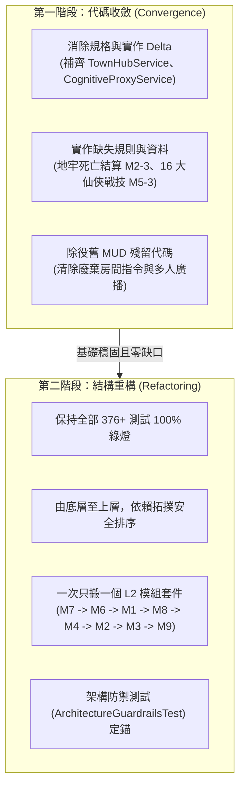
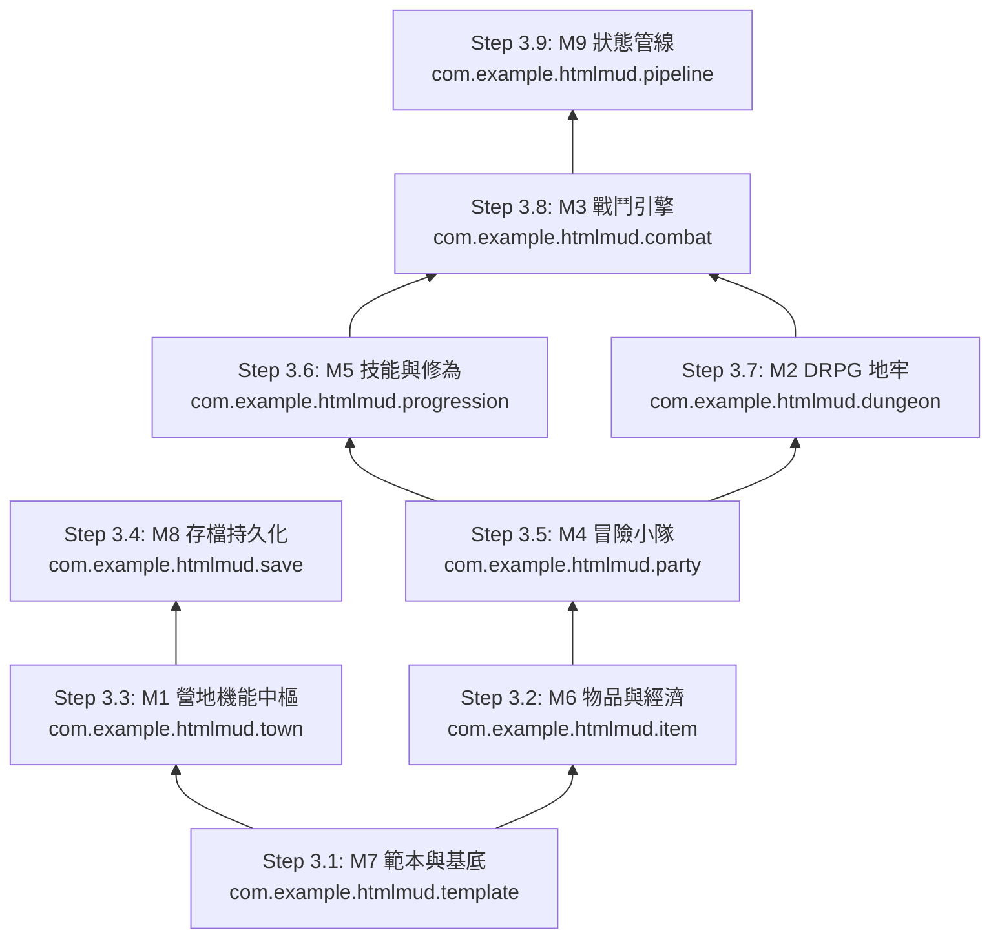

# 🧱 專案程式碼模組化收斂與重構執行計畫 (Code Convergence & Modular Refactoring Tasks)

> **文檔層級**：Level 3 — Task Lists (架構治理與重構專案清單)  
> **關聯規格**：👉 [`docs/2_specifications/MODULES_MAP.md`](../2_specifications/MODULES_MAP.md) 及後端 M1 ~ M9 各模組手冊  
> **專案總表指針**：👉 [`docs/3_task_lists/README.md`](README.md)  
> **全局測試防線**：專案 376+ 項單元與整合測試 100% 綠燈守護（`mvn test`）。任何重構步進皆以測試完全通過為唯一驗收前提。

---

## 🧭 一、核心議題剖析：這是「收斂」還是「重構」？

針對將程式碼依 Level 2 模組整合為模組化套件（Package-by-Feature / Module-First）的討論，在軟體工程定義上屬於：

> ### 📌 **定性結論：這是一場「先功能與規格收斂（Convergence），後套件結構重構（Refactoring）」的漸進式敏捷工程！**



### 1. 什麼是「程式碼收斂 (Code Convergence)」？
- **定義**：讓「實際程式碼」與「L1/L2 規範與 L3 待辦」的落差（Delta）趨近於零，消除代碼與手冊之間的割裂。
- **專案現況中的收斂項目**：
  1. **補齊未實作的規格核心**：L2 M1 規格手冊定義了 `TownHubService` 與 `CognitiveProxyService`（三階靈識透鏡轉譯），但目前程式碼中營地仍過渡依賴舊 MUD 的 `Room.java`。必須先實作這兩個類別，使營地功能完整自洽。
  2. **補齊關鍵規則與契約**：M2-3（地牢全滅扣除戰利品與 30% 虛弱回營）、M2-4（地牢中禁止任意存檔脫離）、M5-3（在 `party_skills.json` 完整落地 16 個標準仙俠神通戰技）。
  3. **清理廢棄殘留**：清除已確認除役的舊 MUD 雙軌文字指令、多人連線廣播代碼。

### 2. 什麼是「程式碼重構 (Code Refactoring)」？
- **定義**：在**不改變任何對外可觀測行為與功能（376+ 測試全綠）**的前提下，改善代碼的內部結構與目錄分組。
- **專案現況中的重構項目**：
  - 目前專案共有 288 個 Java 原始碼檔案，採用的是傳統的「依技術層次分包（Package-by-Layer: `com.example.htmlmud.application.*`、`domain.*`、`infra.*`）」。
  - 重構目標是轉換為「依業務模組分包（Package-by-Feature: `com.example.htmlmud.town`、`dungeon`、`combat`、`party` 等）」，與 Level 2 模組清單 1:1 完全鏡像。

### 3. 為什麼強烈反對「大爆炸一次性重構 (Big Bang Refactoring)」？
- 專案有 288 個 Java 類別與 89 個測試類別。若一次性大範圍剪下貼上、移動套件，極易引發：
  - 數百處 import 錯亂與循環依賴（Circular Dependencies）。
  - Spring Boot `@ComponentScan` 與 Bean 注入失效。
  - JSON 反序列化與資源路徑對應破裂。
  - 測試全面泛紅，除錯難度幾何級數上升。
- **防禦策略**：採用 **「微步迭代、單模組隔離、持續綠燈」** 的安全演進策略。

---

## 🗺️ 二、詳細執行路線圖 (Phased Execution Plan)

```
[Phase 0: 治理與度量] ──> [Phase 1: 營地與透鏡收斂] ──> [Phase 2: 地牢與技能收斂]
                                                               │
                                                               ▼
[Phase 4: 舊代碼除役與防禦] <── [Phase 3: 依模組拓撲逐一重構] <┘
```

---

### 🟢 階段一：核心功能與語意收斂 (Phase 1: Feature Convergence - M1 & Proxy)
> **目的**：先讓營地（M1）具備自給自足的獨立業務類別，切斷對 MUD `Room` 的依賴，為後續抽包打下扎實基礎。

- [x] **Task C1-1 (COGNITIVE-PROXY-SERVICE): 實作靈識認知轉譯代理服務**
  - **位置**：`com.example.htmlmud.domain.service.CognitiveProxyService`
  - **職責**：
    1. 接收字串、設施 DTO 或物品 DTO，以及小隊特工晶片加載率（`chipLoadingRate` 0~100）。
    2. 判定三階認知透鏡（`<30%` 純仙俠表象、`30%~70%` 異象微顯 Glitch、`>70%` 賽博真實覺醒）。
    3. 解析多階 `lenses` 陣列，動態替換標題、說明與 `glitch` 標籤。
  - **測試驗證**：撰寫 `CognitiveProxyServiceTest.java`（驗證三階透鏡切換與邊界條件，綠燈）。

- [x] **Task C1-2 (TOWNHUB-SERVICE): 實作營地機能中樞服務與 DTO**
  - **位置**：`com.example.htmlmud.domain.service.TownHubService` 與 `com.example.htmlmud.domain.model.TownHubDto`
  - **職責**：
    1. 載入 `data/zones/newbie_village/facilities.json`。
    2. 調用 `CognitiveProxyService` 進行表層仙俠化投影。
    3. 提供設施清單查詢、設施點擊互動（打造、道場、晶片、醫療、傳送）與調息（回滿 HP/MP/SAN，清除精神萎靡）。
  - **測試驗證**：撰寫 `TownHubServiceTest.java`（驗證設施加載、調息結算與 DTO 輸出，綠燈）。

- [x] **Task C1-3 (TOWN-ACTIONS-DISPATCH): 收斂營地動作派發通道**
  - **位置**：`CommandDispatcher.java` / `TownFacilityCommand.java`
  - **職責**：將前端點擊營地設施所發送的 `TOWN_FACILITY` 與 `CAMP_REST` 動作，直接由 `TownHubService` 處理並推送最新營地狀態，不經過任何舊 MUD 指令。
  - **測試驗證**：撰寫 `TownFacilityCommandTest.java`（5/5 綠燈），整合至 `CommandDispatcher`。

---

### 🟢 階段二：地牢生存與戰技資料收斂 (Phase 2: Feature Convergence - M2 & M5)
> **目的**：補齊 L2 規範中明訂但程式碼缺漏的地牢死亡結算、存檔安全鎖與 16 大仙俠戰技資料。

- [x] **Task C2-1 (DEFEAT-WIPE-SETTLEMENT): 實作地牢全滅結算與營地虛弱復甦 (M2-3)**
  - **位置**：`DrpgRewardService.java`
  - **職責**：
    1. 當在地牢中遭遇滅團（全隊 HP 歸零）時，立即中斷當前戰鬥。
    2. 將隊伍狀態重置至營地（`inDungeon = false`，`currentRoomId` 重置回營地客棧/入口），全員氣血虛弱復甦（以 30% HP 復活），扣除 20 點 SAN。
    3. 重置地牢探索座標至入口起點，防止下次進入死鎖。
    4. 透過 `ObjectProvider<SaveGameService>` 解耦並觸發自動存檔（`slot_0` AutoSave），確保狀態落盤且無壞檔與循環依賴風險。
  - **測試驗證**：新增 `DungeonDefeatSettlementTest.testDungeonWipeDefeatSettlement` 驗證滅團結算 100% 綠燈。

- [x] **Task C2-2 (IN-DUNGEON-RESTRICTIONS): 實作地牢內部存檔與脫離限制 (M2-4)**
  - **位置**：`SaveGameService.java` / `SaveCommand.java`
  - **職責**：在 `player.isInDungeon()` 且不在撤離點（`STAIRS_UP <`、`STAIRS_DOWN >` 或神秘殘碑 `EVENT !`）時，嚴密阻斷手動存檔，提示「⚠️【地脈煞氣擾動】地牢深處殺機四伏，神念無法入定封印！唯有抵達脫離石階或安全生路（殘碑/生門）方可閉關存檔！」。
  - **測試驗證**：在 `DungeonDefeatSettlementTest.testInDungeonManualSaveRestrictions` 驗證深處走廊阻斷、石階與殘碑處允許存檔，100% 綠燈。

- [x] **Task C2-3 (16-CANONICAL-SKILLS-DATA): 完整落地 16 大仙俠賽博戰技資料 (M5-3)**
  - **位置**：`src/main/resources/data/party/party_skills.json`
  - **職責**：完整對齊 L2《SKILL_SCHEMA.md》第四節 16 大技能矩陣，配置標準仙俠展示名稱（如【偷天換日·轉煞移因訣】、【燃魂溯光·剎那千秋步】），精準綁定四大 `cyberSchool` 與 `comboRole`（PRIMER/DETONATOR）。
  - **測試驗證**：`WorldDataIntegrityTest.java` 與 `CyberSkillAndItemAffixTest.java` 檢驗 16 大技能無警告，100% 綠燈。

---

### 🟡 階段三：依依賴拓撲逐模組漸進重構 (Phase 3: Package-by-Feature Refactoring)
> **原則**：依賴最少之底層模組先行，逐一建立新套件；**每完成一個子步驟，立即執行全量測試驗證（376+ 測試保持 100% 綠燈）**！



- [x] **Step R3.1 (PKG-M7-TEMPLATE): 模組 M7 - 資料範本與看門狗套件封裝**
  - **目標套件**：`com.example.htmlmud.template`
  - **歸整類別**：`TemplateRepository`, `TemplateCatalog`, `TemplateReader`, `TemplateRegistryPort`, `DataIntegrityValidator`, `*Template.java`（含 `com.example.htmlmud.template.model.*`）
  - **驗收標準**：`WorldDataIntegrityTest`, `ArchitectureGuardrailsTest`, `DataIntegrityValidatorTest` 全數 100% 綠燈，全專案 390 項測試零回歸通過。

- [ ] **Step R3.2 (PKG-M6-ITEM): 模組 M6 - 物品裝備與經濟套件封裝**
  - **目標套件**：`com.example.htmlmud.item`
  - **歸整類別**：`ItemDefinition`, `ItemInstance`, `ItemAffix`, `EquipmentSlot`, `UnifiedPartyEconomyService`
  - **驗收標準**：`mvn test -Dtest=UnifiedPartyEconomyTest` 100% 綠燈。

- [ ] **Step R3.3 (PKG-M1-TOWN): 模組 M1 - 營地機能設施中樞套件封裝**
  - **目標套件**：`com.example.htmlmud.town`
  - **歸整類別**：`TownHubService`, `CognitiveProxyService`, `TownHubDto`
  - **驗收標準**：`TownHubServiceTest`、`CognitiveProxyServiceTest` 100% 綠燈。

- [ ] **Step R3.4 (PKG-M8-SAVE): 模組 M8 - 存檔與持久化管線套件封裝**
  - **目標套件**：`com.example.htmlmud.save`
  - **歸整類別**：`SaveService`, `SaveData`, `WriteBehindWorker`, `SaveMigrationAdapter`
  - **驗收標準**：`mvn test -Dtest=AsyncPersistenceLifecycleTest` 100% 綠燈。

- [ ] **Step R3.5 (PKG-M4-PARTY): 模組 M4 - 冒險小隊與古仙陣法套件封裝**
  - **目標套件**：`com.example.htmlmud.party`
  - **歸整類別**：`PartyMember`, `PartyFormation`, `GambitRule`, `SanShield`, `DrpgPartyInventory`
  - **驗收標準**：`mvn test -Dtest=CompanionGambitEngineTest,PartyInventoryAndMadnessTest` 100% 綠燈。

- [ ] **Step R3.6 (PKG-M5-PROGRESSION): 模組 M5 - 技能體系與修為突破套件封裝**
  - **目標套件**：`com.example.htmlmud.progression`
  - **歸整類別**：`SkillDefinition`, `PartyMemberSkill`, `CyberSchool`, `ComboRole`, `XpProgressionService`
  - **驗收標準**：`mvn test -Dtest=CyberSkillAndItemAffixTest,XpProgressionServiceTest` 100% 綠燈。

- [ ] **Step R3.7 (PKG-M2-DUNGEON): 模組 M2 - DRPG 網格地牢探索套件封裝**
  - **目標套件**：`com.example.htmlmud.dungeon`
  - **歸整類別**：`DungeonManager`, `DungeonFloorLoader`, `DungeonPosition`, `TorchSystem`
  - **驗收標準**：`mvn test -Dtest=DungeonTorchAndTrapTest` 100% 綠燈。

- [ ] **Step R3.8 (PKG-M3-COMBAT): 模組 M3 & M3.1 - 戰鬥引擎與狀態效果套件封裝**
  - **目標套件**：`com.example.htmlmud.combat`
  - **歸整類別**：`DrpgCombatLoop`, `CombatRules`, `ComboResolver`, `BattleContext`, `BuffEngine`, `ElementalReactionResolver`
  - **驗收標準**：`mvn test -Dtest=BossPhaseAndPoiseStaggerTest,CrossComboAndFormationResonanceTest,ElementalReactionAndDetonateTest` 100% 綠燈。

- [ ] **Step R3.9 (PKG-M9-PIPELINE): 模組 M9 - 狀態管線與排程協定套件封裝**
  - **目標套件**：`com.example.htmlmud.pipeline`
  - **歸整類別**：`GameLoop`, `CommandDispatcher`, `StateBroadcaster`, `WebSocketHandler`
  - **驗收標準**：`mvn test -Dtest=SessionTakeoverAndSingletonProtagonistTest` 100% 綠燈。

---

### 🔴 階段四：舊代碼除役與架構看門狗 (Phase 4: Legacy Purge & Guardrails)
> **目的**：安全移除未使用的舊 MUD 代碼，並以單元測試永久固化模組邊界，防止未來的破窗效應。

- [ ] **Task C4-1 (LEGACY-CODE-PURGE): 物理除役廢棄代碼**
  - 安全審查並移除已完全無引用之舊 MUD 房間導航、文字指令及過渡類別。
- [ ] **Task C4-2 (ARCH-GUARDRAILS-STRENGTHEN): 強化模組依賴看門狗測試**
  - 在 [`ArchitectureGuardrailsTest.java`](file:///c:/Workspace/my_practice/practice_mud/src/test/java/com/example/htmlmud/domain/validation/ArchitectureGuardrailsTest.java) 增加套件依賴檢驗：
    - 禁止 `template` 反向依賴 `combat` 或 `dungeon`。
    - 禁止模組之間產生非法的循環引用（Circular Dependency）。
  - **驗收標準**：`mvn test` 全量 376+ 測試 100% 綠燈通過。

---

## 📊 三、風險控制與回滾機制 (Risk Management & Safety Net)

| 風險情境 | 觸發原因 | 預防與應對手段 |
| :--- | :--- | :--- |
| **類別找不到 (ClassNotFound)** | 搬移套件後未同步更新 import 或 Spring 掃描路徑 | 每個步驟僅搬移 1 個模組，立即執行全量測試，由編譯器與 Maven 即時抓出並修正。 |
| **JSON 反序列化失敗** | 範本或存檔中存在完整的 Package 路徑名稱 | 檢查所有 Jackson 配置，全面採用別名或 Class 抽象註冊，不直接依賴 Java 全路徑字串。 |
| **循環依賴** | 兩個模組互相調用對方的 Concrete Class | 嚴格遵守依賴反轉原則（Dependency Inversion），透過 Event、DTO 或 Domain Port 解耦。 |
| **工作量失控 (Scope Creep)** | 重構過程中忍不住修改業務邏輯 | 嚴格分開：**收斂階段（Phase 1/2）只補規格缺失；重構階段（Phase 3）只動路徑與 import，絕不偷改業務邏輯！** |
