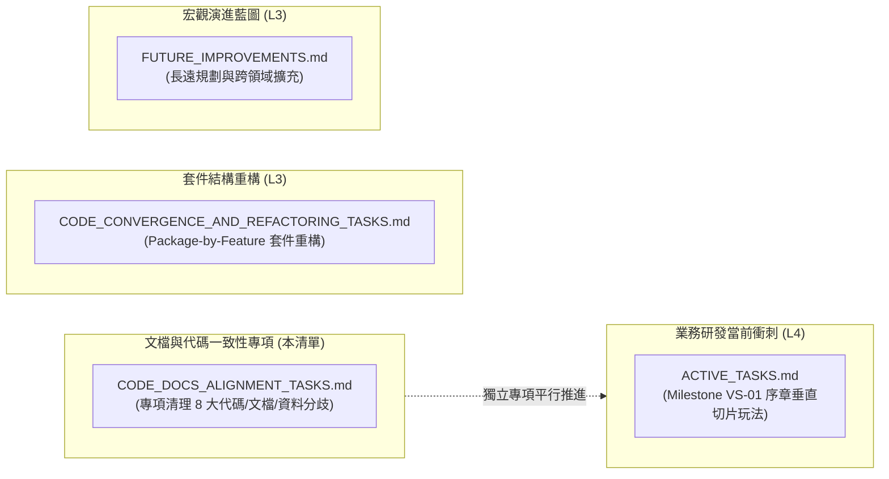

# 📋 文件與程式碼一致性對齊專項任務清單 (Code & Documentation Alignment Tasks)

> **文檔層級**：Level 3 — Task Lists (專項治理與契約對齊中樞)  
> **關聯手冊**：👉 [`docs/2_specifications/MODULES_MAP.md`](../2_specifications/MODULES_MAP.md) 及 Level 2 全域架構手冊  
> **專案總表指針**：👉 [`docs/3_task_lists/README.md`](README.md)  
> **全量測試防線**：專案單元與整合測試 100% 綠燈守護（`mvn test` / `.\test.ps1`）。

---

## 🧭 一、定位聲明：與現有待辦清單的嚴格邊界區隔 (Scope & Boundary)

> [!IMPORTANT]
> **本清單之設立目的為「專項消除文件手冊、資料配置與現行代碼間的 Delta 歷史技術債」。**
> 為了維持敏捷專注，全專案確立以下邊界分工，嚴禁職責混淆：
> 1. **與當前衝刺看板區隔**：[`docs/4_active_tasks/ACTIVE_TASKS.md`](../4_active_tasks/ACTIVE_TASKS.md) 為當前 Phase 2 遊戲玩法垂直切片（當前唯一焦點：**Milestone VS-01 序章地牢冒險**）的微任務看板。本清單**不佔用**當前衝刺焦點，避免衝刺目標漂移。
> 2. **與套件重構清單區隔**：[`CODE_CONVERGENCE_AND_REFACTORING_TASKS.md`](CODE_CONVERGENCE_AND_REFACTORING_TASKS.md) 專注於 Java 後端 Package-by-Feature 套件目錄搬遷與架構拓撲解耦。
> 3. **與長程藍圖清單區隔**：[`FUTURE_IMPROVEMENTS.md`](FUTURE_IMPROVEMENTS.md) 專注於未來的全新系統玩法、宏觀階段演進與遠程 Feature。
> 4. **本清單責任範疇**：依據全專案深度稽核，集中列出「現有代碼未如實遵守 L2 規格」、「資料 JSON 鍵名或歸屬分歧」、「前端殘留歷史廢棄代碼/未符合 CSP 事件委派」之 8 大專案一致性對齊任務。



---

## 🚦 二、任務結構與執行優先序 (Priority Matrix)

| 優先級 | 任務代碼 | 任務名稱 | 核心涉及模組 / 目標檔案 | 影響程度 |
| :---: | :--- | :--- | :--- | :--- |
| **P0** | **Task ALIGN-01** | 清理 HUD 走火入魔舊代碼與無效 seal 封印按鈕 | `party-hud-panel.js` | 消除前端調用已除役指令之執行期錯誤 |
| **P0** | **Task ALIGN-02** | 補齊雷達地牢圖塊符號映射與校正 FE2 手冊錯字 | `dungeon-panel.js`<br>`FE2_DRPG_VIEWPORT_RENDERER.md` | 解決門、寶箱、首領與陷阱顯示為地磚問題 |
| **P1** | **Task ALIGN-03** | 補齊 `SaveData` `chipRate` 持久化與更新 M8 範例 | `SaveData.java`<br>`SaveGameService.java`<br>`M8_SAVE_AND_PERSISTENCE.md` | 避免特工晶片加載率存檔讀取重置 |
| **P1** | **Task ALIGN-04** | 清理重複戰技條目、對齊 17 專精樹 ID 與除役雙軌枚舉 | `party_skills.json`<br>`PartyMemberSkill.java` | 統一四大淵源與消除戰技樹歸屬錯位 |
| **P1** | **Task ALIGN-05** | 首領宋天衡掉落表掛載追蹤晶片與隨機詞綴入庫 | `zones/mozhu_mines/mobs.json`<br>`DrpgRewardService.java` | 確保任務道核必定產出與戰利品隨機詞綴 |
| **P2** | **Task ALIGN-06** | 補齊夥伴初始戰技配置與校對 M4 規格表 | `default_companions.json`<br>`M4_PARTY_AND_FORMATION.md` | 解決凌霜空技能槽與護衛嘲諷缺口 |
| **P2** | **Task ALIGN-07** | 前端內聯 `onclick` 收斂至 `[data-action]` 委派 | `party-equipment-tab.js`<br>`party-tactics-tab.js`<br>`bag-drawer.js` | 全面落實 CSP 安全原則與事件委派規範 |
| **P2** | **Task ALIGN-08** | 校準 `PartyCommand.java` 道基五維屬性文字提示 | `PartyCommand.java` | 修正加點錯誤提示中的 str/con 語意筆誤 |

---

## 📋 三、P0 緊急修復任務卡 (P0 Critical Bug & Dead Code Elimination)

### - [ ] Task ALIGN-01 (FE-CHAOS-PURGE): 清理 `party-hud-panel.js` 走火入魔舊代碼與無效 seal 封印按鈕
- **所屬模組**：FE1 核心狀態 / FE5 小隊表現
- **目標檔案**：
  - `src/main/resources/static/js/panels/party-hud-panel.js`
- **對齊手冊**：
  - [`FE1_CORE_STATE_AND_PIPELINE.md`](../2_specifications/frontend/FE1_CORE_STATE_AND_PIPELINE.md) §1
  - [`M4_PARTY_AND_FORMATION.md`](../2_specifications/backend/M4_PARTY_AND_FORMATION.md) §2
  - [`ARCHITECTURAL_DECISIONS.md`](../2_specifications/ARCHITECTURAL_DECISIONS.md) (ADR-004 走火入魔背刺除役裁決)
- **現況落差**：
  `party-hud-panel.js` 第 55~85 行仍殘留已除役的舊版道心崩潰狀態分支（`SEALED`, `DEAD_MEAT`, `ABERRATION`，以及「40% 背刺隊友」、「100% 變為古神畸變 Boss」），並組裝了 `<button class="seal-trigger-btn" onclick="... window.send('seal ${idx}')">`。因後端 `SealCommand.java` 早已徹底除役，玩家點擊將觸發指令未定義異常。
- **對齊實作步驟**：
  1. 移除 `party-hud-panel.js` 中對 `m.chaosState`、`SEALED`、`DEAD_MEAT`、`ABERRATION` 的歷史邏輯分支。
  2. 移除 `.seal-trigger-btn` 封印按鈕之 HTML 生成與 `window.send('seal ...')` 調用。
  3. 對齊 Option A 規範：隊員狀態僅保留正常、氣血耗盡（`FAINTED`/重傷）以及精神防護耗盡產生的 `WEAKENED`（精神萎靡，全屬性 -10%）狀態提示。
- **驗收標準**：
  - 小隊 HUD 視圖中不再渲染封印按鈕與背刺文字。
  - 瀏覽器主控台在隊員狀態變更時零報錯。

---

### - [ ] Task ALIGN-02 (FE-RADAR-TILES): 補齊雷達地牢圖塊符號映射與校正 FE2 手冊錯字
- **所屬模組**：FE2 DRPG 視口與雷達
- **目標檔案**：
  - `src/main/resources/static/js/panels/dungeon-panel.js`
  - [`FE2_DRPG_VIEWPORT_RENDERER.md`](../2_specifications/frontend/FE2_DRPG_VIEWPORT_RENDERER.md) §4
- **對齊手冊**：
  - [`DUNGEON_SCHEMA.md`](../2_specifications/data_schemas/DUNGEON_SCHEMA.md) §2
  - `src/main/resources/data/dungeons/mozhu_mines_b1f.json`
- **現況落差**：
  1. `dungeon-panel.js` 之 `populateTileAppearance` 僅映射 `#`, `+`, `$`, `◆`, `◇`, `^`, `~`, `P`, `S`, `>`, `<`。地牢真實 JSON 與契約中使用之 `D` (木門)、`T` (寶箱/木箱)、`B` (首領祭壇)、`E` (遺跡碑文/事件)、`X` (外神菌沼/陷阱) 全部落入 default 分支，被渲染為普通地磚 `·`。
  2. `S` 圖塊在雷達代碼中目前硬編碼為溫泉符號 `♨`，但實際上其語意為安全區營地出入口 (`S`)。
  3. `FE2_DRPG_VIEWPORT_RENDERER.md` §4 圖例表格有筆誤，將 `T` 誤植為「陷阱」（正確應為 Treasure 寶箱，陷阱為 `X`）。
- **對齊實作步驟**：
  1. 在 `dungeon-panel.js` 的 `populateTileAppearance` 增加缺失符號支援：
     - `D` -> 門（圖標 `🚪` / 文字 `+`，CSS 類 `tile-door`）
     - `T` -> 寶箱（圖標 `📦` / 文字 `⌸`，CSS 類 `tile-chest`）
     - `B` -> 首領（圖標 `👹` / 文字 `☠`，CSS 類 `tile-boss`）
     - `E` -> 事件/石碑（圖標 `📜` / 文字 `!`，CSS 類 `tile-event`）
     - `X` -> 陷阱/菌沼（圖標 `☣` / 文字 `^`，CSS 類 `tile-trap`）
     - `S` -> 出入口營地（圖標 `⛺` / 文字 `S`，CSS 類 `tile-safe`）
  2. 修正 `FE2_DRPG_VIEWPORT_RENDERER.md` §4 圖例表格中 `T` 與 `X` 的定義，與 `DUNGEON_SCHEMA.md` 達成 1:1 吻合。
- **驗收標準**：
  - 進入 `mozhu_mines_b1f` 地牢時，右側雷達能如實呈現門、寶箱、事件與首領房標示。
  - 文檔連結檢查 `check-doc-links.ps1` 驗證零警告。

---

## 📋 四、P1 核心狀態持久化與資料契約調平 (P1 Data Contract Reconciliation)

### - [ ] Task ALIGN-03 (M8-SAVE-CHIPRATE): 補齊 `SaveData` `chipRate` 持久化與更新 M8 範例
- **所屬模組**：M8 存檔與持久化 / M1 營地特工覺醒
- **目標檔案**：
  - `src/main/java/com/example/htmlmud/save/SaveData.java`
  - `src/main/java/com/example/htmlmud/save/SaveGameService.java`
  - [`M8_SAVE_AND_PERSISTENCE.md`](../2_specifications/backend/M8_SAVE_AND_PERSISTENCE.md) §2
- **對齊手冊**：
  - [`M1_TOWN_HUB_AND_FACILITIES.md`](../2_specifications/backend/M1_TOWN_HUB_AND_FACILITIES.md) §7
  - `src/main/java/com/example/htmlmud/domain/actor/impl/Player.java`
- **現況落差**：
  1. `Player.java`（第 97 行）已加入 `chipRate = 12` 欄位，但 `SaveData.java` 未宣告 `chipRate`，`SaveGameService.java` 亦未在存檔或讀檔時處理此欄位，導致存檔重新載入後特工覺醒進度丟失。
  2. `M8_SAVE_AND_PERSISTENCE.md` §2 中的存檔結構 JSON 範例仍為舊版巢狀結構，未對齊現行 `SaveData.java` 的扁平化結構。
- **對齊實作步驟**：
  1. 在 `SaveData.java` 中增加 `private int chipRate;` 及其 Getter/Setter。
  2. 在 `SaveGameService.java` 的 `createSaveData` 中寫入 `data.setChipRate(player.getChipRate());`。
  3. 在 `SaveGameService.java` 的 `applySaveData` 中恢復 `player.setChipRate(data.getChipRate());`。
  4. 更新 `M8_SAVE_AND_PERSISTENCE.md` §2 範例，如實反映扁平化欄位結構與 `chipRate`。
- **驗收標準**：
  - 執行 `SaveGameServiceTest`，存檔與讀檔後 `player.getChipRate()` 保持原值不丟失。
  - 全套存檔與非同步持久化測試通過。

---

### - [ ] Task ALIGN-04 (M5-SKILL-TAXONOMY): 清理重複戰技條目、對齊 17 專精樹 ID 與除役雙軌枚舉
- **所屬模組**：M5 技能與突破 / 靜態資料契約
- **目標檔案**：
  - `src/main/resources/data/party/party_skills.json`
  - `src/main/java/com/example/htmlmud/party/PartyMemberSkill.java`
- **對齊手冊**：
  - [`SKILL_SCHEMA.md`](../2_specifications/data_schemas/SKILL_SCHEMA.md) §2
  - [`TREE_17_NULL_VOID.md`](../2_specifications/skills/4_cthulhu/TREE_17_NULL_VOID.md)
- **現況落差**：
  1. `party_skills.json` 存在重複戰技宣告（如 `skill_neural_overclock_step` 與 `skill_time_tier1_step` 重複；`skill_bio_keratin_blade` 與 `skill_chitin_tier1_blade` 重複）。
  2. `skill_format_drive` (格式化硬碟) 與 `skill_hard_reboot` (冷重啟) 在 `TREE_17_NULL_VOID.md` 規範中屬於 `CTHULHU` / `tree_null_void`，但 JSON 中錯標為 `HIGH_TECH` 與 `ENGINEER`。
  3. `PartyMemberSkill.java` 中仍宣告有過期的 `CyberSchool` 枚舉（`CYBER_HACK`, `GENE_BIO`, `MECHA_CULT`, `VOID_PSI`），與標準 `OriginSchool`（`CULTIVATOR`, `ENGINEER`, `HIGH_TECH`, `CTHULHU`）形成雙軌。
- **對齊實作步驟**：
  1. 清理 `party_skills.json` 中的冗餘重複項，統一保留 canonical 專精樹前綴命名。
  2. 校正 `skill_format_drive` 與 `skill_hard_reboot` 的 `school` 為 `CTHULHU`、`treeId` 為 `tree_null_void`。
  3. 在 `PartyMemberSkill.java` 中收斂並廢除 `CyberSchool`，全面統一至 `OriginSchool`。
- **驗收標準**：
  - `CyberSkillAndItemAffixTest` 與資料完整性檢查通過。
  - 17 專精樹戰技在 JSON 中 treeId 100% 存在且有效。

---

### - [ ] Task ALIGN-05 (M6-LOOT-CHIP-AFFIX): 首領宋天衡掉落表掛載追蹤晶片與隨機詞綴入庫
- **所屬模組**：M6 物品與經濟 / M3 戰鬥獎勵
- **目標檔案**：
  - `src/main/resources/data/zones/mozhu_mines/mobs.json`
  - `src/main/java/com/example/htmlmud/combat/DrpgRewardService.java`
- **對齊手冊**：
  - [`ITEM_SCHEMA.md`](../2_specifications/data_schemas/ITEM_SCHEMA.md) §1, §3
  - [`M6_ITEM_AND_ECONOMY.md`](../2_specifications/backend/M6_ITEM_AND_ECONOMY.md) §2
- **現況落差**：
  1. 黑煞宗地牢首領 `boss_song_tianheng` 在 `mobs.json` 中的 `dropTable` 未配置 Milestone VS-01 核心任務物品 `item_chip_qianxing_tracker`（千星科技加密追蹤晶片）。
  2. `DrpgRewardService.java` 在產出戰利品入庫至小隊行囊時，未調度 `ItemAffixService` 綁定隨機前綴與後綴。
- **對齊實作步驟**：
  1. 在 `mobs.json` 的 `boss_song_tianheng` 掉落清單中新增 `item_chip_qianxing_tracker`（機率 `1.0`）。
  2. 於 `DrpgRewardService.java` 串接詞綴生成管線，確保戰利品裝備能攜帶隨機詞綴落地行囊。
- **驗收標準**：
  - 擊殺首領後結算清單具備任務晶片。
  - 產出的武器/防具具備屬性詞綴加成；`UnifiedPartyEconomyTest` 綠燈。

---

## 📋 五、P2 內容健全化與前端工程規範推進 (P2 Content Hygiene & Code Standards)

### - [ ] Task ALIGN-06 (M4-COMPANION-SKILLS): 補齊夥伴初始戰技配置與校對 M4 規格表
- **所屬模組**：M4 冒險小隊與陣法
- **目標檔案**：
  - `src/main/resources/data/companions/default_companions.json`
  - [`M4_PARTY_AND_FORMATION.md`](../2_specifications/backend/M4_PARTY_AND_FORMATION.md) §1
- **對齊手冊**：
  - [`M4_PARTY_AND_FORMATION.md`](../2_specifications/backend/M4_PARTY_AND_FORMATION.md) §1
- **現況落差**：
  1. `default_companions.json` 中，初期醫修夥伴 `ling_shuang` (凌霜) 的 `"skills": []` 為空陣列，缺乏初始單體治療技能。
  2. 鐵牛 `tie_niu` 技能陣列中缺少嘲諷戰技 `tank_taunt`。
  3. `M4_PARTY_AND_FORMATION.md` §1 夥伴總表與 JSON 的靈根/門派文字略有微調落差。
- **對齊實作步驟**：
  1. 為 `ling_shuang` 配置初始治療戰技（如 `skill_single_heal` 或醫修專精技）。
  2. 為 `tie_niu` 補齊 `tank_taunt`。
  3. 校對 `M4_PARTY_AND_FORMATION.md` 表格文字與 JSON 欄位一致。
- **驗收標準**：
  - 小隊載入後，凌霜與鐵牛具備可用初始技能；Gambit AI 能正常發動技能。
  - `CompanionGambitEngineTest` 通過。

---

### - [ ] Task ALIGN-07 (FE-CSP-DELEGATION): 前端內聯 `onclick` 收斂至 `[data-action]` 委派
- **所屬模組**：FE1 核心狀態 / FE5 小隊與彈窗
- **目標檔案**：
  - `src/main/resources/static/js/modals/party-equipment-tab.js`
  - `src/main/resources/static/js/modals/party-tactics-tab.js`
  - `src/main/resources/static/js/modals/bag-drawer.js`
- **對齊手冊**：
  - [`FE1_CORE_STATE_AND_PIPELINE.md`](../2_specifications/frontend/FE1_CORE_STATE_AND_PIPELINE.md) §4
- **現況落差**：
  上述前端組件中大量使用字串拼接生成的 `onclick="window.send('... ${id}')"`，違反了 `FE1` 明文要求的「嚴格無內聯腳本、所有使用者互動統一採用 `data-action` 屬性配合容器事件委派 (Event Delegation)」架構憲法。
- **對齊實作步驟**：
  1. 將 HTML 模板字串內的 `onclick="window.send(...)"` 替換為 `data-action="..."` 與對應 `data-*` 資料屬性。
  2. 在各組件初始化時，於容器根節點監聽 `click` 事件，利用 `e.target.closest('[data-action]')` 攔截並轉發至 `window.send`。
- **驗收標準**：
  - 裝備換裝、陣法戰術切換、行囊整理等互動行為無縫運作。
  - 靜態掃描確認檔案內無任何 `onclick=` 字串殘留。

---

### - [ ] Task ALIGN-08 (M5-STAT-PROMPT-FIX): 校準 `PartyCommand.java` 道基五維屬性文字提示
- **所屬模組**：M5 技能與修為 / 後端指令管線
- **目標檔案**：
  - `src/main/java/com/example/htmlmud/application/command/impl/PartyCommand.java`
- **對齊手冊**：
  - [`M4_PARTY_AND_FORMATION.md`](../2_specifications/backend/M4_PARTY_AND_FORMATION.md) §1
  - [`M5_SKILL_AND_PROGRESSION.md`](../2_specifications/backend/M5_SKILL_AND_PROGRESSION.md) §3
- **現況落差**：
  `PartyCommand.java` 第 603 行加點失敗時的錯誤提示文字仍標記為 `con (根骨), str (力量)`。而全專案道基五維體系標準定義為：`str (根骨)` 與 `con (體質)`。
- **對齊實作步驟**：
  1. 將提示文字修正為 `str (根骨), con (體質)`，確保玩家輸入提示符合道基五維體系。
- **驗收標準**：
  - 指令輸入錯誤時的回傳提示文案與 L2 手冊名詞完全相符。
  - `PartyCommandTest` 執行通過。

---

## 🛡️ 六、驗證與防禦基準 (Verification & Guardrails)

執行本清單任務時，必須通過以下四重驗證防線：

1. **單元與整合測試防線**：
   ```powershell
   powershell.exe -ExecutionPolicy Bypass -File .\test.ps1
   ```
2. **文件相對連結防線**：
   ```powershell
   powershell.exe -ExecutionPolicy Bypass -File .\scripts\check-doc-links.ps1
   ```
3. **架構看門狗測試防線**：
   ```powershell
   mvn test -Dtest=ArchitectureGuardrailsTest,DataIntegrityValidatorTest
   ```
4. **四層防漂移審批守護**：
   遵循 `.agents/rules/documentation_alignment_guardrails.md`，任何涉及 L2 規格調整或 L3 待辦更新均需經使用者書面明確許可。

