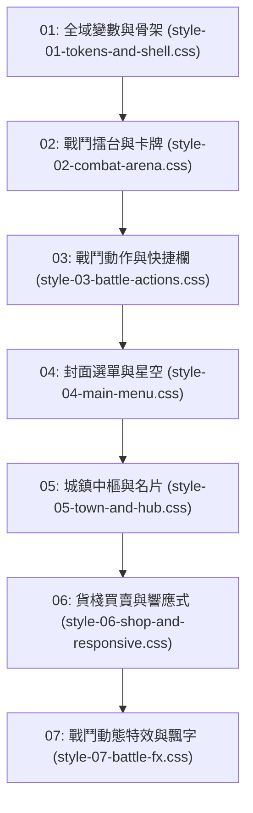

# 🎨 前端 FE-6: 七層樣式串流與視覺主題深度手冊 (CSS Tokens & Themes Manual)

> **模組編號**：FE-6  
> **系統類型**：前端表現層模組  
> **核心定位**：管理暗黑克蘇魯修仙全域視覺規範、CSS Custom Properties（設計變數 Tokens）、嚴格之七層 Cascade 依賴順序串流載入架構、無障礙字級排版標準，以及歷史樣式巨石解耦成果。

---

## 🏛️ 一、暗黑克蘇魯修仙設計美學

《道祖是克蘇魯》融合了古典仙俠的縹緲出塵與洛夫克拉夫特式的不可名狀驚悚。視覺系統透過精準調配的 HSL 色階營造沉浸式氛圍：

```
┌────────────────────────────────────────────────────────┐
│                   核心視覺色譜規範                     │
├─────────────────┬───────────────────┬──────────────────┤
│ 色彩語意        │ 代表色值 (Tokens) │ 應用場景         │
├─────────────────┼───────────────────┼──────────────────┤
│ 玄青暗界 (底色) │ `--bg-primary`    │ 全域深黑星空底色 │
│ 幽藍冷光 (靈氣) │ `--color-qi-blue` │ 正統仙家真元/法力│
│ 暗紅煞氣 (異化) │ `--color-madness` │ 邪物煞氣/SAN 扣減│
│ 琉璃璀璨 (金丹) │ `--color-gold`    │ 境界突破/極品法寶│
│ 翡翠甘霖 (回春) │ `--color-heal`    │ 靈藥滋養/五行逆流│
│ 玄武重甲 (護甲) │ `--color-poise`   │ 罡氣韌性/格擋盾牌│
└─────────────────┴───────────────────┴──────────────────┘
```

---

## 🌊 二、七層 CSS 串流載入架構 (Cascade Order)

為徹底解決傳統 CSS 單一巨石檔案臃腫難以維護的痛點，專案將樣式拆分為 7 層獨立檔案，在 `index.html` 內依順序串流載入：



### 各層職責說明
1. **`style-01-tokens-and-shell.css`**：
   - 定義所有 CSS Variables（字體、間距、色彩、圓角、陰影）。
   - 設定全螢幕 CSS Grid / Flexbox 核心視窗骨架與終端容器。
2. **`style-02-combat-arena.css`**：
   - 戰鬥擂台幾何佈局、生靈卡片邊框、血條、韌性條與 ATB 進度條。
3. **`style-03-battle-actions.css`**：
   - 技能按鈕、真元消耗圖標、公共冷卻（GCD）倒數遮罩與目標鎖定框。
4. **`style-04-main-menu.css`**：
   - 封面選單、修仙標題漸層光暈、星空閃爍動畫。
5. **`style-05-town-and-hub.css`**：
   - 城鎮模式佈局、NPC 資訊卡片、四方出口網格按鈕。
6. **`style-06-shop-and-responsive.css`**：
   - 貨棧商品陳列卡片、購買數量微調器，以及行動端螢幕適配媒體查詢（Media Queries）。
7. **`style-07-battle-fx.css`**：
   - 五行法術光暈、戰鬥打擊飄字動畫（FCT）、罡氣破防粒子碎裂與螢幕微震動效。

---

## 📐 三、無障礙與排版標準規範

1. **字級底線規範**：
   - 全介面文字**保底 $\ge 13\text{px}$**，嚴禁出現 $10\text{px}$ 或 $11\text{px}$ 難以辨識的極小字體。
   - 標題與重點數值階梯：`14px` ➔ `16px` ➔ `20px` ➔ `28px`。
2. **對比度標準**：
   - 遵循 WCAG AA 規範，文字與背景之對比度維持在 $4.5:1$ 以上，長時間遊玩不傷眼。
3. **流暢動效原則**：
   - 動態過渡時間控制在 $150\text{ms} \sim 300\text{ms}$，採用 `ease-out` 或 `cubic-bezier`，手感乾脆俐落不拖泥帶水。

---

## 🧹 四、歷史樣式巨石解耦成果

在早期版本中，曾存在單一 122 KB 的歷史樣式巨石 `static/css/style.css`：
- **現狀**：其全部規則已完整拆解、重構並分配至 `style-01` ~ `style-07`。
- **效益**：模組職責單一，維護時可直接針對對應層級修改，杜絕跨模組樣式污染。

---

## 🔗 五、代表檔案清單

| 檔案路徑 | 模組定位 | 關鍵樣式類別 |
| :--- | :--- | :--- |
| `static/css/style-01-tokens-and-shell.css` | 設計變數與視窗骨架 | `:root`, `.app-shell`, `.terminal-container` |
| `static/css/style-02-combat-arena.css` | 戰鬥擂台與生靈卡牌 | `.battle-arena`, `.hp-bar`, `.poise-bar` |
| `static/css/style-03-battle-actions.css` | 戰鬥動作與快捷按鈕 | `.skill-button`, `.gcd-overlay` |
| `static/css/style-04-main-menu.css` | 封面主選單 | `.main-menu`, `.title-glow`, `.star-field` |
| `static/css/style-05-town-and-hub.css` | 城鎮面板與 NPC 卡片 | `.town-hub`, `.npc-card`, `.exit-btn` |
| `static/css/style-06-shop-and-responsive.css`| 貨棧交易與行動端適配 | `.shop-grid`, `@media (max-width: 1024px)` |
| `static/css/style-07-battle-fx.css` | 打擊飄字與震動特效 | `.fct-damage`, `.screen-shake`, `.broken-pulse` |

---

## 🚀 六、未來架構演進與現代化擴充規劃 (Future Roadmap & Scalability)

為使視覺系統在具備極致東方暗黑修仙美感的同時，兼備現代 Web 樣式架構的極速加載與換膚自由度，確立以下四大演進方向：

### 1. 🎯 現代視覺多主題換膚引擎 (Multi-Theme CSS Engine)
- **三大修仙道門主題一鍵換膚 (Theme Presets)**：
  透過在 `<html>` 標籤動態注入 `data-theme` 屬性，全域色彩變數即時重綁定，提供三套迥異的沉浸式主題：
  1. **【太陰幽冥·暗黑克系 (Default)】**：玄青底色、幽藍冷光、暗紫煞氣、絕望深淵感。
  2. **【青雲正道·水墨仙山 (Ink Zen)】**：米宣紙水墨質感、青松翠柏、淡金流光，適合白天遊玩。
  3. **【天外星蝕·萬劫血煞 (Blood Moon)】**：深紅血月、混沌黑焰，極致壓迫狂暴風。
- **流體排版排版模型 (Fluid Typography with clamp())**：
  全面採用 `font-size: clamp(13px, 1.2vw + 10px, 18px)`，介面元素自 4K 超寬螢幕至折疊手機螢幕自然流暢縮放，徹底消除特定斷點下的突兀跳變。

### 2. 🛡️ 穩定性與變數邊界防禦 (CSS Resilience & Fallbacks)
- **Token 雙層降級防禦 (Two-Tier Variable Fallbacks)**：
  在所有關鍵樣式宣告中提供語法回退（如 `color: var(--color-gold, #f59e0b)`），即使在 WebView 內嵌瀏覽器或特殊環境下 CSS 變數解析異常，也不會引發文字隱形或黑色重疊不可讀。

### 3. ⚡ 效能與容器查詢最佳化 (Container Queries & Critical CSS)
- **現代容器查詢 (CSS Container Queries `@container`)**：
  全面用 `@container` 取代傳統的 `@media` 視口查詢。例如城鎮 NPC 卡牌、戰鬥生靈卡牌依據其「所在父容器寬度」自適應排版，使這些元件可被自由嵌入任何彈窗或側邊欄，達成完美的獨立組件化。
- **首屏關鍵樣式抽取 (Critical CSS Inlining)**：
  提取封面選單（`style-04`）與基礎排版骨架（`style-01`）進行預加載，消除 FOUC（無樣式內容閃爍），秒開頁面。

### 4. 🔌 可擴充性與自訂外觀 (Custom Theme Injector)
- **開放式玩家自訂樣式覆蓋 (Theme Modding Interface)**：
  允許玩家透過外部自訂 CSS 檔案或設定面板覆蓋 `:root` 變數（如自訂氣血條顏色為粉紅或金黃、微調字體為思源黑體），滿足資深玩家對個性化視覺的極致追求。
