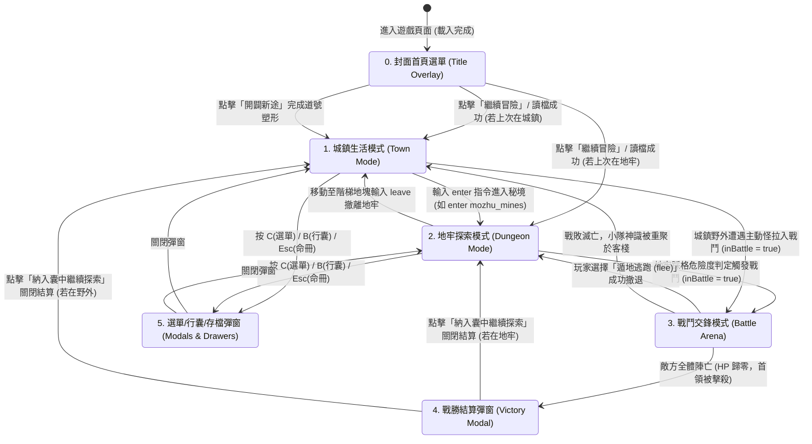

# 🖥️ 前端整體佈局與主視圖切換全景手冊 (Frontend Layout & View Transitions)

> **文件定位**：  
> 本手冊為《道祖是克蘇魯》前端介面的**最高佈局架構與視圖狀態機指南**。  
> 詳解頁面空間劃分、前端 6 大表現模組（FE-1 ~ FE-6）在畫面中的精確落點、三大主舞台互斥呈現機制，以及「何時頁面上有哪些模組、何時會切換到什麼模組」的完整狀態流轉規則。

---

## 🗺️ 一、頁面全景空間骨架圖 (Screen Layout Blueprint)

遊戲介面遵循現代單頁應用（SPA）的固定視窗比例骨架（無多餘頁面捲軸，內部區域獨立平滑滾動），由外至內分為 **五大核心版塊**：

```
┌────────────────────────────────────────────────────────────────────────────────────────┐
│ 1. 頂部全域資訊列 (Global Header) [FE-1, FE-6]                                          │
│ ☯️ 道號: 玄靈子 | 💰 0 靈石 | 🗺️ 墨竹山 | ⏳ 午時 ☁️ 天朗氣清 | [選單 C] [行囊 B] [命冊 Esc]   │
├────────────────────────────────────────────────────────────┬───────────────────────────┤
│ 2. 主舞台核心交鋒視窗 (Stage Left Container)               │ 3. 歷程紀事情報日誌       │
│                                                            │    (Message Log Panel)    │
│  【三大主舞台互斥，依遊戲狀態三選一展開】：               │    [FE-1, FE-6]           │
│                                                            │                           │
│  ┌──────────────────────────────────────────────────────┐  │ • 全部 / 戰鬥 / 劇情 / 系統│
│  │ 態 A：地牢探索態 (Dungeon Radar & Viewport) [FE-2]  │  │ • ANSI 彩色文字串流解碼   │
│  │      • 第一人稱 3 步透視視口                        │  │ • 支援獨立收合與滾動      │
│  │      • 10x10 暗黑迷霧雷達 (跟隨 / 全圖模式)         │  │                           │
│  │      • 正前方視野文字卡 + 八方羅盤控制器            │  │                           │
│  ├──────────────────────────────────────────────────────┤  │                           │
│  │ 態 B：城鎮中樞態 (Town Main Stage) [FE-4]           │  │                           │
│  │      • 城鎮街道景致與房間描述                        │  │                           │
│  │      • 左欄：道路方位羅盤 (WASD 出路網格)           │  │                           │
│  │      • 右欄：身旁 NPC 名片卡牌 + 地面散落靈物       │  │                           │
│  ├──────────────────────────────────────────────────────┤  │                           │
│  │ 態 C：戰鬥交鋒態 (Battle Arena Stage) [FE-3]        │  │                           │
│  │      • 上部：敵方 5x5 魔物陣線 (HP/Poise/ATB/Buff)   │  │                           │
│  │      • 中部：2px 戰場交鋒微光細線                   │  │                           │
│  │      • 下部：我方戰備甲板 (指令選單/5x3戰陣/技能列) │  │                           │
│  │      • 覆蓋層：打擊飄字 (FCT) 與螢幕微震 VFX        │  │                           │
│  └──────────────────────────────────────────────────────┘  │                           │
│                                                            │                           │
│  ────────────────────────────────────────────────────────  │                           │
│  4. 底部小隊狀態 HUD (Party HUD Dock) [FE-1, FE-5]         │                           │
│  ☯️ 陣法：【九宮八卦陣】 靈威: 45/100 [████░░░░░░]        │                           │
│  [主角 HP: 120/120] [鐵牛 HP: 210/210] [燕青] [凌霜] [墨衍]│                           │
├────────────────────────────────────────────────────────────┴───────────────────────────┤
│ 5. 底部情境快捷操作列 (Context Action Bar) [FE-4, FE-6]                                │
│ 💡 WASD: 移動 ‧ I: 探查 ‧ R: 調息 ‧ [🎯 集火] [⚡ 陣法奧義] [🏃 遁地] | [⌨️ 指令框] [🔧 (~)]│
└────────────────────────────────────────────────────────────────────────────────────────┘
```

---

## 🧩 二、前端 6 大表現模組（FE-1 ~ FE-6）在畫面的落點分配

| 模組編號 | 模組名稱 | 頁面實體容器 / 元件 | 出現時機 | 核心功能 |
| :--- | :--- | :--- | :--- | :--- |
| **FE-1** | 核心狀態與事件管線 | `state/store.js`, `network/websocket.js`, 全域 `document` | **常駐背景** | 接收 WebSocket `DrpgStateDto`，派發全域 `data-action` 點擊事件，驅動畫面局部重繪。 |
| **FE-2** | DRPG 視口與雷達渲染器 | `#dungeon-radar-panel` (左舞台) | **地牢非戰鬥探索態** | 第一人稱 3 步透視視口、10x10 雷達迷霧網格、前方景致描述、八方羅盤。 |
| **FE-3** | 戰鬥擂台與特效引擎 | `#battle-arena-panel` (左舞台) + `#battle-fx-layer` | **戰鬥交鋒態** (`inBattle === true`) | 敵方 5x5 陣線、血條/罡氣韌性條/ATB 條、我方 5x3 戰陣盤、打擊飄字、破防爆裂動效。 |
| **FE-4** | 城鎮中樞與動作列面板 | `#town-nav-panel` (左舞台) + `footer.context-action-bar` | **城鎮生活態** + **全域底欄** | 城鎮 NPC 互動名片、出口路徑網格；底部快捷操作列（探索快捷鍵 vs 戰鬥法術列）。 |
| **FE-5** | 小隊裝備與存檔彈窗 | `#party-modal`, `#bag-drawer`, `#save-modal`, `#battle-victory-modal` | **彈窗觸發時** (按鍵或點擊) | 5 人小隊數值與裝備穿脫分頁、30 格公共行囊、5 大存檔槽位管理、戰勝結算翻牌。 |
| **FE-6** | 七層樣式串流與視覺主題 | `static/css/style-01` ~ `style-07.css` | **全域樣式層** | 暗黑克系修仙色譜（玄青/幽藍/暗紅/琉璃金）、無障礙字級（$\ge 13\text{px}$）、響應式佈局。 |

---

## 🔄 三、何時切換？全場景狀態機切換流程圖 (State Machine Flow)

遊戲畫面依據後端推送之 `DrpgStateDto` 狀態，由 **中央狀態流（FE-1: store.js）** 自動觸發主舞台與彈窗的無縫切換：



---

## ⏱️ 四、五大核心場景與頁面模組配置矩陣 (Timing & Composition Matrix)

下表清晰定義了在每一種遊戲狀態下，畫面上「存在什麼模組」以及「各模組處於何種狀態」：

| 場景情境 | 觸發時機與條件 | 左舞台中央主視圖 | 底部快捷列 | 頂部與右側日誌 | 覆蓋彈窗層 |
| :--- | :--- | :--- | :--- | :--- | :--- |
| **0. 封面選單** | 瀏覽器初次載入，未讀檔或剛開啟遊戲。 | 被覆蓋隱藏 | 被覆蓋隱藏 | 被覆蓋隱藏 | **`#title-screen-overlay` [FE-6]**<br/>全螢幕暗黑星空封面、繼續/新遊戲/存檔按鈕。 |
| **1. 城鎮生活態** | `inBattle: false` 且 `viewMode: "TOWN"`（如客棧、村落廣場、門派大殿）。 | **`#town-nav-panel` [FE-4]**<br/>• 房間環境修仙描述<br/>• 道路方位羅盤 (WASD)<br/>• NPC 名片與互動按鈕<br/>• 地面散落靈物列表 | **探索快捷態 [FE-4]**<br/>• 打坐調息 (R)<br/>• 探查四方 (L)<br/>• 拾取靈物 (G) | **全域展開 [FE-1]**<br/>• Header: 靈石、時辰天候<br/>• Party HUD: 5人氣血<br/>• 右側日誌: 城鎮劇情交流 | 無（常態探索視圖） |
| **2. 地牢探索態** | `inBattle: false` 且 `viewMode: "DUNGEON"`（如墨竹礦坑 B1F、太陰古塚）。 | **`#dungeon-radar-panel` [FE-2]**<br/>• 第一人稱透視視口<br/>• 10x10 暗黑迷霧雷達<br/>• 前方 3 步景致文字卡<br/>• 八方步進轉向羅盤 | **地牢導航態 [FE-4]**<br/>• W/S 步進、A/D 轉身<br/>• I: 凝神探查地塊<br/>• R: 調息回復真元 | **全域展開 [FE-1]**<br/>• Header: 區域危險度<br/>• Party HUD: 道心 SAN 值<br/>• 右側日誌: 探測與踩格記錄 | 無（常態探索視圖） |
| **3. 戰鬥交鋒態** | `inBattle: true`（地牢遇敵或遭遇主動魔物）。 | **`#battle-arena-panel` [FE-3]**<br/>• 敵方 5x5 陣線 (血條/韌性/ATB)<br/>• 2px 戰場交鋒微光線<br/>• 我方 5x3 戰陣盤與技能列<br/>• **`#battle-fx-layer`** (飄字/震動) | **戰鬥戰術態 [FE-4]**<br/>• 🎯 集火鎖定目標 (Space)<br/>• ⚡ 釋放陣法奧義 (U)<br/>• 🏃 遁地撤退逃跑 (Esc) | **全域聚焦 [FE-1]**<br/>• Party HUD: 靈威能量充能<br/>• 隊員卡牌: 受創與破防反饋<br/>• 右側日誌: 傷害與五行逆流 | 阻斷常規非戰鬥彈窗 |
| **4. 戰勝結算態** | 敵方全體氣血歸零，戰鬥大捷。 | 保持戰鬥擂台殘局背景 | 提示按 Space 繼續 | 全域背景暗化 | **`#battle-victory-modal` [FE-5]**<br/>• 修為經驗精進進度條<br/>• 繳獲戰利品翻牌動畫<br/>• 納入囊中確認按鈕 |
| **5. 資訊彈窗態** | 玩家隨時按下 `C` (選單) / `B` (行囊) / `Esc` (命冊)。 | 底層探索/戰鬥主舞台保持原樣，疊加暗色半透明遮罩 (Backdrop) | 暫時被遮罩覆蓋 | 暫時被遮罩覆蓋 | **對應彈窗展開 [FE-5]**<br/>• `party-modal` (小隊/裝備)<br/>• `bag-drawer` (30格儲物袋)<br/>• `save-modal` (五大存檔槽) |

---

## ⚡ 五、切換機制的底層程式驅動原理 (Under the Hood)

所有的視圖切換完全由 **資料驅動（Data-Driven）**，嚴禁在視圖層寫死複雜的分支跳轉：

1. **後端廣播 (`DrpgStateDto`)**：
   後端 `GameStateBroadcastService` 每次狀態變動時向 WebSocket 推送最新的單一全景 JSON。
2. **狀態樹監聽 (`store.js`)**：
   前端收到訊息後執行 `store.setState(dto)`，觀察者模式自動觸發通知。
3. **主舞台排他顯示 (`app.js` / `panels`)**：
   ```javascript
   function updateMainStageView(state) {
     const isBattle = state.battle && state.battle.inBattle;
     const viewMode = state.viewMode; // 'TOWN' or 'DUNGEON'

     // 1. 戰鬥優先權最高：若在戰鬥中，強制展示戰鬥擂台
     DOM.battleArenaPanel.classList.toggle('hidden', !isBattle);
     
     // 2. 非戰鬥狀態下，依據 viewMode 二選一
     DOM.townNavPanel.classList.toggle('hidden', isBattle || viewMode !== 'TOWN');
     DOM.dungeonRadarPanel.classList.toggle('hidden', isBattle || viewMode !== 'DUNGEON');
     
     // 3. 底部動作列情境組動態切換
     DOM.contextActionsBattle.classList.toggle('hidden', !isBattle);
     DOM.contextActionsTown.classList.toggle('hidden', isBattle || viewMode !== 'TOWN');
     DOM.contextActionsDungeon.classList.toggle('hidden', isBattle || viewMode !== 'DUNGEON');
   }
   ```
4. **純 CSS 類別控制 (`.hidden`)**：
   透過切換 `.hidden`（`display: none !important;`）實現高達 60 FPS 的瞬間無縫切換，零重排抖動，極致流暢！

---

## 🔗 六、相關手冊索引
- ⚡ 核心狀態與事件委派：[`docs/manual/前端_FE1_核心狀態與事件管線_CORE_STATE_AND_PIPELINE.md`](../manual/前端_FE1_核心狀態與事件管線_CORE_STATE_AND_PIPELINE.md)
- 🗺️ DRPG 視口與雷達手冊：[`docs/manual/前端_FE2_DRPG視口與雷達渲染器_DRPG_VIEWPORT_RENDERER.md`](../manual/前端_FE2_DRPG視口與雷達渲染器_DRPG_VIEWPORT_RENDERER.md)
- ⚔️ 戰鬥擂台與特效手冊：[`docs/manual/前端_FE3_戰鬥擂台與特效引擎_BATTLE_ARENA_AND_FX.md`](../manual/前端_FE3_戰鬥擂台與特效引擎_BATTLE_ARENA_AND_FX.md)
- 🏛️ 城鎮中樞與動作列表冊：[`docs/manual/前端_FE4_城鎮中樞與動作列面板_TOWN_HUB_AND_ACTION_BAR.md`](../manual/前端_FE4_城鎮中樞與動作列面板_TOWN_HUB_AND_ACTION_BAR.md)
- 👥 小隊彈窗與存檔手冊：[`docs/manual/前端_FE5_小隊裝備與存檔彈窗_PARTY_EQUIPMENT_AND_MODALS.md`](../manual/前端_FE5_小隊裝備與存檔彈窗_PARTY_EQUIPMENT_AND_MODALS.md)
- 🎨 七層樣式串流手冊：[`docs/manual/前端_FE6_七層樣式串流與視覺主題_CSS_TOKENS_AND_THEMES.md`](../manual/前端_FE6_七層樣式串流與視覺主題_CSS_TOKENS_AND_THEMES.md)

---

## 🚀 七、前端佈局未來現代化演進規劃 (Frontend Layout Roadmap)

為打造現代化頂級視覺體驗、兼具流暢度與無障礙沉浸感，規劃以下佈局演進策略：

### 1. 現代視覺規劃 (Modern Visuals & Immersion)
- **動態沉浸光影氛圍層 (Ambient Canvas Layer)**：
  - 在第一人稱廊道與戰鬥主舞台底層引入 60 FPS 輕量動態微粒子（暗黑煞氣游絲、幽冥磷火微光、靈氣氤氳流動），背景根據當前樓層與晝夜時辰自適應漸變。
- **自適應停靠型 HUD 面板 (Dockable & Customizable HUD)**：
  - 支援玩家自由調整 HUD 佈局：例如允許將底部 5 人隊伍卡片切換為側邊直排模式，或一鍵將情報日誌最小化為浮動膠囊，滿足大螢幕寬屏與行動端多樣化需求。

### 2. 穩定性與無障礙防禦 (Stability & Accessibility)
- **硬體加速雙軌自動降級防禦 (Hardware Acceleration Fallback)**：
  - 偵測客戶端 GPU 與設備幀率：在低配裝置或 `@media (prefers-reduced-motion)` 開啟時，自動關閉高開銷粒子特效與畫面晃動震顫，降級為純 CSS 靜態指示器，確保 FPS 永不低於 60。
- **全域鍵盤無障礙導航 (Full Keyboard Navigation & ARIA)**：
  - 為所有動態生成的按鈕、卡牌與彈窗補齊 ARIA 標籤與 Focus-Trap，支援純鍵盤 Tab 輪巡切換焦點與 Enter/Space 觸發操作。

### 3. 渲染效能調優 (Rendering Performance & 60 FPS)
- **虛擬化情報日誌捲軸 (Virtualized Log Scrolling)**：
  - 目前情報日誌限制為 200 行防爆記憶體；未來引進 Virtualized List 虛擬滾動技術，僅渲染螢幕可視區域的 30~40 個 DOM 節點，即便記錄上萬行冒險歷史，記憶體消耗亦恆定不變。
- **CSS Paint API 與離屏渲染 (Offscreen Rendering)**：
  - 2D 雷達與透視廊道採用 `OffscreenCanvas` 與 Web Worker 背景預算渲染，根除主 UI 線程的重排（Reflow）抖動。

### 4. 可擴充性與主題生態 (Extensibility & Theme Customization)
- **多套視覺主題無縫熱切換 (Dynamic Theme Switching)**：
  - 基於 CSS Tokens 支援一鍵熱更切換：【暗黑克系修仙 (預設)】、【太虛水墨仙俠】、【賽博古修霓虹】三大主題風格包，純資料驅動替換顏色與字型變數。
- **離線 PWA 支援 (Progressive Web App)**：
  - 封裝 Service Worker 離線快取靜態資源與音效檔，支援一鍵安裝至桌面，享受原生 App 等級的全螢幕沉浸遊戲體驗。
