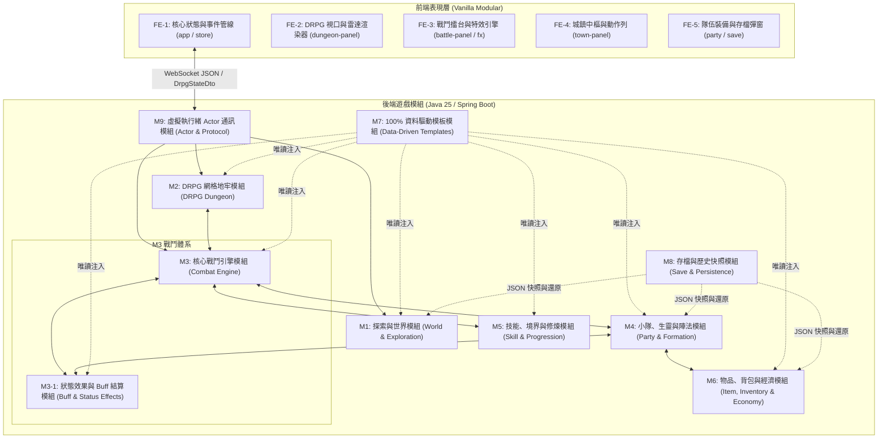

# 🧩 遊戲功能模組全景手冊 (Game Functional Modules Map)

> **文件定位**：  
> 本手冊自「功能模組／次系統（Subsystems）」的視角出發，將整個《道祖是克蘇魯》遊戲解構為清晰的功能模組拼圖。  
> 幫助開發者與研究者快速掌握各模組的職責邊界、代表類別、設定檔位置與協同工作流。

---

## 🗺️ 一、遊戲模組總覽架構圖

本遊戲採用 **雙軌模式（城鎮 MUD ↔ 地牢 DRPG）**，由 **後端 9 大核心業務模組（含 M3-1 戰鬥子模組）** 與 **前端 6 大表現模組** 深度協同運作：



---

## ⚙️ 二、後端 9 大核心功能模組 (含 M3-1 戰鬥子模組)

### 1. M1: 探索與世界模組 (World & Exploration)
- 📖 **詳細技術手冊**：[`後端_M1_探索與世界模組_WORLD_AND_EXPLORATION.md`](../manual/後端_M1_探索與世界模組_WORLD_AND_EXPLORATION.md)
- **核心職責**：
  - 管理城鎮與野外地圖拓撲網絡（房間間的北/南/東/西/進/出關聯）。
  - 維護房間內的生靈（NPC、巡邏怪、招募夥伴）與地面遺落物品。
  - 驅動世界心跳輪詢（`WorldPulse`），負責怪物刷新與房間狀態流轉。
- **代表類別**：
  - `RoomService`, `WorldManager`, `RoomMovementService`, `WorldPulse`
- **資料設定來源**：
  - `src/main/resources/data/zones/*/rooms.json`

### 2. M2: DRPG 網格地牢模組 (DRPG Dungeon)
- 📖 **詳細技術手冊**：[`後端_M2_DRPG網格地牢模組_DRPG_DUNGEON.md`](../manual/後端_M2_DRPG網格地牢模組_DRPG_DUNGEON.md)
- **核心職責**：
  - 負責第一人稱地下城走格子探索，管理樓層座標（`GridCoord`）與朝向（`GridDirection`）。
  - 解算前方三步視野透視（`inspectForward`）與暗黑迷霧踩格探索記錄（`visited` 矩陣）。
  - 地塊互動事件解算：封印石門、機關陷阱、密封棺槨寶箱（`openedChests` 矩陣）與向上撤離石階（`exitRoomId`）。
  - 遇敵率（`dangerRate`）動態計算，步步驚心觸發遭遇戰。
- **代表類別**：
  - `DungeonManager`, `DungeonFloorLoader`, `DungeonNavigator`, `DungeonFloor`, `DungeonTile`
- **資料設定來源**：
  - `src/main/resources/data/dungeons/*.json`

### 3. M3: 核心戰鬥引擎模組 (Combat Engine)
- 📖 **詳細技術手冊**：[`後端_M3_核心戰鬥引擎模組_COMBAT_ENGINE.md`](../manual/後端_M3_核心戰鬥引擎模組_COMBAT_ENGINE.md)
- **核心職責**：
  - **半即時迴圈**：基於 200ms Tick 頻率推進戰鬥時間線，處理敵人攻擊間隔與玩家小隊技能 GCD/吟唱。
  - **圓桌判定演算法**：優先級單次骰算（未命中 ➔ 閃避 ➔ 招架 ➔ 暴擊 ➔ 普通命中）。
  - **罡氣削韌與破防（Poise System）**：攻擊扣減敵人韌性條，破防時觸發「虛弱受創」與傷害倍率加成。
  - **九大五行傷害與抗性結算**：物理 10% 保底穿透、五行抗性百分比折減，抗性 $>100\%$ 觸發靈氣逆流回血。
  - **仇恨與站位系統**：基於前排加成、嘲諷係數與陣法倍率智慧選擇攻擊目標。
- **代表類別**：
  - 純領域函式：`com.example.htmlmud.domain.combat.CombatRules`
  - 業務編排：`DrpgBattleService`, `DrpgCombatLoop`, `DrpgEnemyTacticsService`, `DrpgRewardService`
- **資料設定來源**：
  - `src/main/resources/data/party/party_skills.json`, `data/zones/*/mobs.json`

### 3.1 M3-1: 狀態效果與 Buff 結算模組 (Buff & Status Effects)
- 📖 **詳細技術手冊**：[`後端_M3-1_狀態效果與Buff結算模組_BUFF_AND_STATUS_EFFECTS.md`](../manual/後端_M3-1_狀態效果與Buff結算模組_BUFF_AND_STATUS_EFFECTS.md)
- **核心職責**：
  - 管理生靈（玩家主角、小隊同伴、敵怪）狀態生命週期，支援限時心跳與 `PERMANENT_DURATION = -1` 常駐陣法光環。
  - WoW 式具名刷新策略：持續時間重置、層數累加、護盾取較大值、多重護盾「最短時效優先抵扣」。
  - 罡氣破防條（Poise Break）攻防博弈：未破防傷害折減與霸體、失衡力竭全額爆發、友方回春/補盾解控救場。
  - 九大天道靈氣五行抗性與逆流回血契約（`CombatRules.resolveResistance`，抗性 > 100% 轉為治療）。
  - 控場全動作入口門控（強控中斷吟唱/意圖、封咒禁止道法、破冰暴擊）。
  - 「屬性圖示聚合 (Element-Icon Aggregated HUD)」極簡呈現，拒絕冗長名稱破版。
- **代表類別**：
  - `BuffSettlementService`, `ActiveBuff`, `Buffable`, `BuffCategory`, `ActiveBuffDto`, `CombatRules`
- **資料設定來源**：
  - `src/main/resources/data/party/party_skills.json`, `data/buffs/`

### 4. M4: 小隊、生靈與陣法模組 (Party, Living & Formation)
- 📖 **詳細技術手冊**：[`後端_M4_小隊生靈與陣法模組_PARTY_AND_FORMATION.md`](../manual/後端_M4_小隊生靈與陣法模組_PARTY_AND_FORMATION.md)
- **核心職責**：
  - 5 人標準小隊編制（2 前衛、1 中衛、2 後衛）。
  - 道基五維屬性體系（體質 HP、真元 MP、神識/暴擊、根骨/防禦、身法/速度）。
  - 道心理智（SAN 值）異變機制：面對不可名狀神魔時扣減 SAN，低於閾值觸發瘋狂低語與屬性紊亂。
  - 夥伴招募好感度與戰陣編排（九宮八卦陣、北斗七星陣等不同陣形帶來的攻防加成）。
- **代表類別**：
  - `PartyService`, `Party`, `PartyMember`, `LivingService`, `FormationEngine`
- **資料設定來源**：
  - `src/main/resources/data/formations/formations.json`, `data/companions/default_companions.json`

### 5. M5: 技能、境界與修煉模組 (Skill & Progression)
- 📖 **詳細技術手冊**：[`後端_M5_技能境界與修煉模組_SKILL_AND_PROGRESSION.md`](../manual/後端_M5_技能境界與修煉模組_SKILL_AND_PROGRESSION.md)
- **核心職責**：
  - 技能學習、真元消耗檢定、冷卻時間（CD）與通用冷卻（GCD）管制。
  - 動態屬性縮放（`SkillBridgeService.scaleSkill`）：在保留 Buff、削韌、五行標籤的前提下，根據施法者道基五維動態縮放威力。
  - 境界突破（練氣 ➔ 築基 ➔ 金丹...）與自由屬性點分配。
- **代表類別**：
  - `SkillBridgeService`, `XpProgressionService`, `SkillCostService`, `FormulaEvaluator`
- **資料設定來源**：
  - `src/main/resources/data/classes/classes.json`, `data/skills.json`

### 6. M6: 物品、背包與經濟模組 (Item, Inventory & Economy)
- 📖 **詳細技術手冊**：[`後端_M6_物品背包與經濟模組_ITEM_AND_ECONOMY.md`](../manual/後端_M6_物品背包與經濟模組_ITEM_AND_ECONOMY.md)
- **核心職責**：
  - 四大裝備槽位管理（武器 `MAIN_HAND`/`OFF_HAND`、頭部 `HEAD`、胸甲 `BODY`、鞋子 `FEET`、飾品 `ACCESSORY`/`RING`）。
  - 30 格小隊共用儲物袋（`PartyInventory`）與堆疊機制。
  - 貨棧買賣交易、貨幣（碎銀、靈石）扣除、消耗品使用（百草金創藥、辟邪靈茶）。
- **代表類別**：
  - `PartyInventory`, `PartyItemSlot`, `GameItem`, `ShopCommand`, `DropCommand`, `GetCommand`
- **資料設定來源**：
  - `src/main/resources/data/items.json`, `data/zones/*/shops.json`

### 7. M7: 100% 資料驅動模板模組 (Data-Driven Templates)
- 📖 **詳細技術手冊**：[`後端_M7_資料驅動模板模組_DATA_DRIVEN_TEMPLATES.md`](../manual/後端_M7_資料驅動模板模組_DATA_DRIVEN_TEMPLATES.md)
- **核心職責**：
  - 專案第一紅線基石：遊戲所有數據（地圖、怪物、物品、技能、商店、任務、陣法）完全脫離 Java 代碼。
  - 啟動時自動掃描解析所有 JSON 資源，維護於高效唯讀快取。
  - 提供 `TemplateReader` 介面，依賴反轉隔離底層載入器。
  - 開機自我校驗（`DataIntegrityValidator`）：全面排查死鏈、無效引用與數值邊界。
- **代表類別**：
  - `TemplateRepository`, `TemplateReader`, `TemplateRegistryPort`, `DataIntegrityValidator`
- **資料設定來源**：
  - `src/main/resources/data/**/*.json`

### 8. M8: 存檔與歷史快照模組 (Save & Persistence)
- 📖 **詳細技術手冊**：[`後端_M8_存檔與歷史快照模組_SAVE_AND_PERSISTENCE.md`](../manual/後端_M8_存檔與歷史快照模組_SAVE_AND_PERSISTENCE.md)
- **核心職責**：
  - 確立以 `SaveData` JSON 為唯一單一真相源（Single Source of Truth），徹底淘汰複雜的關聯資料庫 Schema。
  - 五大獨立存檔槽位（`slot_1` ~ `slot_5`）與專屬自動存檔（`slot_auto`）。
  - 存檔版本治理（`schemaVersion`）與自動備份（`.bak`）回滾防禦機制。
  - 關鍵時機自動觸發：進入/撤離地牢、戰勝結算、離線前排空。
- **代表類別**：
  - `SaveGameService`, `AutoSaveService`, `SaveData`, `CharacterSave`, `RoomPersistenceService`
- **存檔存放目錄**：
  - `saves/slot_*.json`

### 9. M9: 虛擬執行緒 Actor 通訊模組 (Actor & Protocol)
- 📖 **詳細技術手冊**：[`後端_M9_虛擬執行緒Actor通訊模組_ACTOR_AND_PROTOCOL.md`](../manual/後端_M9_虛擬執行緒Actor通訊模組_ACTOR_AND_PROTOCOL.md)
- **核心職責**：
  - 基於 Java 21/25 Virtual Threads + 訊息信箱，為冒險主角（`Player`）與活躍房間（`RoomActor`）建立輕量併發 Actor。
  - 整合 Spring WebSocket，負責全狀態數據（`DrpgStateDto`）推送與 ANSI 彩色字串流。
  - 提供執行緒安全上下文管理（`MudContext`）。
- **代表類別**：
  - `VirtualActor`, `Player`, `MudWebSocketHandler`, `GameStateBroadcastService`, `CommandDispatcher`


---

## 🎨 三、前端 6 大表現模組 (Vanilla Modular)

> 💡 **整體佈局與主視圖切換指南**：  
> 請參見專屬手冊 **[`FRONTEND_LAYOUT_GUIDE.md`](FRONTEND_LAYOUT_GUIDE.md)**，詳解五大版塊空間骨架、三大主舞台互斥呈現、五大場景模組配置與狀態轉移矩陣。

前端採用現代純原生模組化架構（Vanilla JS + Vanilla CSS），完全零肥大框架依賴：

- ⚡ **FE-1 核心狀態與事件管線**：[`前端_FE1_核心狀態與事件管線_CORE_STATE_AND_PIPELINE.md`](../manual/前端_FE1_核心狀態與事件管線_CORE_STATE_AND_PIPELINE.md)（`app.js`, `store.js`, `websocket.js`）
- 🗺️ **FE-2 DRPG 視口與雷達渲染器**：[`前端_FE2_DRPG視口與雷達渲染器_DRPG_VIEWPORT_RENDERER.md`](../manual/前端_FE2_DRPG視口與雷達渲染器_DRPG_VIEWPORT_RENDERER.md)（`dungeon-panel.js`）
- ⚔️ **FE-3 戰鬥擂台與特效引擎**：[`前端_FE3_戰鬥擂台與特效引擎_BATTLE_ARENA_AND_FX.md`](../manual/前端_FE3_戰鬥擂台與特效引擎_BATTLE_ARENA_AND_FX.md)（`battle-panel.js`, `buff-hud-helper.js`）
- 🏛️ **FE-4 城鎮中樞與動作列面板**：[`前端_FE4_城鎮中樞與動作列面板_TOWN_HUB_AND_ACTION_BAR.md`](../manual/前端_FE4_城鎮中樞與動作列面板_TOWN_HUB_AND_ACTION_BAR.md)（`town-panel.js`, `action-bar-panel.js`）
- 👥 **FE-5 小隊裝備與存檔彈窗**：[`前端_FE5_小隊裝備與存檔彈窗_PARTY_EQUIPMENT_AND_MODALS.md`](../manual/前端_FE5_小隊裝備與存檔彈窗_PARTY_EQUIPMENT_AND_MODALS.md)（`party-modal.js`, `save-modal.js`, `victory-modal.js`）
- 🎨 **FE-6 七層樣式串流與視覺主題**：[`前端_FE6_七層樣式串流與視覺主題_CSS_TOKENS_AND_THEMES.md`](../manual/前端_FE6_七層樣式串流與視覺主題_CSS_TOKENS_AND_THEMES.md)（`style-01` ~ `style-07.css`）

```
static/
├── js/
│   ├── app.js                          # FE-1: 核心入口與全域 data-action 事件委派
│   ├── state/store.js                  # FE-1: 中央響應式狀態樹
│   ├── network/websocket.js            # FE-1: WebSocket 通訊與斷線重連管線
│   ├── panels/
│   │   ├── dungeon-panel.js            # FE-2: DRPG 視口透視與雷達地圖渲染器
│   │   ├── battle-panel.js             # FE-3: 戰鬥擂台、血條、韌性條與打擊特效
│   │   ├── town-panel.js               # FE-4: 城鎮中樞與 NPC 互動面板
│   │   └── action-bar-panel.js         # FE-4: 底部快捷動作列
│   └── modals/
│       ├── party-modal.js              # FE-5: 小隊管理彈窗
│       ├── party-equipment-tab.js      # FE-5: 裝備換裝分頁 (純資料驅動)
│       ├── save-modal.js               # FE-5: 存檔與讀檔多槽位彈窗
│       └── victory-modal.js            # FE-5: 戰鬥勝利結算彈窗
└── css/
    ├── style-01-tokens-and-shell.css   # FE-6: 色彩變數、排版規範與基礎佈局
    ├── style-02-combat-arena.css       # FE-6: 戰鬥擂台與生靈卡牌樣式
    ├── style-03-battle-actions.css     # FE-6: 戰鬥操作與技能按鈕佈局
    ├── style-04-main-menu.css          # FE-6: 封面選單與暗黑星空背景
    ├── style-05-town-and-hub.css       # FE-6: 城鎮中樞與資訊清單
    ├── style-06-shop-and-responsive.css# FE-6: 貨棧買賣與行動端響應式適配
    └── style-07-battle-fx.css          # FE-6: 打擊飄字、破防爆裂與動態特效
```

---

## 🔄 四、經典端到端業務協同流程 (End-to-End Walkthrough)

### 範例：玩家在地牢前進一步並遭遇戰鬥至結算

```
[玩家在鍵盤按下 'W' 鍵]
       │
       ▼
1. FE-1 (app.js) 捕獲按鍵，向 M9 (MudWebSocketHandler) 送出文字指令: "step w"
       │
       ▼
2. M9 調度至 DungeonCommand，轉交 M2 (DungeonManager) 判定網格位移
       │
       ▼
3. M2 解算 (x, y) 座標，更新 visited 迷霧矩陣，並向 M9 廣播前進視野 (inspectForward)
       │
       ▼
4. M2 擲骰檢定 dangerRate，判定遭遇墨竹山畸變魔物，立即啟動 M3 (DrpgBattleService)
       │
       ▼
5. M3 從 M7 (TemplateRepository) 載入怪物模板，並從 M4 (PartyService) 取得 5 人小隊站位
       │
       ▼
6. M3 啟動 DrpgCombatLoop (200ms Tick 輪詢)：
   - 玩家點擊技能 ➔ M5 (SkillBridgeService) 動態縮放 ➔ M3 (CombatRules) 圓桌判定
   - 命中 ➔ 扣除怪物 Poise 韌性 ➔ 觸發破防虛弱狀態 ➔ 五行傷害加成結算
       │
       ▼
7. 首領氣血歸零：
   - M3 呼叫 M6 (PartyInventory) 發放戰利品至小隊共用儲物袋
   - M3 呼叫 M5 (XpProgressionService) 派發經驗並觸發潛在升級
   - M7 (TemplateReader) 觸發 QuestTemplate 劇情對話解算
       │
       ▼
8. M8 (AutoSaveService) 自動觸發戰後安全快照，寫入 saves/slot_auto.json
       │
       ▼
9. M9 將全景狀態組裝為 DrpgStateDto.of(...) 推送給前端
       │
       ▼
10. 前端 FE-3 (battle-panel) 播放破防爆裂動效，彈出 FE-5 (victory-modal) 戰利品收納！
```

---

## 🚀 五、純單機單體模組深度演進藍圖 (Single-Player Monolith Roadmap)

本專案圍繞「一人掌控 5 人戰術小隊之純單機 DRPG 沉浸體驗」，規劃以下四大模組演進維度：

### 1. 單人小隊戰術深度 (Tactical Party & Companion Gambits)
- **隊友 Gambit 規則鏈引擎 (M4 擴展)**：
  - 為 4 名招募夥伴實作 FFXII 風格的條件式戰術規則鏈（例如：「隊友血量 < 35% ➔ 施放回春術」、「敵怪處於破防虛弱 ➔ 施放太白重擊」），100% 透過 JSON 規則檔驅動，讓單人掌控 5 人小隊流暢自如。
- **陣法聯攜技與五行連鎖反應 (M3 & M4 協同)**：
  - 五行靈氣環境共鳴：前排土系修士施加「流沙束縛」後，後排木系修士觸發「藤蔓絞殺」產生額外 50% 破防傷害。

### 2. 探索沉浸與黑暗博弈 (Dungeon Survival & Sanity)
- **火把燃盡度與視野迷霧 (M2 擴展)**：
  - 引入「火把光明度」消耗計量。光照度降低時前方視野從 3 步縮減為 1 步，遇怪率倍增；燃盡時全隊陷入漆黑，強制觸發 SAN 值精神檢定。
- **古仙靈視與 SAN 值幻覺事件 (M2 & M1 協同)**：
  - SAN 值過低時地牢出現偽裝寶箱怪（擬態鬼物）與牆面蠕動低語，但在幻覺中亦可看見一般狀態下隱形的古修士道藏暗門。

### 3. 本地存檔防禦與強健性 (Save Robustness & Crash Recovery)
- **多槽位原子存檔與自動備份 (M8 擴展)**：
  - 實作安全雙寫入策略（先寫入 `.json.tmp`，完成校驗後原子替換 `slot_N.json`），並自動留存 `.bak` 歷史版本，防止突發斷電或系統當機導致存檔損壞。
- **存檔 Schema 自動向上遷移 (Schema Migration Pipeline)**：
  - 面對未來的數值或屬性擴充，透過宣告式遷移器（`SaveDataMigrator`）自動將舊版存檔平滑升級至最新結構。

### 4. 資料驅動設計與零硬編碼 (100% Data-Driven Architecture)
- **純靜態資料驅動 (100% Data-Driven)**：
  - 遵循專案第一紅線，所有門派職業、武學技能、敵怪首領、地下城地圖與掉落表，100% 集中於 `src/main/resources/data/**/*.json`。擴充新內容純靠新增或修改 JSON 配置，絕無代碼特例。
- **🚫 已正式除役之過度設計**：
  - 徹底除役多人在線房間同步、副本實例叢集、Protobuf 二進位協定、動態 JAR 外部外掛 SPI 與腳本熱更，專注於極致穩健的單機單體架構。
