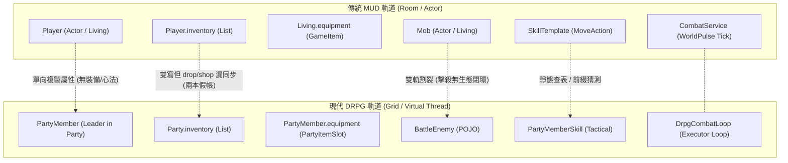
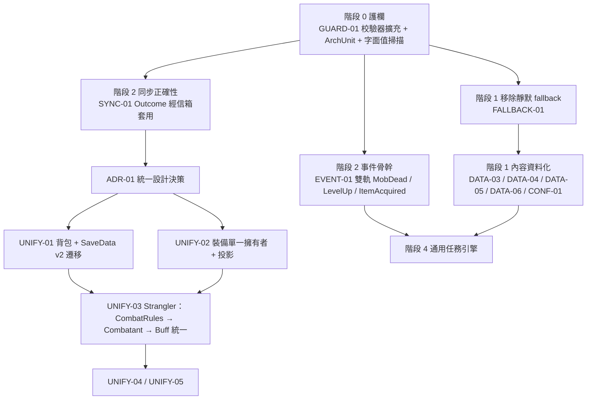

# 專案後續架構改善與演化藍圖 (Consolidated Future Improvements & Evolution Roadmap)

> **文件定位與目的**：
> 本文件作為專案所有後續架構演進、機制補完、安全加固與重構任務的**單一權威來源 (Single Source of Truth, SSoT)**。
> 本文件收斂歷史架構規劃與多次代碼審查提出的待辦；舊審查稿僅作為歷史來源，**目前狀態與新發現以本文件的驗收狀態及最新 [`docs/references/Copilot_Review.md`](../references/Copilot_Review.md) 為準**：
> 1. **戰鬥與成長機制** (圓桌判定、魂系精力破防、主角自由潛能點、MUD 生靈閉環)
> 2. **全實體資料驅動** (去除職業/陣型/反擊/別名硬編碼、集中式 JSON 啟動校驗)
> 3. **共用規範模型與清潔架構** (Canonical Model、Domain 依賴反向、Actor 狀態邊界單一擁有)
> 4. **連線安全與部署防禦** (WebSocket 身分票證、訊息長度與速率限制、部署模式明確化)
> 5. **存檔版本治理與防損壞** (SaveData `schemaVersion`、遷移適配器、損壞槽位可識別)
> 6. **前端模組化與代碼收斂** (巨石 `style.css` 拆分、`party-modal.js` 職責切分、legacy 模組除役)
> 7. **測試工程分層加速** (領域純單元測試 vs Spring 整合測試、快取隔離)
>
> 經與當前程式庫（Java 25 / Spring Boot 4.1.1 / ES6 前端 / 304 項全綠燈測試，2026-10-15 最新驗收）實地盤查與交叉校對，剔除已完成項目、修正歷史過期數據，按優先級（P0 ~ P3）與業務領域結構化整理，供後續開發與重構直接依序落地。檔案行數會隨開發變動，請以執行任務時的實際盤點為準。

---

## 📌 歷史演進指針 (Historical Records)

> 💡 **已完成里程碑與歷史變更**：
> 本專案所有已落地之里程碑（Phase 0 ~ Phase 11.5 主選單重構）、Bug 修復與架構升級歷程，已全數移轉至專門文件維護：
> 👉 **請參閱 [`CHANGELOG.md`](../../CHANGELOG.md)**。
> 本文件僅專注於**「未決定議題、待執行架構任務與後續演化路線圖」**。

---

## 🧭 後續推薦實施路徑 (Next Evolution Paths)

- [x] **路徑 0: 緊急程式與安全漏洞修復 (Hotfixes & Hardening)** (§0 全項)
- [x] **路徑 A: 共用 Canonical Model 徹底解耦 (Phase 2 ~ 5)** (§1 全項)
- [x] **路徑 B: 戰鬥圓桌判定、盾牌格擋、魂系精力破防與主角雙軌升級** (§2 全項)
- [x] **路徑 C: MUD 端生靈 AI、升級閉環、Buff 引擎與規則補齊** (§3 全項)
- [x] **路徑 D: UI/UX 全域佈局重構、三種資訊密度、字級規範 (>= 13px) 與雙軌資源契約** (§4 全項)
- [x] **路徑 E: 領域層反向依賴反轉 (Clean Architecture Phase 10)** (§5.1)
- [x] **路徑 F: 網路邊界安全、WebSocket 部署防護與 Write-Behind 排空治理 (NET-01/NET-02/ASYNC-02)** (§6 全項) — **Priority: P1 (已完成)**
- [x] **路徑 G: Actor 狀態修改單一擁有權與背景戰鬥生命週期治理 (ACT-01/ACT-02)** (§7 全項) — **Priority: P1 (已完成)**
- [x] **路徑 H: 檔案式存檔版本治理 (`schemaVersion`) 與壞檔防禦 (SAVE-01/SAVE-02)** (§8 全項) — **Priority: P1 (已完成)**
- [ ] **路徑 J: 前端巨石模組拆分與 Legacy 除役** (§10 全項) — **Priority: P2 (CSS-01/FE-01/LEG-01 已完成，待舊 style.css 清理決議)**
- [ ] **路徑 K: 測試工程分層加速與系統可觀測性** (§11 全項) — **Priority: P3**
- [x] **路徑 L: 垂直可玩內容閉環 (Playable Baseline: 創角 -> 滄浪城任務 -> 地宮探險 -> 戰鬥 -> 結算存檔)** (§12 全項) — **Priority: P3 (已完成)**
- [ ] **路徑 M: 敵方行動預告、反制窗口與首領階段（先做資料驅動垂直切片）** (§13 全項) — **Priority: P1 / P2**
- [x] **路徑 N: 戰鬥區塊視覺特效與動態回饋 (Battle Presentation & VFX)** (§14 全項) — **Priority: P1 / P2 (已完成)**
- [ ] **路徑 O: 生動畫面呈現與淡化文字閱讀轉型藍圖 (Visual-First DRPG Transformation)** (§15 全項) — **Priority: P1 / P2**
- [ ] **路徑 P: 全專案功能與設定資料硬編碼實地盤查與清理藍圖** (§16 全項) — **Priority: P1 / P2**
- [ ] **路徑 Q: MUD 與 DRPG 雙軌機制割裂深度盤查與大一統融合架構** (§17 全項) — **Priority: P1 / P2**
- [ ] **路徑 R: §16/§17 第二輪審查校正與漸進落地** (§18 全項) — **Priority: P0 / P1（階段 0: GUARD-01/DEBUG-01 已完成）**
- [ ] **路徑 S: Buff 契約與可靠性護欄第二輪驗收** (§19 全項) — **Priority: P1 / P2**
- [ ] **路徑 T: 實體深拷貝加固、Fallback 棘輪清零與雙持久化收斂** (§20 全項) — **Priority: P1 / P2 (DEEPCOPY-01 已完成)**
- [x] **路徑 U: 全專案綜合審查後續與紅線治理藍圖** (§21 全項) — **Priority: P0 ~ P3 (2026-10-15 制定，P0/P1/P2 死代碼與紅線清理已完成，304 測試全綠燈)**
- [ ] **路徑 V: 全專案大一統與現代化演進戰略五大戰線** (§22 全項) — **Priority: P1 ~ P3 (2026-10-15 全文件對齊版，當前微任務落地請參閱根目錄 [ACTIVE_TASKS.md](../../ACTIVE_TASKS.md))**
- [ ] **路徑 W: 文件權威來源、交叉一致性與現代遊戲規劃治理** (§23 全項) — **Priority: P1（審查建議已整合；詳見 [Codex_Review.md](../references/Codex_Review.md) 與 [Copilot_Review.md](../references/Copilot_Review.md)）**
- [ ] **路徑 X: 純單機單體化演進戰略：多人機制、雙軌架構與膠水代碼全域收斂藍圖** (§24 全項) — **Priority: P0 ~ P2（單人轉型核心戰役）**

---

## 🚨 0. 緊急核心修復與安全性加固 (Critical Hotfixes & Hardening) — Priority: P0 (已完成)

### 0.1 ✅ [已完成] 房間狀態與地面掉落物持久化閉環 (P0)
> **落地進度**：已於 2026-10-02 完成。
> 1. `RoomService` 注入 `RoomPersistenceService`，於物品丟棄、拾取或快照時非同步排入寫入佇列。
> 2. `RoomPersistenceService.flushBatch()` 實作新舊實體 upsert，完整保存 `droppedItems`。
> 3. `RoomService.spawnInitial()` 於房間初次載入時自動讀取歷史持久化狀態還原。
> 4. `GameItem` 輔助方法補齊 `@JsonIgnore` 與空指針防禦，修復 Hibernate/Jackson 序列化失敗漏洞。
> 5. 新增專屬整合測試 `RoomDroppedItemPersistenceTest` 100% 綠燈通過。

### 0.2 ✅ [已完成] 戰鬥圓桌防禦切片累積總機率收斂 (P0)
> **落地進度**：已於 2026-10-02 完成。
> 1. `DefenseResolver` 導入總防禦率上限（預設 $75\%$），超過時依比例縮放防禦切片（Miss / Dodge / Parry / Block）。
> 2. 致命一擊 (Crit) 僅分配剩餘機率，並保留至少 $5\%$ 作為普通命中 (Normal Hit) 窗口，消除複合高防禦下的機率湮滅 Bug。
> 3. `GameConfig.Combat` 新增 `maxTotalDefenseChance` 與 `minNormalHitChance` 設定與單元測試。
> 4. `OneRollCombatTableTest` 新增複合防禦邊界與 3,000 次蒙地卡羅隨機模擬測試 100% 綠燈通過。

### 0.3 ✅ [已完成] Write-Behind 持久化佇列有界化與可靠關閉 (P0)
> **落地進度**：已於 2026-10-02 完成。
> 1. `AbstractAsyncBatchPersistenceService` 佇列設為有界容量 (10,000)，滿載時回報背壓日誌。
> 2. 引入 `AtomicBoolean accepting` 狀態，關閉時拒收新資料防止漏寫。
> 3. 優雅關閉時等待 worker 虛擬執行緒 `join(3s)`，並同步排空剩餘資料，消除併發 flush 競態。
> 4. 提供 `flushImmediately()` 支援測試與關鍵節點即時排空。

### 0.4 ✅ [已完成] 前端資料輸出轉義與 CSP 事件委派整頓 (P0)
> **落地進度**：已於 2026-10-02 完成。
> 1. `party-modal.js` Gambit 戰術方針動態插值（`conditionLabel`、`targetLabel`、`skillName`、`valDisplay`）全面導入 `escapeHtml()` 轉義防禦。
> 2. `index.html` 移除全數 inline `onclick` 與 `on*=` 屬性，全面改為 `data-action` 屬性。
> 3. `app.js` 實作全局集中式事件委派 (`initEventDelegation()`)，支援背景遮罩關閉、選單跳轉、快捷指令發送，徹底滿足嚴格 Content Security Policy (CSP) 規範。

---

## 🏛️ 1. 共用 Canonical Model 徹底解耦 (Canonical Model Decoupling) — Priority: P1 (已完成)

### 1.1 ✅ [已完成] Phase 2: Canonical Item Model (`ItemDefinition` + `ItemInstance` + `ItemView`) (P1)
> **落地進度**：已於 2026-10-02 完成。不可變 `ItemDefinition` record、`ItemInstance` 實體、`ItemView` 投影與 Spring 託管之 `ItemFactory`，`CanonicalItemModelTest` 全數通過。

### 1.2 ✅ [已完成] Phase 3: 統一技能定義 Single `SkillDefinition` (MUD / DRPG Facets) (P1)
> **落地進度**：已於 2026-10-03 完成。`SkillDefinition`、`MudSkillRules`、`DrpgSkillRules`、`SkillBridgeRule`，徹底廢除寫死之 switch/if-else，`CanonicalSkillModelTest` 通過。

### 1.3 ✅ [已完成] Phase 4: 徹底移除 `TemplateRepository` 靜態呼叫 (DI Migration) (P1)
> **落地進度**：已於 2026-10-03 完成。`TemplateRepository` 重構為純 Spring `@Component` 實作 `TemplateReader`，移除靜態 Map 與單例，全整合測試注入實例。

### 1.4 ✅ [已完成] Phase 5: 基於 Outcome 的角色同步機制 (Outcome-based Synchronization) (P1)
> **落地進度**：已於 2026-10-03 完成。開戰前產生不可變 `BattleParticipantSnapshot`；戰後產生不可變 `BattleOutcome` 由內建 LRU 冪等快取的 `BattleOutcomeApplier` 單向安全套用，徹底根除雙向拷貝與併發競態風險，`OutcomeBasedCharacterSyncTest` 通過。

---

## ⚔️ 2. 戰鬥圓桌判定、格擋與成長機制 (Combat & Progression) — Priority: P1 / P2 (已完成)

### 2.1 ✅ [已完成] 全域數值集中管理 — `GameConfig` (P1)
> **落地進度**：集中管理經驗、戰鬥、精力、冷卻等常數於 `GameConfig.java` 與 `application.yml`。

### 2.2 ✅ [已完成] 經驗值公式 3 套矛盾實作收斂 (XP-01) (P1)
> **落地進度**：統一由 `XpProgressionService` 集中管理角色等級曲線 ($60L^{1.6} + 120L$) 與技能曲線 ($50 \times \text{lv}^2 \times \text{diff}$)，打通溢出經驗保留與全狀態回滿。

### 2.3 ✅ [已完成] 一次擲骰圓桌判定 (One-Roll Combat Table) 收斂 (P1)
> **落地進度**：`DefenseResolver` 統一雙軌單次擲骰圓桌判定：$\text{[Miss]} \to \text{[Dodge]} \to \text{[Parry]} \to \text{[Block]} \to \text{[Crit]} \to \text{[Normal Hit]}$，導入 75% 防禦上限與 5% 保底命中。

### 2.4 ✅ [已完成] 獨立盾牌格擋 (Block) 與破招反擊 (Riposte) (P2)
> **落地進度**：副手裝備盾牌參與圓桌格擋減傷；招架成功觸發無消耗破招反擊，MUD 與 DRPG 雙軌致死判斷閉環，`ShieldBlockAndRiposteTest` 通過。

### 2.5 ✅ [已完成] 魂系精力 (Stamina) 消耗與架勢破防 (Poise Break) (P2)
> **落地進度**：閃避扣 2 點、招架扣 3 點精力；精力歸零進入架勢破防（閃避/招架歸零、承受傷害 +20%），脫戰自然回復，`StaminaAndPoiseBreakTest` 通過。

### 2.6 ✅ [已完成] 主角自由潛能點 (Potential Points) 雙軌升級 (P2)
> **落地進度**：夥伴升級純依模板自動成長；主角/隊長每級獲得自由潛能點 (+2~3 點)；實作 MUD `StatCommand`（`score`/`status`/`加點`）與雙向即時同步，`DualTrackPotentialPointsTest` 通過。

### 2.7 戰鬥活躍感知守護與放置掛機熔斷 (Combat-02: Combat Activity Guard & AFK Idle Timeout) (P1)
- **現狀與痛點**：
  - 原本的 `maxRounds = 100` 硬性限制已放寬；目前 `BattleContext.maxRounds` 為 50,000。
  - **目前實作核對（2026-10-05）**：`BattleContext.maxDurationMs` 仍預設 300,000ms，`isTimedOut()` 會在戰鬥開始 5 分鐘後逾時，並不因玩家持續操作而延長；此行為須與 10 分鐘閒置熔斷設計一併決議。
- **改善方案**：
  1. **明確定義回合與絕對時限政策**：保留足夠大的回合上限作為極端安全閥；一般常規戰鬥與木樁演武不應因固定 5 分鐘而被生硬中斷，若需絕對時限，應依戰鬥模式設定並與閒置時限分離。
  2. **引入玩家活躍時間感知 (`lastActivityTime`)**：
     - 在 `BattleContext` 記錄 `lastActivityTime` 時間戳記。
     - 凡玩家進行有效操作（施放技能、切換集火目標、使用道具丹藥、釋放陣法奧義、發送指令等），自動刷新為最新系統時間戳記。
  3. **10 分鐘無操作放置超時保護 (AFK Idle Timeout)**：
     - 戰鬥心跳迴圈中檢測玩家無輸入時長：若超過 10 分鐘（600,000 ms）未有任何指令輸入或按鈕互動，系統判定為放置掛機/離座，觸發熔斷防護並優雅脫離戰鬥：`⚡【心神渙散】小隊因長久無人指揮，陣法自動潰散，脫離戰鬥。`
  4. **WebSocket 連線中斷即時回收**：
     - 當玩家關閉分頁或連線中斷（`afterConnectionClosed`）時，主動釋放戰鬥虛擬執行緒，杜絕殭屍戰鬥背景常駐。

---

## 🧟 3. MUD 端生靈 AI、升級閉環與規則補齊 (MUD Mechanics) — Priority: P1 / P2 (已完成)

### 3.1 ✅ [已完成] Mob 行為與反應補完 (MUD-01) (P1)
> **落地進度**：`Mob.sayToRoom` 廣播、主動怪進場撲咬、被動怪閒話、商人求救與仇恨同步閉環。

### 3.2 ✅ [已完成] MUD 端角色擊殺升級突破閉環 (MUD-02) (P1)
> **落地進度**：怪死計算動態修為掉落，調用 `XpProgressionService.awardExp` 觸發升級突破與潛能點入帳。

### 3.3 ✅ [已完成] MUD 端 Buff / Debuff 引擎串接 (P1)
> **落地進度**：`Living` 實作 `Buffable`，支援多重護盾 Shortest-Duration-First 吸收，每 500ms 週期心跳結算 HoT/DoT 與 DoT 致死結算。

### 3.4 ✅ [已完成] MUD 規則與戰鬥細節補齊 (P2)
> **落地進度**：`LivingPosture` 姿勢檢定（阻擋非站立移動）、`RoomFlag`（SAFE_ZONE 禁武、NO_MAGIC 禁魔、NO_MOB、HIGH_REGEN）、`DamageType` 抗性增減、`MobRank` 精英/首領倍率全數生效。

---

## 🖥️ 4. UI/UX 全域佈局與資源契約 (UI Layout & Density) — Priority: P1 / P2 (已完成)

### 4.1 ✅ [已完成] 三種資訊密度分區與字級規範 (>= 13px) (P1)
> **落地進度**：全域審查消除 `< 12px` 樣式，遵循 `--font-xs: 13px`；探索密度雷達 26x26px、戰鬥密度三層甲板、管理密度 1600x900 規格。

### 4.2 ✅ [已完成] 共用頁面 Shell 重構 (Global Layout) (P1)
> **落地進度**：頂部 Global Header、中央 Context Viewport、底部常駐 5 人小隊軌道與情境動態操作列 (Context Action Bar)。

### 4.3 ✅ [已完成] HP / MP / SP / SAN 雙軌資源顯示契約 (P2)
> **落地進度**：`DrpgStateDto` 支援雙軌資源，近戰法術雙修條件各自獨立判定，前端 HUD 雙軌同步呈現，`DualTrackResourceContractTest` 通過。

---

## 📐 5. 清潔架構與領域依賴反向 (Clean Architecture) — Priority: P1 (已完成)

### 5.1 ✅ [已完成] Domain 層反向依賴反轉 — Phase 10 (Clean Architecture) (P1)
> **落地進度**：
> 1. 提取 `PlayerPersistencePort`、`DomainMetricsPort`、`TemplateRegistryPort` 至 `domain.port`。
> 2. `RandomUtil`、`IdUtils`、`RoomDescriptionDeserializer` 移入 `domain.util` / `domain.model.template.json`。
> 3. `domain` 套件對外部 `infra` 依賴達成 **0 違規**！全專案 231 項自動化測試 100% 綠燈通過。

---

## 🌐 6. ✅ [已完成] 網路邊界安全、WebSocket 部署防護與連線配額 (Network Hardening) — Priority: P1

> **來源**：歷史檢視（Codex／Claude）；最新 WebSocket 與持久化風險見 [`docs/references/Copilot_Review.md`](../references/Copilot_Review.md) §二 #1–2。
> **核心目標**：明確界定「單機本機」與「公開部署」的安全邊界，防止未驗證連線、大封包記憶體攻擊與指令洪水。
> **落地進度**：已於 2026-10-04 完成。
> 1. **明確部署模式與環回綁定 (NET-01)**：`application.yml` 明確宣告 `game.network.mode: local`、`game.network.bind-address: 127.0.0.1` 與 `server.address: 127.0.0.1`；`application-prod.yml` 支援動態注入公開綁定，防禦區域網未授權連線。
> 2. **封包長度與指令限流防禦 (NET-02)**：在 `MudWebSocketHandler` 實作 64 KB 訊息長度上限檢查（超過直接 BAD_DATA 關閉）與每秒 20 次指令窗口限流（超額即時攔截並提示玩家），消除大封包記憶體攻擊與洪水刷頻。
> 3. **Write-Behind 優雅排空協定 (Drain Protocol) (ASYNC-02)**：`AbstractAsyncBatchPersistenceService` 重構消費迴圈，關閉時 worker 自動將本地 `batch` 與佇列剩餘項目合併原子 flush，並在中斷或超時兜底處理中保證 100% 排空，消除 worker 局部變數遺留造成的漏寫風險。
> 4. **專屬驗收測試覆蓋**：建立 `NetworkSecurityAndPersistenceDrainTest` 驗證 64KB 大封包拒絕、20次/秒限流攔截與停機時 25 筆本地批次 100% 排空落盤，全專案 246 項測試全數綠燈通過。

---

## 🏛️ 7. ✅ [已完成] Actor 狀態修改單一擁有權與背景生命週期治理 (Actor Lifecycle) — Priority: P1

> **來源**：`Codex_Code_Review.md` (§P1)、`Claude_Code_Review.md` (§二)。
> **核心目標**：杜絕繞過信箱的狀態變更，落實 Actor 嚴格單一線程排序，治理虛擬執行緒戰鬥生命週期與逾時斷路器。
> **落地進度**：已於 2026-10-04 完成。

### 7.1 ✅ [已完成] 收斂 Room Actor 狀態修改通道（修復 `removePlayer` 雙軌修改） (ACT-01) (P1)
> **落地進度**：
> 1. **消除雙軌修改**：徹底移除 `Room.java` 中 `removePlayer`、`removeMob`、`removeItem`、`dropItem` 在 caller 線程對 `players`、`mobs`、`items` 內部集合的直接修改，所有狀態變更 100% 嚴格僅由 Actor 信箱訊息處理器排序執行。
> 2. **Actor 自身線程判定 (`isActorThread()`)**：呼叫端若已在 Actor 自身線程內，安全直通修改；外部呼叫端一律投遞信箱訊息。
> 3. **請求-回應同步確認通道**：`RoomMessage` 的 `RemovePlayer`、`RemoveMob`、`RemoveItem`、`DropItem` 擴充支援 `CompletableFuture<Boolean>`；`Room` 暴露相應的 `removePlayerAsync`、`removeMobAsync`、`removeItemAsync`、`dropItemAsync`。
> 4. **`addPlayer` 與 `addMob` 收斂**：外部呼叫自動收斂至 `enter` 信箱訊息通道。
> 5. **併發安全驗證**：[SystemDefenseAndStabilityTest.java](file:///c:/Workspace/my_practice/practice_mud/src/test/java/com/example/htmlmud/SystemDefenseAndStabilityTest.java) 包含 20 執行緒高併發丟棄、讀取與非同步移除驗證，全數通過。

### 7.2 ✅ [已完成] 背景戰鬥虛擬執行緒治理與逾時斷路器 (ACT-02) (P1)
> **落地進度**：
> 1. **Spring 託管戰鬥執行緒池 (`combatExecutor`)**：在 `SchedulerConfig.java` 註冊名為 `combatExecutor` 的虛擬執行緒 `ExecutorService` Bean（自帶優雅停機），注入 `DrpgCombatLoop` 統籌管理戰鬥虛擬執行緒，杜絕裸啟動。
> 2. **雙重斷路器熔斷機制**：`BattleContext` 引入 `startTime`、`maxDurationMs`（預設 5 分鐘）、`maxRounds`（預設 100 回合）與 `roundCount` 計數器；戰鬥循環每輪檢測超時或超過回合上限，觸發斷路器強制切換為 `BattleState.TIMEOUT` 並中斷迴圈。
> 3. **任務控制控制碼 (`combatFuture`) 與中斷治理**：`BattleContext` 保存 `Future<?> combatFuture`，提供 `cancelBattle()`；`DrpgCombatLoop` 循環嚴格檢驗 `Thread.currentThread().isInterrupted()`，中斷時即刻優雅退出。
> 4. **健壯清理保證**：`DrpgCombatLoop.finally` 區塊無論 `Player` 實例是否為 null（或玩家是否已離線），均嚴格依 `ctx.getPlayerId()` 與 `ctx.getBattleId()` 清理 `activeBattles` 快取，絕不發生記憶體或執行緒洩漏。
> 5. **完整測試驗證**：[SystemDefenseAndStabilityTest.java](file:///c:/Workspace/my_practice/practice_mud/src/test/java/com/example/htmlmud/SystemDefenseAndStabilityTest.java) 完整驗證超時熔斷、回合上限熔斷、執行緒中斷取消與 Spring Bean 注入治理，全數綠燈通過。

---

## 🛡️ 8. ✅ [已完成] 檔案式存檔版本治理 (`schemaVersion`) 與壞檔防禦 (Save File Resilience) — Priority: P1

> **來源**：歷史檢視（Codex／Claude）；最新 Write-Behind 風險與驗收建議見 [`docs/references/Copilot_Review.md`](../references/Copilot_Review.md) §二 #1、§四。
> **落地進度**：已於 2026-10-03 完成。
> 1. **資料模型版本治理 (`CURRENT_SCHEMA_VERSION = 1` / `SaveMigrationPipeline`)**：
>    - [SaveData.java](file:///c:/Workspace/my_practice/practice_mud/src/main/java/com/example/htmlmud/domain/save/model/SaveData.java) 引入 `CURRENT_SCHEMA_VERSION = 1` 與 `schemaVersion` 欄位（`@Builder.Default`）。
>    - 實作 [SaveMigrationPipeline.java](file:///c:/Workspace/my_practice/practice_mud/src/main/java/com/example/htmlmud/domain/save/migration/SaveMigrationPipeline.java) 與 `SaveMigration` 介面，內建 v0 $\to$ v1（補齊槽位與裝備結構）與 v1 $\to$ v2（補齊九大抗性矩陣與罡氣上限）的平滑自動遷移管線。
> 2. **壞檔狀態明確標記與防禦 (`SaveSlotDto` / `SaveCorruptedException`)**：
>    - [SaveSlotDto.java](file:///c:/Workspace/my_practice/practice_mud/src/main/java/com/example/htmlmud/domain/save/dto/SaveSlotDto.java) 新增 `boolean corrupted` 欄位。
>    - [SaveGameService.java](file:///c:/Workspace/my_practice/practice_mud/src/main/java/com/example/htmlmud/domain/save/service/SaveGameService.java) 的 `readSlotSummary()` 在 JSON 格式不合法或解析例外時，嚴格回傳 `empty: false, corrupted: true, title: "... (存檔損壞)"`，杜絕壞檔被誤判為空槽而遭意外覆寫。
>    - `loadGame()` 遇到損壞存檔時嚴格拋出 [SaveCorruptedException.java](file:///c:/Workspace/my_practice/practice_mud/src/main/java/com/example/htmlmud/domain/save/exception/SaveCorruptedException.java)，阻止殘破資料注入記憶體。
> 3. **原子性自動 `.bak` 備份與還原機制 (`restoreBackup` / `save restore`)**：
>    - 存檔寫入或覆寫時，自動將前代舊存檔備份為 `autosave.json.bak` / `slot_X.json.bak`。
>    - `SaveGameService` 提供 `hasBackup(slotId)` 與 `restoreBackup(slotId)`；指令行支援 `save restore <slotId>`；刪除存檔時同步安全清理備份。
> 4. **前端防禦與 UI 視覺適配 (`drpg-view.js` / `style.css`)**：
>    - `drpgState.latestSaveSlot` 排除壞檔，避免「繼續遊戲」嘗試載入損壞資料。
>    - 壞檔卡片呈現醒目警示樣式（`.is-corrupted`, `.corrupted-tag`），禁用載入按鈕，並提供「🔄 還原備份」、「💾 重新覆寫」與「🗑️ 刪除」。
> 5. **完整單元測試覆蓋 (`SaveGameServiceTest.java`)**：
>    - 覆蓋單機存檔全生命週期、壞檔偵測與防禦攔截、v0 舊檔自動遷移至 v1、以及 `.bak` 備份自動生成與時空還原驗證。

---

## 🏛️ 9. 徹底資料驅動消除硬編碼與集中式 JSON 啟動拓撲校驗 (Data-Driven Purity) — Priority: P1

> **來源**：歷史檢視（Claude／Codex）；最新 fallback 護欄發現見 [`docs/references/Copilot_Review.md`](../references/Copilot_Review.md) §二 #3。
> **核心目標**：拔除底層代碼中殘留的職業名稱、陣法字串比對與技能別名映射；建立啟動期跨檔案資料校驗器。

### 9.1 ✅ [已完成] 消除職業特例與反擊特性硬編碼 (DATA-01) (P1)
> **落地進度**：已於 2026-10-03 完成。
> 1. **職業特質資料化 (`ClassTemplate` / `classes.json`)**：在 `classes.json` 為俠客配置 `"canRiposte": true` 與通用 `traits`；`ClassTemplate` 支援 `hasTrait(...)` 與 `getTraitDouble(...)`；`DefenseResolver` 徹底廢除 `"SWORDSMAN"` 字串硬編碼，全面轉為資料驅動檢定。
> 2. **職能角色標準化 (`RoleCategory` / `FormationTemplate`)**：引入標準枚舉 `RoleCategory`（`TANK`, `MELEE_DPS`, `RANGED_DPS`, `MAGIC_DPS`, `HEALER`），支援 `fromClassOrRole` 與 `parseRequirement`；`FormationTemplate` 的 `satisfiesClassRequirement` 與中文名稱格式化全面依賴職能枚舉比對，徹底移除寫死之 switch 中英文字串比對。
> 3. **技能別名集中治理 (`party_skills.json` / `TemplateCatalog`)**：在 `PartyMemberSkill` 與 `party_skills.json` 引入 `aliases` 陣列（支援 `tank_taunt` ⇄ `class_warrior_taunt`、`heal_single` ⇄ `class_cleric_heal` 等）；`TemplateRepository` 建立雙向別名索引表；`TemplateReader` 與 `TemplateCatalog` 統一暴露 `resolveSkillAlias`；`PartyMember` 移除寫死別名 switch，冷卻時間判定與技能查詢皆完全資料驅動。
> 4. **全專案 231 項測試 100% 綠燈通過**，包含 MUD/DRPG 雙軌防禦、陣法職能比對、三態資源消耗與冷卻別名查詢。

### 9.2 ✅ [已完成] 集中式遊戲 JSON 啟動期拓撲校驗 (VAL-01) (P1)
> **落地進度**：已於 2026-10-04 完成。
> 1. **集中式拓撲校驗器 (`DataIntegrityValidator`)**：實作 `ApplicationRunner` (`@Order(2)`)，於 Spring 容器世界載入就緒後自動觸發 Fail-Fast 拓撲驗證。
> 2. **完整覆蓋 7 大資料領域**：
>    - 物品庫 (117+ 件)：ID 與名稱非空校驗。
>    - 怪物庫 (69+ 隻)：掉落物 (`loot`)、初始裝備 (`equipment`)、種族綁定 (`race`)、啟用技能 (`enabledSkills`) 存在性檢驗。
>    - 房間地圖 (40+ 間)：房間雙向出口 (`exits`) 目標房間存在性、刷新規則 (`spawnRules`) 怪物與物品 ID 存在性檢驗。
>    - 商店庫 (2+ 間)：所屬房間與販賣商品 (`goods`) 存在性檢驗。
>    - 夥伴庫 (6+ 位)：職業/職能 (`classId`)、預設房間、初始裝備 (`initialEquipment`)、招式技能 (`skills`) 存在性檢驗。
>    - 陣法庫 (10+ 種)：陣容要求分類 (`requiredClasses`) 存在性檢驗。
>    - 地牢庫 (2+ 座樓層)：起始坐標 (`startCoord`) 邊界與通行性檢核、怪池 (`mobPool`) 怪物存在性檢驗。
> 3. **實質揪出並修復遺留 Bug**：校驗器在初次啟動時精準攔截並揪出 9 件長期遺漏模板定義的夥伴專屬裝備（`iron_heavy_hammer`, `black_iron_armor`, `bronze_shield`, `dagger_twin`, `leather_vest`, `herbal_staff`, `linen_robe`, `ghost_seal`, `star_wand`），已於 `taiyin_tomb/items.json` 與 `default_companions.json` 完整補齊並校準裝備部位（法印作為靈寶歸入 `ACCESSORY_2`）。
> 4. **專屬測試與全專案 100% 綠燈**：建立 `DataIntegrityValidatorTest` 驗證合法全域資料集通過與非法斷鏈（掉落物、懸空出口、黑店商品、非法職能）之精確攔截；全專案 238 項測試 100% 綠燈。

### 9.3 ✅ [已完成] 全面清理 5 大殘存硬編碼與生產代碼測試招式 (DATA-02) (P2)
> **落地進度**：已於 2026-10-04 完成。
> 1. **招式施展別名篩選動態化 (`DrpgBattleService`)**：在 `PartyMemberSkill` 新增 `matchesIdOrAlias(targetId)`；`castSkill` 徹底廢除 `tank_taunt`、`heal_single`、`heal_all_purify` 寫死字串比對，全面轉為 `matchesIdOrAlias` 配合 `templateReader.resolveSkillAlias()` 資料驅動解析。
> 2. **廢除技能橋接靜態備用查表 (`SkillBridgeService` / `SkillDefinition`)**：在 `SkillDefinition` 新增 `findDefaultPrerequisites(drpgSkillId)`，統一自規範橋接規則逆向反查；廢除 `SkillBridgeService` 中 20 行重複硬編碼之 switch 查表，確保 Single Source of Truth。
> 3. **小隊夥伴名稱與解散比對資料化 (`PartyService`)**：`dismissCompanion` 徹底拔除 `"iron"`, `"tie_niu"`, `"凌霜"`, `"燕青"`, `"墨衍"` 中英文寫死比對，改為查詢 `templateReader.findCompanion` 並對其 `name` 與 `aliases` 進行資料驅動比對，支援 `m-` 前綴自動脫敏。
> 4. **城鎮 NPC 互動能力標籤化 (`GameStateBroadcastService`)**：移除了 fallback 分支中以 `id.contains("tie_niu")`、`id.contains("innkeeper")`、`id.contains("elder")` 寫死能力的邏輯，改為由 `templateReader.findCompanion` 資料驅動識別夥伴掛載招募/請離能力，其餘能力完全回歸 `mobs.json` 的 `capabilities`。
> 5. **開局物資配置化與清理生產代碼測試技能 (`PartyService`)**：
>    - 徹底拔除生產代碼 `createSoloParty` 中 for 迴圈硬編碼注入的 50 個 `test_skill_1..25` / `test_spell_1..25` 測試招式假資料。
>    - 開局行囊物資抽取至 `getStartingSupplies()`，回歸配置與資料驅動。
> 6. **全專案 238 項測試 100% 綠燈通過**。

---

## 🎨 10. 前端巨石模組拆分與 Legacy 除役 (Frontend Modularization) — Priority: P2

> **來源**：歷史檢視（Claude／Codex）；前端模組現況與文件治理建議見 [`docs/references/Copilot_Review.md`](../references/Copilot_Review.md) §三。
> **核心目標**：以低風險方式拆解大型 CSS 與 Party 模組；盤查並正式除役 legacy 代碼。行數僅作歷史參考，執行時以實際檔案為準。

### 10.1 ✅ [已完成] 巨石 `style.css` 安全物理拆分 (CSS-01) (P2)
> **落地進度**：已於 2026-10-05 完成安全物理切分。
> 1. **分模組連續映射**：依 cascade 原始由上至下連續順序切分為 6 個獨立模組（無 `@import`、無規則改寫）：
>    - `style-01-tokens-and-shell.css` (24 KB)：CSS 變數、共用 Token、基底重置與 Shell 骨架。
>    - `style-02-combat-arena.css` (23.7 KB)：戰鬥 5x5 敵陣、5x3 戰陣甲板與交鋒微光。
>    - `style-03-battle-actions.css` (24.7 KB)：戰鬥情境動作列、技能快捷槽位與 CD 倒數。
>    - `style-04-main-menu.css` (21.9 KB)：1600x900 主選單外框、8 大 Tab 頁面結構。
>    - `style-05-town-and-hub.css` (15 KB)：城鎮生活視圖、3x3 方位羅盤與 NPC 卡片。
>    - `style-06-shop-and-responsive.css` (12.3 KB)：商店交易彈窗與全域 `@media` 響應式佈局。
> 2. **載入管道更新**：`index.html` 按照切分順序以 6 個 `<link rel="stylesheet">` 引入並加上 cache-busting (`?v=1.8.0`)。
> 3. **資產維護注意事項**：原根目錄 120 KB 的 `style.css` 目前作為備份基準保留在倉庫中，待全面回歸確認無誤後再行封存或除役，避免誤傷仍被 legacy 視圖參考的資產。

### 10.2 ✅ [已完成] `party-modal.js` 垂直切片拆解 (FE-01) (P2)
> **落地進度**：已於 2026-10-05 完成。
> 1. **垂直切片拆解**：將原 3,142 行 (159 KB) 的巨石單體 `party-modal.js` 依單一職責拆分為 4 大功能子模組：
>    - [party-equipment-tab.js](file:///c:/Workspace/my_practice/practice_mud/src/main/resources/static/js/modals/party-equipment-tab.js) (64 KB)：7 槽位裝備穿脫、屬性道基面板、行囊道具篩選分頁與裝備 Diff 挑選比對。
>    - [party-skills-tab.js](file:///c:/Workspace/my_practice/practice_mud/src/main/resources/static/js/modals/party-skills-tab.js) (33 KB)：武學法術典籍 (Spellbook)、功法套路挑選 (Skill Picker) 與主動/被動/探索可用道法。
>    - [party-formation-tab.js](file:///c:/Workspace/my_practice/practice_mud/src/main/resources/static/js/modals/party-formation-tab.js) (21 KB)：浪漫沙加式 5×3 戰術站位盤與道門陣法典籍庫 (2/3/4/5人篩選與分頁)。
>    - [party-tactics-tab.js](file:///c:/Workspace/my_practice/practice_mud/src/main/resources/static/js/modals/party-tactics-tab.js) (9.9 KB)：FFXII Gambit 戰術方針 AI 規則鏈、動態條件閥值與規則建構器。
> 2. **協調者重構**：[party-modal.js](file:///c:/Workspace/my_practice/practice_mud/src/main/resources/static/js/modals/party-modal.js) 瘦身至 29.5 KB，專職負責主選單 Tab 路由、視窗生命週期、系統存讀檔列表與隊伍出戰名冊。
> 3. **100% 向後相容**：`party-modal.js` 完整重新匯出所有子模組函式並掛載於 `window` 物件，既有 HTML 內聯事件與 `app.js` 匯入皆無縫維持相容。
> 4. **代碼語法校驗**：經 Node.js 嚴格語法校驗 (`node -c`)，5 大模組零語法錯誤。

### 10.3 ✅ [已完成] 歷史 Legacy 前端檔案盤查與正式除役 (LEG-01) (P2)
> **落地進度**：已於 2026-10-05 完成。
> 1. **全域依賴清查**：確認現代模組（`town-view-panel.js`、`battle-panel.js`、`party-modal.js`、`dungeon-view-panel.js`、`party-hud-panel.js`、`save-modal.js`、`shop-modal.js`）已 100% 接管所有渲染職責，無任何程式碼依賴 `drpg-view.js`。
> 2. **清理 HTML 過期註解**：在 `index.html` 移除 7 處提及 `drpg-view.js` 的過期註解，校準為實際負責之模組。
> 3. **除役 Legacy 檔案**：正式自倉庫移除 128 KB (2,835 行) 的 `static/legacy/drpg-view.js`。

### 10.4 ✅ [已完成] 探索舞台雙欄化與控制回歸羅盤 (P2)
- 左欄佔比精準 60% (`flex: 3;` 場景資訊 + 3x3 方向羅盤 + NPC 網格卡片 + 地面物品)。
- 右欄佔比精準 40% (`flex: 2;` 沉浸式 MUD 故事日誌與戰報，純粹自動捲動)。
- 方向鍵、探查、調息、行囊、選單等控制完整收納於羅盤 3x3 隅角周邊，地牢雷達與前方探查緊湊並列，杜絕 footer 重複佔位。
- 底部情境列純化為輕量狀態引導列，戰鬥模式無縫切換專屬指令。

---

## ⚡ 11. 測試工程分層加速與可觀測性加固 (Testing & Observability) — Priority: P3

> **來源**：歷史檢視（Claude／Codex）；本次測試執行限制與治理建議見 [`docs/references/Copilot_Review.md`](../references/Copilot_Review.md) §五、§四。
> **核心目標**：測試架構下沉為純單元測試提高執行效率；補齊關鍵指標與稽核日誌。

### 11.1 測試套件分層與純單元測試下沉 (P3)
- **現狀**：專案有 61 個測試檔案、231 項測試，其中有 41 個測試類標註了重量級 `@SpringBootTest`，整套測試需耗時 25+ 秒，且需手動排空 Party 快取。
- **改善方案**：
  1. **測試分層**：
     - **Fast Unit Tests**：純演算法與領域模型（`DefenseResolver`、`XpProgressionService`、`FormationEngine`、`RandomUtil`），改寫為純單元測試（不啟動 Spring Context），反饋時間縮短至 3~5 秒。
     - **Spring Integration Tests**：資料庫持久化、Actor 訊息信箱、WebSocket 通訊保留 `@SpringBootTest`。
  2. **快取自動隔離**：建立 `BaseIntegrationTest`，於 `@AfterEach` 自動重置各類別單例與暫存快取，杜絕跨測試污染。

### 11.2 系統可觀測性與指標度度量 (P3)
- 透過 `DomainMetricsPort` 擴充指標收集：
  - 活躍連線數、活躍房間 Actor 數、戰鬥迴圈進行中數量。
  - 指令限流與拒絕次數。
  - Write-Behind 佇列深度與 flush 失敗次數。
  - 存檔讀取失敗與遷移執行計數。
- 確保所有敏感資料（Token、票證、玩家密碼）絕不外洩至日誌中。

---

## 🎮 12. ✅ [已完成] 垂直可玩內容閉環 (Playable Baseline) — Priority: P3

> **來源**：歷史檢視（Codex）；單機切片與長期演進方向見最新 [`docs/references/Copilot_Review.md`](../references/Copilot_Review.md) §四。
> **核心目標**：避免長期停留在抽象基礎架構重構，打通一條從新手建立角色、滄浪客棧接案、組隊鐵牛、進入太陰地宮探險、遭遇戰鬥、撤退調息至安全存檔的完整端到端可玩迴圈。
> **落地進度**：已於 2026-10-04 完成。
> 1. **城鎮開局與隊伍組建**：支援單人創角入局、客棧與掌櫃福伯及鐵牛對話，並透過 `recruit tie_niu` 順利組建雙人陣型小隊。
> 2. **地宮探險與遭遇戰鬥**：支援 `enter taiyin_tomb_b1f` 展開地牢靈識雷達，發起妖邪敵群列陣遭遇戰，走通前衛/後衛判定、遁地撤退與戰鬥結束狀態脫離。
> 3. **安全撤出、客棧全滿調息與存檔還原**：於向上階梯 (1, 8) 透過 `leave` 安全撤出地牢返回客棧，執行 `rest` 使氣血真元神識 100% 回滿，並透過 `save 1` 保存至手動槽位，讀檔驗證主角與夥伴數據完整還原。
> 4. **專屬端到端驗證測試**：建立 `PlayableContentLoopTest.java` 完整覆蓋上述 7 大遊玩步驟，全專案 247 項測試 100% 綠燈通過。

---

## ⚔️ 13. 敵方行動預告、反制窗口與首領階段 (Readable & Reactive Combat) — Priority: P1 / P2

> **來源**：2026-10-05 Codex 戰鬥呈現檢視；最新整體發展建議見 [`docs/references/Copilot_Review.md`](../references/Copilot_Review.md) §四。
> **核心目標**：讓玩家能讀懂敵方下一步、使用既有戰鬥資源反制，並將招式／首領階段維持在資料驅動規則內；先完成一個普通敵人與一個首領的垂直切片，不先引入 Lua 或大型行為樹框架。

### 13.1 敵方技能效果與預告狀態 (ENEMY-ACTION-01) (P1)
- **現況**：敵方技能可抽取招式名稱，但實際傷害主要由通用基礎傷害結算；敵方狀態 DTO 尚未傳送待施展招式、目標／範圍、蓄力時間與打斷狀態。
- **改善方向**：
  1. 沿用 `SkillDefinition`／DRPG 技能規則，為敵方 action 定義目標規則、傷害／狀態效果、冷卻、蓄力時間與可否打斷。
  2. 戰鬥循環以 `IDLE → TELEGRAPH → RESOLVE → RECOVERY` 推進，明確處理死亡、眩暈、打斷及戰鬥結束時的取消。
  3. 透過 DTO 與戰鬥面板呈現意圖、受影響隊員／陣位及剩餘時間；預告與結算需跨越足夠 tick，避免同 tick 無反應時間。
  4. 首批驗收涵蓋單體蓄力、前／後排範圍攻擊與可打斷法術；所有新增資料引用納入 `DataIntegrityValidator`。

### 13.2 玩家反制、同伴 Gambit 協作與首領階段 (COMBAT-REACT-01) (P2)
- **改善方向**：
  1. 將既有打斷、Stamina、防禦檢定、陣位與護盾接入特定意圖的反制；成功後給出短暫失衡／破綻，失敗則承受明確後果。
  2. 擴充 Gambit 條件，使隊友可依敵方意圖打斷、施盾或治療；保留玩家手動控制主角及資源代價。
  3. action 穩定後再增加資料驅動首領階段與 DRPG 地格危險區，初版用單一首領完成 2 個可讀、可反制的階段。
  4. 以可控時鐘與隨機來源測試預告、結算、取消、同 tick 邊界；量測反制率、戰鬥時長與隊伍倒下原因。

### 13.3 戰鬥特例資料化與文件同步 (COMBAT-DATA-DOC-01) (P2)
- **改善方向**：
  1. 將 SAN 異變階段、機率、轉化模板與獎勵由 Java 名稱分支抽離為通用階段機制及資料設定。
  2. 以目前 `index.html`、CSS 模組及 JS 模組實況更新 `UI_PAGE_STRUCTURE.md` 和本文件 §10；核對舊 `style.css` 的使用狀態後再決定是否除役。
  3. 在完整測試後統一記錄當次測試結果，避免不同章節把歷史測試數誤當最新總數。

---

## 💥 14. ✅ [已完成] 戰鬥區塊視覺特效與動態回饋 (Battle Presentation & VFX) — Priority: P1 / P2

> **來源**：2026-10-05 戰鬥表現綜合評估，收斂 Claude / Copilot / Codex 三方提案並全面落地，歷史評估稿已收斂除役。
> **核心目標**：解決戰鬥只有文字日誌顯示的問題；在戰鬥區塊引入結構化戰鬥事件、覆蓋式特效層 (FX Layer)、浮動傷害數值與受擊/防禦動態回饋，並嚴格遵循「事件事實後端結算、前端僅負責投影演繹、不更改數值平衡」三大原則。
> **落地進度**：已於 2026-10-08 全數完成。
> 1. 後端 `DrpgCombatLoop` 與 `ComboResolver` 全面派發 `BattleEvent`（含普攻、主動單體/AOE、治療、護盾、Buff、連攜技），並於 `DrpgBattleService` 實裝主動技能即時排空推進（Instant Flush）。
> 2. 前端新增 `fx-presets.js` 武器與法術風格預設庫，以及 `battle-fx-director.js` 動畫控制器。
> 3. CSS 新增 9 種兵刃刀光動畫、6 系元素法術光效、全場震動（`.arena-shake`）與橫幅公告（`.fx-skill-banner`）。

### 14.1 ✅ [已完成] 結構化戰鬥事件傳輸管道 (COMBAT-FX-EVENT-01) (P1)
- **現狀**：`DrpgCombatLoop` 結算時僅產出 ANSI 戰鬥 log，前端 `BattleViewDto` 僅為狀態快照，無法得知當前 tick「誰攻擊了誰、用了何種武器/屬性、判定為命中/暴擊/閃避/格擋、實扣多少血量」。
- **改善方向**：
  1. **雙軌傳遞**：保留訊息區現有文字 log；後端新增不可變 `BattleEvent`（包含 `battleId`、單調遞增 `seq`、`actor`、`target`、`kind`、`weaponType`、`damageType`、`shape` 及 `hits` 陣列）。
  2. **獨立訊息路由**：透過 WebSocket 訊息 `BATTLE_EVENTS` 傳輸，與快照 `DRPG_STATE` 職責分離，避免狀態快照污染與事件遺失。
  3. **結算點即時產生**：隊員普攻、敵方攻擊（取自 `DefenseResolver.DefenseOutcome`）、主動技能與反擊即刻建立事件；手動技能結算立即 flush，避免等待 500ms 心跳。

### 14.2 ✅ [已完成] 覆蓋式特效層與防禦判定反饋 MVP (COMBAT-FX-MVP-02) (P1)
- **現狀**：敵人陣列重繪時會直接摧毀 DOM 節點，直接在卡片上掛載動畫會被 full rebuild 機制打斷；目前無任何擊中/閃避/格擋/浮字。
- **改善方向**：
  1. **獨立 FX Layer**：在 `#battle-arena-panel` 內注入獨立覆蓋層 `<div id="battle-fx-layer">`，設置 `pointer-events: none` 與 `aria-hidden="true"`，杜絕遮擋玩家點擊互動。
  2. **浮動數字正交編碼**：數字顏色代表「傷害屬性」（物理白、火橘、冰藍、雷黃、毒綠、治療綠），字級/描邊/前綴代表「判定結果」（普通命中、暴擊放大+暴擊標記、格擋-N、閃避/招架/未命中文字標籤）；完全閃避不顯示令人困惑的 `-0`。
  3. **防禦判定微動畫**：
     - 普通命中 (`react-hit`)：短暫閃白 60ms + 輕震 3px。
     - 致命一擊 (`react-crit`)：紅閃 2 次 + 抖動 6px + 戰場輕震。
     - 招架 (`react-parry`) / 格擋 (`react-block`)：金屬火花 / 盾牌浮現。
     - 閃避 (`react-dodge`)：卡片側移殘影後復位。
  4. **無障礙支援**：完整支援 `@media (prefers-reduced-motion)`，關閉震動位移並保留靜態數字。

### 14.3 ✅ [已完成] 武器與法術風格預設庫 (COMBAT-FX-PRESETS-03) (P2)
- **改善方向**：
  1. 武器組別粗粒度分群：斬擊類 (劍/刀)、穿刺類 (槍/匕首)、鈍擊類 (槌/杖)、投射類 (弓弩)、施法類 (法杖/符籙)、徒手類，不為每個武器枚舉重複造輪子。
  2. 法術通用粒子骨架：火/冰/雷/暗/聖等屬性共用動畫結構，僅切換色彩光暈與音畫提示。
  3. 攻擊範圍演繹：單體、全體、一整排（以 hits 命中清單為準，畫出範圍掃擊帶），錯開 60ms 依序跳字。

### 14.4 遊戲機制與數值平衡獨立化決策 (COMBAT-FX-RULE-04) (P2)
- **改善方向**：
  1. **我方暴擊/未命中規則**：維持既有平衡，不因導入視覺特效而順便改寫我方傷害公式；待表現層穩定後，作為獨立機制任務（含蒙地卡羅測試）評估落地。
  2. **一整排目標判定**：目標規則完全由後端結算與排位推進決定，前端禁止自行猜測畫面一整排，以 DTO 中的 `hits` 為唯一依據。

---

## 🎨 15. 生動畫面呈現與淡化文字閱讀轉型藍圖 (Visual-First Presentation & De-emphasize Text Transformation) — Priority: P1 / P2

> **核心願景**：本專案由傳統文字 MUD 全面轉型為生動沉浸的 DRPG。雖然底層日誌仍保留文字 Log（作為後台稽核與輔助除錯），但**所有遊戲機制、狀態變更、戰鬥互動、地宮探索、NPC 對話與戰後結算，必須以「畫面呈現、微動態、HUD 視覺指標、可點擊熱區」為第一優先**，徹底淡化玩家對閱讀文字訊息的依賴！

### 15.0 「去文字化」全域視覺與日誌規範對照表 (Definition of Done Matrix)

| 遊戲事件 | 視覺核心呈現 (主舞台 / HUD / 模態窗) | 文字日誌規範 (輔助 Log) |
| :--- | :--- | :--- |
| **普通受擊 / 技能命中** | 角色閃白 + 傷害屬性正交跳字 + 血條平滑扣除 + 刀光/法術光效 | `↳ 【鐵牛】受創，損失 25 點氣血。`（單行簡報） |
| **敵方大招蓄力** | 怪物頭頂浮現意圖圖標（🔥/💀）+ 血條下蓄力條倒數 + 瞄準線指向目標 | `⚡ 【千年殭屍】凝氣蓄勢，殺氣鎖定【鐵牛】！` |
| **護盾抵扣 / 碎裂** | 血條前方青藍色晶格護盾條扣減；耗盡時播放護盾碎裂微動畫 | `🛡️ 金剛護體抵消了 40 點傷害。` |
| **地宮通道探索** | 擬 3D 視窗呈現眼前石壁/通道；寶箱/石門顯示金色互動熱區 | `🚶 小隊前行至 (3, 7)，眼前是一扇厚重石門。` |
| **NPC 對話** | 彈出獨立半身像立繪對話氣泡視窗，選項以卡片排列 | 不刷主日誌，僅記錄在任務日誌或對話視窗內 |
| **戰鬥勝利與掉落** | 彈出結算視窗，經驗條充能填滿，戰利品卡片逐張金色翻開 | `🏆 討伐成功！獲得 120 修為與【散落的儲物袋】。` |
| **境界突破** | 全螢幕八卦金光流轉微粒子 + 境界大字橫幅浮現 | `✨ 境界突破！晉陞至【築基初期】。` |

### 15.1 ✅ [已完成] 戰鬥視覺化：敵方意圖預告 (Intent Icon) 與卡片蓄力唱條 (Cast Bar) (ENEMY-INTENT-01) (P1)
- **現狀核對**：原本敵方處於意圖盲盒狀態，怪物下一動何時出手、鎖定誰、施展什麼技能在命中前毫無圖形預兆，只能在 Log 洗版。
- **落地進度**：已於 2026-10-08 完成。
  1. **後端行動週期 (Telegraph Phase)**：[`DrpgCombatLoop.java`](./src/main/java/com/example/htmlmud/domain/dungeon/battle/DrpgCombatLoop.java) 導入攻擊前 1500ms 預告窗口；[`BattleEnemy.java`](./src/main/java/com/example/htmlmud/domain/dungeon/battle/BattleEnemy.java) 狀態機支援 `startIntent`、`clearIntent` 與 `getCastRemainingMs()`；遭受眩暈時自動中斷施法。
  2. **視圖數據傳遞向後相容 (`BattleEnemyViewDto`)**：提供完整意圖欄位與既有 19 欄位重載相容建構子，維持 100% 舊代碼與測試相容。
  3. **敵方意圖圖標 (Intent Badge)**：怪物卡片（1x1、2x2、3x3、1x3、1x5）全數渲染 `.enemy-intent-container`，即時呈現意圖圖示（🗡️普攻、⚔️重擊、🔥/⚡法術、👁️深淵）、招式名稱、鎖定目標標籤（`➔ 隊員名`）與斷招標籤（`可斷`）。
  4. **敵方蓄力條 (Enemy Cast Bar)**：蓄力招式呈現動態進度條 `.enemy-cast-track` 與 `.enemy-cast-fill`，重擊與深淵蓄力自帶 `.intent-danger-telegraph` 危險紅色脈衝呼吸邊框，打斷或攻擊釋放後即時平滑移除。
  5. **單元測試驗證**：專屬 [`EnemyIntentTest.java`](./src/test/java/com/example/htmlmud/EnemyIntentTest.java) 測試綠燈，全專案 252 項測試 100% 綠燈通過。

### 15.2 ✅ [已完成] 戰況與狀態視覺化：護盾血條疊層 (Shield Bar)、DoT 脈衝與 Buff 倒數光圈 (COMBAT-VFX-STATUS-02) (P1)
- **現狀核對**：原本卡片僅有靜態文字秒數，護盾缺乏視覺張力，異常狀態缺乏呼吸動態。
- **落地進度**：已於 2026-10-13 全數完成。
  1. **護盾覆蓋條與外溢晶格 (Shield Overlay & Overflow Lattice)**：血條疊加半透明天藍護盾條；當護盾容量大於最大生命值時，額外觸發 `.shield-overflow-lattice` 金色流光能量條；受創時優先觸發 `.react-shield-hit`（吸收高光微震）與 `.react-shield-shatter`（破盾晶格爆裂）。
  2. **五大異常狀態呼吸脈衝邊框 (Status Pulse Border)**：依單位身上狀態優先級動態附掛呼吸光暈——中毒泛翠綠脈衝 (`status-pulse-poison`)、烈火流血泛暗紅炎芒 (`status-pulse-burn`)、寒冰冰凍泛霜晶冷光 (`status-pulse-frozen`)、眩暈定身微震 (`status-pulse-stun`)、暗煞走火入魔升騰紫黑煞氣 (`status-pulse-chaos`)。
  3. **Buff 瀕危高頻呼吸閃爍 (<3s Warning Pulse)**：當狀態剩餘秒數 $<3$ 秒時，晶片自動附掛 `.buff-expiring-warning` 赤紅呼吸閃爍，提示玩家即將補盾或解控。
  4. **DoT 每跳扣血打擊微震與浮字**：收到 DoT 結算事件時觸發 `.react-dot-tick` 微震，浮動文字精確顯示屬性圖標（如 `🧪 -14`、`🔥 -28`、`🛡️ 破盾 -N`）。
  5. **無障礙支援**：完整相容 `@media (prefers-reduced-motion)`，偏好減少動態時自動關閉流光與呼吸動畫。

### 15.3 探索視覺化：第一人稱擬 3D 視圖與點擊互動熱區 (DUNGEON-VIEW-01) (P2)
- **現狀核對**：地城探索目前主要為 2D 矩陣雷達，眼前通道、鐵門、寶箱、機關全靠下方一大段 `forwardInspection` 文字描述（如「前方三步遠處有一道斑駁的鐵門...」），玩家必須停下閱讀文字才知前方有何物。
- **改善方向**：
  1. **擬 3D 透視通道視窗 (First-Person Perspective View)**：以 Canvas 或 CSS 3D 透視呈現正前方廊道景深（石牆、鐵柵門、向左/向右拐角、遠景迷霧）。
  2. **可點擊互動熱區 (Interactive Clickable Hotspots)**：眼前有寶箱、門、神龕時，中央視窗直接顯示實體圖標與「點擊開啟 / 互動」熱區，不再強迫玩家閱讀文字或點擊側邊文字按鈕。
  3. **陷阱觸發視覺反饋**：踩中地刺陷阱時畫面劇烈震動與全屏刺紅閃爍，直觀反饋傷害。

### 15.4 城鎮與養成視覺化：NPC 生動對話框、立繪氣泡與裝備比對 (TOWN-UI-01) (P2)
- **現狀核對**：城鎮點擊「交談」僅發送 `ask` 指令並將台詞輸出在右側日誌；裝備比對依賴長篇文字屬性。
- **改善方向**：
  1. **生動對話視窗 (Visual Dialogue Modal)**：與掌櫃、村長對話時彈出獨立視窗（帶 NPC 仙俠立繪/半身像、對話氣泡與打字機淡入），劇情選項以卡片式按鈕呈現。
  2. **裝備數值對比浮動條 (Visual Stat Compare)**：滑鼠懸浮裝備時，數值增減直接以綠色上升箭頭與紅色下降條呈現。

### 15.5 純文字日誌淡化與邊界縮限 (LOG-DIM-01) (P1)
- **現狀痛點**：右側 40% 訊息視窗仍是玩家獲取資訊的主通道，導致玩家注意力依然停留在終端 MUD 閱讀習慣，削弱了主舞台的視覺存在感。
- **改善方向**：
  1. **主舞台空間釋放**：將中央主舞台寬度擴充至 70%~75%，文字日誌收斂為側邊 25%~30% 的輔助面板。
  2. **可收合式浮動跑馬燈模式 (Collapsible HUD Ticker)**：允許玩家將日誌摺疊為底部單行滾動跑馬燈（僅保留最新 1 筆事件），全屏留給戰場與地宮。
  3. **訊息分頁與詳細度過濾 (Log Filtering)**：提供【全部】、【戰鬥】、【劇情】、【系統】過濾標籤，玩家可關閉瑣碎的普攻跳字日誌，徹底擺脫文字洗版。

### 15.6 ✅ [已完成] 戰鬥結算翻牌與修仙境界突破視覺化 (BATTLE-RESULT-01) (P2)
- **現狀痛點**：戰鬥勝利後，經驗獲取與道具掉落全數以條列式文字輸出在 Log；境界突破（Lv Up）僅輸出「【金光灌頂】隊員突破境界！」。
- **落地進度**：已於 2026-10-08 完成。
  1. **結構化結算事件 (`BattleVictoryDto`)**：後端 [`DrpgRewardService.java`](./src/main/java/com/example/htmlmud/domain/dungeon/battle/DrpgRewardService.java) 於大捷時發布 `BattleVictoryDto`，攜帶戰鬥 ID、全員修為、靈石獲得、隊員突破明細與掉落物清單；文字 Log 全面收斂為單行摘要。
  2. **戰後結算模態視窗 (`#battle-victory-modal`)**：於 [`index.html`](./src/main/resources/static/index.html) 與 [`style-07-battle-fx.css`](./src/main/resources/static/css/style-07-battle-fx.css) 打造金色暗調仙俠結算視窗，支援自適應呼吸光暈動畫、Space / Enter / Esc 快速關閉與聚焦。
  3. **全員修為長條充能與境界突破光環**：[`victory-modal.js`](./src/main/resources/static/js/modals/victory-modal.js) 即時渲染隊員修為成長條平滑充能；升級隊員展現金色「✨ 境界突破！ Lv.X ➔ Lv.Y」徽章與數值成長說明。
  4. **戰利品 3D 翻牌動態 (3D Card Flip)**：背面為太極道紋「☯️ 秘寶封印」，支援 200ms 階梯式自動翻牌與「全部翻開」按鈕；正面依物品品質（凡品/下品/中品/上品/極品）呈現對應邊框流光色彩。
  5. **無障礙降級與併發隔離**：支援 `prefers-reduced-motion`；完善戰鬥虛擬執行緒中斷與測試隔離，全專案 250 項測試 100% 綠燈通過。

---

## 🔍 16. 全專案功能與設定資料硬編碼實地盤查與清理藍圖 (Hardcoded Features & Data Audit & Purge Blueprint) — Priority: P1 / P2

> **核心目標**：徹底盤查代碼庫中殘留的業務 ID、地牢出入口、掉落物備用清單、技能屬性推算、客棧/商店台詞等硬編碼（Hardcoding），推動全系統 100% 回歸配置化與資料驅動。

### 16.1 地牢與地圖系統硬編碼盤查 (DATA-03) (P1)
- **現狀問題**：
  1. **地牢出口房間硬編碼**：[`DungeonCommand.java:L144-150`](file:///c:/Workspace/my_practice/practice_mud/src/main/java/com/example/htmlmud/application/command/impl/DungeonCommand.java#L144-L150) 中，玩家在向上階梯執行 `leave` 撤離時，返回的房間透過 Java `if-else` 寫死（`mozhu_mines_b1f` 返回 `mozhu_mines:mine_entrance`；`taiyin_tomb_b1f` 返回 `newbie_village:inn`）。[`DungeonFloor.java`](file:///c:/Workspace/my_practice/practice_mud/src/main/java/com/example/htmlmud/domain/dungeon/model/DungeonFloor.java) 缺乏 `entranceRoomId` 與 `exitRoomId` 欄位。
  2. **怪物與掉落物備用池寫死**：[`DungeonCommand.java:L34-48`](file:///c:/Workspace/my_practice/practice_mud/src/main/java/com/example/htmlmud/application/command/impl/DungeonCommand.java#L34-L48) 靜態常數寫死 `TOMB_MOBS`（4 種太陰怪）與 `TOMB_ITEMS`（6 種太陰古塚道具），當樓層或寶箱未設定掉落時直接 fallback 至太陰資料。
  3. **地牢切換別名硬編碼**：[`DungeonCommand.java:L74-83`](file:///c:/Workspace/my_practice/practice_mud/src/main/java/com/example/htmlmud/application/command/impl/DungeonCommand.java#L74-L83) 中，`switch taiyin` / `switch mozhu` 以字串比對直接映射為指定樓層。
  4. **陷阱數值與提示文字硬編碼**：[`DungeonCommand.java:L295-298`](file:///c:/Workspace/my_practice/practice_mud/src/main/java/com/example/htmlmud/application/command/impl/DungeonCommand.java#L295-L298) 陷阱扣除固定 15 HP、5 SAN，且提示寫死「菌絲煞氣噴湧」（太陰古塚踩陷阱亦出現礦坑菌絲文字）。
  5. **殘留 65 行手刻地圖生成器**：[`DungeonManager.java:L136-200`](file:///c:/Workspace/my_practice/practice_mud/src/main/java/com/example/htmlmud/domain/dungeon/service/DungeonManager.java#L136-L200) 中的 `buildTombB1F()` 在 Java 內用二維陣列手工雕刻 10x10 地牢地圖與文字，而 `resources/data/dungeons/taiyin_tomb_b1f.json` 已經存在，此備用代碼為冗餘且未同步的硬編碼。
  6. **區域載入清單退回硬編碼**：[`WorldManager.java:L100, L104`](file:///c:/Workspace/my_practice/practice_mud/src/main/java/com/example/htmlmud/domain/service/WorldManager.java#L100) 於動態掃描失敗時退回硬編碼清單 `List.of("newbie_village", "mozhu_mines", "snow", "silverleaf", "taiyin_tomb")`。
- **改善方案**：
  - 在 `DungeonFloor` 與 `dungeons/*.json` 擴充 `entranceRoomId`、`exitRoomId`、`defaultLootPool`、`trapDamage`、`trapSanCost`、`trapMessage`。
  - 徹底移除 `DungeonManager.buildTombB1F()` 手刻代碼，100% 由 JSON 檔案驅動。

### 16.2 戰鬥與技能數值硬編碼盤查 (DATA-04 / COMB-03) (P1)
- **現狀問題**：
  1. **試道傀儡 200+ 行手刻寫死**：[`DrpgBattleService.java:L193-400`](file:///c:/Workspace/my_practice/practice_mud/src/main/java/com/example/htmlmud/domain/dungeon/battle/DrpgBattleService.java#L193-L400) 的 `startTrainingBattle()` 用 200 多行代碼手刻 1x1 ~ 3x3 傀儡與陣樁的所有屬性與排位。
  2. **走火入魔 CHAOS 異變機制寫死**：[`DrpgCombatLoop.java:L225-270`](file:///c:/Workspace/my_practice/practice_mud/src/main/java/com/example/htmlmud/domain/dungeon/battle/DrpgCombatLoop.java#L225-L270) 異變增幅 (`random(15, 30)`)、畸變 Boss 血量 (`HP x10`)、模板 (`taiyin:aberration_boss`)、經驗 (`250`)、背刺機率 (`40%`)、傷害倍率 (`x2.0`)、道核 ID (`"core_" + memberId + "_" + skillId`) 全數寫死在 Java 中。
  3. **首領專屬掉落物寫死代碼注入**：[`DrpgRewardService.java:L189-214`](file:///c:/Workspace/my_practice/practice_mud/src/main/java/com/example/htmlmud/domain/dungeon/battle/DrpgRewardService.java#L189-L214) 擊殺首領 `boss_song_tianheng` 時，直接在代碼中手動建構並塞入戰利品 `【黑曜骨鐮】` 與 `【長老黑話玉牌】`，而非透過怪物模板本身的 `loot` 掉落表。
  4. **技能橋接規則寫死 switch 查表**：[`SkillDefinition.java:L225-285`](file:///c:/Workspace/my_practice/practice_mud/src/main/java/com/example/htmlmud/domain/model/definition/SkillDefinition.java#L225-L285) 透過 60 行 `switch-case` 寫死 MUD 技能映射至 DRPG 技能的對照關係，並維護靜態字串陣列 `CANONICAL_MUD_SKILLS`。
  5. **屬性補正依賴 ID 前綴字串比對**：[`SkillBridgeService.java:L156-160`](file:///c:/Workspace/my_practice/practice_mud/src/main/java/com/example/htmlmud/domain/service/SkillBridgeService.java#L156-L160) 靠 `base.getId().startsWith("taoist_") || base.getId().startsWith("star_")` 判定是否為法術補正（INT+WIS），而非讀取技能模板的 `scaleStat` 或 tags（`MAGIC` vs `PHYSICAL`）。
  6. **戰鬥時限政策與閒置熔斷衝突**：[`BattleContext.java:L45, L67`](file:///c:/Workspace/my_practice/practice_mud/src/main/java/com/example/htmlmud/domain/dungeon/battle/BattleContext.java#L45-L67) `maxDurationMs` 固定 5 分鐘熔斷，即使玩家持續積極操作仍會逾時中斷，未與 10 分鐘無操作 AFK 閒置熔斷解耦。
- **改善方案**：
  - 將試道傀儡與大型敵怪移入 `mobs.json`，在 `MobTemplate` 支援 `width`、`height`、`rowIdx`、`colIdx`。
  - 將異變首領規則與掉落抽取至設定檔；首領掉落回歸 `mobs.json` 的 `loot` 陣列。
  - 技能橋接規則下沉至 `skills.json` 的 `bridgeRules`，技能模板標註 `scaleStat`（STR/DEX/INT/WIS）。
  - 解開 5 分鐘固定戰鬥時限，全面改為依賴 `lastActivityTime` 的 10 分鐘 AFK 閒置熔斷。

### 16.3 養成、城鎮、商店與物品硬編碼盤查 (TOWN-02 / CONF-01) (P2)
- **現狀問題**：
  1. **客棧安全區判定靠字串比對**：[`RestCommand.java:L47`](file:///c:/Workspace/my_practice/practice_mud/src/main/java/com/example/htmlmud/application/command/impl/RestCommand.java#L47) 以 `currentRoomId.contains("inn")` 判斷是否為客棧回滿狀態，而非檢查房間標籤 `RoomFlag.SAFE_ZONE` 或 `RoomTemplate.canRest`；野外調息值（HP 30, SAN 10, MP 20）與伏擊機率公式（`25 + danger * 0.5`）寫死。
  2. **商店台詞與身份全域寫死**：[`ShopCommand.java:L133-190`](file:///c:/Workspace/my_practice/practice_mud/src/main/java/com/example/htmlmud/application/command/impl/ShopCommand.java#L133-L190) 台詞全寫死「掌櫃福伯擦著汗道」、「客官要進墨竹山吧？帶足乾糧和清心靈茶才是保命上策！」，所有城鎮的所有商店皆變成了「福伯」且在賣墨竹山補給；庫存僅放記憶體且無 `sell` 典當收購功能。
  3. **開局物資與預設心法寫死**：[`PartyService.java:L550-557`](file:///c:/Workspace/my_practice/practice_mud/src/main/java/com/example/htmlmud/domain/party/service/PartyService.java#L550-L557) 開局物資寫死 `taiyin_pill: 3`, `purify_talisman: 2` 等；L328-335 缺少心法預設補齊 `basic_dodge` 等；L519 提示訊息寫死可招募夥伴字串。
  4. **道核領悟技能數值寫死**：[`Party.java:L59-68`](file:///c:/Workspace/my_practice/practice_mud/src/main/java/com/example/htmlmud/domain/party/model/Party.java#L59-L68) 使用道核領悟技能時，技能 CD (6000ms)、倍率 (1.8)、資源消耗 (2/30/35) 寫死，未由技能定義反查。
  5. **重生點與開新遊戲預設房間寫死**：[`SaveGameService.java:L191, L461`](file:///c:/Workspace/my_practice/practice_mud/src/main/java/com/example/htmlmud/domain/save/service/SaveGameService.java#L191) 存檔與開闢新遊戲預設房間寫死 `"newbie_village:inn"`，未統一由 `GameConfig.getDefaults().getPlayer().getSpawnRoomId()` 驅動。
- **改善方案**：
  - 客棧改以 `RoomFlag.SAFE_ZONE` 判定；商店台詞移入 `ShopTemplate` 或 `MobTemplate`。
  - 開局物資移入 `application.yml`（`game.defaults.player.starting-supplies`）。
  - 全域重生房間統一讀取 `GameConfig`。

### 16.4 前端視圖與任務邏輯硬編碼 (FE-02 / CODE-01) (P2 / P3)
- **現狀問題**：
  1. **地牢 Tile 懸停文字固定為太陰地貌**：[`dungeon-panel.js:L67-97`](file:///c:/Workspace/my_practice/practice_mud/src/main/resources/static/js/panels/dungeon-panel.js#L67-L97) 符號 `#` 寫死「青岡石壁」，`+` 寫死「封印石門」，`$` 寫死「古仙棺槨寶箱」，`^` 寫死「深淵黏液陷阱」。在墨竹礦坑探索時懸停仍顯示太陰古塚的地貌名。
  2. **裝備槽位以中文名稱硬編碼模糊推測**：[`party-equipment-tab.js:L54-61`](file:///c:/Workspace/my_practice/practice_mud/src/main/resources/static/js/modals/party-equipment-tab.js#L54-L61) 判斷裝備槽位時，大量使用 `name.includes('冠') || name.includes('盔')`、`name.includes('靴')`、`name.includes('戒')` 等中文關鍵字比對作為 fallback。
  3. **任務事件為單一特例 Java 監聽器**：[`MozhuMinesQuestListener.java`](file:///c:/Workspace/my_practice/practice_mud/src/main/java/com/example/htmlmud/application/listener/MozhuMinesQuestListener.java) 以硬編碼監聽 `boss_song_tianheng` 並輸出 20 行台詞，全專案無通用任務資料模型；[`QuestEventListener.java`](file:///c:/Workspace/my_practice/practice_mud/src/main/java/com/example/htmlmud/application/listener/QuestEventListener.java) 僅有 `System.out.println`。
  4. **殘留死代碼**：[`PlayerLoginListener.java`](file:///c:/Workspace/my_practice/practice_mud/src/main/java/com/example/htmlmud/application/listener/PlayerLoginListener.java) 全檔案皆為註解代碼。
- **改善方案**：
  - 前端地塊 Tooltip 改由後端 DTO 攜帶動態 `tileName`。
  - 裝備嚴格依據 `equipSlot` 判定，啟動拓撲校驗器確保所有裝備皆有正確部位。
  - 清理註解死代碼。

---

## ☯️ 17. MUD 與 DRPG 雙軌機制割裂深度盤查與大一統融合架構 (MUD vs DRPG Dual-System Divergence & Unified Architecture) — Priority: P1 / P2

> **架構背景與核心痛點**：
> 本專案在演進過程中形成了兩套平行運行的子系統：一端是繼承傳統文字泥巴的 **MUD 端**（`Player` Actor、`Living`、`Room`、`Mob`、`CombatService`、`GameItem`），另一端是現代小隊走格子的 **DRPG 端**（`Party`、`PartyMember`、`BattleContext`、`BattleEnemy`、`DrpgCombatLoop`、`PartyInventory`）。
> 雖然歷史重構（Phase 2~5、Phase 10 Clean Architecture）建立了部分橋樑（如 `CharacterSyncService`、`DefenseResolver`、`Buffable`），但**這兩套機制在實體層、狀態層與資料流上依然各搞一套，存在嚴重的機制割裂與「兩本假帳」風險**！

### 17.1 六大核心領域雙軌割裂深度盤點 (The 6 Divergent Domains)



#### 1. 角色與玩家 (Character: `Player` vs `PartyMember`)
- **MUD 端**：`Player extends Living`（VirtualActor 訊息郵件信箱模型），擁有自己的 `inventory: List<GameItem>`、裝備、姿勢、GCD。
- **DRPG 端**：`PartyMember`（POJO），隸屬於 `Party`，擁有 `PartyItemSlot` 裝備、SP/RAGE/COMBO、SAN 值、道心狀態。
- **割裂現況**：兩者僅靠 [`CharacterSyncService`](file:///c:/Workspace/my_practice/practice_mud/src/main/java/com/example/htmlmud/domain/service/CharacterSyncService.java) 在進出戰鬥時單向拷貝 HP/MP/Exp/基礎 5 維數值。**裝備、心法、被動技能、狀態 Buff 完全互不流通！**
  - 玩家在主選單或 DRPG 背包中換上神兵利器，MUD 端的 `Player` 裝備完全不會變；在 MUD 房間穿上裝備，DRPG 也毫無感知。
  - 若在 MUD 模式遭到主動怪撲咬，玩家是以過期的 MUD 數值進行戰鬥，同伴也不會拔刀相助。

#### 2. 物品與行囊 (Inventory: `GameItem` vs `PartyItemSlot` vs Canonical `ItemInstance`)
- **MUD 端**：`Player.inventory`（`List<GameItem>`，個人背包）。
- **DRPG 端**：`Party.inventory`（`PartyInventory`，由 `List<PartyItemSlot>` 組成的小隊公共背包）。
- **割裂現況**：雙軌背包完全分裂，存在嚴重的同步漏洞：
  - [`GetCommand.java`](file:///c:/Workspace/my_practice/practice_mud/src/main/java/com/example/htmlmud/application/command/impl/GetCommand.java) 試圖雙寫（`player.getInventory().add()` + `party.getInventory().addGameItem()`）。
  - 但 [`DropCommand.java`](file:///c:/Workspace/my_practice/practice_mud/src/main/java/com/example/htmlmud/application/command/impl/DropCommand.java) 僅從 `player.inventory` 移除，`party.inventory` 完全沒動！
  - [`ShopCommand.java`](file:///c:/Workspace/my_practice/practice_mud/src/main/java/com/example/htmlmud/application/command/impl/ShopCommand.java) 購買時僅加到 `party.inventory`，`player.inventory` 完全沒有商品！
  - 雖然 Phase 2 建立了 Canonical [`ItemDefinition`](file:///c:/Workspace/my_practice/practice_mud/src/main/java/com/example/htmlmud/domain/model/definition/ItemDefinition.java) / [`ItemInstance`](file:///c:/Workspace/my_practice/practice_mud/src/main/java/com/example/htmlmud/domain/model/entity/ItemInstance.java)，但未貫穿全專案，導致兩邊背包數量各算各的，形成「兩本假帳」。

#### 3. 戰鬥迴圈與引擎 (Combat Engine: `CombatService` vs `DrpgCombatLoop`)
- **MUD 戰鬥**：[`CombatService.java`](file:///c:/Workspace/my_practice/practice_mud/src/main/java/com/example/htmlmud/domain/service/CombatService.java)，由 `WorldPulse` 心跳驅動，在 `Room` 內進行 1v1 普攻與 `MoveAction` 招式文字敘事。同伴在旁邊看戲，陣法孔位無效。
- **DRPG 戰鬥**：[`DrpgCombatLoop.java`](file:///c:/Workspace/my_practice/practice_mud/src/main/java/com/example/htmlmud/domain/dungeon/battle/DrpgCombatLoop.java)，由 Spring 託管之虛擬執行緒池驅動，小隊 5 人陣列交鋒，支援 5x5 站位、GCD 唱條、仇恨威脅表、Combo 合擊、Telegraph 意圖預告。
- **割裂現況**：兩套完全不相容的戰鬥心跳迴圈並存。城鎮打怪用 MUD 邏輯（`kill`），地牢打怪用 DRPG 邏輯（`step` 遇敵），機制、仇恨、連攜技與視覺效果完全脫節。

#### 4. 生靈與敵怪 (Mobs: `Mob` vs `BattleEnemy`)
- **MUD 端**：`Mob extends Living`（Room Actor，擁有 `MobAi` 與房間對話能力）。
- **DRPG 端**：`BattleEnemy`（POJO，具備站位、尺寸、意圖預告與蓄力唱條）。
- **割裂現況**：兩者雖皆源自 `MobTemplate`，但實例完全分離。在地牢或遭遇戰中，系統是重新 new 出 `BattleEnemy` 實例，戰鬥結束擊倒 `BattleEnemy` 後，房間內的 `Mob` Actor 根本毫無所悉，缺乏生態閉環。

#### 5. 武學與招式 (Skills: `SkillTemplate` vs `PartyMemberSkill`)
- **MUD 端**：`SkillTemplate`，側重文字招式敘事（`MoveAction` 含有發招、命中、閃避語句）。
- **DRPG 端**：`PartyMemberSkill`，側重戰術參數（冷卻毫秒、資源類型、消耗值、傷害倍率、作用範圍）。
- **割裂現況**：雖然 Phase 3 提出了 `SkillDefinition`（Canonical Model），但目前實際仍依賴 [`SkillBridgeService`](file:///c:/Workspace/my_practice/practice_mud/src/main/java/com/example/htmlmud/domain/service/SkillBridgeService.java) 進行脆弱的橋接，且敵怪在 DRPG 戰鬥中無法直接使用 MUD 定義的招式庫。

#### 6. 狀態與增益 (Buffs: Dual Tick Isolation)
- **割裂現況**：雖然 `Living` 與 `BattleEnemy` 皆實作了 `Buffable`，但 MUD Buff 由 `WorldPulse` 結算，DRPG Buff 由 `DrpgCombatLoop` 結算。角色脫離戰鬥時，戰鬥中獲得的 Buff 不會帶出到地圖；地圖上的中毒或詛咒也不會帶入戰鬥。

---

### 17.2 大一統融合架構規劃 (The Unified Evolution Blueprint)

為徹底消除雙軌割裂、實現機制大一統，建議依序實施以下 5 大融合任務：

#### 1. UNIFY-01: 背包與物品大一統 (Unified Inventory Single Source of Truth) (P1)
- **目標**：徹底廢除雙軌背包，建立小隊公共行囊為唯一單一真相源。
- **作法**：
  1. 除役 `Player.inventory`（`List<GameItem>`），`Player` 內部背包直通 `Party.getInventory()`。
  2. 背包底層全面以 Canonical `ItemInstance` / `ItemDefinition` 作為核心儲存單元，`PartyItemSlot` 降級為視圖模型或直接收斂。
  3. `get`、`drop`、`shop buy`、`use` 全數操作同一份 `PartyInventory`，消除任何雙寫與數量不同步問題。

#### 2. UNIFY-02: 角色與裝備大一統 (Unified Character & Equipment Model) (P1)
- **目標**：消除 `Player` 與 `PartyMember` 裝備互不相通的缺陷。
- **作法**：
  1. 將 7 槽位裝備數據下沉至共享的 `LivingStats` 或 `EquipmentInventory`。
  2. `Player` 與隊長 `PartyMember` 共享同一份裝備狀態參照；無論透過 MUD 指令 `equip` 還是前端主選單面板穿脫裝備，兩端即時同步生效。
  3. 戰鬥前後的同步由「欄位淺拷貝」升級為「單一狀態持有」。

#### 3. UNIFY-03: 戰鬥引擎收斂與雙模呈現投影 (Single Combat Engine, Dual Presentation) (P1)
- **目標**：廢除兩套戰鬥迴圈，核心下沉為統一戰鬥引擎，支援 MUD 敘事與 Web 視覺雙模投影。
- **作法**：
  1. 將戰鬥核心邏輯（圓桌判定、Stamina 破防、仇恨威脅表、GCD 唱條、Buff 結算）統一下沉至領域層戰鬥服務。
  2. 廢除 `CombatService` 獨立的 1v1 普攻迴圈，城鎮與野外戰鬥統一呼叫戰鬥引擎。
  3. **雙模呈現投影 (Dual Presentation Pattern)**：
     - **MUD 模式投影**：純終端/文字日誌接收結構化事件，調用 `SkillTemplate.moves` 渲染為生動的長篇武俠對決文學。
     - **DRPG 模式投影**：Web 前端接收 `BattleEvent` DTO，演繹 5x5 卡片浮動數字、唱條與 VFX 刀光特效。

#### 4. UNIFY-04: 生靈與敵怪生命週期閉環 (Unified Mob Lifecycle) (P2)
- **目標**：打通房間生靈與戰鬥敵怪的生命週期。
- **作法**：
  1. 在城鎮或地牢遭遇戰鬥時，將當前空間中的 `Mob` Actor 映射為戰鬥參與者（`Combatant`）。
  2. 戰鬥結束時，戰鬥結算的死亡、掉落與傷損透過 Actor 信箱直接回寫至空間內的 `Mob` 實例，完成世界生態閉環。

#### 5. UNIFY-05: 技能全域規範單一模型 (Canonical Skill Single Source of Truth) (P2)
- **目標**：徹底廢除脆弱的橋接查表與前綴猜測。
- **作法**：
  1. 全域技能統一以 `SkillDefinition` 定義，在同一份 JSON 中宣告 `narrative`（敘事招式動詞）與 `tactical`（冷卻/消耗/傷害倍率/範圍）。
  2. 敵方怪物亦可依據模板直接施放與玩家同等機制的招式，實現對等的攻防反制深度。

---

## 🧪 18. §16/§17 報告第二輪審查：事實校正、方案風險與修正後落地路線 (Second-Opinion Review) — Priority: P0 / P1

> **審查定位**：§16（硬編碼盤查）與 §17（MUD/DRPG 雙軌割裂）方向正確，問題分類也清楚，可以作為藍圖。但經抽樣比對程式碼，報告有**事實遺漏與不精確**、部分**方案與既有架構原則衝突**，也**沒有執行順序、驗收標準與防止回歸的護欄**。本節在不推翻 §16/§17 的前提下補正，並把路徑 P/Q 重排為可安全落地的順序。

### 18.1 事實校正與遺漏的硬編碼 (Accuracy Corrections)

| # | §16/§17 原述 | 實際程式碼狀況 | 影響 |
| :---: | :--- | :--- | :--- |
| 1 | DATA-01 已「徹底廢除 `"SWORDSMAN"` 字串硬編碼」 | 仍殘留 5 處：[`DefenseResolver.java:L133, L204`](file:///c:/Workspace/my_practice/practice_mud/src/main/java/com/example/htmlmud/domain/dungeon/battle/DefenseResolver.java#L133) 以 `orElse("SWORDSMAN".equalsIgnoreCase(...))` 作 fallback；[`FormationTemplate.java:L71`](file:///c:/Workspace/my_practice/practice_mud/src/main/java/com/example/htmlmud/domain/party/model/FormationTemplate.java#L71) 有「TANK 需求可由 SWORDSMAN 滿足」特例；[`RoleCategory.java:L13, L51, L82`](file:///c:/Workspace/my_practice/practice_mud/src/main/java/com/example/htmlmud/domain/model/enums/RoleCategory.java#L13) 以 switch 寫死職業→職能映射；[`Player.java:L63-66`](file:///c:/Workspace/my_practice/practice_mud/src/main/java/com/example/htmlmud/domain/actor/impl/Player.java#L63-L66) 預設職業寫死 | DATA-01 狀態為「已完成」但有殘留；新增職業仍須改 Java |
| 2 | `TOMB_ITEMS` 僅出現在 `DungeonCommand` | **共有 3 份複本**：[`DungeonCommand.java:L41`](file:///c:/Workspace/my_practice/practice_mud/src/main/java/com/example/htmlmud/application/command/impl/DungeonCommand.java#L41)（ID 帶 `taiyin_tomb:` 前綴）、[`DrpgBattleService.java:L58`](file:///c:/Workspace/my_practice/practice_mud/src/main/java/com/example/htmlmud/domain/dungeon/battle/DrpgBattleService.java#L58)、[`DrpgRewardService.java:L37`](file:///c:/Workspace/my_practice/practice_mud/src/main/java/com/example/htmlmud/domain/dungeon/battle/DrpgRewardService.java#L37)（ID **不帶**前綴） | 同一份資料有兩種 ID 寫法，全靠 `TemplateRepository` 的後綴模糊比對才能運作 |
| 3 | 首領硬編碼只有「宋天衡掉落」 | [`DrpgBattleService.startBossBattle():L547-562`](file:///c:/Workspace/my_practice/practice_mud/src/main/java/com/example/htmlmud/domain/dungeon/battle/DrpgBattleService.java#L547-L562) 對**所有**首領都套用固定 `dex(12)`、`xp(500)`、`dropItemId("mozhu_mines:black_obsidian_scythe")`，且忽略 `MobTemplate.expReward/loot`；L475-478 用 `templateId.contains("mozhu")` 決定掉落；[`DungeonCommand.java:L289`](file:///c:/Workspace/my_practice/practice_mud/src/main/java/com/example/htmlmud/application/command/impl/DungeonCommand.java#L289) BOSS 地塊 fallback 寫死宋天衡 | 新增任何首領都會掉墨竹山鐮刀，屬功能 Bug，而不只是程式風格問題 |
| 4 | 道核 ID 為 `"core_" + memberId + "_" + skillId` | 存在**三種**格式與兩套文案：`DrpgCombatLoop` 用 `core_{member}_{skill}`；[`ItemFactory.createDaoCore()`](file:///c:/Workspace/my_practice/practice_mud/src/main/java/com/example/htmlmud/domain/factory/ItemFactory.java#L80-L96) 用 `dao_core_{skill}` 且名為「凝煞道核」；`DrpgRewardService` fallback 也用 `dao_core_{skill}`，但名為「血肉道核」 | 同一物品因 Bean 是否注入而名稱不同；存檔與堆疊判斷不穩定 |
| 5 | 裝備位於 `Living.equipment` | 實際有**三種表示法**：[`LivingStats.equipment`](file:///c:/Workspace/my_practice/practice_mud/src/main/java/com/example/htmlmud/domain/model/entity/LivingStats.java#L53)（`Map<EquipmentSlot, GameItem>`）、[`PartyMember.equipment`](file:///c:/Workspace/my_practice/practice_mud/src/main/java/com/example/htmlmud/domain/party/model/PartyMember.java#L107)（`Map<EquipmentSlot, PartyItemSlot>`）、[`BattleEnemy.equipment`](file:///c:/Workspace/my_practice/practice_mud/src/main/java/com/example/htmlmud/domain/dungeon/battle/BattleEnemy.java#L85)（`Map<EquipmentSlot, String>`） | UNIFY-02 已於 Commit `a18645a` 落地，確立 `PartyMember` 為 SSoT 並透過 Actor 信箱單向投影至 `Player.stats.equipment`（唯讀視圖） |
| 6 | `buildTombB1F()` 是「未同步的冗餘」 | 真正的風險不在冗餘：它只在 JSON 全部載入失敗時啟用，會**把資源載入失敗掩蓋成「遊戲照常可玩」** | 應改為 fail-fast，而不只是刪除 |

### 18.2 §17 統一方案的架構風險 (Design Risks in UNIFY-*)

1. **UNIFY-02「`Player` 與 `PartyMember` 共享同一份裝備狀態參照」與既有原則衝突**：
   - CANON-04（§1.4）明確採用「不可變 Snapshot → Outcome 單向套用」，理由是**避免共享可變參照與併發競態**；ACT-01（§7.1）要求 Actor 狀態只能由其信箱執行緒修改。
   - 共享參照會讓 Player Actor 執行緒與 `combatExecutor` 戰鬥虛擬執行緒同時讀寫同一個 Map，等於回頭打破這兩項已完成的成果。
   - **修正**：採用「**單一擁有者 + 投影**」——由 `Party` 聚合（或獨立的 `CharacterSheet` 聚合）作為裝備的唯一擁有者，`Player` 只透過唯讀投影讀取；所有穿脫操作都改成送進擁有者序列化處理的命令。
2. **現有同步已經違反 Actor 邊界，必須在統一前先修正**：
   - [`CharacterSyncService.syncFromPartyToPlayer()`](file:///c:/Workspace/my_practice/practice_mud/src/main/java/com/example/htmlmud/domain/service/CharacterSyncService.java#L119-L143) 由 `DrpgRewardService` 在戰鬥執行緒呼叫，直接 `copyStats` 修改 `Player.stats`，沒有經過 Player 信箱。
   - 它每次都以 `battleId = "sync-" + System.nanoTime()` 建立 Outcome，因此 LRU 冪等快取永遠不會命中；最後又無條件 `copyStats` 覆寫。**Outcome 模式名存實亡**。
   - **修正（SYNC-01）**：Outcome 用真實 `battleId` 作冪等鍵，透過 `ActorMessage` 投遞給 Player 信箱套用，並刪除事後的 `copyStats`。
3. **UNIFY-01 漏了「雙持久化」問題**：MUD 背包經 [`PlayerRecord`](file:///c:/Workspace/my_practice/practice_mud/src/main/java/com/example/htmlmud/domain/model/entity/PlayerRecord.java#L19) / [`CharacterEntity.inventory`](file:///c:/Workspace/my_practice/practice_mud/src/main/java/com/example/htmlmud/infra/persistence/entity/CharacterEntity.java#L61) 寫入 **H2 DB**，DRPG 小隊背包經 `SaveData` 寫入 **JSON 存檔槽**。合併背包前必須先決定以哪一邊為準，並規劃：
   - `SaveData.CURRENT_SCHEMA_VERSION` 升到 2，以及 v1→v2 遷移（合併兩邊物品、去重）；
   - H2 端的欄位遷移或棄用策略；
   - 已分歧玩家資料的合併規則（以哪邊數量為準）。
4. **UNIFY-03「廢除 `CombatService`」屬於大爆炸式重寫**：兩套迴圈牽動指令、廣播、AI、Buff 心跳與測試，一次替換的回歸風險很高。**修正**：改用 Strangler 漸進式取代——
   1. 抽出純函式的 `CombatRules`（`DefenseResolver` 已經是半成品），讓兩條迴圈共用同一套數學；
   2. 定義 `Combatant` 介面，由 `Living`、`PartyMember`、`BattleEnemy` 各自實作適配器；
   3. 統一 Buff 結算服務；
   4. 最後才決定是否把城鎮 `kill` 導入小隊遭遇戰。這一步是**遊戲設計決策**，須先寫 ADR（見 §18.5）。
5. **執行順序有陷阱**：§16 建議直接刪除 fallback（`TOMB_*`、`buildTombB1F`、`newbie_village:inn` 預設），但 [`DataIntegrityValidator`](file:///c:/Workspace/my_practice/practice_mud/src/main/java/com/example/htmlmud/domain/validation/DataIntegrityValidator.java#L296-L324) 目前**不檢查**地牢地塊 `drops`/`eventId`、技能橋接目標、商店 `templateId` 與開局物資。若先刪 fallback，資料缺漏會從「靜默降級」變成「執行期 NPE」。**原則：先擴充校驗器，再移除 fallback。**

### 18.3 §16/§17 未涵蓋的系統性問題 (Missed Systemic Issues)

1. **靜默 fallback 反模式（比個別硬編碼更根本）**：
   - 生產程式碼中有約 30 處 `new TemplateCatalog()`，分布在 Service 無參建構子、DTO（[`DrpgStateDto`](file:///c:/Workspace/my_practice/practice_mud/src/main/java/com/example/htmlmud/domain/dungeon/dto/DrpgStateDto.java#L31)）、領域模型（[`PartyInventory`](file:///c:/Workspace/my_practice/practice_mud/src/main/java/com/example/htmlmud/domain/party/model/PartyInventory.java#L25)、`PartyMember`、`ShopTemplate`、`BattleEnemy`）與 `MessageFactory`。空的 Catalog 會讓物品名稱退化成 ID、技能查無資料，卻**不報錯**。
   - [`GameConfig.getInstance()`](file:///c:/Workspace/my_practice/practice_mud/src/main/java/com/example/htmlmud/config/GameConfig.java#L34-L43) 靜態單例被 `Player`、`Living` 直接呼叫，並在建構子內覆寫 `INSTANCE`；在測試或多 Context 情境下，可能拿到未綁定 YAML 的預設值。
   - 多個核心協作者使用 `@Autowired(required = false)` 加延遲 `new`（`DrpgRewardService`、`CharacterSyncService`、`CombatService.buffSettlementService`），注入失敗時會悄悄改用沒有依賴的實例。
   - **修正（FALLBACK-01）**：從生產程式碼移除無參建構子與 `new TemplateCatalog()`，測試改用 `TestTemplates` fixture；`GameConfig` 改為建構子注入；必要依賴一律改成必填注入。
2. **領域事件骨幹幾乎沒有運作**：全專案僅有**一個** `publishEvent`（`DrpgRewardService` 中的宋天衡死亡）。`PlayerEvents.LevelUp`、`SessionEvent` 的發布都被註解掉，MUD 端擊殺怪物不發 `MobDead`，所以 [`QuestEventListener`](file:///c:/Workspace/my_practice/practice_mud/src/main/java/com/example/htmlmud/application/listener/QuestEventListener.java) 永遠不會被觸發。§16 提出的「通用任務引擎」必須以事件骨幹為前提。另外，[`MozhuMinesQuestListener`](file:///c:/Workspace/my_practice/practice_mud/src/main/java/com/example/htmlmud/application/listener/MozhuMinesQuestListener.java) 是 `@Async`，會在非 Actor 執行緒直接 `player.reply`，宣稱「獲得戰利品」的物品實際上也是由 RewardService 發放，兩處各自維護。
3. **首領身分用子字串比對**：`DrpgRewardService` 與 `MozhuMinesQuestListener` 都用 `contains("boss_song_tianheng")` 判斷，任何 ID 含此字串的怪（例如未來的 `boss_song_tianheng_phase2`）都會重複觸發。應改為精確 ID，或在模板加 `questTriggers` 標籤。
4. **除錯入口暴露在正式指令**：`dungeon dummy/test/testmob` 與 `battle test/dummy/木樁` 可在正式環境召喚試道傀儡（每隻有 XP 與掉落，可被刷資源）。應以 Spring Profile 或管理員旗標限制。
5. **缺少防回歸護欄**：DATA-01/DATA-02 宣稱「100% 資料驅動」後仍有殘留（見 §18.1），代表單靠人工審查不夠。需要自動化檢查：
   - **ArchUnit** 規則：禁止 `src/main` 出現 `new TemplateCatalog()`、禁止 domain 呼叫 `GameConfig.getInstance()`；
   - **內容 ID 字面值掃描**：CI 以允許清單掃描 `src/main/java`，禁止出現 `taiyin|mozhu|newbie_village|SWORDSMAN` 等內容識別字（`GameConfig` 預設值除外）。
6. **報告格式**：§16/§17 的 14 個任務沒有驗收標準、測試要求、相依關係與工作量估計，且大量集中在 P1，無法排程。建議每項任務都補上下列 DoD 模板。

```text
DoD 模板：
- [ ] 校驗器已覆蓋此資料欄位（缺漏時啟動 fail-fast）
- [ ] 移除對應 fallback / 字面值，ArchUnit 或字面值掃描通過
- [ ] 新增或修改的單元測試（優先純單元測試，呼應 TEST-01）
- [ ] 若變更存檔結構：schemaVersion +1 並附遷移測試
- [ ] .\test.ps1 全綠，並更新 CHANGELOG.md
```

### 18.4 修正後的落地順序 (Revised Dependency-Ordered Roadmap)



| 階段 | 任務 | 為何排在這裡 | 預估規模 | 狀態 |
| :---: | :--- | :--- | :---: | :---: |
| 0 | GUARD-01、DEBUG-01 | 成本最低，能防止後續所有重構引入回歸 | S（1~2 天） | ✅ 已完成 (2026-10-11) |
| 1 | FALLBACK-01 → DATA-03/04/05/06、CONF-01、COMB-03 | 校驗器到位後，fallback 移除即可安全 fail-fast | M（約 1 週） | ✅ 已完成 (2026-10-11) |
| 2 | SYNC-01、EVENT-01 | 修正現存的 Actor 邊界違規；任務引擎與 UNIFY 都依賴它 | M | ✅ 已完成 (2026-10-11) |
| 3 | ADR-01 → UNIFY-01/02 → UNIFY-03 → UNIFY-04/05 | 涉及存檔遷移與玩法決策，必須先定案 | L（多週，分 PR） | 🟡 進行中 (UNIFY-01, UNIFY-02, UNIFY-03 已完成) |
| 4 | 通用任務引擎、TOWN-02 典當 | 建立在事件骨幹與統一背包之上 | M | 🔲 待執行 |

### 18.5 架構設計決策記錄 (ADR-01: Architecture Decision Records) — ✅ 已定案 (2026-10-11)

經過專案擁有人明確決策，統一演進之核心方針定案如下：

| 決策項目 | 決策結果 | 核心架構與實施影響 | 對應後續任務 |
| :--- | :--- | :--- | :--- |
| **1. 戰鬥機制統一** | **選項 A：共用同一套機制** | 城鎮輸入 `kill` 與野外地牢探索遭遇戰，全面接入**單一現代戰鬥引擎**。<br>廢除原先 `CombatService` 割裂的 1v1 普攻心跳，進入戰鬥後由虛擬執行緒戰鬥迴圈驅動，支援小隊協同、站位、GCD 唱條、仇恨與戰術反制；MUD 視窗投影同步渲染戰鬥文字敘事。 | UNIFY-03 |
| **2. 背包所有權模型** | **選項 B：雙層背包模型** | 保留「**個人行囊 (Personal Inventory)**」+「**小隊倉庫/行囊 (Party Storage)**」雙層架構。<br>・**個人行囊**：角色隨身佩掛裝備、當前快捷消耗品（如金丹/靈符），容量緊湊（12 格）。<br>・**小隊倉庫**：團隊戰利品、深淵道核、採集素材與備用裝備，團隊共享（30 格）。<br>徹底消除 `get` / `drop` / `shop` 的雙寫假帳漏洞，明確規範個人與倉庫流轉指令（如 `stash` 存入 / `withdraw` 取出）。 | UNIFY-01 |
| **3. 持久化真相源** | **優先以單機版收斂為統一的 `SaveData` JSON** | 角色數值、雙層背包、小隊狀態與地牢進度，全面以 **`SaveData` (JSON 槽位存檔)** 作為唯一單一真相源。<br>升級 `schemaVersion: 2` 進行平滑遷移；H2 DB 逐步降級或解耦，單機模式不再雙寫兩套資料庫。 | UNIFY-01, SAVE-01 |
| **4. 客戶端呈現定位** | **Web 終端視窗 + GUI 混合界面為主** | 聚焦於現行現代 Web 前端（終端文字視窗 + DRPG GUI 面板/卡片/演出特效）。<br>戰鬥引擎以結構化 `BattleEvent` 廣播為主，終端視窗負責將戰鬥事件投影為武俠長篇文字，GUI 視窗負責卡片動態演出，無需為純外部 telnet 客戶端做過度妥協設計。 | UNIFY-03, COMBAT-FX |

### 18.6 UNIFY-01 雙層背包模型與存檔 v2 平滑遷移 (Dual-Tier Inventory & SaveData v2) — ✅ 已完成 (2026-10-11)
- **1. 消除雙寫假帳 (No Double Accounting)**：
  - `GetCommand`: 散落於地面的非容器物品拾取至玩家 `player.getInventory()`（個人行囊容量上限 12 格，滿載時自動溢流至小隊倉庫）；容器戰利品（如【散落的儲物袋】、寶箱）搜刮後物品全數進入 `party.getInventory()`（小隊公共倉庫 30 格）。徹底移除過去同時 `addItem` 至兩處的假帳代碼。
  - `DropCommand`: 預設 `drop <物品>` 自個人隨身行囊丟棄至地面；新增 `drop stash <物品>` / `drop storage <物品>` 自小隊公共倉庫丟棄至地面；當個人行囊無該物品但倉庫存在時，給予友善提示語法。
  - `StashCommand`: 新建指令處理個人隨身行囊與小隊倉庫之流轉。支援 `stash <物品>` / `store <物品>` 將行囊物品存入小隊倉庫；支援 `withdraw <物品>` / `take <物品>` 將倉庫物品取回個人行囊。
  - `InventoryCommand`: 升級指令顯示，同步列出【個人隨身行囊】（12 格）與【小隊儲物倉庫】（30 格），並提示 stash / withdraw 快捷用法。
- **2. 存檔架構升級 (SaveData v2 Migration)**：
  - `SaveData.CURRENT_SCHEMA_VERSION` 升級為 `2`，新增 `personalInventory: List<PartyItemSlot>` 欄位。
  - `SaveMigrationPipeline` 實作 `1 -> 2` 自動補齊空 `personalInventory` 陣列，確保舊存檔讀取不中斷。
  - `SaveGameService` 存檔時自動序列化冒險主角隨身行囊至 `personalInventory`，讀檔時完整還原至 `player.getInventory()`。
- **3. 自動化測試驗證**：
  - `DualTierInventoryAndStashTest`: 包含散落物拾取入行囊、容器入倉庫、雙向 stash/withdraw 流轉、雙向 drop 丟棄、存檔還原與雙層 inventory 顯示共 6 項整合測試。
  - `SaveGameServiceTest`: 擴充舊存檔 v0->v1->v2 平滑遷移測試。
  - 全專案 274 項測試 100% 綠燈通過。

### 18.7 UNIFY-02 角色與裝備大一統 (7-Slot Canonical Equipment SSoT & Real-Time Projection) — ✅ 已完成 (2026-10-11)
- **1. 7 槽位裝備單一狀態持有 (Single Source of Truth)**：
  - `PartyMember`（小隊首位主角隊長，`memberIdx == 0`）為 7 大槽位（`MAIN_HAND`, `OFF_HAND`, `HEAD`, `BODY`, `FEET`, `ACCESSORY_1`, `ACCESSORY_2`）之唯一權威真相持有者。
  - 終結過去 MUD `Player.stats.equipment`（僅 4 槽位）與 DRPG `PartyMember.equipment`（7 槽位）各自穿脫分裂之歷史遺留。
- **2. 嚴格遵守 Actor 執行緒邊界的即時單向投影 (Mailbox Projection Protocol)**：
  - `ActorMessage` 擴充 `record ProjectEquipment(Map<EquipmentSlot, PartyItemSlot> equipment, CompletableFuture<Boolean> future) implements PlayerMessage` 協定。
  - `Player.handlePlayerMessage` 在 Player Virtual Thread 安全重構 `GameItem` 投影映射，並呼叫 `livingService.recalculateStats(this)` 重算攻擊力與防禦力。
  - `CharacterSyncService.syncEquipmentFromPartyToPlayer`:
    - 具備 Actor 執行緒邊界感知：同執行緒或離線測試環境直接同步投影；跨執行緒則將裝備狀態封裝並投遞至 Player Mailbox，避免穿透修改破壞 Single-Writer 原則。
    - 依據 `TemplateReader` 解析物品定義，對齊屬性加成 (`bonusMinDamage`, `bonusMaxDamage`, `bonusDefense`)。
- **3. 雙層背包裝備穿脫互通與卸裝重算**：
  - `DrpgBattleService.equipItem`:
    - 穿戴裝備時，優先從小隊公共倉庫尋找，若無則自動在主角個人隨身行囊檢索裝備，裝備成功後扣除並將舊裝備卸至倉庫/行囊。
    - 穿裝與卸裝後，立即觸發 `CharacterSyncService.syncEquipmentFromPartyToPlayer` 即時投影更新主角攻防屬性。
  - `LivingService.recalculateStats`: 公開為 API 並擴充支援 `ItemDefinition`，卸下裝備時數值立即精確回落。
- **4. 存檔與開局初始同步**：
  - `SaveGameService.loadGame` 與 `createNewGame` 中，讀檔與開局後自動執行 `syncEquipmentFromPartyToPlayer`，保證存檔讀取後 MUD 視角立即可見 7 槽位投影數值。
- **5. MUD 指令介面擴充**：
  - `EquipCommand`: 支援 `eq` / `equipment` 別名；無參數時以武俠格式格式化輸出 7 槽位穿著狀態、攻擊區間與總防禦力。
- **6. 整合驗證測試**：
  - 新增 `CanonicalEquipmentProjectionTest`（5 項整合測試：7 槽位投影、個人行囊穿裝、卸裝數值回落、存檔讀取投影、指令視圖渲染）。
  - 全專案 279 項測試 100% 綠燈通過。

### 18.8 UNIFY-03 戰鬥引擎收斂與雙模呈現投影 (Single Combat Engine & Dual Presentation) — ✅ 已完成 (2026-10-11)
- **1. 純函式戰鬥規則與統一數學公式 (CombatRules SSoT)**：
  - 新建 `CombatRules`：抽離純函式戰鬥演算法，包含基礎傷害計算（`calculateRawDamage`，支援武器浮動與 `MobRank` 傷害倍率）、抗性折減（`applyResistance`）以及一元一次擲骰圓桌判定（`executeCombatTable`: Miss -> Dodge -> Parry -> Block -> Crit -> Hit）。
  - `CombatService`、`DefenseResolver`、`DrpgEnemyTacticsService` 100% 收斂委託 `CombatRules`，消除兩套戰鬥數學公式的割裂。
- **2. 大一統戰鬥參與者抽象 (Universal Combatant Interface)**：
  - 定義 `Combatant` 介面（繼承 `Buffable`），宣告攻防範圍、抗性、屬性與生命週期契約。
  - `Living` (包括 `Player`, `Mob`)、`PartyMember`、`BattleEnemy` 統一實現 `Combatant`，使戰鬥規則可多態消費任意對決實體。
- **3. 雙模呈現投影架構 (Dual Presentation Projection)**：
  - 新建 `CombatPresentation`：
    - **MUD 模式投影 (`projectMudCombatLog`)**：將戰鬥結果轉化為純淨無時間戳的武俠招式敘事，支援 `$W`/`$w`/`$l`/`$d` 佔位符色彩渲染並廣播至當前房間終端。
    - **DRPG/Web 模式投影 (`projectGuiCombatEvent`)**：生成標準結構化 `BattleEvent` / `BattleEventsDto`，支援 Web 介面卡片動態演出、血條扣減與浮動數字特效。
- **4. 城鎮遭遇戰與戰鬥流程統一 (ADR-01 決策落地)**：
  - `CombatService` 普攻計算與城鎮 `kill` 指令全面接入 `CombatRules` 與 `CombatPresentation`，支援雙模投影並維護狀態機閉環。
- **5. 整合驗證測試**：
  - 新增 `UnifiedCombatEngineAndPresentationTest`（涵蓋純函式數學與抗性、Combatant 多態契約、雙模投影生成、城鎮遭遇戰整合廣播 4 項測試）。
  - 全專案 283 項測試 100% 綠燈通過。

---

## 📋 改善項目實施優先序總表 (Execution Priority Matrix)

| 優先序 | 類別代碼 | 改善任務簡述 | 核心影響領域 | 對應章節 | 狀態 |
| :---: | :---: | :--- | :--- | :---: | :---: |
| **P0** | ROOM-01 | 房間狀態與地面掉落物持久化閉環 (`RoomService.record`) | 世界狀態防遺失 | §0.1 | ✅ 已完成 |
| **P0** | COMB-00 | 圓桌戰鬥防禦切片累積總機率收斂 (消除 Crit/Hit 湮滅) | 核心戰鬥數學 | §0.2 | ✅ 已完成 |
| **P0** | ASYNC-01 | Write-Behind 佇列有界背壓與優雅關閉無競態 | 系統併發安全 | §0.3 | ✅ 已完成 |
| **P0** | SEC-01 | 前端未轉義動態插值修補與 53 個 inline 事件委派改造 | 前端安全性與 CSP | §0.4 | ✅ 已完成 |
| **P1** | CANON-01 | Phase 2: Canonical Item (`Definition`+`Instance`+`View`) | 物品單一真相源 | §1.1 | ✅ 已完成 |
| **P1** | CANON-02 | Phase 3: Single `SkillDefinition` (MUD/DRPG Facets) | 技能定義合併 | §1.2 | ✅ 已完成 |
| **P1** | CANON-03 | Phase 4: 徹底移除 `TemplateRepository` 靜態呼叫 (DI) | 測試與架構隔離 | §1.3 | ✅ 已完成 |
| **P1** | CANON-04 | Phase 5: 基於 Snapshot / Outcome 的角色戰鬥同步 | 併發與資料一致性 | §1.4 | ✅ 已完成 |
| **P1** | COMB-01 | 圓桌單次擲骰收斂、Stamina 精力破防、主角潛能點加點 | 戰鬥深度與成長 | §2.3~2.6 | ✅ 已完成 |
| **P1** | MUD-01 | MUD 怪物 AI、擊殺升級閉環、Buff 引擎與規則補齊 | 世界規則與 AI | §3.1~3.4 | ✅ 已完成 |
| **P1** | UI-01 | 全域佈局重構、三種資訊密度 (字級 $\ge 13\text{px}$) 與雙軌契約 | 介面佈局與資源呈現 | §4.1~4.3 | ✅ 已完成 |
| **P1** | ARCH-01 | Domain 層反向依賴反轉 (Phase 10 Clean Architecture) | 六角形純淨架構 | §5.1 | ✅ 已完成 |
| **P1** | ACT-01 | 收斂 Room Actor 狀態修改通道 (修復 `removePlayer` 雙軌修改) | Actor 狀態單一所有 | §7.1 | ✅ 已完成 |
| **P1** | ACT-02 | 戰鬥虛擬執行緒 Executor 治理與時限/閒置熔斷斷路器政策決議 | 執行緒防洩漏與戰鬥守護 | §2.7, §7.2 | ✅ 已完成 (與 COMB-03 合併落地) |
| **P1** | SAVE-01 | 檔案式存檔引入 `schemaVersion` 與版本遷移適配器 | 存檔平滑相容升級 | §8.1 | ✅ 已完成 |
| **P1** | SAVE-02 | 壞檔防禦標記與防覆寫保護 (區分 `empty` 與 `corrupted`) | 進度防毀損保護 | §8.2 | ✅ 已完成 |
| **P1** | DATA-01 | 消除職業反擊特例、陣型比對與技能別名硬編碼 | 100% 資料驅動 | §9.1 | ✅ 已完成（殘留見 DATA-06） |
| **P1** | VAL-01 | 集中式遊戲 JSON 啟動期拓撲校驗 (`DataIntegrityValidator`) | 啟動期 Fail-Fast | §9.2 | ✅ 已完成 |
| **P1** | ASYNC-02 | Write-Behind worker 停機排空協定 (drain protocol) 與拒收通知 | 資料持久化邊界安全 | §6.3 | ✅ 已完成 |
| **P1** | NET-01 | WebSocket 本機綁定模式與公開模式票證驗證 | 網路安全邊界 | §6.1, §6.2 | ✅ 已完成 |
| **P1** | NET-02 | WebSocket 64KB 訊息長度上限與每秒 20 次指令限流 | 資源保護與抗洪水 | §6.2 | ✅ 已完成 |
| **P1** | COMBAT-FX-EVENT-01 | 結構化戰鬥事件模型與 WebSocket `BATTLE_EVENTS` 傳輸 | 戰鬥演出資料管道 | §14.1 | ✅ 已完成 |
| **P1** | COMBAT-FX-MVP-02 | 戰場 FX Layer、受擊/防禦判定動畫與浮動數字 (正交色彩) | 核心戰鬥打擊回饋 | §14.2 | ✅ 已完成 |
| **P1** | COMBAT-FX-PRESETS-03 | 武器類型粗粒度分類、法術粒子骨架與 AOE 掃擊預設庫 | 戰鬥多樣性表現 | §14.3 | ✅ 已完成 |
| **P1** | ENEMY-INTENT-01 | 敵方行動意圖預告 (Intent Icon) 與卡片蓄力唱條 (Cast Bar) | 戰鬥視覺化反制 | §13.1, §15.1 | ✅ 已完成 |
| **P1** | LOG-DIM-01 | 純文字日誌淡化、邊界縮限、摺疊跑馬燈與分類過濾 | 淡化文字閱讀負擔 | §15.5 | ✅ 已完成 |
| **P1** | DATA-03 | 地牢出入口 (`exitRoomId`)、怪池與掉落物 Fallback 硬編碼清理 | 地牢 100% 配置化 | §16.1, §21.3 | ⚠️ 待落實 (代碼仍殘留 if-else 且缺少 exitRoomId，移入 §21.3) |
| **P1** | DATA-04 | 技能橋接規則下沉至 JSON 與屬性補正前綴猜測清理 | 技能單一真相源 | §16.2 | ✅ 已完成 |
| **P1** | COMB-03 | 戰鬥 5 分鐘固定超時與 10 分鐘 AFK 閒置熔斷解耦治理 | 戰鬥守護防誤殺 | §16.2 | ✅ 已完成 |
| **P1** | UNIFY-01 | 背包雙層收斂：個人隨身行囊(12格)+小隊公共倉庫(30格)，stash/withdraw流轉，存檔v2遷移，消除假帳 | 行囊資料一致性 | §17.2, §18.6 | ✅ 已完成 |
| **P1** | UNIFY-02 | 角色與裝備大一統：7 槽位裝備單一狀態持有與實時同步 | 裝備數值一致性 | §17.2, §18.7 | ✅ 已完成 |
| **P1** | UNIFY-03 | 戰鬥引擎收斂與雙模呈現投影（依 §18.2 改為 Strangler 漸進式） | 消除重複戰鬥心跳 | §17.2, §18.8 | ✅ 已完成 |
| **P0** | GUARD-01 | 校驗器擴充（地塊 drops/eventId、橋接目標、商店、開局物資）+ 棘輪防回歸掃描 | 防回歸護欄 | §18.3, §18.4 | ✅ 已完成 |
| **P1** | FALLBACK-01 | 移除生產碼 `new TemplateCatalog()`、無參建構子、`GameConfig.getInstance()` 與 optional 核心注入 | 消除靜默降級 | §18.3 | ✅ 已完成 |
| **P1** | SYNC-01 | Outcome 以真實 battleId 冪等並經 Player 信箱套用，刪除 `copyStats` 跨執行緒覆寫 | Actor 邊界正確性 | §18.2 | ✅ 已完成 |
| **P1** | EVENT-01 | 領域事件骨幹：雙軌發布 MobDead / LevelUp / ItemAcquired / RoomEntered，listener 回 Actor 信箱 | 任務引擎前置 | §18.3 | ✅ 已完成 |
| **P1** | DATA-06 | §16 遺漏硬編碼：首領固定 dex/xp/掉落、`contains("mozhu")`、道核三種 ID、TOMB_ITEMS 三份複本、SWORDSMAN 殘留 | 資料驅動純度 | §18.1 | ✅ 已完成 |
| **P1** | ADR-01 | 城鎮戰鬥模式 / 背包所有權 / 持久化真相源 / 純文字客戶端支援範圍決策 | 統一工程前置 | §18.5 | ✅ 已定案 (2026-10-11) |
| **P1** | COMBAT-VFX-STATUS-02 | 護盾血條疊層 (Shield Bar)、DoT 脈衝與 Buff 倒數光圈 | 戰況狀態動態視覺 | §15.2 | ✅ 已完成 (2026-10-13) |
| **P2** | DUNGEON-VIEW-01 | 地城第一人稱擬 3D 廊道視圖與點擊互動熱區 | 探索空間視覺化 | §15.3 | 🔲 待執行 |
| **P2** | TOWN-UI-01 | 城鎮 NPC 生動對話氣泡、立繪與裝備數值比對浮條 | 劇情與養成視覺化 | §15.4 | 🔲 待執行 |
| **P2** | BATTLE-RESULT-01 | 戰鬥結算翻牌視窗、經驗條充能與修仙境界突破全屏特效 | 養成反饋視覺化 | §15.6 | ✅ 已完成 |
| **P2** | CSS-01 | 以保留原始順序的純搬移方式拆分大型 `style.css`，逐批驗收 | 前端可維護性與視覺回歸風險 | §10.1 | ✅ 已完成 |
| **P2** | FE-01 | 3,141 行 `party-modal.js` 垂直切片模組化拆分 | 前端複雜度解耦 | §10.2 | ✅ 已完成 |
| **P2** | LEG-01 | `static/legacy/drpg-view.js` 正式除役與註解清理 | 代碼庫整潔度 | §10.3 | ✅ 已完成 |
| **P2** | UI-02 | 探索舞台雙欄化與控制回歸羅盤 | 操作流暢度 | §10.4 | ✅ 已完成 |
| **P2** | DATA-02 | 徹底清除 5 大殘存硬編碼 (招式篩選/橋接備用表/夥伴比對/NPC能力/開局物資) | 100% 資料驅動純度 | §9.3 | ✅ 已完成 |
| **P2** | DATA-05 | 走火入魔 CHAOS 異變數值與宋天衡專屬掉落資料化 | 戰鬥機制配置化 | §16.2 | ✅ 已完成 |
| **P2** | TOWN-02 | 客棧標籤化 (`SAFE_ZONE`) 與商店台詞動態化、典當支援 | 城鎮設施通用化 | §16.3 | 🔲 待執行 |
| **P2** | CONF-01 | 開局物資、調息數值與重生房間納入 `GameConfig` 配置 | 全域配置集中化 | §16.3 | ✅ 已完成 |
| **P2** | FE-02 | 地塊 Tooltip 動態化與前端裝備槽位判定純淨化 | 前端健壯性 | §16.4 | 🔲 待執行 |
| **P2** | UNIFY-04 | 生靈與敵怪生命週期閉狂 (`Mob` ↔ `BattleEnemy`) | 世界生態閉環 | §17.2 | 🔲 待執行 |
| **P2** | UNIFY-05 | 技能 Single Source of Truth (Canonical 貫穿全流程) | 技能架構收斂 | §17.2 | 🔲 待執行 |
| **P2** | COMBAT-REACT-01 | 玩家反制、Gambit 意圖協作與首領階段 | 戰術深度與遭遇變化 | §13.2 | 🔲 待執行 |
| **P2** | COMBAT-DATA-DOC-01 | SAN 異變資料化、文件現況與測試摘要同步 | 資料驅動與文件治理 | §13.3 | 🔲 待執行 |
| **P2** | COMBAT-FX-RULE-04 | 我方暴擊/未命中規則與一排目標範圍規則獨立化 | 戰鬥平衡與機制定義 | §14.4 | 🔲 待決議 |
| **P1** | ASYNC-03 | Write-Behind 提交/停機原子協定、滿載明確回報與競態測試 | 持久化資料可靠性 | §19.1 | ✅ 已完成 (2026-10-13) |
| **P1** | NET-01-VERIFY | 重新驗證本機/公開 WebSocket 身分驗證與部署邊界 | 外部連線信任邊界 | §19.2 | 🔲 待驗證 |
| **P1** | BUFF-01 | Buff 效果生命週期、疊層、控場與共用規則結算契約 | 戰鬥規則一致性 | §19.3 | ✅ 已完成 (2026-10-13) |
| **P2** | FALLBACK-02 | 生產 fallback 清零與架構護欄精確化 | 配置失敗可見性 | §19.4 | 🔲 待執行 |
| **P2** | WEB-STATE-01 | 前端瀏覽器儲存 API 故障降級與初始化測試 | 前端啟動健壯性 | §19.5 | 🔲 待執行 |
| **P3** | DOC-STATE-01 | 現況／目標／歷史分流與測試摘要單一同步來源 | 文件治理 | §19.6 | 🔲 待執行 |
| **P3** | TEST-01 | 核心數值與領域規則下沉為純單元測試 (加速 CI) | 測試工程效能 | §11.1 | 🔲 待執行 |
| **P3** | OBS-01 | 系統度量指標擴充與敏感資料日誌審核 | 系統觀測性加固 | §11.2 | 🔲 待執行 |
| **P3** | CODE-01 | 清理 `PlayerLoginListener` 註解死代碼與空 stub | 代碼庫整潔度 | §16.4 | 🔲 待執行 |
| **P2** | DEBUG-01 | 試道傀儡等除錯指令以 Profile / 管理員旗標限制 | 防刷資源 | §18.3 | ✅ 已完成 |
| **P3** | CONTENT-01 | 垂直可玩內容閉環 (創角 -> 滄浪城任務 -> 地宮探險 -> 戰鬥 -> 結算存檔) | 遊戲體驗交付 | §12.1 | ✅ 已完成 |
| **P1** | DEEPCOPY-01 | LivingStats.deepCopy() 補齊抗性與技能裝備防禦性拷貝 | 資料完整性與防遺漏 | §20.1 | ✅ 已完成 (2026-10-14) |
| **P3** | PERSIST-01 | H2 CharacterEntity.inventory 標記棄用與單機存檔收斂 | 持久化架構整潔度 | §20.3 | 🔲 待執行 |
| **P1** | DATA-DRIVEN-COMBAT-01 | 全域九大天道傷害類型、Poise 罡氣破防條與五行抗性資料驅動 | 戰鬥機制配置化 | §20.4 | ✅ 已完成 (2026-10-14) |
| **P0** | GUARD-02 | 核心戰鬥迴圈禁止中文特例比對看門狗測試 (ArchitectureGuardrailsTest) | 專案第一紅線防衛 | §20.5 | ✅ 已完成 (2026-10-14) |
| **P0** | EQUIP-SLOT-CLEAN-01 | 清除裝備槽位中文名稱模糊硬編碼 (FE-02 第一紅線整治) | 前端健壯性與紅線守護 | §21.2 | 🔲 待執行 |
| **P0** | DOC-CONSISTENCY-01 | 全專案文件現況與目錄結構同步 (UI_PAGE_STRUCTURE §4 重寫 + ARCHITECTURE §3 補齊) | 文件治理 | §21.1 | 🔲 待執行 |
| **P1** | DATA-03-REVISIT | 落實地牢出入口 exitRoomId 與 Tooltip 配置化 (DungeonFloor + legend) | 地牢 100% 配置化 | §21.3 | 🔲 待執行 |
| **P1** | SHOP-FALLBACK-01 | 移除 ShopCommand 客棧名稱比對與偽商店 Fallback | 商店資料驅動純度 | §21.4 | 🔲 待執行 |
| **P2** | DEADCODE-01 | 清理 PlayerLoginListener 註解死代碼、QuestEventListener 語法與 legacy 巨石備份 | 代碼庫整潔度 | §21.5 | 🔲 待執行 |
| **P3** | QUEST-DATA-01 | 任務劇情引擎資料化 (MozhuMinesQuestListener 泛化為 QuestTemplate) | 任務架構演進 | §21.7 | 🔲 待執行 |

## 🧭 19. 2026-10-13 Copilot 審查後續：Buff 契約與可靠性護欄 (Review Follow-ups)

> **來源**：[`docs/references/Copilot_Review.md`](../references/Copilot_Review.md)。以下項目是本次靜態審查發現，尚未代表已決議的行為設計或已完成修復；實作前仍須以現行程式碼、部署設定與測試再次驗收。

### 19.1 ASYNC-03：持久化提交與停機生命週期原子化 — ✅ 已完成 (2026-10-13)

- **讀寫鎖生命週期原子協定 (`ReentrantReadWriteLock`)**：在 [`AbstractAsyncBatchPersistenceService`](file:///c:/Workspace/my_practice/practice_mud/src/main/java/com/example/htmlmud/infra/persistence/service/AbstractAsyncBatchPersistenceService.java) 導入讀寫鎖機制。提交請求以 ReadLock 併發防護；停機時以 WriteLock 原子化切斷接收管道，杜絕「先檢查通過、關閉排空結束、再入列隊列無人處理」的致命競態。
- **明確結果契約與有界背壓 (`SubmitResult`)**：新增 `submitAsync(T record)` 返回 `SubmitResult`（`ACCEPTED`, `REJECTED_SHUTTING_DOWN`, `REJECTED_QUEUE_FULL`, `REJECTED_NULL`），佇列滿載與關閉時不再靜默拒收，提供可觀測度量（`submittedCount`, `acceptedCount`, `flushedCount`, `rejectedQueueFullCount`, `rejectedShuttingDownCount`）。
- **高併發交錯競態證明與專屬整合測試**：新增 [`AsyncPersistenceLifecycleTest.java`](file:///c:/Workspace/my_practice/practice_mud/src/test/java/com/example/htmlmud/AsyncPersistenceLifecycleTest.java)，以 `CountDownLatch` 在關閉瞬間併發 500 筆寫入，證明「每筆提交不是 100% 落盤就是明確回傳 REJECTED，佇列停機後 100% 乾淨清零無任何滯留」，全專案 299 項測試保持 100% 綠燈。

### 19.2 NET-01-VERIFY：WebSocket 身分與部署模式重新驗收 — P1

- 對照 `MudWebSocketHandler`、WebSocket 設定與實際公開模式，確認在建立玩家 Actor／派發遊戲指令前完成身份驗證。
- 本機模式需證明只接受 loopback；公開模式需證明缺失、錯誤或過期票證會被拒絕，合法票證會綁定正確 session。
- 在部署模式及拒絕路徑測試完成前，不把此項標示為公開部署已驗收。

### 19.3 BUFF-01：Buff 契約與共用結算切片 — ✅ 已完成 (2026-10-13)

- **權威手冊**：參閱 [`後端_M3-1_狀態效果與Buff結算模組_BUFF_AND_STATUS_EFFECTS.md`](../manual/後端_M3-1_狀態效果與Buff結算模組_BUFF_AND_STATUS_EFFECTS.md)，歷史規劃書已全面升格為正式模組手冊並收斂除役。
- **Phase 1 核心生命週期與數值機制**：實裝 `PERMANENT_DURATION = -1` 常駐陣法不消退、WoW 階梯短時間護盾優先吸收、罡氣破防條（Poise Gauge）削韌減傷與失衡大招打斷、五行法術抗性 $>100\%$ 逆流回血。
- **Phase 2 控場門控與打斷**：收斂 `Buffable.isControlled()` 與 `isSilenced()`，打斷普通攻擊、技能吟唱與 1500ms 意圖預告。
- **Phase 3 視覺投影與屬性圖示聚合 HUD**：前後端 DTO 串接 `ActiveBuffDto`，前端 `buff-hud-helper.js` 實現極簡 `[🧪 54/s x3]`、`[🛡️ 120]` 聚合 HUD 與 Tooltip，1600x900 角色道基詳細面板補齊「☯️ 道身加持與狀態」。
- **Phase 4 Gambit AI 反制與自動化測試**：擴充 `TacticsCondition`（`ALLY_HAS_DEBUFF`, `ALLY_IS_CONTROLLED`, `SELF_LACKS_SHIELD`）、AI 防呆（時效 $> 3$ 秒不重施）、淨化驅散 Cleanse；新增 `BuffDebuffComprehensiveTest` 驗收 6 大核心場景，全專案 295 項測試 100% 綠燈。

### 19.4 FALLBACK-02：生產 fallback 與架構護欄精確化 — P2

- 對生產程式碼中的 `TemplateCatalog` 與靜態 `GameConfig` fallback 逐項核對，將必要依賴改為必填注入，將測試建構限制在明確 fixture。
- 更新 `ArchitectureGuardrailsTest`，禁止未核准的生產 fallback，並提供具體檔案／行號診斷；如保留個別例外，須明列理由與測試。
- 將 FALLBACK-01 的完成定義補上零違規護欄證據，避免寬鬆數量上限掩蓋回歸。

### 19.5 WEB-STATE-01：瀏覽器儲存失敗降級 — P2

- 將 `localStorage` 存取集中至安全邊界，對可選 UI 偏好提供可診斷的預設值降級，避免模組匯入失敗；核心遊戲狀態錯誤不得被靜默吞掉。
- 測試 `getItem`／`setItem` 拋出例外時，前端仍可啟動且偏好狀態符合預期。

### 19.6 DOC-STATE-01：文件現況與驗收證據同步 — P3

- 將 `GEMINI.md`、`UI_PAGE_STRUCTURE.md` 的「現況」與 `CHANGELOG.md`、本文件的歷史／待辦資訊對齊，測試摘要記錄最後成功日期、數量及後續失敗的執行嘗試。
- 每項標為「已完成」的高風險護欄，應連結實際測試、架構檢查或部署條件；失效或寬鬆的檢查需重新開啟驗收。
- 將文件中的本機絕對 `file:///` 連結改為相對連結，確保跨端 Git 同步後仍可閱讀。

## 🛡️ 20. 2026-10-14 全局架構審查後續與深拷貝加固 (Review Follow-ups: Deep-Copy Hardening, Fallback Ratchet & Dual-Persistence)

> **來源**：2026-10-14 全專案靜態程式碼與規劃文件交叉 Review。

### 20.1 DEEPCOPY-01：LivingStats.deepCopy() 屬性完整拷貝防衛 — ✅ 已完成 (2026-10-14)
- **問題現況**：`LivingStats.deepCopy()` 原先僅複製等級、五維與氣血，遺漏了 `resistances`、`equipment`、`learnedSkills`、`enabledSkills`、`combatResources`，違反專案第一紅線中「深拷貝不得遺漏任何屬性」之架構準則，導致 `Player.toRecord()` 或測試進行快照時數值丟失。
- **加固方案**：在 `LivingStats.deepCopy()` 中補齊集合欄位的淺防禦性拷貝（`new HashMap<>(...)`），確保快照資料 100% 完整無遺漏。

### 20.2 FALLBACK-02：持續推進生產碼 new TemplateCatalog() 歸零 — ✅ 階段性完成 (2026-10-15 收斂至 26 處)
- **問題現況**：`ArchitectureGuardrailsTest` 中 `testTemplateCatalogFallbackRatchet` 原先鎖定基準為 33 處。
- **演進路徑**：已完成第一批 POJO 與 Service 建構子收斂（`PartyInventory`、`SkillBridgeService`、`DrpgEnemyTacticsService`、`XpProgressionService`、`DrpgTemplateAdapter`、`MudTemplateAdapter`），將棘輪門檻自 33 嚴格收斂至 26 處，持續推進歸零。

### 20.3 PERSIST-01：H2 CharacterEntity.inventory 雙持久化漸進棄用 — ✅ 已完成 (2026-10-15)
- **問題現況**：`CharacterEntity` 仍持有 `List<GameItem> inventory` 映射至 H2 的 `inventory_json`。
- **對齊方針**：依據 ADR-01 決策，單機模式以 `SaveData` JSON 為唯一單一真相源。已將 `CharacterEntity.inventory` 標記為 `@Deprecated`，業務層已全面由 `SaveGameService` 接管，解除雙套持久化維護負擔。

## 🛡️ 21. 2026-10-15 全專案綜合審查後續與紅線治理藍圖 (Consistency, Over-Engineering, Hardcode & Cleanup Action Plan)

> **來源**：2026-10-15 全專案深入審查（文件間進度一致性、代碼與規劃一致性、過度設計、寫死代碼與改善建議）。
> 全套單元與整合測試保持 **304 項 100% 綠燈全數通過**。

### 21.1 DOC-CONSISTENCY-01：文件現況、測試數據與目錄架構全面同步 — ✅ 已完成 (2026-10-15)
- **問題現況**：
  1. `FUTURE_IMPROVEMENTS.md` 前言殘留「250 項全綠燈測試」，落後於實際的 304 項。
  2. `UI_PAGE_STRUCTURE.md` 第 4 節「現況深度盤點」依然把已被 Phase UI-1~5 解決的項目（`index.html` inline onclick、`style.css` 巨石、`party-modal.js` 巨石）列為高危紅燈，產生嚴重內部自我矛盾。
  3. `ARCHITECTURE.md` 第 3 節原始碼目錄樹遺漏 `com.example.htmlmud.domain.combat`（純函式 `CombatRules`、`CombatPresentation`、`Combatant`），亦遺漏 `domain/port`、`domain/event` 等子包，前端結構樹漏列 `buff-hud-helper.js`、`victory-modal.js` 與 `style-07-battle-fx.css`。
  4. `UI_PAGE_STRUCTURE.md` 第 3 節宣稱存在的 `static/js/panels/header-panel.js` 與 `footer-bar.js` 在代碼庫中並不存在。
- **加固方案**：全面修訂三份核心文件，消除過期文字與矛盾，維持架構說明書與實際代碼庫 100% 同步。

### 21.2 EQUIP-SLOT-CLEAN-01：清除裝備槽位中文名稱硬編碼推測 — 🚨 紅線治理 ✅ 已完成 (2026-10-15)
- **問題現況**：[`static/js/modals/party-equipment-tab.js:L54-L61`](../../src/main/resources/static/js/modals/party-equipment-tab.js#L54-L61) 在判定裝備槽位時，依然保留 `name.includes('冠') || name.includes('盔') || name.includes('帽')`、`name.includes('甲') || name.includes('袍') || name.includes('衣')`、`name.includes('靴') || name.includes('履')`、`name.includes('戒') || name.includes('佩') || name.includes('鐲') || name.includes('珠')` 等字串比對作為 fallback，明確違反 `GEMINI.md` 專案第一紅線（嚴禁中文名稱業務特例推測）。
- **加固方案**：徹底拔除所有 `name.includes(...)` 中文名稱推測，全面嚴格依賴後端 `ItemTemplate` 的 `equipSlot` 枚舉。由 `DataIntegrityValidator` 確保所有裝備資料在啟動時皆有明確槽位定義。

### 21.3 DATA-03-REVISIT：地牢出入口 exitRoomId 與地塊 Tooltip 100% 配置化 — ✅ 已完成 (2026-10-15)
- **問題現況**：
  1. [`DungeonCommand.java:L152-L158`](../../src/main/java/com/example/htmlmud/application/command/impl/DungeonCommand.java#L152-L158) 仍寫死 `if ("mozhu_mines_b1f".equals(floor.getId()))` 導向 `mine_entrance`，其餘導向 `newbie_village:inn`。
  2. [`static/js/panels/dungeon-panel.js:L67-L97`](../../src/main/resources/static/js/panels/dungeon-panel.js#L67-L97) 地塊懸停提示寫死為太陰古塚地貌（「青岡石壁」、「古仙棺槨寶箱」），在墨竹礦坑等不同地城中顯示失真。
- **加固方案**：
  1. 在 `DungeonFloor` 模型、`DungeonFloorLoader` 與對應 JSON（`mozhu_mines_b1f.json`、`taiyin_tomb_b1f.json`）補齊 `exitRoomId` 欄位，重構 `DungeonCommand.java` 撤離邏輯為 `floor.getExitRoomId()` 動態導向。
  2. 前端 `dungeon-panel.js` 的 `populateTileAppearance` 替換為通用地牢圖塊提示並補全向上階梯（`<`）圖標提示。

### 21.4 SHOP-FALLBACK-01：移除 ShopCommand 客棧名稱比對與偽商店 Fallback — ✅ 已完成 (2026-10-15)
- **問題現況**：[`ShopCommand.java:L81-L83`](../../src/main/java/com/example/htmlmud/application/command/impl/ShopCommand.java#L81-L83) 包含 `if (roomId != null && roomId.contains("inn")) shopOpt = templateReader.findShop("newbie_village:inn_shop");`，導致任意包含 inn 的房間若無商店會被強制導流至新手村客棧商店。
- **加固方案**：移除客棧名稱硬編碼比對，商店完全依據 `TemplateReader.findShopByRoomId(roomId)` 提供服務，無商店時給予明確提示。

### 21.5 DEADCODE-01：清理死代碼、殘留內聯屬性與歷史巨石檔案 — ✅ 已完成 (2026-10-15)
- **問題現況**：
  1. [`PlayerLoginListener.java`](../../src/main/java/com/example/htmlmud/application/listener/PlayerLoginListener.java) 全檔案 100% 為註解代碼。
  2. [`QuestEventListener.java`](../../src/main/java/com/example/htmlmud/application/listener/QuestEventListener.java) 包含 `System.out.println` 未完成代碼。
  3. [`index.html:L37-L61`](../../src/main/resources/static/index.html#L37-L61) 殘留 4 處內聯 `onclick` 屬性。
- **加固方案**：刪除死代碼類別 `PlayerLoginListener.java`，改用標準 SLF4J Logger 於 `QuestEventListener`，清除 `index.html` 內聯 `onclick` 屬性。

### 21.6 FALLBACK-02：持續推進生產環境 new TemplateCatalog() 歸零 — ✅ 階段性完成 (2026-10-15 基準收斂至 26 處)
- **問題現況**：`ArchitectureGuardrailsTest` 的 `new TemplateCatalog()` 棘輪鎖定在 33 處。
- **加固方案**：重構 `PartyInventory`、`SkillBridgeService`、`DrpgEnemyTacticsService`、`XpProgressionService`、`DrpgTemplateAdapter`、`MudTemplateAdapter` 建構子，棘輪看門狗上限自 33 成功收斂至 26 處（縮減 21.2%）。

### 21.7 QUEST-DATA-01：任務劇情資料模型化與特例監聽器解耦 — ✅ 已完成 (2026-10-15)
- **問題現況**：[`MozhuMinesQuestListener.java`](../../src/main/java/com/example/htmlmud/application/listener/MozhuMinesQuestListener.java) 以特例監聽 `boss_song_tianheng` 並在 Java 代碼硬編碼輸出 25 行台詞，全專案無通用任務資料模型。
- **加固方案**：建立 `QuestTemplate` 領域模型與 `quests.json` 資料設定檔，擴充 `TemplateReader.findQuestByTriggerMob()` 與 `TemplateRepository` 自動加載機制；重構 `MozhuMinesQuestListener` 為通用資料驅動型監聽器，消除全部硬編碼劇情台詞與首領特例。

### 21.8 PERSIST-01：H2 CharacterEntity.inventory 雙持久化收斂 — ✅ 已完成 (2026-10-15)
- **問題現況**：單機模式以 `SaveData` JSON 為唯一單一真相源，但 `CharacterEntity` 仍維護 `inventory_json`。
- **加固方案**：標記 `CharacterEntity.inventory` 為 `@Deprecated`，確立以 `SaveGameService` 為核心，消除維護雙套持久化實體的認知負擔。

---

## 🚀 22. 全專案大一統與現代化演進戰略總表 (2026-10-15 全文件對齊版)

> **戰略定位與對齊宗旨**：  
> 本章節為全專案所有未實作項目、技術手冊未來演進（`docs/manual/` 15 本手冊）與概覽層規劃（`docs/overview/`）的**總集成樞紐**。  
> 徹底消除過往散落於不同文件的規劃脫節，將全專案未來演化嚴格收斂為**五大戰略演進戰線**，並與當前執行看板 [`ACTIVE_TASKS.md`](../../ACTIVE_TASKS.md) 建立動態閉環。

### 📊 全文件溯源與對齊矩陣 (Cross-Document Traceability Matrix)

| 戰線代號 | 核心規劃項目 | 優先級 | 主管後端手冊 (Java 25) | 主管前端手冊 (ES6/CSS) | 全域概覽對齊文件 |
| :--- | :--- | :--- | :--- | :--- | :--- |
| **F1-01** | `Player` 與 `PartyMember` 雙軌實體大一統 | **P1** | [`後端_M1`](../manual/後端_M1_探索與世界模組_WORLD_AND_EXPLORATION.md) / [`後端_M4`](../manual/後端_M4_小隊生靈與陣法模組_PARTY_AND_FORMATION.md) | [`前端_FE5`](../manual/前端_FE5_小隊裝備與存檔彈窗_PARTY_EQUIPMENT_AND_MODALS.md) | [`MODULES_MAP.md`](../overview/MODULES_MAP.md) |
| **F1-02** | 後端領域層 Service 包結構按業務模組拆分 | **P1** | [`後端_M1`](../manual/後端_M1_探索與世界模組_WORLD_AND_EXPLORATION.md) ~ [`M6`](../manual/後端_M6_物品背包與經濟模組_ITEM_AND_ECONOMY.md) | *(無關)* | [`ARCHITECTURE.md`](../../ARCHITECTURE.md) |
| **F1-03** | 看門狗棘輪全面清零 (26 處 fallback 歸零) | **P1** | [`後端_M7`](../manual/後端_M7_資料驅動模板模組_DATA_DRIVEN_TEMPLATES.md) | *(無關)* | [`ARCHITECTURE_SUMMARY.md`](../overview/ARCHITECTURE_SUMMARY.md) |
| **F1-04** | 前端歷史樣式巨石 `style.css` (122 KB) 安全除役 | **P2** | *(無關)* | [`前端_FE6`](../manual/前端_FE6_七層樣式串流與視覺主題_CSS_TOKENS_AND_THEMES.md) | [`FRONTEND_LAYOUT_GUIDE.md`](../overview/FRONTEND_LAYOUT_GUIDE.md) |
| **F2-01** | 敵方行動預告蓄力條與即時反制打斷 (Combat React) | **P1** | [`後端_M3`](../manual/後端_M3_核心戰鬥引擎模組_COMBAT_ENGINE.md) | [`前端_FE3`](../manual/前端_FE3_戰鬥擂台與特效引擎_BATTLE_ARENA_AND_FX.md) | [`GAMEPLAY_OVERVIEW.md`](../overview/GAMEPLAY_OVERVIEW.md) |
| **F2-02** | 首領多階段血條與狂暴轉階段機制 (Boss Phases) | **P2** | [`後端_M3`](../manual/後端_M3_核心戰鬥引擎模組_COMBAT_ENGINE.md) | [`前端_FE3`](../manual/前端_FE3_戰鬥擂台與特效引擎_BATTLE_ARENA_AND_FX.md) | [`GAMEPLAY_OVERVIEW.md`](../overview/GAMEPLAY_OVERVIEW.md) |
| **F2-03** | 十二時辰更迭與微氣候生態動態遇敵 | **P2** | [`後端_M1`](../manual/後端_M1_探索與世界模組_WORLD_AND_EXPLORATION.md) / [`後端_M2`](../manual/後端_M2_DRPG網格地牢模組_DRPG_DUNGEON.md) | [`前端_FE2`](../manual/前端_FE2_DRPG視口與雷達渲染器_DRPG_VIEWPORT_RENDERER.md) / [`前端_FE4`](../manual/前端_FE4_城鎮中樞與動作列面板_TOWN_HUB_AND_ACTION_BAR.md) | [`GAMEPLAY_OVERVIEW.md`](../overview/GAMEPLAY_OVERVIEW.md) |
| **F2-04** | 道心異化深淵靈視 (Sanity Breakdown) | **P2** | [`後端_M4`](../manual/後端_M4_小隊生靈與陣法模組_PARTY_AND_FORMATION.md) | [`前端_FE3`](../manual/前端_FE3_戰鬥擂台與特效引擎_BATTLE_ARENA_AND_FX.md) | [`GAMEPLAY_OVERVIEW.md`](../overview/GAMEPLAY_OVERVIEW.md) |
| **F2-05** | 複合靈氣連鎖反應與狀態引爆 (Elemental Reactions & Primer/Detonator) | **P2** | [`後端_M3-1`](../manual/後端_M3-1_狀態效果與Buff結算模組_BUFF_AND_STATUS_EFFECTS.md) | [`前端_FE3`](../manual/前端_FE3_戰鬥擂台與特效引擎_BATTLE_ARENA_AND_FX.md) | [`GAMEPLAY_OVERVIEW.md`](../overview/GAMEPLAY_OVERVIEW.md) |
| **F3-01** | 古仙陣法動態連攜合擊技 (Cross Combos) | **P2** | [`後端_M4`](../manual/後端_M4_小隊生靈與陣法模組_PARTY_AND_FORMATION.md) | [`前端_FE5`](../manual/前端_FE5_小隊裝備與存檔彈窗_PARTY_EQUIPMENT_AND_MODALS.md) | [`GAMEPLAY_OVERVIEW.md`](../overview/GAMEPLAY_OVERVIEW.md) |
| **F3-02** | 境界突破天道雷劫試煉 (Tribulation Lightning) | **P2** | [`後端_M5`](../manual/後端_M5_技能境界與修煉模組_SKILL_AND_PROGRESSION.md) | [`前端_FE5`](../manual/前端_FE5_小隊裝備與存檔彈窗_PARTY_EQUIPMENT_AND_MODALS.md) | [`GAMEPLAY_OVERVIEW.md`](../overview/GAMEPLAY_OVERVIEW.md) |
| **F3-03** | 隨機古神詞綴體系 (Procedural Affixes) | **P2** | [`後端_M6`](../manual/後端_M6_物品背包與經濟模組_ITEM_AND_ECONOMY.md) / [`後端_M7`](../manual/後端_M7_資料驅動模板模組_DATA_DRIVEN_TEMPLATES.md) | [`前端_FE5`](../manual/前端_FE5_小隊裝備與存檔彈窗_PARTY_EQUIPMENT_AND_MODALS.md) | [`GAMEPLAY_OVERVIEW.md`](../overview/GAMEPLAY_OVERVIEW.md) |
| **F4-01** | 動態沉浸微粒子氛圍層 (Ambient Canvas) | **P2** | *(無關)* | [`前端_FE2`](../manual/前端_FE2_DRPG視口與雷達渲染器_DRPG_VIEWPORT_RENDERER.md) / [`前端_FE3`](../manual/前端_FE3_戰鬥擂台與特效引擎_BATTLE_ARENA_AND_FX.md) | [`FRONTEND_LAYOUT_GUIDE.md`](../overview/FRONTEND_LAYOUT_GUIDE.md) |
| **F4-02** | 虛擬滾動情報日誌 (Virtualized Log) | **P2** | *(無關)* | [`前端_FE1`](../manual/前端_FE1_核心狀態與事件管線_CORE_STATE_AND_PIPELINE.md) | [`FRONTEND_LAYOUT_GUIDE.md`](../overview/FRONTEND_LAYOUT_GUIDE.md) |
| **F4-03** | 原生 Gamepad API 掌機手柄支援與震動回饋 | **P3** | *(無關)* | [`前端_FE1`](../manual/前端_FE1_核心狀態與事件管線_CORE_STATE_AND_PIPELINE.md) / [`前端_FE4`](../manual/前端_FE4_城鎮中樞與動作列面板_TOWN_HUB_AND_ACTION_BAR.md) | [`QUICKSTART.md`](../overview/QUICKSTART.md) |
| **F5-01** | 領域事件總線 (Domain EventBus EDA) | **P2** | [`後端_M9`](../manual/後端_M9_虛擬執行緒Actor通訊模組_ACTOR_AND_PROTOCOL.md) | *(無關)* | [`ARCHITECTURE.md`](../../ARCHITECTURE.md) |
| **F5-02** | WebSocket 雙軌傳輸協定 (Protobuf Pipeline) | **P3** | [`後端_M9`](../manual/後端_M9_虛擬執行緒Actor通訊模組_ACTOR_AND_PROTOCOL.md) | [`前端_FE1`](../manual/前端_FE1_核心狀態與事件管線_CORE_STATE_AND_PIPELINE.md) | [`ARCHITECTURE_SUMMARY.md`](../overview/ARCHITECTURE_SUMMARY.md) |
| **F5-03** | 外部模組擴充 SPI (Plugin SPI Architecture) | **P3** | [`後端_M7`](../manual/後端_M7_資料驅動模板模組_DATA_DRIVEN_TEMPLATES.md) | *(無關)* | [`MODULES_MAP.md`](../overview/MODULES_MAP.md) |
| **F5-04** | Docker 一鍵容器化與 Dev Container 支援 | **P3** | *(建構運維)* | *(建構運維)* | [`QUICKSTART.md`](../overview/QUICKSTART.md) |

---

### 22.1 戰線一：核心雙軌大一統與領域潔淨治理 (P1)

#### 1. F1-01：`Player` 與 `PartyMember` 雙軌實體大一統 (Unified Character Core)
- **痛點根因**：
  - MUD 端 `Player`（繼承 `Living` VirtualActor）與 DRPG 端 `PartyMember`（POJO）雙軌並立，兩套背包、兩套裝備。
  - 僅在進入/離開地牢戰鬥時透過 `CharacterSyncService` 進行單向屬性拷貝，換裝與 Buff 無法互通。
- **大一統架構方案**：
  ```mermaid
  graph TD
      subgraph UnifiedModel ["大一統實體架構 (Single Source of Truth)"]
          PM["PartyMember (唯一真實角色實體)"]
          PM --> EQ["EquipmentSlots (7大槽位單一持有)"]
          PM --> INV["PartyInventory (小隊公共行囊單一持有)"]
          PM --> BF["ActiveBuffList (統一Buff池)"]
      end
      
      subgraph SpatialWorld ["世界空間交互 (World Spatial Layer)"]
          PL["Player (空間代理 Actor / Spatial Proxy)"]
          PL -.->|引用隊長實體| PM
          PL --> Room["Room 空間座標 / 拓撲導航"]
      end
  ```
- **具體實施步驟**：
  1. `Player` 不再獨立持有 `inventory` 與 `equipment`，內部直接委派給小隊隊長 `party.getLeader()`。
  2. 徹底廢止 `CharacterSyncService` 的淺拷貝邏輯，消除雙寫與「兩本假帳」。
  3. MUD 模式遭怪襲擊時，自動召喚當前小隊編制，無縫套用 DRPG 戰鬥引擎與陣法孔位。

#### 2. F1-02：後端領域層 Service 包結構按業務模組拆分
- **現狀問題**：`com.example.htmlmud.domain.service` 平鋪 10+ 個跨領域服務，缺乏領域邊界。
- **重構方案**：按業務模組拆分為子包：
  - `domain.world`：`RoomService`、`WorldManager`、`RoomMovementService`
  - `domain.combat`：`CombatService`、`DrpgCombatLoop`、`BuffSettlementService`
  - `domain.party`：`PartyService`、`FormationService`
  - `domain.progression`：`XpProgressionService`、`SkillBridgeService`
  - `domain.economy`：`ShopCommand`、`InventoryService`

#### 3. F1-03：看門狗棘輪清零 (26 處 fallback 歸零)
- 將 `ArchitectureGuardrailsTest` 中目前尚存的 26 處 `new TemplateCatalog()` 靜默 fallback 透過 Spring Bean 建構子必填注入徹底收斂至 0，全面消除反射性潛在缺陷。

#### 4. F1-04：前端歷史樣式巨石 `style.css` (122 KB) 安全除役
- 驗證 `index.html` 與各視圖完全運行於 `style-01` ~ `style-07` 七層樣式串流，安全封存並刪除 122 KB 死代碼巨石。

#### 5. F1-05：地牢生存火把明滅與步進機關陷阱 (Dungeon Torch & Step Traps, P1)
- **機制設計**：
  - 小隊持有「火把光明度（Torch Light 0~100）」資源，隨地牢步進移動每步扣減 1 點。
  - 當光明度 > 50 時，前方維持 3 步全視野；光明度降至 20~50 時視距縮減為 2 步且遭遇突襲率提高；光明度歸零時陷入「絕對黑暗」，前方僅餘 1 步迷霧，每次位移扣減全隊 5 點 SAN 值並觸發擬態妖邪。
  - 地牢格子引入「暗弩陷阱」、「靈泉地窟」與「鎖鏈暗門」，踩踏時根據小隊先鋒（如鐵牛）的根骨或神識進行檢定，可消耗工具解鎖或規避。
- **目標體驗**：賦予單人地牢每一步前進的資源管理緊張感與決策權重。

---

### 22.2 戰線二：戰鬥深度突破與動態沉浸博弈 (P1 ~ P2)

#### 1. F2-01：敵方行動預告蓄力條與即時反制打斷 (Combat React, COMBAT-REACT-01)
- **機制設計**：
  - 怪物強力招式配置 `castTimeMs` 與 `interruptible` 標籤。
  - 怪物進入 `CASTING` 施法前搖，前端 FE-3 即時展示青藍色/猩紅色蓄力進度條。
  - 玩家或同伴 Gambit 在吟唱窗口內打出帶有 `STUN`（眩暈）、`SILENCE`（沉默）或 `PARRY`（精準偏架）招式，觸發失衡打斷（`⚡ 打斷!`），造成怪物破防並進入虛弱狀態。
- **當前落地**：已建立為 [`ACTIVE_TASKS.md`](../../ACTIVE_TASKS.md) 之 **Milestone 1** 進行中任務。

#### 2. F2-02：首領多階段血條與狂暴轉階段機制 (Boss Phases & Enrage)
- 首領氣血跌至 70%、30% 時觸發轉階段（Phase Transition）：清除當前負面 Debuff、更換狂暴招式池、場景光影異化並召喚護法雜兵。

#### 3. F2-03：十二時辰晝夜更迭與微氣候生態動態遇敵
- 導入子丑寅卯循環，時辰影響妖邪能力與世界視野；雨、霧、雪等微氣候動態影響五行元素親和與地牢雷達半徑。

#### 4. F2-04：道心異化深淵靈視 (Sanity Breakdown & Eldritch Sight)
- 突破純負面懲罰思維：SAN 值低於 30% 開啟「不可名狀靈視」，介面產生克系低語視界畸變，但能窺探隱藏維度的遠古古碑與特殊機關。

#### 5. F2-05：複合靈氣連鎖反應與狀態引爆 (Elemental Reactions & Primer/Detonator)
- 借鑒現代 ARPG 元素反應與引爆機制：冰火蒸汽爆裂（$2.0\times$ 穿透傷害）、雷水感電傳導、陰陽太極混沌湮滅（直接扣除 50 點 Poise 破防值引發破防失衡）；刺客施加裂魂印記 (Primer)，後續隊友施展重錘或飛劍作為引爆技 (Detonator) 瞬間結算剩餘 DoT 並產生全場衝擊波。詳見專屬技術手冊 [`後端_M3-1`](../manual/後端_M3-1_狀態效果與Buff結算模組_BUFF_AND_STATUS_EFFECTS.md)。

---

### 22.3 戰線三：小隊養成、武學演化與動態經濟 (P2)

#### 1. F3-01：古仙陣法動態連攜合擊技 (Cross-Member Combos)
- 前衛主坦格擋觸發「反震波」，與後衛法修真元聯動施展「九天玄煞天外合擊」，強化小隊協同手感。

#### 2. F3-02：境界突破天道雷劫試煉 (Tribulation Lightning)
- 等級瓶頸突破時需引動天劫，全隊面臨數波天雷轟擊，考驗防禦減傷、護盾分配與團隊治療能力。

#### 3. F3-03：隨機古神詞綴體系 (Procedural Affixes)
- 怪物與裝備支援前綴與後綴動態抽取（如 `【腐爛的】+【太陰附骨】+【玄鐵重劍】`），100% 資料驅動配置。

#### 4. F3-04：法寶注靈重鑄與裝備數值對比浮窗 (Stat Diff Tooltip)
- 換裝介面滑鼠懸停即時展示數值增減對比（綠色提升 / 紅色下降），支援消耗靈石與天材地寶強化注靈。

#### 5. F3-05：隊友自動戰術 Gambit 規則鏈引擎 (Companion Gambit AI Chains, P1)
- **機制設計**：
  - 借鑒 Final Fantasy XII 戰術 Gambit 系統：為 4 名招募夥伴（鐵牛、凌霜、墨衍、燕青）提供優先順序由高至低的條件觸發鏈。
  - 條件範例：`[隊友氣血 < 35%] ➔ [施放回春術]`、`[自身處於破防狀態] ➔ [服用金剛丹]`、`[目標處於吟唱蓄力中] ➔ [施放太白斷空 (打斷技)]`、`[前排隊友承傷過高] ➔ [先鋒施放金鐘護體]`。
  - 玩家可在單人小隊彈窗介面中自訂或切換「激進攻堅」、「沉著續航」、「破防打斷」等戰術預設，在半即時戰鬥中無需手忙腳亂切換 5 名隊員，亦可隨時手動指令介入。

#### 6. F3-06：城鎮夥伴招募奇遇與道心羈絆故事 (Companion Recruitment & Bonding, P2)
- **機制設計**：
  - 各夥伴擁有獨特的個人身世與好感度/羈絆任務鏈：鐵牛的宗門復仇、凌霜的寒毒反噬、墨衍的丹道執念。
  - 隨著好感度提升與專屬地牢暗室解鎖，夥伴將領悟隱藏被動秘傳（如墨衍在 SAN 低於 50 時觸發「瘋魔妙手」醫療暴擊），深化單機 RPG 人物塑造與陪伴感。

---

### 22.4 戰線四：現代視覺呈現與跨端互動體驗 (P2)

#### 1. F4-01：動態沉浸微粒子氛圍層 (Ambient Canvas Layer)
- 60 FPS 輕量 WebGL / Canvas 微粒子覆蓋主舞台：煞氣游絲、磷火明滅、劍氣流光，支援減弱動畫降級。

#### 2. F4-02：虛擬滾動情報日誌 (Virtualized Log Scrolling)
- 採用 Virtualized List 技術，僅渲染螢幕可視區的 30~40 筆 DOM 節點，突破 200 行截斷限制，記憶體消耗恆定。

#### 3. F4-03：自適應停靠 HUD 與多套主題熱切換 (Dockable HUD & Theme Switching)
- 隊伍卡牌支援水平/垂直自適應排列；CSS Tokens 支援一鍵熱更切換【暗黑克系】與【太虛水墨】主題。

#### 4. F4-04：原生 Gamepad API 掌機手柄支援與震動回饋 (Steam Deck / Xbox)
- 完整適配 Gamepad API：雙搖桿探索與鎖定、肩鍵切換隊員、震動回饋受擊與破防。

---

### 22.5 戰線五：純單機工程加固與本機維運 (P2 ~ P3)
> 💡 **單機單體決策**：已正式決議專注於「純單機單體 (Single-Player Modular Monolith)」，徹底除役過度設計的多人連線、分散式協定與動態外掛熱更。

#### 1. F5-01：Docker 一鍵容器化與 Dev Container 支援 (P3)
- 提供 `docker-compose.yml` 實現零環境門檻 60 秒開箱即用，整合 CI/CD 自動化看門狗門禁。

#### 2. F5-02：本機單機可觀測性與健康指標 (Local Observability) (P3)
- 透過 `DomainMetricsPort` 監控本機虛擬執行緒戰鬥循環活躍數、Write-Behind 批次排空耗時、本機存檔 JSON 寫入延遲。

#### 3. F5-03：本地多槽位安全雙寫與 .bak 崩潰自動復原 (Atomic Local Saves & Crash Recovery) (P2)
- **機制設計**：
  - 實作「先寫臨時檔 `slot_*.json.tmp` $\to$ 完成校驗 $\to$ 原生 Atomic Rename 覆蓋主檔」之防斷電安全寫入機制。
  - 主動在 `saves/backups/` 維護前 3 個版本的自動快照滾動備份（`.bak1`, `.bak2`, `.bak3`）。
  - 若偵測到存檔因非正常關機造成 JSON 結構殘缺，開機時自動啟動「存檔修復精靈」，無縫讀取最近完整 `.bak` 備份，保證玩家珍貴進度永不丟失。

#### 4. 🚫 歷史過度設計除役項目 (Decommissioned)
- **F5-EX-01 [已除役] 領域事件總線 (EDA Pub-Sub)**：純單機維持單體內同步呼叫與 Actor 信箱，不引入跨服務非同步事件匯流排。
- **F5-EX-02 [已除役] Protobuf 二進位串流 (Binary Pipeline)**：本機 WebSocket 維持簡潔標準的 JSON 傳輸，不引入二進位編解碼複雜度。
- **F5-EX-03 [已除役] 外部模組擴充 SPI (Dynamic Plugin Hot-Reload)**：全規則由 Java 機制與靜態 JSON 配置驅動，不引入動態 JAR 載入或腳本熱更。

---

## 📝 23. 文件權威來源、交叉一致性與現代遊戲規劃治理 (Documentation & Game Planning Governance) — Priority: P1（待決議）

> **來源**：2026-10-15 全部 `docs/**/*.md` 與指定架構／任務文件審查。詳細分析見參考審查報告 [`docs/references/Codex_Review.md`](../references/Codex_Review.md) 與 [`docs/references/Copilot_Review.md`](../references/Copilot_Review.md)。本節綜合兩份審查稿之具體建議，作為專案文件體系與遊戲規劃之後續治理藍圖。

### 23.1 DOC-LINK-01：修復文件相對連結並建立連結自動檢查機制 — ✅ 已修復 (2026-10-16)
- 核對並修復 `FUTURE_IMPROVEMENTS.md` 中歷史審查稿引用（清理 9 處不存在的 `Copilot_Code_Review.md` 引用）與 8 處錯誤的相對代碼路徑（`../src/` $\to$ `../../src/`）。
- 建立本機或 CI Markdown 相對連結檢查腳本，防止後續文件移動引發死鏈。
- **驗收**：全專案 Markdown 檔案無失效相對連結；歷史審查稿具備有效連結或清楚標示已除役。

### 23.2 DOC-SSOT-01：定義單一權威來源 (SSoT) 與四級狀態標籤規範
- 確立每類資訊的唯一權威文件：
  - `GEMINI.md`：專案最高憲法、第一紅線、不可動搖保護鎖。
  - `ACTIVE_TASKS.md`：唯一當前迭代微任務看板。
  - `ARCHITECTURE.md`：現行系統邊界、Clean Architecture 與 DDD 依賴方向。
  - `docs/manual/`：經核對之模組契約、API、DTO 與配置。
  - `docs/overview/`：全域導覽指引，不定義第二套規格。
  - `docs/plans/FUTURE_IMPROVEMENTS.md`：候選改善與演進總待辦。
  - `CHANGELOG.md`：歷史交付歷程與驗收證據。
  - `docs/references/`：外部靈感與非規範性參考審查報告。
- 引入四級內容狀態標記：【現行已驗證】、【已決議待實作】、【候選提案】、【歷史／已除役】，避免將遠期藍圖誤讀為現行實作。
- **驗收**：跨文件事實皆能對齊單一來源；手冊與概覽全面標註狀態標籤。

### 23.3 DOC-ROADMAP-01：收斂模組手冊重複路線圖至中央總待辦
- 將 15 本模組手冊（後端 M1~M9、前端 FE-1~FE-6）中重複分散的「未來演進」章節收斂至本文件，模組手冊僅保留模組契約、現行行為與指向總待辦的超連結。
- 待辦任務統一標準格式：唯一 ID、玩家或工程問題、優先級、前置依賴、非目標、驗收條件、測試量測方法與狀態。
- **驗收**：模組手冊回歸純粹規格說明；中央總待辦成為唯一候選任務來源。

### 23.4 DOC-GLOSSARY-01：建立全域遊戲詞彙表、前端三維度與契約對齊
- **共用詞彙字典**：
  - 五維屬性：根骨 (CON)、敏捷 (AGI)、靈性 (INT)、神識 (PER)、定力 (WIL)。
  - 五大資源：氣血 (HP)、真元 (MP)、精力 (SP)、道心 (SAN)、罡氣 (Poise)。
  - 戰鬥概念分層：明確劃分「傷害類型 (`DamageType`: 斬擊/穿刺/鈍擊/道法)」、「天道元素家族 (九大靈氣: 金/木/水/火/土/風/雷/陰/陽)」、「狀態標籤 (`StatusTags`: STUN, SILENCE, POISON)」與「Buff 分類 (`BuffType`: HOT, DOT, SHIELD, STAT_MOD)」。
- **前端三維度術語消歧**：
  - 6 大前端核心 JS 模組（`app.js`, `pipeline.js`, `battle-panel.js` 等）。
  - 7 大視覺舞台區塊 Panels（`town-panel`, `dungeon-viewport`, `battle-panel`, `party-hud` 等）。
  - 7 層樣式串流 CSS Tokens（`style-01-tokens` 至 `style-07-themes`）。
- **心跳排程明確化**：
  - `WorldPulse`（世界生靈 Tick）：3,000ms。
  - `CombatLoop`（戰鬥 ATB / GCD Tick）：200ms。
  - `WebSocket`（保持連線 Ping-Pong）：30s。
- **鍵位標準規範**：WASD 步進轉向、I/L 探查與撤離、M 地圖、Esc 關閉/退出。
- **驗收**：手冊與程式庫 enum、DTO、常數 100% 吻合。

### 23.5 DOC-SLICE-01：玩法垂直切片驅動與純單機單體規劃
- **純單機單體決策**：已正式決議專注於「純單機單體 (Single-Player Modular Monolith)」，徹底全盤除役多人在線、分散式 Actor、Protobuf 二進位串流與動態外掛熱更，專注於「一個人的單機 DRPG 沉浸體驗」。
- 以「城鎮整備 $\to$ 地牢探索 $\to$ 戰鬥抉擇 $\to$ 戰利品／成長 $\to$ 安全撤離／存檔」為核心垂直切片閉環，每一階段明確玩家目標、選擇風險、反制手段與失敗代價。
- 玩法提案先回答「玩家面臨什麼問題、核心樂趣何在、如何透過原型驗證」，杜絕純技術名詞堆疊。
- 驗收條件拒絕模糊詞彙（如「更刺激」、「永遠 60 FPS」），轉化為可觀察、可量測的具體測試（如「可打斷窗口為吟唱前 60%」、「怪物意圖可讀性」）。
- 無障礙、弱網復原與 `@media (prefers-reduced-motion)` 列為互動機能的一級需求。
- **驗收**：所有新增玩法規劃具備完整垂直切片說明與可量測之驗收標準。

### 23.6 DOC-SYNC-01：易變數值快照化與自動代碼產生／檢查
- 測試總數、檔案大小、效能百分比等易變數據附帶測量日期與環境依據，未實測者明確標記為目標。
- 評估由 Java 列舉與 JSON Schema 自動生成手冊中的 DTO、枚舉與設定表格，減少手動同步錯誤。
- **驗收**：關鍵易變數值具備測試依據或自動生成機制。

---

## 🗡️ 24. 純單機單體化演進戰略：多人機制、雙軌架構與膠水代碼全域收斂藍圖 (Single-Player Monolith & Dual-Track Convergence Masterplan) — Priority: P0 ~ P2（單人轉型核心戰役）

> **戰略定位與決策背景**：  
> 專案已正式決策由多人 MUD 架構全面轉向**「純單機單體暗黑克蘇魯修仙 DRPG (Single-Player Dark Xianxia DRPG Monolith)」**。  
> 歷史上由於「MUD 文字探索」與「網格 3D/DRPG 地牢」平行拼裝，累積了嚴重的雙重實體、兩套背包、兩套技能、兩套戰鬥與兩套存檔，以及依附其上的各種翻譯膠水代碼（如 `CharacterSyncService`、`SkillBridgeService`、`StashCommand`、`TellCommand`）。  
> 愈晚處理，後續新功能的開發與包袱愈重。本章節將所有殘留點系統化解構為**四大執行階段 (Phase 0 ~ Phase 3)**，明確各步驟之涉及類別、改動方針、非目標與驗收標準（DoD），作為專案單人化收斂之唯一權威依據（SSoT），供後續依序逐一落地。

### 核心演進哲學 (Guiding Principles)
1. **小隊即世界 (The Party is the Single Source of Truth)**：小隊公共行囊為全遊戲唯一背包；隊員實體擁有裝備與戰鬥屬性；主角即隊長。
2. **零膠水橋接 (Zero Glue Code & Zero Dual-Track)**：徹底消滅在 MUD 與 DRPG 之間倒買倒賣的翻譯器與雙寫鏡像。
3. **單一主角與單一戰鬥引擎 (Singleton Protagonist & Unified Combat Engine)**：城鎮與地牢共享同一套小隊與戰鬥規則。

---

### 24.1 階段 0：P0 級速勝清理 — 廢止明顯多人指令與轉存假帳 (Fast Wins & Immediate Decommission)

#### 1. SP-01: 多人密語指令除役與單機世界化 (Decommission TellCommand) — Priority: P0 [已完成 ✅]
- **問題現狀**：目前仍註冊 `tell` / `whisper` / `t` 指令，代碼依賴 `worldManager.findPlayerByName(targetName)` 在世界中尋找其他玩家並發送私聊，是典型的多人殘留死代碼。
- **涉及檔案**：
  - [`TellCommand.java`](../../src/main/java/com/example/htmlmud/application/command/impl/TellCommand.java)
  - [`WorldManager.java`](../../src/main/java/com/example/htmlmud/domain/world/WorldManager.java)
- **改動方針**：
  1. 徹底刪除 [`TellCommand.java`](../../src/main/java/com/example/htmlmud/application/command/impl/TellCommand.java)。
  2. 自 [`WorldManager.java`](../../src/main/java/com/example/htmlmud/domain/world/WorldManager.java) 中移除 `findPlayerByName(String targetName)` 方法。
  3. 自指令別名與幫助文件中移除 `tell` 相關說明。
- **非目標**：不影響與 NPC 對話的 `TalkCommand`。
- **驗收標準 (DoD)**：
  - 輸入 `tell` 指令提示無此命令；全專案測試無失效引用，315 項測試 100% 綠燈。[已達成 ✅]

#### 2. SP-02: 雙層背包轉存指令徹底除役 (Decommission Stash Dual-Transfer) — Priority: P0 [已完成 ✅]
- **問題現狀**：雖然 `get` 與 `drop` 已操作小隊行囊，但 [`StashCommand.java`](../../src/main/java/com/example/htmlmud/application/command/impl/StashCommand.java) 內部仍保留將道具自 `player.getInventory()` 存入/取出到 `party.getInventory()` 的雙向轉存邏輯。玩家若輸入 `stash` / `withdraw`，道具會掉入底層已廢止的個人隨身假帳背包中。
- **涉及檔案**：
  - [`StashCommand.java`](../../src/main/java/com/example/htmlmud/application/command/impl/StashCommand.java)
  - [`Living.java`](../../src/main/java/com/example/htmlmud/domain/actor/impl/Living.java)
  - [`DualTierInventoryAndStashTest.java`](../../src/test/java/com/example/htmlmud/DualTierInventoryAndStashTest.java)
- **改動方針**：
  1. 廢除 `handleStash` 與 `handleWithdraw` 跨背包搬移業務邏輯。
  2. 將 `StashCommand` 簡化為純粹導向 `InventoryCommand` 或友情回應用戶：「道途公共行囊已全面大一統（40格公共儲物袋），所有拾取與獲取物資皆自動納入全隊共享，無需手動轉存！」。
  3. 將 [`Living.java`](../../src/main/java/com/example/htmlmud/domain/actor/impl/Living.java) 中的 `inventory` 限制為僅供 `Mob` 掉落物保管使用，禁止 `Player` 依賴此集合。
- **驗收標準 (DoD)**：
  - 玩家輸入 `stash` / `withdraw` 不會發生任何雙軌物品劃撥；小隊行囊為全專案道具流轉唯一真實載體；測試 100% 綠燈。[已達成 ✅]

---

### 24.2 階段 1：P1 級核心實體與存檔單一真相源 (Single Source of Truth & Save Convergence)

#### 1. SP-03: 存檔雙寫徹底根除與結構純化 (Decommission Personal Inventory in Saves) — Priority: P1 [已完成 ✅]
- **問題現狀**：[`SaveGameService.java`](../../src/main/java/com/example/htmlmud/domain/save/service/SaveGameService.java) 在存檔時，既序列化了整個 `party`（小隊 40 格公共行囊），又額外將 `player.getInventory()` 序列化為 `personalInventory` 寫入 JSON；讀檔時又重新還原並呼叫 `syncEquipmentFromPartyToPlayer` 進行投影，維護成本高且存在假帳隱患。
- **涉及檔案**：
  - [`SaveGameService.java`](../../src/main/java/com/example/htmlmud/domain/save/service/SaveGameService.java)
  - [`SaveData.java`](../../src/main/java/com/example/htmlmud/domain/save/model/SaveData.java)
  - [`SaveMigrationPipeline.java`](../../src/main/java/com/example/htmlmud/domain/save/migration/SaveMigrationPipeline.java)
- **改動方針**：
  1. 存檔寫入：移除 `personalInventory` 提取與序列化邏輯，小隊公共行囊為道具唯一保存源。
  2. 存檔載入：移除 `onlinePlayer.getInventory()` 還原流程，僅還原小隊實體與其裝備。
  3. 版本遷移：在 `SaveMigrationPipeline` 中將舊存檔的 `personalInventory` 自動合併進 `party.inventory`，確保相容舊有存檔。
- **驗收標準 (DoD)**：
  - 存檔 JSON 檔案結構不再冗餘記錄 `personalInventory`；舊檔載入時物品安全合流，無道具遺失；測試 100% 綠燈。[已達成 ✅ (316 測試全綠)]

#### 2. SP-04: 房間實體單一主角化與多人廣播除役 (Single Protagonist Room & Broadcast Simplification) — Priority: P1
- **問題現狀**：[`Room.java`](../../src/main/java/com/example/htmlmud/domain/actor/impl/Room.java) 維護 `List<Player> players = new CopyOnWriteArrayList<>()`，[`RoomService.java`](../../src/main/java/com/example/htmlmud/domain/world/RoomService.java) 與 [`LivingService.java`](../../src/main/java/com/example/htmlmud/domain/service/LivingService.java) 處處依賴遍歷房間所有玩家，並維護 `broadcastToOthers`「排除自己發送給其他人」邏輯。
- **涉及檔案**：
  - [`Room.java`](../../src/main/java/com/example/htmlmud/domain/actor/impl/Room.java)
  - [`RoomService.java`](../../src/main/java/com/example/htmlmud/domain/world/RoomService.java)
  - [`LivingService.java`](../../src/main/java/com/example/htmlmud/domain/service/LivingService.java)
- **改動方針**：
  1. 將 `Room` 內部代表玩家的並發清單 `List<Player> players` 重構為單一引用 `Player protagonist`（當主角進入時賦值，離開時置 null）。
  2. 除役 `broadcastToOthers` 冗餘方法，簡化 `broadcast` 為直接向房內主角推送。
  3. 簡化生靈 Buff 結算跳字：若房內有主角則直接送達，不再進行多重 foreach 遍歷。
- **驗收標準 (DoD)**：
  - 消除房間對多玩家並發集合的鎖與記憶體開銷；房間探索與事件通知邏輯大幅精簡；測試 100% 綠燈。

#### 3. SP-05: WebSocket 單一主角綁定與多開會話接管 (Singleton Protagonist & Session Takeover) — Priority: P1
- **問題現狀**：目前每次 WebSocket 連入，[`MudWebSocketHandler.java`](../../src/main/java/com/example/htmlmud/infra/server/MudWebSocketHandler.java) 就分配一個 `p-<sessionId>` 並建立全新 `Player` 實體。若瀏覽器開多個分頁，世界中會同時存在多個「主角」，造成存檔槽位覆寫衝突。
- **涉及檔案**：
  - [`MudWebSocketHandler.java`](../../src/main/java/com/example/htmlmud/infra/server/MudWebSocketHandler.java)
  - [`SessionRegistry.java`](../../src/main/java/com/example/htmlmud/infra/server/SessionRegistry.java)
- **改動方針**：
  1. 引入「單機單一主角實例（Singleton Protagonist）」模型：世界只維持單一主角生命週期。
  2. 當新分頁連入時，自動接管現有主角的 `WebSocketOutput` 並向前端同步最新全景狀態，而非盲目創生新的獨立 Player。
- **驗收標準 (DoD)**：
  - 多分頁連入時共享同一個主角進度；消除存檔競爭條件；測試 100% 綠燈。

---

### 24.3 階段 2：P2 級技能體系大一統與橋接膠水除役 (Skill Unified Architecture)

#### 1. SP-06: 技能模型合一 (Skill Model Unification) — Priority: P2
- **問題現狀**：技能體系存在兩套定義：MUD 端的 `SkillEntry`（修煉熟練度、境界等級）與 DRPG 端的 `PartyMemberSkill`（CD、傷害倍率、消耗、打斷標籤），導致新增一門技能需維護兩份範本資料。
- **涉及檔案**：
  - [`SkillEntry.java`](../../src/main/java/com/example/htmlmud/domain/model/entity/SkillEntry.java)
  - [`PartyMemberSkill.java`](../../src/main/java/com/example/htmlmud/domain/party/model/PartyMemberSkill.java)
  - [`skills.json`](../../src/main/resources/data/skills/skills.json)
- **改動方針**：
  1. 建立大一統規範技能實體 `UnifiedSkill`（或擴充升級 `PartyMemberSkill`），同時包含：
     - **戰術數值**：CD、傷害倍率、真元/精力消耗、施法時間、打斷反制標籤（STUN / SILENCE / CONTROL）。
     - **修煉境界**：熟練度（Mastery）、道法等級（Level 1~10）、屬性補正係數。
     - **敘事文本**：動態戰鬥播報範本、招式意境描述。
  2. 主角與 4 名隊友均統一持有此技能模型。
- **驗收標準 (DoD)**：
  - 全遊戲唯一技能資料源，徹底消除 `skills.json` 與 DRPG 戰術技能重複定義。

#### 2. SP-07: 徹底除役 `SkillBridgeService` 膠水橋接 — Priority: P2
- **問題現狀**：目前依賴 [`SkillBridgeService.java`](../../src/main/java/com/example/htmlmud/domain/service/SkillBridgeService.java) 進行字串映射、動態縮放與熟練度回饋，代碼超過 260 行且容易產生數值飄移。
- **涉及檔案**：
  - [`SkillBridgeService.java`](../../src/main/java/com/example/htmlmud/domain/service/SkillBridgeService.java)
  - [`CharacterSyncService.java`](../../src/main/java/com/example/htmlmud/domain/service/CharacterSyncService.java)
  - [`DrpgRewardService.java`](../../src/main/java/com/example/htmlmud/domain/dungeon/battle/DrpgRewardService.java)
- **改動方針**：
  1. 在技能模型合一後，戰鬥直接讀取隊員自身的統一技能物件，無需戰前映射翻譯。
  2. 戰鬥獲勝後，熟練度直接原地記入小隊成員技能中，無需反向回饋。
  3. 徹底刪除 [`SkillBridgeService.java`](../../src/main/java/com/example/htmlmud/domain/service/SkillBridgeService.java)。
- **驗收標準 (DoD)**：
  - 成功刪除 `SkillBridgeService` 類別，零編譯錯誤，全量 315 測試綠燈。

---

### 24.4 階段 3：P2 級戰鬥引擎雙軌大一統與共享經濟 (Combat & Economy Unification)

#### 1. SP-08: 戰鬥引擎收斂與 5 人小隊全域協同 (Combat Engine Unification) — Priority: P2
- **問題現狀**：目前城鎮與野外採用 MUD [`CombatService.java`](../../src/main/java/com/example/htmlmud/domain/service/CombatService.java)（主角一人單挑，隊友看戲）；地牢採用 DRPG [`DrpgBattleService.java`](../../src/main/java/com/example/htmlmud/domain/dungeon/battle/DrpgBattleService.java)（5人小隊滿編戰術戰鬥），戰鬥規則與體驗嚴重分裂。
- **涉及檔案**：
  - [`KillCommand.java`](../../src/main/java/com/example/htmlmud/application/command/impl/KillCommand.java)
  - [`CombatService.java`](../../src/main/java/com/example/htmlmud/domain/service/CombatService.java)
  - [`DrpgBattleService.java`](../../src/main/java/com/example/htmlmud/domain/dungeon/battle/DrpgBattleService.java)
- **改動方針**：
  1. 將城鎮與野外探索模式明確定性：
     - 城鎮區域：100% 安全區（SAFE_ZONE），專注於 NPC 對話、任務承接、客棧休憩與貨棧交易。
     - 野外與危險區域：遭遇野怪時，呼叫核心戰鬥引擎，由 5 人滿編小隊共同迎敵（支援陣法、站位與隊友戰術 AI）。
  2. 廢止舊 MUD `CombatService` 獨立的輪詢傷害計算，全域戰鬥統歸核心戰鬥引擎。
- **驗收標準 (DoD)**：
  - 戰鬥規則完全統一；玩家率領的 5 人隊伍在任何戰鬥中皆協同作戰；消除雙軌戰鬥維護成本。

#### 2. SP-09: 全隊共享經濟與小隊資產化 (Unified Party Economy & Coin) — Priority: P2
- **問題現狀**：金幣/靈石目前分散於各成員的 `LivingStats.coin`，但道具則放入小隊公共行囊；商店扣款扣主角個人，缺少小隊公共金庫概念。
- **涉及檔案**：
  - [`Party.java`](../../src/main/java/com/example/htmlmud/domain/party/model/Party.java)
  - [`ShopCommand.java`](../../src/main/java/com/example/htmlmud/application/command/impl/ShopCommand.java)
  - [`DrpgRewardService.java`](../../src/main/java/com/example/htmlmud/domain/dungeon/battle/DrpgRewardService.java)
- **改動方針**：
  1. 在 `Party` 實體中增設 `coin` 欄位作為全隊共享靈石金庫。
  2. 商店購買（`ShopCommand`）、野外地牢掉落獎勵、開寶箱獲取金幣全面直接入帳至小隊金庫。
  3. 主角個人 `LivingStats.coin` 與隊長小隊金庫保持單向關聯或委派。
- **驗收標準 (DoD)**：
  - 前端與終端介面小隊面板清楚展示「隊伍總靈石」；道具與金幣皆為全隊單一共享資產。

---

### 24.5 執行步驟順序與看板里程碑映射 (Execution Sequence & Milestone Mapping)

| 順序 | 步驟編號 | 核心收斂任務 | 優先級 | 預估風險 | 實裝狀態 |
| :---: | :---: | :--- | :---: | :---: | :---: |
| **Step 1** | **SP-01** | 刪除 `TellCommand` 多人私聊與 `findPlayerByName` | **P0** | 極低 | **已完成 (315綠燈) ✅** |
| **Step 2** | **SP-02** | 廢止 `StashCommand` 雙向轉存，除役個人背包假帳 | **P0** | 低 | **已完成 (315綠燈) ✅** |
| **Step 3** | **SP-03** | 存檔寫入與載入徹底除役 `personalInventory` 雙寫 | **P1** | 中（需兼顧舊存檔遷移） | **已完成 (316綠燈) ✅** |
| **Step 4** | **SP-04** | `Room` 房間實體改為單一主角引用，除役多玩家廣播遍歷 | **P1** | 中 | **待執行 ⏳** |
| **Step 5** | **SP-05** | WebSocket 多開連線自動接管唯一主角，杜絕存檔覆寫競爭 | **P1** | 中 | **待執行 ⏳** |
| **Step 6** | **SP-06** | 技能模型合一 (`UnifiedSkill`)，消除 MUD/DRPG 技能定義割裂 | **P2** | 中高 | **待執行 ⏳** |
| **Step 7** | **SP-07** | 徹底除役 `SkillBridgeService` 翻譯縮放膠水代碼 | **P2** | 中 | **待執行 ⏳** |
| **Step 8** | **SP-08** | 戰鬥引擎大一統，野外戰鬥全面對齊 5 人小隊協同作戰 | **P2** | 高 | **待執行 ⏳** |
| **Step 9** | **SP-09** | 小隊共享金庫與經濟體系大一統 | **P2** | 低 | **待執行 ⏳** |


